# Advanced Modifications

Procedures on this page generally involve fabrication or some modifications to the motorcycle that involve some risk.

## Guides

Youtube Video blogs that cover Zero customization

**Electric Terry**

[Electric Terry Hershner](https://www.youtube.com/user/gasfreeearth/videos) illustrates his long and adventurous career breaking records with Zero motorcycles, involving adding batteries, chargers, streamlined fairings, and conventional fairings to a 2012 Zero S and then a 2015 Zero SR for touring.

**DoctorBass**

[DoctorBass](https://www.youtube.com/channel/UCp1WbWrsdKV_XT-_Jr_7HpA) is a "wizard"-level electric motorcycle tinkerer from Quebec.

Many of his videos cover battery pack teardowns and construction, as well as instrumented performance measurement and tuning of powertrains.

[Electric race playlist](https://www.youtube.com/playlist?list=PLIKut_pH6iuiZrCWhxPIeT59nsKCM9tjo) showcases electric motorcycle racing (drag, street, and track).

**[DigiNow](https://web.archive.org/web/2025/https://zeromanual.com/wiki/DigiNow)**

[DigiNow Inc](https://www.youtube.com/channel/UCb5Tkxx5Xg5krDY5QQCRdqA) by [DigiNow](https://web.archive.org/web/2025/https://zeromanual.com/wiki/DigiNow) describes their products and shows some demonstrations.

**NewZeroland**

[Zero Modifying playlist](https://www.youtube.com/playlist?list=PLj677QLSu64TDDE-KuYOb4Vd7X0VQ0X3n) by [NewZeroland](https://www.youtube.com/channel/UCdEMqkiM5I-98gxZKJXQ65Q)

**Dump the Pump**

[Dump the Pump](https://www.youtube.com/channel/UCLZ9tcCrr_bq2tSdJ_a-0eg) includes videos preparing a 2015 Zero DS for touring with a fairing and chargers.

**Zero Pionier**

[Zero Motorcycles by "Zero Pionier" in German](https://www.youtube.com/playlist?list=PLEVz4SEGjzJsMhtUmaC--CLiJtUDM0ar4) with a 2017 Zero SR.

[24h-Weltrekord-Fahrt 2018 by "Zero Pionier" in German](https://www.youtube.com/playlist?list=PLEVz4SEGjzJsY7Sf-BGoGQ9rdtApndQCN) describes an effort to see what the maximum distance a Zero with OEM equipment can achieve in 24 hours.

## Ergonomics

### Custom Windscreen Mount

The OEM windscreens are all MRA windscreens mounted via two points to the handlebar risers. They're attached to the windscreens below their center of pressure (CP) so have a tendency to wobble in highway speed winds and sometimes even fold.

Alternatively, you may choose a larger windscreen not designed for the OEM mounts, and want to secure it so it doesn't have this problem.

**Windscreen mount improvement options**

- Acquire a [longer set of MRA stalks](http://www.twistedthrottle.com/shop-by-product/ergonomics-rider-comfort/windshields/mra-mount-kits) that go around the handlebars (they all match the OEM mount) and change the angle of the mount to balance the windscreen forces better.

  For a mount with existing holes, you can pick the upper holes to re-use and make a new pair above those at the right distance, then secure the mount to those, to minimize the modifications to the screen.
- Brace the windscreen at a third point (or second pair of points) near the headlamp.

  A little metal bracket from the headlamp mount bolts up to the screen with a little clip or such might do the trick.

**NOTE**

If you drill through the windscreen to make a mount point, use drill bits meant for plastic so they won't catch and crack the plastic.

### [Quick Seat Release](https://web.archive.org/web/2025/https://zeromanual.com/wiki/SDS_Platform/Create_Quick_Seat_Release)

**Goal**

Most motorcycle manufacturers offer a secure but quick seat release using the ignition key.

**Motivation**

Accessing the 12V fuse panel without a special tool on the road is the most common use-case.

Accessing the [OBD-II port](https://web.archive.org/web/2025/https://zeromanual.com/wiki/OBD-II_Port_Location) for data logging, diagnostics, or iterative modification is less common but important for supporting other modifications.

**Overview**

1. Unbolt the bracket from the seat pan.

   Zero uses T45 Torx bolts to [secure the seat](https://web.archive.org/web/2025/https://zeromanual.com/wiki/SDS_Platform/Seat) via a metal bracket.

   Use the bracket in place to anchor the existing seat bolts which stabilize the [top rack and/or side racks](Aftermarket.md#Hard_Cases "Aftermarket").
2. Create a new fastening joint by making a hole in the seat pan.
3. Create a place for the quick-release control to emerge from the frame around the tail.
4. Use a quick-release pin to control it through this opening.

**References**

- [Forum user Lecram describes his project](http://electricmotorcycleforum.com/boards/index.php?topic=4612.msg31318#msg31318)
- [Pitking Products Quick Release Clip - Push Button Release](http://www.demon-tweeks.co.uk/motorsport/bonnet-pins-fasteners/pitking-products-quick-release-clip-push-button-release)
- [Sargent Fast Access Pins](http://www.sargentcycle.com/Seats-Accessories/Sargent-Fast-Access-Pins/) replace the seat bolts (but don't work as well once the top rack is installed).
- [Sargent Pin Instructions for the SV650](http://web.archive.org/web/20020621213104/http://home.earthlink.net/~nkdsv/sv650_quick_release_seat.PDF)

### Footpegs

#### [Footpeg](https://web.archive.org/web/2025/https://zeromanual.com/wiki/Footpegs) Relocation

[Footpeg Relocator Adaptors](http://electricmotorcycleforum.com/boards/index.php?topic=5956.0) for the FX model.

#### Dual Sport Footpeg Rubber

[KuRi reports at EMF](https://www.electricmotorcycleforum.com/boards/index.php?topic=9819) that he's designed a 3d-printable footpeg rubber.

[Footpeg Rubber for Zero Motorcycles DS DSR](https://www.thingiverse.com/thing:4141991) on Thingiverse

### [Larger Rubber-Capped Footpegs](https://web.archive.org/web/2025/https://zeromanual.com/wiki/Adapting_Footpegs)

This adapts larger footpegs to replace Zero's stock [Footpegs](https://web.archive.org/web/2025/https://zeromanual.com/wiki/Footpegs).

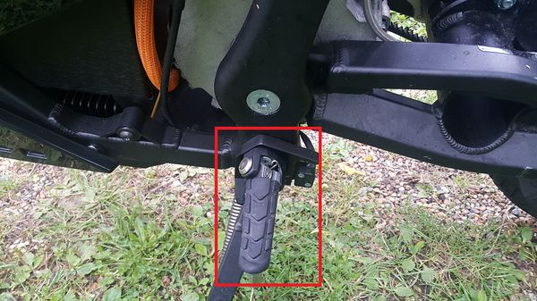 *Honda footpegs with rubber pad*

[David Walsh reports](http://electricmotorcycleforum.com/boards/index.php?topic=7331.msg61153#msg61153)

> Hi all, I've added a few farkles to my 2012 DS...
> As I reused the original Zero pins, I found these were a couple of mm larger diameter than the pins fitted to the Honda foot-pegs, so I drilled them out. As they are aluminum, this is easy to do.
> I then found that while they would still hinge up out of the way, they were a little larger than the Zero pegs, so I filed off a mm or so off of them and.. They fitted, worked fine and are comfortable.
> I bought these aftermarket ones [cheap and good  :) ] :
> <http://www.ebay.co.uk/itm/Motorcycle-Footrest-Foot-Pegs-For-Honda-CBR-750-600-1300-Yamaha-Suzuki-Kawasaki/152050093683>"

**Materials**

The item he purchased was: EAN/UPC 931152292558

**Tools**

Metal file

Drill

**Steps**

1. Drill out the pin fitting to match the Zero footpeg pin diameter.
2. File off ~1mm for fitment.

### Left Hand Controls

#### [High Beam Switch Toggle Sculpting](https://web.archive.org/web/2025/https://zeromanual.com/wiki/Gen2/High_Beam_Switch_Toggle_Sculpting)

**Goal**

This fixes a design/ergonomics issue with 2015+ models, where the high beam toggle is difficult to manipulate.

Prior to 2015, a large rocker switch operated the high/low beam selector, and no hazard warning toggle was available.

**Steps**

1. Form a nub shape of [Sugru](https://en.wikipedia.org/wiki/Sugru) putty and adhere to the lower end of the High Beam Switch slider.

   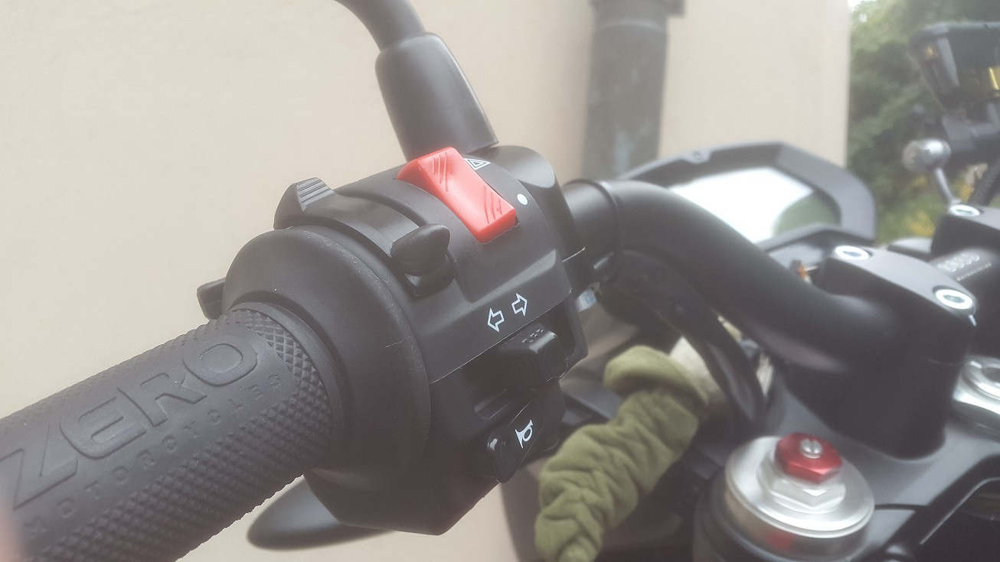
2. Let it set for a while (30 minutes to 24 hours?) before trying to use it.

**References**

- [High Beam Switch Improvement/Mod forum thread](http://electricmotorcycleforum.com/boards/index.php?topic=6275.0)
- [Demonstration video on YouTube](https://www.youtube.com/watch?v=YS4_EOVrO9I):

### Handlebar Riser Adapters

[Handlebar Riser Adaptors](http://electricmotorcycleforum.com/boards/index.php?topic=5019.0)

These adaptors tilt the risers 20° to move the bar-clamp centers back about 45mm from the OEM location, and up @ 10mm or so. They also greatly reduce the steering-stem-to-riser-bolt offset on the '14 FX, from 34mm to 12mm (all my ICE bikes have 14mm to 18mm offsets). Modern MX/offroad bars tend to be low and straight for the most part, and adding a bit more rise and setback allows me a greater choice than before. It's hard to tell from the photos at the Zero site, but it looks like these should work on any Zero that has removable risers with M10 riser bolts.

### [Helmet Lock Relocation](https://web.archive.org/web/2025/https://zeromanual.com/wiki/SDS_Platform/Install_Tank_Lock_As_Tail_Helmet_Lock)

This relocates the stock [tank lock](https://web.archive.org/web/2025/https://zeromanual.com/wiki/SDS_Platform/Tank_Lock) on [SDS Platform](https://web.archive.org/web/2025/https://zeromanual.com/wiki/SDS_Platform) models onto the tail as a helmet lock.

Most motorcycle locks place a helmet on the side of the tail section.

SDS Platform models have a [stock lock](https://web.archive.org/web/2025/https://zeromanual.com/wiki/SDS_Platform/Tank_Lock) on the frame behind the front forks, for locking in the tank bag but is also somewhat usable for helmets.

[How to use this lock with a flexible cable loop to lock a helmet](http://electricmotorcycleforum.com/boards/index.php?topic=4768)

When replacing the tank bag with a [Power Tank](https://web.archive.org/web/2025/https://zeromanual.com/wiki/Power_Tank), [Charge Tank](https://web.archive.org/web/2025/https://zeromanual.com/wiki/Charge_Tank), or other tank replacement, the lock can be repositioned as it is no longer as accessible or uniquely suited for that position.

**Steps**

1. Pick a spot on the (left side of the) frame where there are no wires.

   **NOTE:** Figure out more specific ways or places to do this.

   | | |
   | --- | --- |
   |   **Warning:** | Be very careful when drilling holes in the tail; the Sevcon motor controller and cabling are inside and should not be compromised for any reason! |
2. Tape the frame for drilling.
3. Use the lock to mark the hole positions on the tape.
4. Keep drill speed down a bit so the screw head will go in.
5. Drill 2 small pilot holes then enlarge (up to 3/16 or 3mm; *need to get more specific here*).
6. Position the lock in a hook-down orientation over the holes.
7. Insert the same screws and tighten.

The existing holes in the frame might be worth re-using or filling in.

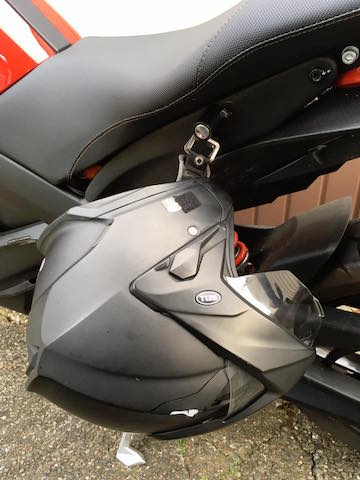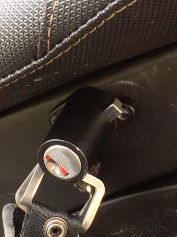

**References**

[Ian Semple described a relocation on Facebook](https://www.facebook.com/groups/zmcowners/permalink/1051151764954031/)

[Helmet Lock Installation on DSR](https://electricmotorcycleforum.com/boards/index.php?topic=7902)

### Throttle Upgrade

Ted Dillard tried out and prefers the Domino throttle to the stock 2013-2014 Magura to reduce wrist twist for ergonomic reasons, published with a howto:

- [5kOhm Throttles: Domino vs. Magura](https://evmc2.wordpress.com/2014/03/30/5k-ohm-throttles-domino-vs-magura/)
- [Domino Premium throttle to replace stock Magura throttle](http://electricmotorcycleforum.com/boards/index.php?topic=4481)
- [Domino Twist-Grip Throttle with Microswitch product page at ElectricMotorSports](http://www.electricmotorsport.com/ev-parts/throttles/domino-twist-grip-throttle-with-microswitch.html)
- [Domino Throttle Installation](http://electricmotorcycleforum.com/boards/index.php?topic=5252.0) by Ray Ivers

Models from 2015 and onwards (for reasons that were published but need citation) have an incompatible throttle interface and require Sevcon controller reprogramming to switch throttles.

## Aesthetics

### Tail Eliminator

[BenTheRighteous](https://www.thingiverse.com/BenTheRighteous/about) has created a [3D-printable rear fender eliminator](https://www.thingiverse.com/thing:3136698) for S/SR models. [EMF thread](http://electricmotorcycleforum.com/boards/index.php?topic=8359.0)

## Frame

### [Rear Axle Sliders](https://web.archive.org/web/2025/https://zeromanual.com/wiki/Gen2/Fabricate_Rear_Axle_Sliders)

The [rear axle](https://web.archive.org/web/2025/https://zeromanual.com/wiki/Gen2/Rear_Axle) is hollow and can accommodate sliders like the ones [R&G Racing sells for 2013-2014 Zero models](http://www.rg-racing.com/browsebike/Zero/SR/2014/SP0053BK/), or [this for later models including FX](https://www.rg-racing.com/browsetype/Spindle_Sliders/Zero/DSR/SS0056BK/#).

**[Suggested Materials](https://www.facebook.com/groups/zmcowners/permalink/1357926957609842/)**

- ¼" × 36" all thread rod ($2.27)
- ¼×20 lock nuts, 4 ea. ($2.36)
- M10×1.25 40 mm bolts, 2 ea ($1.82)

  tried drilling the stock bolts but they beat me so I bought these and drilled holes for safety wire.

  Not sure why I couldn't drill the OEM bolts, could just be crappy bits?
- ¼" washer, 4 ea. ($2.46)
- Blank skateboard wheels, 4 ea. ($12.70)

**Reference**

[rear axle slider how-to](https://www.facebook.com/groups/zmcowners/permalink/1357926957609842/)

## Braking

### [Left Hand Rear Brake](https://web.archive.org/web/2025/https://zeromanual.com/wiki/Gen2/Replace_Rear_Brake_Pedal_With_Lever)

A small number of Zero owners have installed a left brake lever to replace the rear brake pedal.

**Reference**

- [Rear hand brake](http://electricmotorcycleforum.com/boards/index.php?topic=7937) by [EMF User Specta](http://electricmotorcycleforum.com/boards/index.php?action=profile;u=8237) has part numbers and some relevant fastener specifications.

#### TacticalMindz Kit

togo found the [[TacticalMindz "Dual Fitting Rear Hand Brake AMP Kit - Footbrake Bypass Basic Kit" at 174.00 USD](https://www.tacticalmindz.com/products/dual-fitting-rear-hand-brake-kit)] to be a straightforward install on a 2014 SR.

It's not clear if it's compatible with ABS on later models.

See [Re: Riding without a clutch](http://electricmotorcycleforum.com/boards/index.php?topic=7433.15) forum thread.

#### Keith's KTM lever

[Keith provides some details of their installation based on KTM clutch lever 54602040300](http://electricmotorcycleforum.com/boards/index.php?topic=5328.msg50287;topicseen#msg50287)

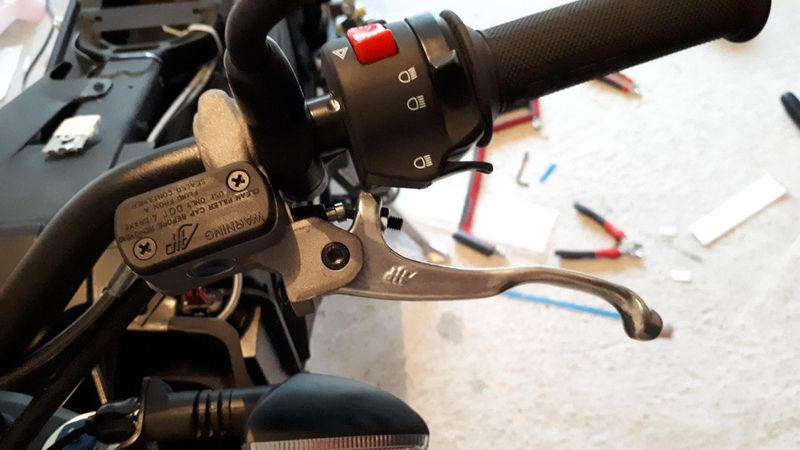 *Hand master cylinder*

**Setup to replace the rear brake's foot pedal by a left hand bar lever.**

- The brake has a great feeling and it can activate the ABS with one finger.
- A clutch master cylinder DOT4 compatible from AJP (reference 650.00.302) with a 9.5 mm piston can be used.

  Master cylinders with pistons from 9 to 11 mm are suitable.

  A bigger one will give a too hard to press feeling.

  A smaller one will be really too soft and not effective.

**Steps (General)**

1. Disconnect the foot master cylinder from the ABS block.
2. Connect the hand master cylinder in its place.
   - A 70 cm brake hose is long enough to connect the master cylinder to the ABS.

**Notes**

- To make the bleeding easier, it is possible to inject brake fluid from the caliper with a big syringe up to the master cylinder.
- Pressure Sensor

  It is not possible to reuse the pressure sensor that is mounted on the foot master cylinder (built in the banjo screw).

  The OEM sensor's thread is M10x1.25 mm.

  The replacement sensor's thread on the caliper and the hand master cylinder are M10x1 mm.

  - It must be possible to mount an M10x1 mm pressure sensor instead of the original.

  This sensor is used to activate the rear light when braking.

### Better right hand lever

- Yamaha lever, reportedly less harsh: <http://electricmotorcycleforum.com/boards/index.php?topic=4949.msg58200#msg58200>

## Powertrain

### [Variable Regen](https://web.archive.org/web/2025/https://zeromanual.com/wiki/Gen2/Implement_Variable_Regen)

**Goal**

Variable [Regen](https://web.archive.org/web/2025/https://zeromanual.com/wiki/Regen) is an attractive feature that the Sevcon controller can implement but Zero doesn't deliver in their [Gen2](https://web.archive.org/web/2025/https://zeromanual.com/wiki/Gen2) platform models.

**Steps**

1. Install a connection into an unused analog input on the SevCon controller's 35-pin AMPSeal connector.

   Use Sevcon's DVT software to configure the software to read it and map it appropriately.
2. Install a handle or switch to control the regen.

   Mount a handle or switch that provides a variable voltage output on the handlebar.

   Wire it up and amplify or tune the sensor to match the input requirements.

**References**

- [Variable/step-less regen](http://electricmotorcycleforum.com/boards/index.php?topic=3744)
- [More install details](http://electricmotorcycleforum.com/boards/index.php?topic=3265.msg17286#msg17286)
- [Change regen while riding?](http://electricmotorcycleforum.com/boards/index.php?topic=4288)
- [Illustrative video of the connections](https://www.youtube.com/watch?v=M-lIV70_JMs):

**Related**

- [Regen Braking kit for 2011 XU](http://electricmotorcycleforum.com/boards/index.php?topic=3027)

### [Left Hand Variable Regen Lever](https://web.archive.org/web/2025/https://zeromanual.com/wiki/Gen2/Create_Variable_Regen_Lever)

**Goal**

Control [Regen](https://web.archive.org/web/2025/https://zeromanual.com/wiki/Regen) via an analog lever for greater control.

EVtricity racing installed and configured a variable regen lever on the left handle.

This requires Sevcon configuration changes.

**References**

[How to make a powerful regen lever for your Zero](http://electricmotorcycleforum.com/boards/index.php?topic=4357.0)

[ZERO SR Race Mods](http://www.diyelectriccar.com/forums/showthread.php/zero-sr-race-mods-124073p4.html)

### [Reverse Mode](https://web.archive.org/web/2025/https://zeromanual.com/wiki/Gen2/Implement_Reverse_Mode)

**Goal**

A reverse mode is handy when trying to push the bike rearwards uphill, or in tricky traction conditions.

Sevcon's market primarily consists of forklifts and tractors, so the Sevcon is already set up for reverse operation.

Naturally, a reverse mode is unsafe for motorcycles beyond a very limited speed (5mph, say).

Trikester worked with Harlan to install a reverse mode switch on a 2013 FX.

- [Reverse Switch added to FX](http://electricmotorcycleforum.com/boards/index.php?topic=3365)
- [Reverse switch addition](http://electricmotorcycleforum.com/boards/index.php?topic=5147.0)

**Note**

Recent Zero models (2016? seems IPM-related) have a glitch when reverse mode is configured using the standard Sevcon recommendation.

Zero custom firmware could be interfering, or it could be a custom setting; unclear which yet.

**How It Works**

The Sevcon controller can be programmed to take a digital/binary input as a reverse mode directive.

The Sevcon as used by Zero has some unused pins; one of the digital inputs will be needed for the extra signal. Use SevCon's DVT software and IXXAT cabling to configure this.

Since Zero programs the Sevcon to operate in torque mode instead of speed mode, the reverse mode allows the throttle to operate like a variable regen that transitions to reverse from 0mph.

The transition to reverse can be configured a bit for some motorcycle-specific safety, but mainly to avoid a jerky transition.

Torque and speed limits can be set separately for reverse operation (40% and 5mph are good to start with).

**Control**

The enable needs to be dual-throw to turn off the forward input signal and turn on the reverse input signal, so use a DPDT or SPDT switch, or a SPST switch that drives a relay.

A momentary push button switch is better for control safety, since any instability while moving in reverse should be resolvable by letting go of the control.

Any kind of binary switch can be used (toggle, etc), technically, but getting into a stuck reverse situation could be dangerous.

Mounting the switch should account for keeping the wiring protected and secure, and the switch should either be weather-rated or in a protective enclosure.

Mount location should be accessible from the left handlebar but not where it can be accidentally engaged.

Trikester's mount placed it in front of the handle, requiring the index finger to extend to reach it.

### Wide Belt for Pre-2017 Models

[Big belt Kits for pre-2017 bikes.](http://electricmotorcycleforum.com/boards/index.php?topic=6538)

This involves designing and machining a front sprocket to adapt to the older keyed shaft.

It will also change the gear ratio (without making a different rear sprocket choice) to reduce top speed and raise torque.

## Electrical Accessories

### [Always-On Accessory Power Supply](https://web.archive.org/web/2025/https://zeromanual.com/wiki/Gen2/Always-On_Accessory_Power_Supply)

**Goal**

The [Gen2](https://web.archive.org/web/2025/https://zeromanual.com/wiki/Gen2) platform models power the 12V system from a [DC-DC 12V Converter](https://web.archive.org/web/2025/https://zeromanual.com/wiki/DC-DC_12V_Converter) that is only enabled on key-on via signaling from the [MBB](https://web.archive.org/web/2025/https://zeromanual.com/wiki/Gen2/Main_Bike_Board).

Some 12V accessories for security and other purposes benefit from an uninterrupted power supply.

**Applications**

- An embedded system Arduino etc.
- implement keyless unlocking
- antilock devices
- bike locators

**Always-On 12V Power Supply**

[Burton's howto with a video and disclaimer](http://electricmotorcycleforum.com/boards/index.php?topic=3766.msg22451)

**Always-On 5V Power Supply**

Two lines to the DC-DC converter are always on at main battery voltage (see [the SDS platform wiring diagram](https://web.archive.org/web/2025/https://zeromanual.com/wiki/SDS_Platform/Schematic)).

Doctorbass observed in the above thread that many USB charging adapters can run on DC as easily as AC.

It may be risky to try this.

### Givi Top Case RGB LED

This uses an Arduino + WS2812 custom RGB LEDs to add brake lighting to a [Givi V47NN Tech Top Case](https://www.givi.it/cases/Monokey/V47NN%20TECH)

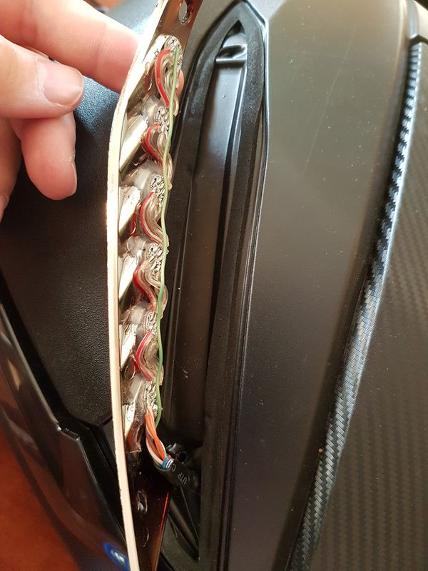 *LEDs in the case*

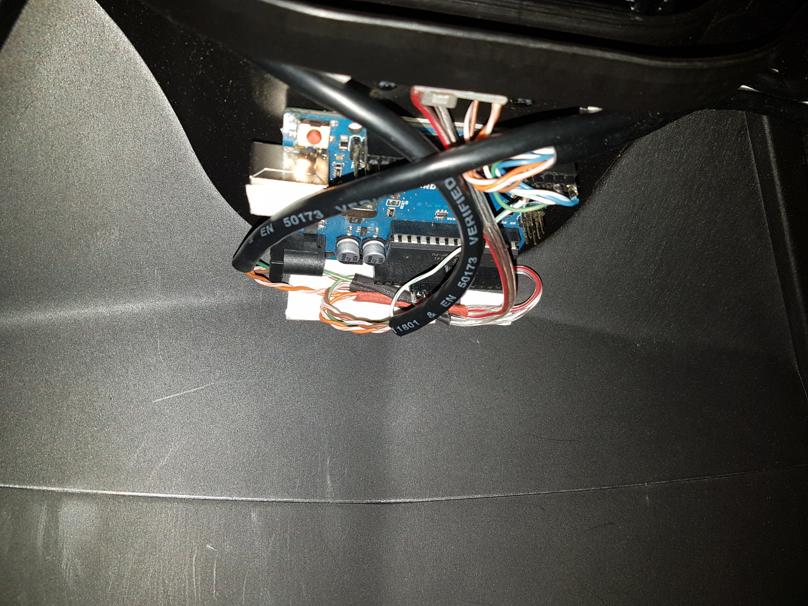 *Wiring and Arduino board*

The Givi V47 series top case has an optional [LED kit](https://www.givi.it/cases/Monokey/V47NN%20TECH?o=E135) that adds an extra stop light.

This is a DIY version of the same.

**Parts and Tools**

- hot glue
- a soldering iron
- an Arduino to hook it up to the bikes wiring and make it all light up.

**References**

- [Zero S 2016 Givi Topcase LED MOD video on YouTube](https://www.youtube.com/watch?v=gVIXSBNNbzE):

### [Sound System](https://web.archive.org/web/2025/https://zeromanual.com/wiki/Sound_System)

**Goal**

Offset the silence of your ride, for safety reasons, and also for style.

**[SoundRacer](http://soundracer.se/)**

This plugs into the 12V accessory port (OEM or otherwise) and provides a small fake ICE vehicle sound for your Zero.

This is meant for cars so it uses a radio frequency for a car radio to tune to.

A mobile app is provided for customization and control.

No reported Zero installs, for the obvious overhead of installing a stereo system on one's motorcycle.

**[SoundRacer EVEESS](http://eveess.com/)**

This sound system is definitely DIY: be prepared for some light crimping work and to pin connectors and install a speed sensor on the front axle.

For the Zero, mind the size of the speakers; the smaller speaker pair are easier to mount than the single large speaker, unless you have the OEM crash bars.

Preparing a custom sound file involves using a simple utility to process it for the embedded computer. Prior to that, you'll want to use an audio-processing tool like Audacity to fit your sample into its requirements.

[NanoMech's installation report](http://electricmotorcycleforum.com/boards/index.php?topic=3915)

## Diagnostics

### [Cycle Analyst](https://web.archive.org/web/2025/https://zeromanual.com/wiki/Cycle_Analyst)

This allows datalogging of a variety of parameters tracking voltage, current, and regen for trips.

| | |
| --- | --- |
|   **Warning:** | This requires a great deal of skills and knowledge to install and calibrate correctly on a Zero, and is not intended for casual customers. |

See our [Cycle Analyst](https://web.archive.org/web/2025/https://zeromanual.com/wiki/Cycle_Analyst) page for details.

## [Front Wheel Swap](https://web.archive.org/web/2025/https://zeromanual.com/wiki/Gen2/Front_Wheel_Swap)

**Scope**

You can swap out the 19" [front wheel](https://web.archive.org/web/2025/https://zeromanual.com/wiki/Gen2/Front_Wheel) on the DS to the 17" S wheel.

An FX/FXS swap seems similar though the brake discs and other systems will differ.

**Motivations**

- Increased front braking power.
- Reduced front rotational weight.

  19" DS wheel with tire is 23 lbs

  17" S wheel and tire is 19 lbs.

  A total of 4 lbs reduced rotational weight.
- Appearance, as it matches the rear 17" DS rear wheel to give a more *Super-moto* look.
- Smoother tires and lighter front wheel means a small gain in range, perhaps 2~4%.
- ABS system will still work as before!

**Parts Needed**

- A model year matching 'S' front 17" wheel. The wheel did include the bearings, seals, and valve-stem installed. (My 2016 'S' front wheel was $300 + S&H)
- Either a 110/70/17 tire, or a 120/70/17 tire.

  **NOTE:** I chose the 120mm width as you have many more choices in tires.

  | | |
  | --- | --- |
  |   **Warning:** | I do not believe anything wider then a 120mm front will fit between the front shocks as this leaves about 4mm per side. |
- A 130/80/17 rear tire to match the front.

  This is optional, but highly recommended.

  Also, if you decide to change the rear tire size be aware that the range and speed are calculated by the Motor RPM and this will be incorrect if the REAR tire size is modified.

**Example Choices**

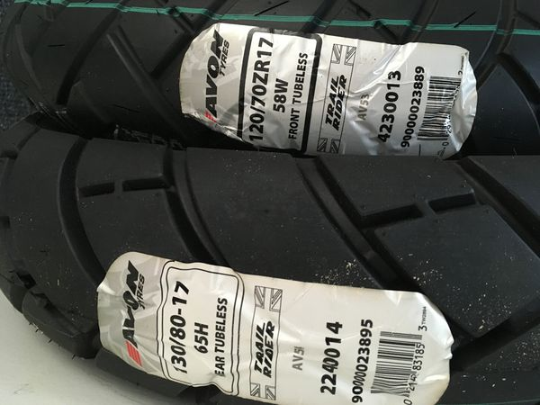

- In my case I chose a 120/70/17, and 130/80/17 Avon Trailrider tire.

  They are a 90/10 Dual Sport tire that are designed for 90% ON-road use, Highly recommended! ($260 + S&H)

**Tools**

- [Rear Stand](https://web.archive.org/web/2025/https://zeromanual.com/wiki/Rear_Stand) for rear wheel.
- [Lift](https://web.archive.org/web/2025/https://zeromanual.com/wiki/Lift) for front wheel (or floor jack) to lift front of bike.
- Associated tools for [Front Wheel Removal](https://web.archive.org/web/2025/https://zeromanual.com/wiki/Front_Wheel_Removal) and [Rear Wheel Removal](https://web.archive.org/web/2025/https://zeromanual.com/wiki/Rear_Wheel_Removal).
- Small slide hammer with hook.
- Thin high-quality screwdrivers for prying.
- 6mm Allen key wrench.
- 8mm Allen key wrench.
- 17mm Allen key wrench.
- Long ratchet (recommend 3/8" drive).
- Blue Loctite thread locker.
- Hammer and 26mm socket (or seal-press tool)
- Torque Wrench (ideally 3/8" and 1/2" drives)

**Steps**

1. [Front Wheel Removal](https://web.archive.org/web/2025/https://zeromanual.com/wiki/Front_Wheel_Removal)

   On the DS this is easy, just remove the front 6mm pinch bolts, and remove the 17mm hex axle. The wheel will slide right out no problem. Mind the ABS sensor.

   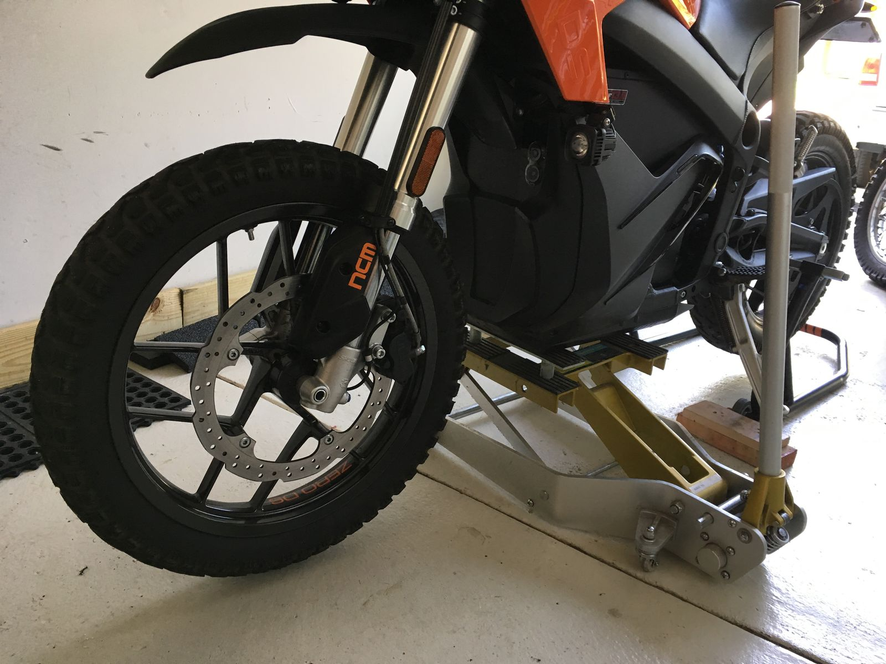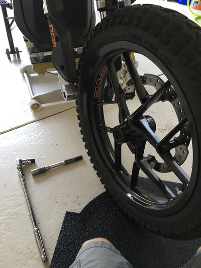
2. Once the wheel is removed, set it on a large soft surface (a moving blanket works).
3. Break loose, and remove the 5⨉ 6mm Allen bolts holding on the brake rotor.

   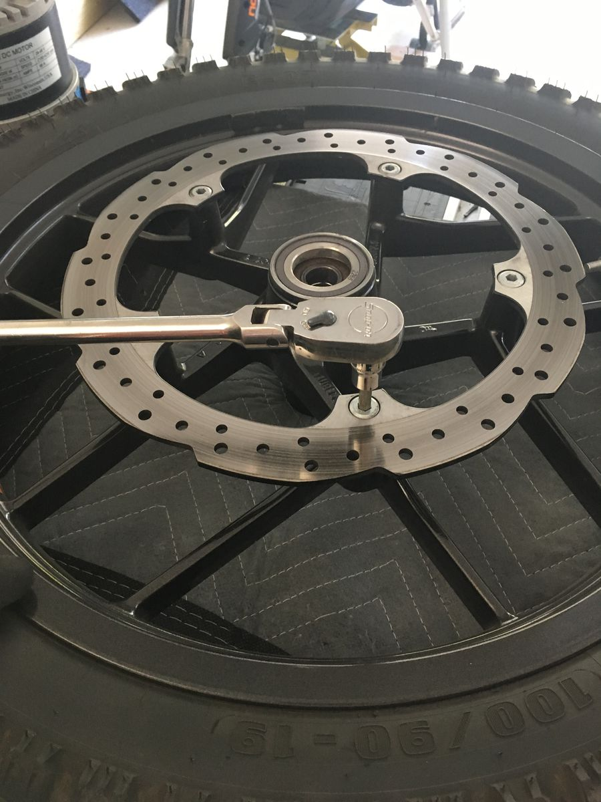
4. Remove the ABS reluctor ring

   When comparing the hub's of both the 19" and 17" wheels you will notice a small ring in front of the wheel bearing.

   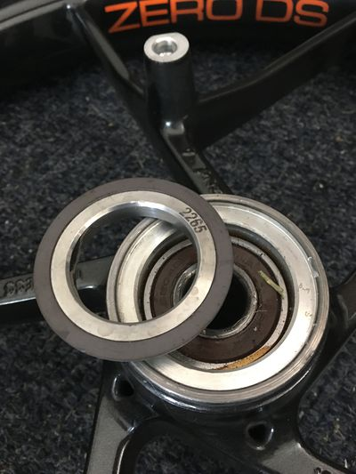

   This is the ABS reluctor ring so the ABS knows the speed of your wheel.

   Using gentle and steady force pry a small gap under the ring, then using a small slide hammer with a hook remove the ring by working it around the ring.

   Excessive force is **NOT NEEDED**.

   If you are uncomfortable doing this step a motorcycle shop can swap it easily.

   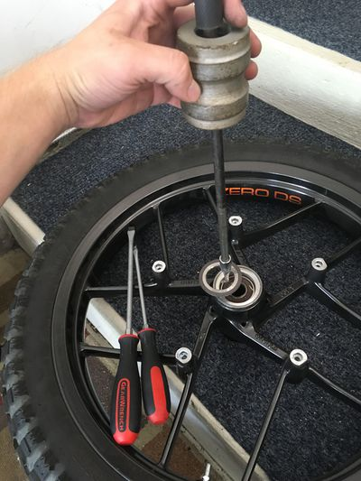
5. At this point you can have the tires installed and balanced by a shop, or do it yourself.
6. Swap the front brake rotor to the new 17" front wheel, install the bolts but **DO NOT TIGHTEN**.
7. Gently tap the ABS ring into the new wheel.

   You can use a large 26mm socket or seal-press tool to hit it evenly.
8. Remove the front brake caliper using an 8mm hex.

   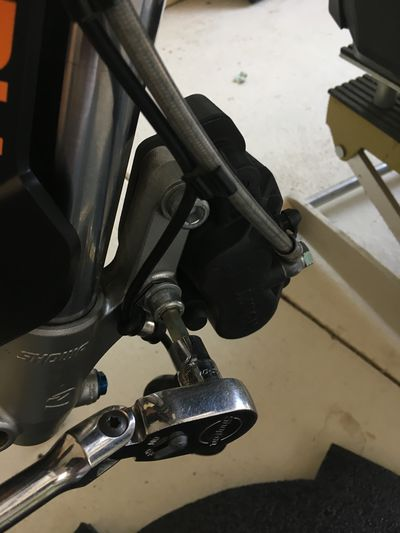
9. [Install front wheel](https://web.archive.org/web/2025/https://zeromanual.com/wiki/Front_Wheel_Removal) by threading the 17mm axle and 6mm pinch bolts.

   Use thread-locker on the pinch bolts.
10. Loosen the brake rotor bolts about 1/4" and slide the brake caliper on the rotor.
11. Apply thread-locker on the brake rotor threads and install bolts firmly with a long 3/8" ratchet and 6mm hex.

    **NOTE:** I could not find a torque value for these bolts, If someone can supply that please add it.
12. Apply thread-locker on 8mm brake caliper bolts and torque to 19 ft-lbs.
13. Now verify that the front wheel spins smoothly, has no side-to-side play, and the front brake properly stops the front wheel.
14. [Remove the rear wheel](https://web.archive.org/web/2025/https://zeromanual.com/wiki/Rear_Wheel_Removal) and have a rear tire installed and balanced.
15. Gently test ride the bike.

    Be aware of any un-usual noises or feelings when riding.

    After about 20 miles of riding use your fingers to feel the front wheel hub and see if the bearing is overheating.

    They should have little to no heat; compare then to the rear for reference.

Enjoy the lighter and more nimble feeling of your DS!

- After approximately 100 miles of on and off road riding I can say the off road abilities are still quite exceptional while the on-road riding improved greatly!

| |
| --- |
| 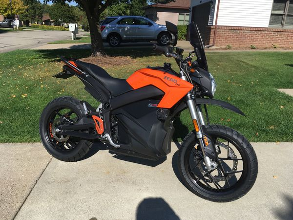   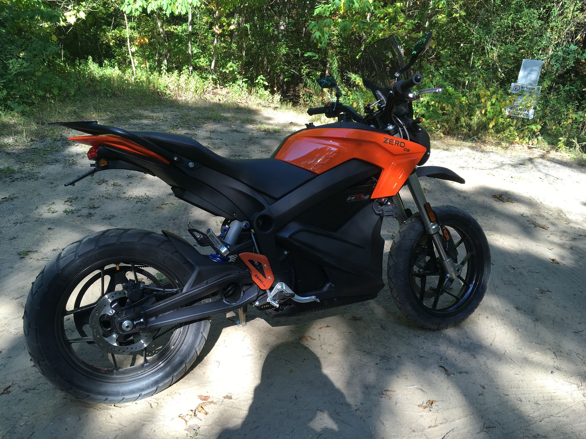   .jpg) |

## Charging

### Top Case Charger Install

**[Diginow 6.6kw Supercharger in top case install project](http://electricmotorcycleforum.com/boards/index.php?topic=6713.0)**

### [Charging Through Sevcon Controller Lugs](https://web.archive.org/web/2025/https://zeromanual.com/wiki/Install_Charging_Circuit_At_Controller)

This describes installing *appropriately crimped and terminated* cables onto the [Sevcon controller](https://web.archive.org/web/2025/https://zeromanual.com/wiki/Gen2/Motor_Controller)'s DC terminals.

| | |
| --- | --- |
|   **Warning:** | This procedure, if performed imprecisely, can result in irreversible damage to your powertrain, fire, injury, and even death. |

**Motivation**

The officially recommended charging inlet is the [Accessory Charging Port](https://web.archive.org/web/2025/https://zeromanual.com/wiki/Accessory_Charging_Port), which is fused to less than the 1C limit.

In order to achieve 1C charging, some bypass is required for at least one charging subsystem.

One may run one charging system through the port and one through the controller.

**Mechanism**

The Sevcon Gen4 controller has a series of terminals: M1, B-, M2, B+, M3.

B+ and B- are battery side terminals used mostly for input power but also supply power back to the battery via regen.

**Requirements**

Planned route and matching cable length from the controller to the charger.

See the Sevcon Gen4 product manual under **Connecting power cables**.

- Keep cable runs short
- Minimize current loops by keeping positive and negative cables as close together as possible.
- Route cables away from the LED if you intend to make this visible under normal operating conditions.
- Minimize bending and avoid touching the protective riser brackets around the terminals.

**Terminal Bolt Concerns**

Connect your power cables using the original bolts.

- They are sized to clamp one ring lug thickness.
- Use a longer bolt (of the same material!) if you are fastening more than one ring lug.
- Minimum thread engagement = 10mm.
- Maximum bolt penetration = 15mm.

For the [Power Tank](https://web.archive.org/web/2025/https://zeromanual.com/wiki/Power_Tank), longer terminal bolts (by 5mm likely) may be required to ensure the right amount of thread engagement.

| | |
| --- | --- |
|   **Disclaimer:** | **TBD** acquiring the right bolts (measurements and alloys) |

**Materials**

- Red and black cables (4AWG rated for 80A) crimped to M8 ring terminal lugs.
- [Anderson SBS75X brown or red](https://web.archive.org/web/2025/https://zeromanual.com/wiki/Anderson_connector) for charger connection, again the cables require **impeccable professional crimping**.

| | |
| --- | --- |
|   **Warning:** | An appropriate crimp tool and skills to use are not adequately specified online.   Power cable crimping should only be performed by a practiced and reviewed professional with specific experience in this application. |

**Tools**

- Torque wrench specifically suitable for *low-torque*, *precise* specifications and socket.
- Small Philips-head screwdriver (PH1?).

| | |
| --- | --- |
|   **Warning:** | Controller terminal bolts are made of a soft conductive metal and should not be manipulated with any excess force.   - Cross-threading or any distortion or excess or imbalanced compression of the bolt threads may result in excess thermal stresses under power.   - Poor conduction between the bolt threads, head, and the terminals may result in excessive heat and fire while riding.   - Sevcon terminal bolts are made of an unspecified alloy, and do not have a known safe replacement.     Store-bought bolts of the same shape may result in excessive heating and fire while riding |

**Steps**

1. [Perform a lockout on the powertrain](https://web.archive.org/web/2025/https://zeromanual.com/wiki/De-Energize_Controller).
2. [Remove the seat](https://web.archive.org/web/2025/https://zeromanual.com/wiki/Seat_Removal).
3. [Controller verified fully de-energized](https://web.archive.org/web/2025/https://zeromanual.com/wiki/De-Energize_Controller).

   | | |
   | --- | --- |
   |   **Warning:** | Proceeding without completely verification is highly dangerous and could result in injury or destructive damage to equipment. |
4. Record the existing cable layout via photograph to preserve after the operation.

   | | |
   | --- | --- |
   |   **Disclaimer:** | Do not trust illustrations given here - internal cable layouts might vary for any reason. |
5. *Gently* loosen the bolts fastening the leads on B+ and B-.

   | | |
   | --- | --- |
   |   **Warning:** | Ensure the breaking torque is limited by your tool to not much more than the specification (7-12 ft-lbs) to tighten the terminal bolts later. |
6. Place the cable leads over the terminals as follows:

   | Color | Terminal |
   | --- | --- |
   | Red | B+ |
   | Black | B- |

   Form a stack from bottom to top of:

   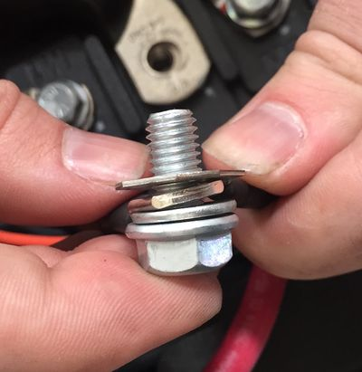 *Charge connection terminal stack*

   1. Monolith terminal. *in background of photo*
   2. *(Optional)* Power Tank terminal.
   3. Charger terminal.
   4. *(For B- Only)* Ground reference terminal. *photo note: this is incorrectly shown between/below the charger terminal*
   5. Washer.
   6. Terminal bolt.
7. Ensure that the route for the battery leads is the same as before.
8. Ensure that the route for the charger leads minimizes bending and does not contact the protective riser brackets around the terminals.

   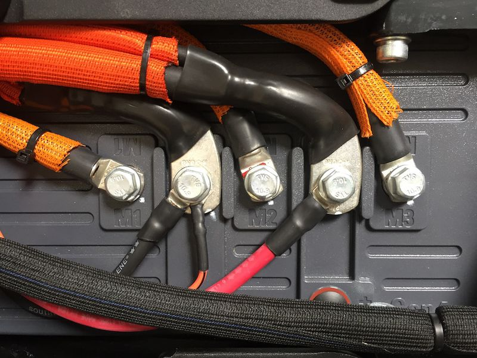 *Controller charge connection routing (example)*
9. Gently but firmly re-tighten the bolts on B+ and B- to 7 Nm ± 1 Nm (6.2ft-lbs) per Sevcon (also recommended 7-12 ft-lbs).
10. Confirm electrical connectivity from each terminal to the Anderson connector that terminates the other end of the charger cable leads.
    1. While still de-energized, re-confirm there is no DC voltage at the terminals.
    2. Verify low/no resistance from the bolt head at **B-** to the end of the **black** cable's lead inside the Anderson connector.
    3. Verify low/no resistance from the bolt head at **B+** to the end of the **red** cable's lead inside the Anderson connector.
11. Prepare the working area for live testing:
    1. Remove any tools or stray materials from the surface of the controller.
    2. Route the new charging connection so that it rests away from any conductive elements, including the frame.
12. Test live *without* the charger.
    1. Key the vehicle on.
       - *Immediately* key the vehicle off on any sign of an electrical fault.
       - Verify the contactor closes.
       - Verify that there are no reported errors, or only precharge warnings.
       - Check DC voltage across the red and black terminals in the Anderson connector housing; it should match expected battery voltage exactly.
13. Test charging.

    | | |
    | --- | --- |
    |   **Disclaimer:** | TBD Full safety procedure and checklist |
14. [Fully de-energize the controller](https://web.archive.org/web/2025/https://zeromanual.com/wiki/De-Energize_Controller) again for maintenance close-out.
15. Route the new charging connector to its intended destination.

    Ensure that the new cabling cannot be chafed by the edge of the controller cover.

    Ensure that the connector is securely positioned so that it will not strain the controller lug connections or the terminals within the connector housing.

    Ensure that the connector is placed away from splash and dust weathering.
16. Re-fasten the controller cover.
17. Re-install the seat.

**References**

- [made additional accessory charge port for Zero](http://electricmotorcycleforum.com/boards/index.php?topic=7111) was used to update this section.

  | | |
  | --- | --- |
  |   **Disclaimer:** | This includes somewhat unresolved debate about appropriate electrical safeguards (fuse or breaker choice) for a connection like this. |

### Hard-Mounting Chargers

**[Impersonating a Beemer with QuiQ Chargers](http://electricmotorcycleforum.com/boards/index.php?topic=4698)**

Mount QuiQ chargers on the side of the S platform power pack in the lower forward quarter to get the "BMW boxer" look.

### [Leave-In Kettle Cord](https://web.archive.org/web/2025/https://zeromanual.com/wiki/SDS_Platform/Fabricate_Permanent_Onboard_Power_Cable)

 *2016 DSR with leave-in kettle cord installed*

**Goal**

Convenient modification for with [digiNow SuperCharger v2](https://web.archive.org/web/2025/https://zeromanual.com/wiki/DigiNow/Super_Charger_V2) installed and pigtail option to split one phase of the J1772 input to an edison plug pigtail.

Model year 2016 DSR used for illustration

**Materials**

[3ft 14AWG Right Angle Power Cord #7683](https://www.monoprice.com/product?p_id=7683) from Monoprice retailer.

Zip ties

**Steps**

1. [Remove onboard charger rubber dust cap](https://web.archive.org/web/2025/https://zeromanual.com/wiki/Gen2/Charging_Inlet)
2. [Remove the plastics](https://web.archive.org/web/2025/https://zeromanual.com/wiki/SDS_Platform/Lower_Plastics_Removal) if you want to route behind them.
3. Insert the leave-in kettle cord.

   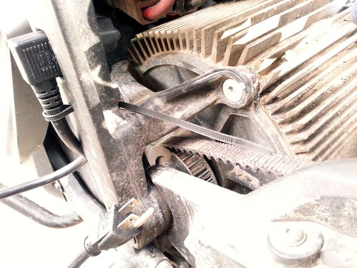 *Zip-tie applied*
4. Affix zip ties as needed and reinstall the plastics.

### [Charger Y-Cable](https://web.archive.org/web/2025/https://zeromanual.com/wiki/Gen2/Fabricate_Charger_Y-Cable)

This describes how to fabricate a Y-Cable for joining chargers into the [Accessory Charging Port](https://web.archive.org/web/2025/https://zeromanual.com/wiki/Gen2/Accessory_Charging_Port).

One can [combine](Chargers.md#Combining_Chargers "Chargers") up to four [Zero Quick Chargers](https://web.archive.org/web/2025/https://zeromanual.com/wiki/Zero_Quick_Charger) to the 2014+ S platform models (up to 2 chargers prior to 2014).

To connect more than one charger, at least one Y-Cable is required.

This cable is [available from Zero for $250](https://www.zeromotorcycles.com/shop/index.php?main_page=product_info&cPath=15_5&products_id=196), but can also be fabricated if you have the tools.

| # | Part | Mouser PN | Notes |
| --- | --- | --- | --- |
| 3 | [Anderson Power Products](https://web.archive.org/web/2025/https://zeromanual.com/wiki/Anderson_connector) SBS75X connectors, Brown | [SBS75XBRN-BK](https://www.mouser.com/ProductDetail/Anderson-Power-Products/SBS75XBRN-BK?qs=SE5nP5gvQKVqojwsu3jvEA%3D%3D/) | Color matters, since it also reflects the voltage and is keyed. |
| 4 | [Anderson Power Products](https://web.archive.org/web/2025/https://zeromanual.com/wiki/Anderson_connector) SBS50 #10 AWG connectors | [879-1339G3-BK](http://www.mouser.com/ProductDetail/Anderson-Power-Products/1339G3-BK/) |  |
| 6 | [Anderson Power Products](https://web.archive.org/web/2025/https://zeromanual.com/wiki/Anderson_connector) SBS50 #6 AWG connectors | [879-1339G2-BK](http://www.mouser.com/ProductDetail/Anderson-Power-Products/879-1339G2-BK/) |  |
| 4 | [Anderson Power Products](https://web.archive.org/web/2025/https://zeromanual.com/wiki/Anderson_connector) SBS75X aux socket connector | [879-PM16S1416S32](http://www.mouser.com/ProductDetail/Anderson-Power-Products/879-PM16S1416S32) |  |
| 2 | [Anderson Power Products](https://web.archive.org/web/2025/https://zeromanual.com/wiki/Anderson_connector) SBS75X aux pin connector, standard sequence | [879-PM16P1416S30](http://www.mouser.com/ProductDetail/Anderson-Power-Products/879-PM16P1416S30) |  |

**Steps**

1. Choose one connector to be the common, to connect to the bike.

   The other two will connect to the Quick Chargers.
2. Using an [appropriate crimp tool](Skills.md#Power_Cables "Skills"), use the #6 AWG connectors to crimp two red #10 wires.

   Repeat with two black wires.
3. Click the #6 connectors into the common SBS75X connector, observing the polarity marked on the connector.
4. Crimp the #10 AWG connectors onto the other ends of the red and black wires.

   Click them into the other SBS75X connectors, again observing polarity.
5. Use a #16 - #14 wire for the charge enable pins.

   Connect one end to a pin-connector, and insert into the recessed hole in the common connector.
6. Connect the other end to two socket connectors, and insert into both not-recessed holes in a downstream connector.

   Stripping back the wire and using heat-shrink tubing may make for a better fit.
7. Repeat using the other charge enable pin for the other connector.

**Note**

The seemingly-odd charger enable connections are due to the MBB only being able to drive two Delta-Q chargers per output, and allow a single Y-Cable design to be used as either the first or second in a fan-out.

**Disclaimer**

I made my cable the naive way with a single charger-enable pin to both connectors before I was told this.

If someone has an official cable and can verify the wiring, that would be appreciated.

This drawing is made from an official cable.

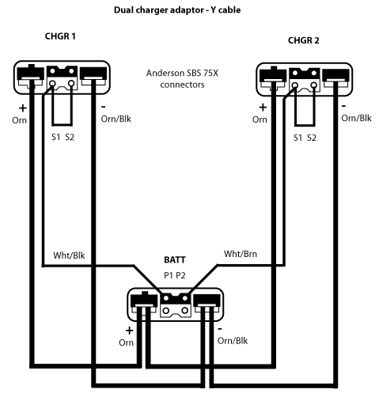 *OEM Y Adapter Cable schematic*

**Charging Two Packs From One Charger**

A simple modification to the Y cable will allow two packs to be connected to one charger.

This allows simultaneous charging of two packs off the bike.

While two chargers could do this twice as fast, the AC power circuit for two chargers must be rated greater than 15 amps at 120V, often not available.

**Disclaimer**

I believe this modified Y connection is equivalent to the connection used when charging two packs on the bike.

So the BMS in each pack controls its charging independently once both are enabled.

I have tested it and it works. However, this configuration may be imperfect, use at your own risk.

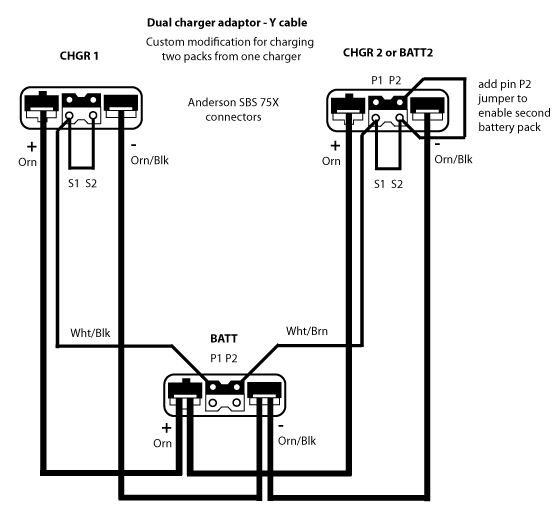 *Y-cable modification*

**Connecting to a Pack Adapter vs Second Charger**

Here is a photo of the modified connector wiring with a pin added to allow connection to a pack adaptor instead of a second charger.

The added Anderson pin [PM16P1620S30](http://www.mouser.com/ProductDetail/Anderson-Power-Products/879-PM16P1620S30) requires a special insertion tool. However it can be soldered to a heavy wire and supported in place with a tie wrap to the other wires as shown here.

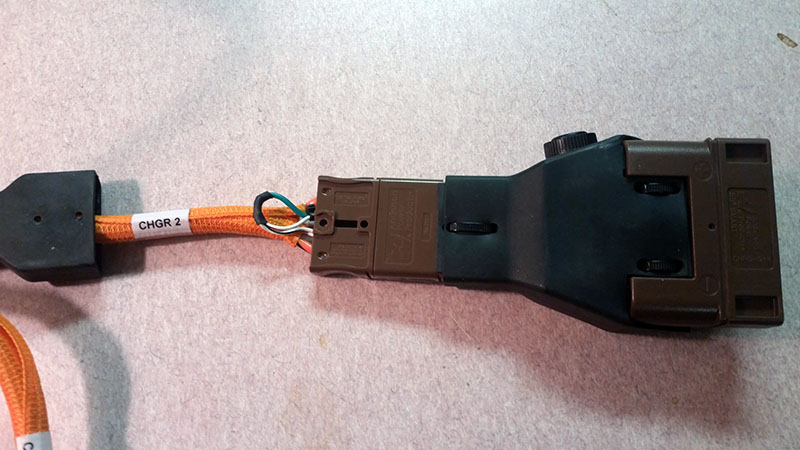 *Y-cable modification wiring*

### Type2 to 3x regular power outlets adapter

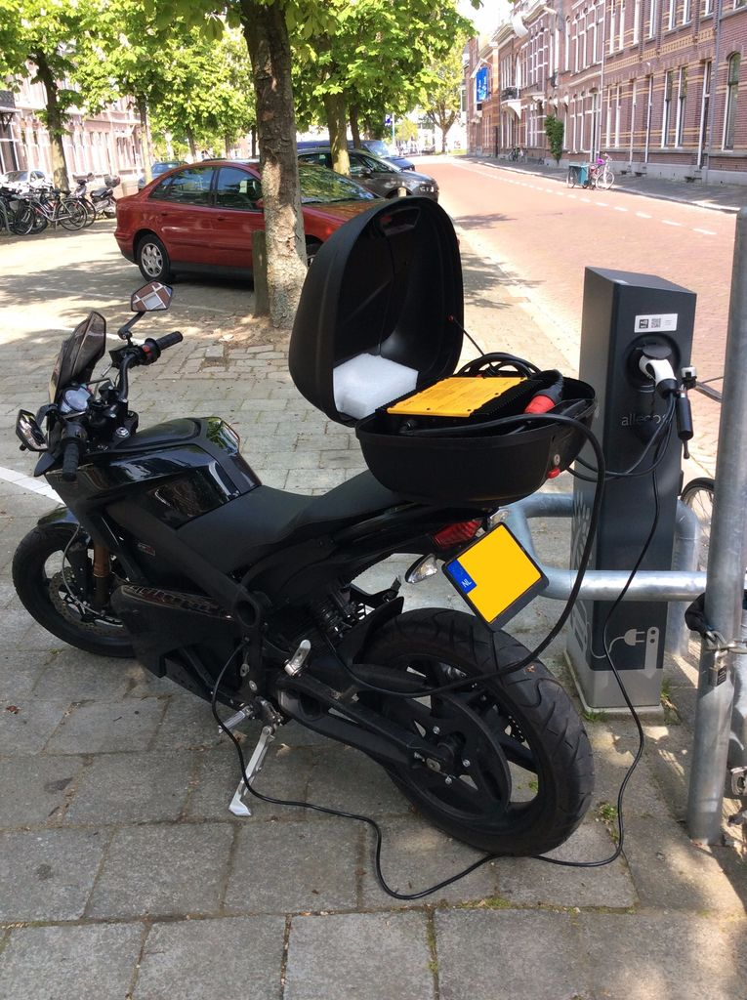

Using your Quiq chargers while on the road :) Get 3x 230V connections out of a Type2 connection/charging station with this adapter.

[Type 2 to 3x 230V Sockets Instructable](http://www.instructables.com/id/Type2-Mennekes-to-3-230V-Sockets-under-Constructio/)

### [Charging Off Bike](https://web.archive.org/web/2025/https://zeromanual.com/wiki/XMX_Platform/Charging_Off-Bike)

**Goal**

The [XMX Platform](https://web.archive.org/web/2025/https://zeromanual.com/wiki/XMX_Platform) FX/FXS models have [removable power pack modules](https://web.archive.org/web/2025/https://zeromanual.com/wiki/Power_Pack_Module) that can be charged while off the bike.

**NOTE:** 2017 models do not have modular packs unless requested as an extra-cost option.

**Motivations**

- Charging packs off the bike can be useful when the bike is parked where there is no power available.
- It can also be faster because the external chargers have higher wattage and can be combined using Y adapters.
- Swapping fully charged packs with a depleted ones is by far the fastest way to recharge an electric motorcycle; it can be done in minutes.

**Notes**

- The power packs are easily removed but they weigh over 40 pounds (19 kg) each, so handling requires strength and care.
- To use two separately-charged packs together, it is best to charge them to the same voltage / SoC.

  The bike tries to use both packs equally at the same time.

  If one has a higher charge state, it will use it until it matches the lower-charged one and then use both together.

  That can reduce the bike performance at high speeds and torque demand since it can't use both packs when they are unbalanced.

**Cabling**

Connecting external chargers to the power packs requires the [Power Pack Module Charging Adapter](http://www.zeromotorcycles.com/shop/index.php?main_page=product_info&cPath=15_5&products_id=186&zenid=96opflrmbs8v0mvbjcclcqdo53) sold by Zero for $140 each.

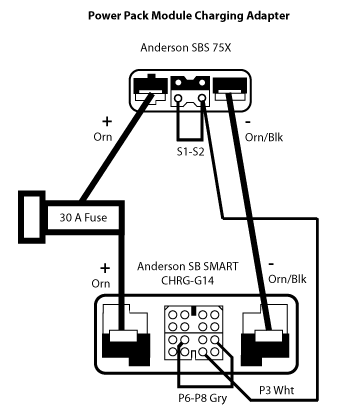

Combining external chargers for one Power Pack module requires the [Quick Charger Y Adapter](http://www.zeromotorcycles.com/shop/index.php?main_page=product_info&cPath=15_5&products_id=196&zenid=96opflrmbs8v0mvbjcclcqdo53) sold by Zero for $250 each.

Each Y cable joins 2 chargers. Joining 4 chargers requires 3 cables; two cables join each pair of chargers, and then the third cable joins the output of each Y cable.

**DIY OPTION:** See the [Y-Cable instructions](https://web.archive.org/web/2025/https://zeromanual.com/wiki/Gen2/Fabricate_Charger_Y-Cable) to make one using [Anderson connectors](https://web.archive.org/web/2025/https://zeromanual.com/wiki/Anderson_connector).

**Configurations**

A wide variety of charging connections can be used on and off the bike with various charging rates and AC power requirements.

Here are the possibilities using various [chargers](Chargers.md "Chargers") combined with the [onboard 650W Calex charger](https://web.archive.org/web/2025/https://zeromanual.com/wiki/Onboard_Charger) in some cases.

The [C-Rate](https://web.archive.org/web/2025/https://zeromanual.com/wiki/C-Rate) is computed for a [ZF3.3 Power Pack Module](http://www.zeromotorcycles.com/shop/index.php?main_page=product_info&cPath=15_5&products_id=229) shipped on 2016-2017 models.

[Older models](http://www.zeromotorcycles.com/zero-fx/2013/specs.php) carrying a [ZF2.8](http://www.zeromotorcycles.co.il/zero/shop/index-main_page=product_info&products_id=190.php.html) will require multiplying this rate by 1.17.

|  |  |  |  | Chargers |  |  | Circuit Rating |  |
| --- | --- | --- | --- | --- | --- | --- | --- | --- |
| External Model | Per-Unit Power | Rate | Packs | Onboard | External | Y-cables | @ 120V | @ 240V |
| N/A | 0 | 0.10C | 2 | ✓ | 0 | 0 | 15A | 10A |
| 〃 | 〃 | 0.20C | 1 | 〃 | 〃 | 〃 | 〃 | 〃 |
| [OEM Quick Charger](https://web.archive.org/web/2025/https://zeromanual.com/wiki/Zero_Quick_Charger) | 1kW |  |  |  |  |  |  |  |
| 〃 | 〃 | 0.14C | 2 | ✗ | 1 | 1 if off bike | 15A | 10A |
| 〃 | 〃 | 0.24C | 2 | ✓ | 1 | 0 | 〃 | 〃 |
| 〃 | 〃 | 0.28C | 1 | ✗ | 1 | 0 | 〃 | 〃 |
| 〃 | 〃 | 0.28C | 2 | ✗ | 2 | 1 if on bike | 20A | 10A |
| 〃 | 〃 | 0.38C | 2 | ✓ | 2 | 1 | 25A | 15A |
| 〃 | 〃 | 0.55C | 1 | ✗ | 2 | 1 if on bike | 20A | 10A |
| 〃 | 〃 | 0.55C | 2 | ✗ | 4 | 3 | 50A | 25A |
| 〃 | 〃 | 0.65C | 2 | ✓ | 4 | 3 | 50A | 25A |
| 〃 | 〃 | 0.75C | 1 | ✓ | 2 | 1 | 25A | 15A |
| [Elcon 2500](https://web.archive.org/web/2025/https://zeromanual.com/wiki/Hollywood_Electrics/Elcon_2500) | 2.5kW | 0.44C | 2 | ✗ | 1 | 0 | – | 15A |
| 〃 | 〃 | 0.54C | 2 | ✓ | 〃 | 〃 | 〃 | 〃 |
| 〃 | 〃 | 0.87C | 1 | ✗ | 〃 | 〃 | 〃 | 〃 |
| [DigiNow SuperCharger](https://web.archive.org/web/2025/https://zeromanual.com/wiki/DigiNow/Super_Charger) | 3.3kW | 0.58C | 2 | ✗ | 1 | 0 | – | 15A |
| 〃 | 〃 | 0.68C | 2 | ✓ | 〃 | 〃 | 〃 | 20A |

**Over-Rating Configurations**

- 4 [OEM Quick Chargers](https://web.archive.org/web/2025/https://zeromanual.com/wiki/Zero_Quick_Charger) with one pack exceeds the [1C contactor limit](https://web.archive.org/web/2025/https://zeromanual.com/wiki/Main_Contactor).
- 1 [DigiNow SuperCharger](https://web.archive.org/web/2025/https://zeromanual.com/wiki/DigiNow/Super_Charger) exceeds 1C for one Power Pack Module unless de-rated in the firmware below 3.3kW.

**Power Pack Discharge / Diagnostics Adapter**

[Single Brick off bike Pack SOC tester, close contactor](http://electricmotorcycleforum.com/boards/index.php?topic=7116)
A variation of the DIY charging adapter, this controls the enable signal for testing.

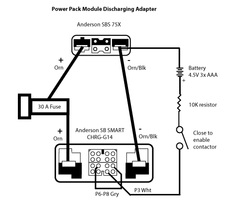

**[Zero FX Single Battery Block Hack](https://www.youtube.com/watch?v=-pjosOHyMdU) video on YouTube**

Packs that are off the bike can be monitored to determine the state of charge by measuring the voltage:

- Use a DVM with probes as shown to get a reading between 90 and 117 volts.

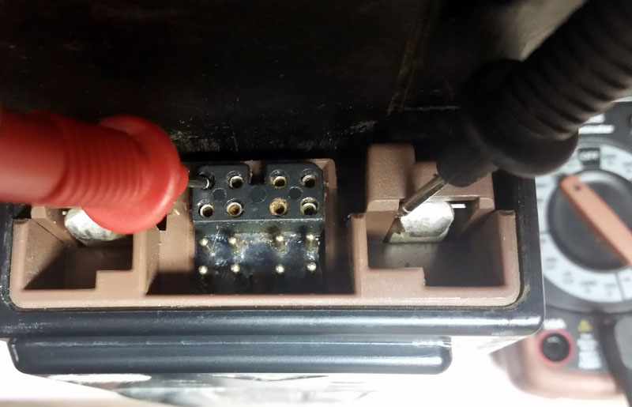

- Then use these graphs to find the approximate charge level that the bike will report.

| | |
| --- | --- |
| 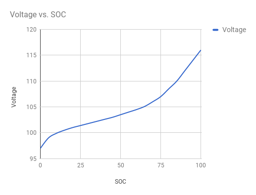 | 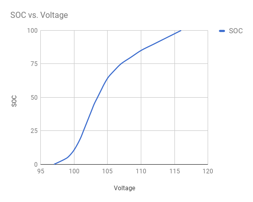 |

## Battery

### Battery Rebuild

#### [Pre-2013 Battery Rebuild](https://web.archive.org/web/2025/https://zeromanual.com/wiki/Gen1/Battery_Rebuild)

**Goal**

[Gen1](https://web.archive.org/web/2025/https://zeromanual.com/wiki/Gen1) models are unsupported by Zero but are relatively simple in operation.

Replacing an aging or failed battery can be effective (if expensive) for the right owner with the skills or access to a professional.

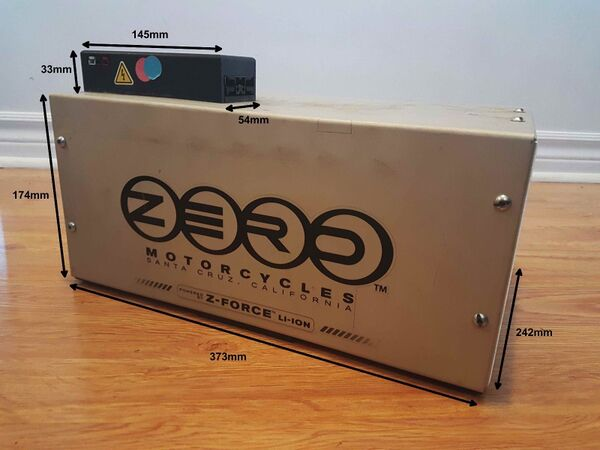 *2011 Zero X Battery with dimensions*

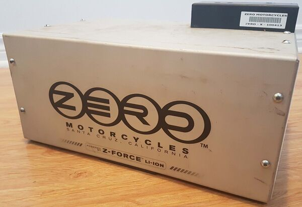 *2011 Zero X Battery*

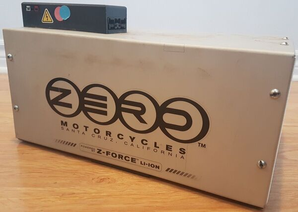 *2011 Zero X Battery*

**Overview**

There are several somewhat documented reports of using a stack of Nissan LEAF 7.4V 60Ah modules (7 in series or 7s = 51.8V ≅ 52V) to replace a pre-2013 Zero S-platform battery pack.

Reportedly, the BMS handles this relatively well. Details still being assembled.

**References**

- [2011 XU total rebuild, need batt advice](http://electricmotorcycleforum.com/boards/index.php?topic=7045.msg59994#msg59994) by user [honey\_badger](http://electricmotorcycleforum.com/boards/index.php?action=profile;u=7671).
- [Completed Zero 2010 X battery rebuild with lithium pouch cells](http://electricmotorcycleforum.com/boards/index.php?topic=6277) by user [Brian Zero](http://electricmotorcycleforum.com/boards/index.php?action=profile;u=7464), likely Zero's battery engineer.
- [Restoring a 2010 Zero S Electric Motorcycle Battery](https://medium.com/@ryan.mcneely_93025/restoring-a-2010-zero-s-electric-motorcycle-battery-5575209f2026)
- [2010 Zero MX Battery Replacement - Nissan Leaf Modules](https://www.electricmotorcycleforum.com/boards/index.php?topic=10240)
- [Are you looking for a BATTERY for XU/X/MX 2009 2010 2011?](https://www.electricmotorcycleforum.com/boards/index.php?topic=3358)

