# Aftermarket

## Overview

Vendor-supported accessories or accessories with confirmed fits for the Zero platform are listed below.

Unofficial or owner-discovered fits for the Zero are covered as [Common Modifications](Common_Modifications.md "Common Modifications") or [Advanced Modifications](Advanced_Modifications.md "Advanced Modifications"), depending on the need for customization or fabrication.

Procedures for installing official accessories are covered as [Common Modifications](Common_Modifications.md "Common Modifications") as well.

## General Information

### [OEM Store](http://www.zeromotorcycles.com/shop/)

Zero motorcycles [launched an accessories store in mid-2013](http://www.zeromotorcycles.com/press-releases/june-18-2013-accessories.html).

Items are only available through dealers.

Products occasionally appear and disappear without notice.

Store is down as of December 7, 2019

**[Storage](http://www.zeromotorcycles.com/shop/index.php?main_page=index&cPath=7)**

Covers [luggage](#Luggage) options.

**[Comfort](http://www.zeromotorcycles.com/shop/index.php?main_page=index&cPath=2)**

Covers [windscreens](#Windscreens), handguards, and tank grips.

Formerly (circa 2013) included heated grips and a heated seat option.

**[Power](http://www.zeromotorcycles.com/shop/index.php?main_page=index&cPath=5)**

Covers [charging](#Chargers), the [power tank](#OEM_Power_Tank), the power pack, and 12V accessories.

**[Performance](http://www.zeromotorcycles.com/shop/index.php?main_page=index&cPath=6)**

Covers gearing ratio options, the chain kit, FX shock, and the 2013 rear brake upgrade/fix.

**[Design](http://www.zeromotorcycles.com/shop/index.php?main_page=index&cPath=18)**

Covers crash/drop bars, [windscreens](#Windscreens), the rain guard, and [Pro Taper offroad footpegs](http://www.zeromotorcycles.com/shop/index.php?main_page=product_info&cPath=15_18&products_id=219).

**[Garage](http://www.zeromotorcycles.com/shop/index.php?main_page=index&cPath=4)**

Covers the brake lever parking hold and the belt tension gauge.

Formerly included a garage work mat and other items.

[Riding Gear](http://www.zeromotorcycles.com/shop/index.php?main_page=index&cPath=14) (includes touchscreen-compatible gloves) and branded [casual wear](http://www.zeromotorcycles.com/shop/index.php?main_page=index&cPath=3) also have sections for fans.

### [Hollywood Electrics](https://web.archive.org/web/2025/https://zeromanual.com/wiki/Hollywood_Electrics)

[Hollywood Electrics](https://hollywoodelectrics.com) has been a significant supporter of the Zero market for several years, and has supported aftermarket charging and racing customizations. They don't keep everything in stock and may have to order from Zero. In those instances, you may want to check your local dealer if one is near you to save the shipping charge.

They now have an online store, featuring:

- [Zero Accessories](https://hollywoodelectrics.com/collections/zero-accessories)
- [Hollywood Electrics' Custom Zero designs](https://hollywoodelectrics.com/collections/hollywood-electrics-customs), available for quotes.
- [Pre-Owned Zeros](https://hollywoodelectrics.com/collections/pre-owned)

### [Twisted Throttle](http://www.twistedthrottle.com)

Twisted Throttle has some Zero-specific and [Zero-fit-suitable product listings](http://www.twistedthrottle.com/shop-by-bike/zero).

They resell [R&G's Zero-fit products](http://www.rg-racing.com/browseBike/Zero/) for the North American market:

- [Tail Tidy fender eliminator](http://www.twistedthrottle.com/r-g-racing-tail-tidy-fender-eliminator-for-zero-s-13-zero-ds-13)

  How-to video: [Zero Motorcycle R&G Tail Tidy Install](https://www.youtube.com/watch?v=4XI1NrNwBpg)
- [Frame Sliders for the 13-14 DS model years](http://www.twistedthrottle.com/r-g-racing-aero-style-frame-sliders-for-the-zero-ds-13)

Otherwise, they list waterproof DrySpec soft bags and tires that fit.

### [AF1 Racing](https://web.archive.org/web/2025/https://zeromanual.com/wiki/AF1_Racing)

[AF1 Racing](https://web.archive.org/web/2025/https://zeromanual.com/wiki/AF1_Racing) is an Austin, TX, USA Zero dealer that publishes some [Zero-specific pages](http://www.af1racing.com/store/Scripts/prodList.asp?idCategory=3103) listing [OEM parts](Exploded_Views.md "Exploded Views") and [accessories](http://www.af1racing.com/store/Scripts/prodList.asp?idCategory=3108).

Their [AF1 Zero Accessories Listing](http://www.af1racing.com/store/Scripts/prodList.asp?idCategory=3108) features R&G Racing's products as well as [side racks](https://web.archive.org/web/2025/https://zeromanual.com/wiki/Zero_Aftermarket) and matching side cases from the Givi and SW-Motech fittings.

The AF1 Racing webstore also offers OEM Bodywork Kits for the [S/SR](https://www.af1racing.com/store/Scripts/prodView.asp?idProduct=96092), [DS](https://www.af1racing.com/store/Scripts/prodView.asp?idProduct=96093),[DSR](https://www.af1racing.com/store/Scripts/prodView.asp?idProduct=96097), [FX](https://www.af1racing.com/store/Scripts/prodView.asp?idProduct=96101) and [FXS](https://www.af1racing.com/store/Scripts/prodView.asp?idProduct=96112)

### Luna Cycle

[Luna Cycle](https://lunacycle.com) offers a [wide belt kit, including two sprockets](https://lunacycle.com/zero-motorcycle-wide-belt-sprocket-conversion-kit/)

## Battery Upgrades

EV battery upgrades are necessarily very constrained:

- The output voltage must be the same to avoid re-engineering the systems, so additional capacity must be added in parallel, not series.
- The cell technology should be a good match to have reasonably good load-sharing between batteries in parallel.
- The batteries should be harnessed in tandem without much dynamic reconnection, so a "battery trailer" right now is just a concept for recharge buffering.

Judging from the OEM offerings, the BMS software is essential for getting good cooperative behavior with the bike's MBB. This means that battery modules should have as close a match of hardware signaling connections, and BMS hardware and software revisions, to get the best result and avoid technical issues or damage.

### [OEM Power Pack Module](https://web.archive.org/web/2025/https://zeromanual.com/wiki/Power_Pack_Module)

The Power Pack module is Zero's solution for modular battery power, available for the [X platform](https://web.archive.org/web/2025/https://zeromanual.com/wiki/XMX_Platform) bikes.

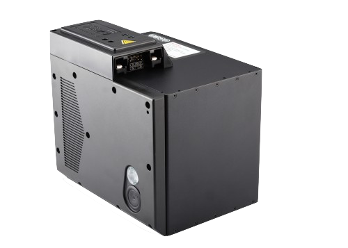 *ZF2.8 Power Pack*

It packages a single [Brick](https://web.archive.org/web/2025/https://zeromanual.com/wiki/Brick) with a [BMS](https://web.archive.org/web/2025/https://zeromanual.com/wiki/BMS) and a power connector with a smaller [contactor](https://web.archive.org/web/2025/https://zeromanual.com/wiki/Main_Contactor).

As of 2017, the [X platform](https://web.archive.org/web/2025/https://zeromanual.com/wiki/XMX_Platform) includes a non-removable [long brick](https://web.archive.org/web/2025/https://zeromanual.com/wiki/Long_Brick) module in the default configuration.

- It is unclear whether a long brick module will be separately available except by special order.
- The removable power pack module option is available by request with some additional cost.

**[ZF3.6 Power Pack module](http://www.zeromotorcycles.com/shop/index.php?main_page=product_info&cPath=15_5&products_id=251)**

30Ah(?) Farasis cells in 28s1p configuration with a [BMS](https://web.archive.org/web/2025/https://zeromanual.com/wiki/BMS).

Suitable for 2014+ bikes.

New case shape, slightly extended!

Different part number per year.

**[ZF3.3 Power Pack module](http://www.zeromotorcycles.com/shop/index.php?main_page=product_info&cPath=15_5&products_id=229)**

**Discontinued**; *special order for 2013 models?*

28Ah Farasis cells in 28s1p configuration with a [BMS](https://web.archive.org/web/2025/https://zeromanual.com/wiki/BMS).

Suitable for 2014+ bikes.

Same part number for 2014-2016, new part number for 2017.

**[ZF2.8 Power Pack module](http://www.zeromotorcycles.co.il/zero/shop/index-main_page=product_info&products_id=190.php.html)**

**Discontinued**; *special order for 2013 models?*

25Ah Farasis cells in 28s1p configuration with a [BMS](https://web.archive.org/web/2025/https://zeromanual.com/wiki/BMS).

Suitable for 2013-2015 bikes.

Different part number per year.

**Dimensions**

9.5 x 7.5 x 9.75in (HxWxL)

**Weight**

45lbs.

**Operational Notes**

Cell balancing seems less effective than the main power pack.

### [OEM Power Tank](https://web.archive.org/web/2025/https://zeromanual.com/wiki/Power_Tank)

The Zero's Power Tank is the only available battery upgrade for the [SDS Platform](https://web.archive.org/web/2025/https://zeromanual.com/wiki/SDS_Platform) that is officially supported or has a straightforward path to install.

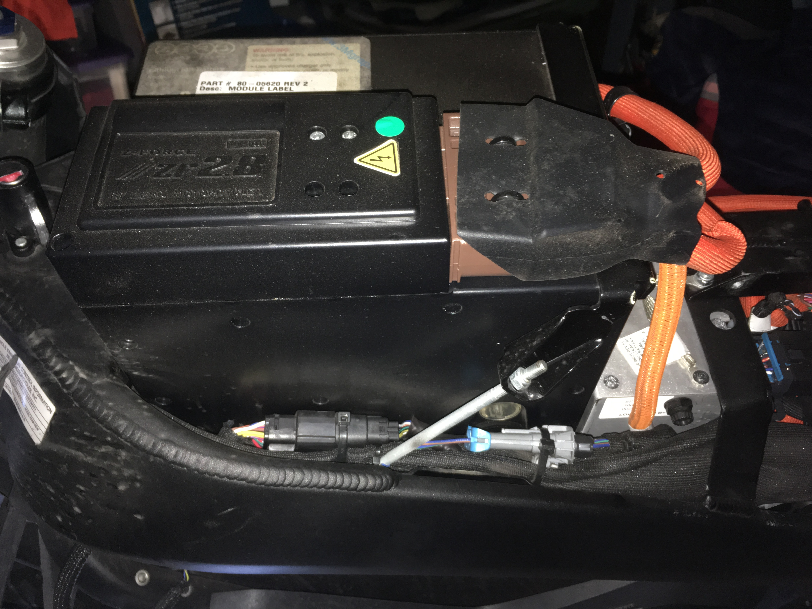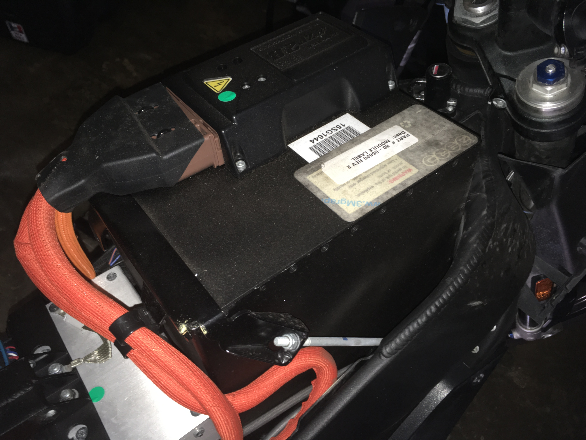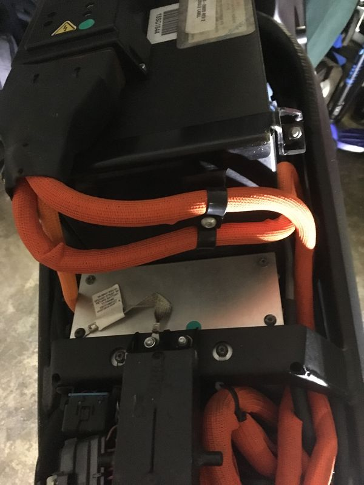

- It's equivalent to a single [Power Pack Module](https://web.archive.org/web/2025/https://zeromanual.com/wiki/Power_Pack_Module) for a Zero FX/FXS.
- A "3-brick" or "longbrick" S or DS model can accept the Power Tank as an upgrade.
- It has its own internal [BMS](https://web.archive.org/web/2025/https://zeromanual.com/wiki/BMS) which requires a significant amount of behavioral parity and configuration matching with the bike's Power Pack.

  Officially, the BMS firmware versions must be exactly matched, but this is not confirmed.
- The [MBB](https://web.archive.org/web/2025/https://zeromanual.com/wiki/MBB) is wired and configured to talk to two BMSs total, #0 for the Power Pack and #1 for the Power Tank.

  This corresponds to handling two BMSs for each X platform module.

  Power Tank logs and settings will be accessible as BMS #1.

**Dealership Install Requirement**

An install requires dealership access to:

- Check and match firmware revisions between the Power Tank, Power Pack, and MBB.
- Connect the systems safely so that there isn't a major current inrush that damages the bike or the Power Tank.

**Revisions**

The Power Tank and Power Pack products are revised per generation of [Cells](https://web.archive.org/web/2025/https://zeromanual.com/wiki/Battery/Cells). The Power Tank adds 25% capacity to the main pack.

1. [2.8kWh (discontinued)](http://www.zeromotorcycles.com/shop/index.php?main_page=product_info&products_id=203) original version released 2014.
2. [3.3kWh (discontinued)](http://www.zeromotorcycles.com/shop/index.php?main_page=product_info&products_id=239), released 2016.
3. [3.6kWh](http://www.zeromotorcycles.com/shop/index.php?main_page=product_info&products_id=253), released 2018, listed for 2014+ models.

**Install Limitations**

Only one Power Tank may be installed per vehicle.

- The S Platform tank area is the only reasonable place to mount a Power Tank, because of its incredible density.
- The MBB is configured to coordinate and communicate with two BMS units.
- The Main Pack has one BMS on the S Platform, and the X Platform is set up to carry one or two Power Pack units, each with a BMS, unless using a Long Brick (2017+).

It is not set up for disconnect without dealership involvement.

**Parts**

| Part number | Part | Price (USD) |
| --- | --- | --- |
| 24-08153 | TANK BODYWORK ASSEMBLY CHARGETANK | 300 |
| 24-08175-1XX | DSR TANK ASSEMBLY BLACK |  |
| 24-08177-1XX | DSR POWER TANK ASSEMBLY BLACK | 125 |
| 12-08011 | Power Tank Fasteners and Harness Kit |  |

**Location**

It fits in the tank area for 2014+ Zero models of S/DS/SR/DSR under the tank plastics.

**Mounting**

2014+ frame features are required for the approved mount.

- A carrier tray in the tank area suspends the Power Tank almost a centimeter total (3mm gap clearance) above the main Power Pack battery.
- Holes in the frame on the forward inner sides of the tank area anchor the Power Tank.

  These holes typically are covered by cable runs, and can be found by moving them aside.

  J-bolts hook into these holes and retain a corner bracket around the top rear edge of the Power Tank.

**Operational Notes**

Cell balancing seems less effective than and separate from the main power pack per [cell balance with powertank?](http://electricmotorcycleforum.com/boards/index.php?topic=7087).

**Dimensions**

9.5 x 7.5 x 9.75in (HxWxL)

24 x 19 x 25cm

**Weight**

45lbs./20,4kg

**Troubleshooting**

Early installations (2014) of the Power Tank had issues where the Power Tank's capacity would not count towards the bike's capacity, or the bike might shut down.

General consensus appears to be that charging a bike with the Power Tank (prior to some BMS firmware revision) could cause a self-protective disconnection due to imbalances between the Power Tank and the main Power Pack.

While this shouldn't happen with 2015+ Power Tanks, they can still have issues during or after installation if the Power Tank's charge state is not matched / balanced with the main Power Pack.

Basically, one or other contactor might not shut, resulting in reduced power capacity.

If for any reason something like this occurs, plug the bike in and wait for pack voltage and power tank voltages to match. The bike should operate normally at that point.

**Connections**

A cable harness attaches to the Power Tank's rear-facing output port.

The harness hooks into the bike's main systems to communicate with the MBB, and also runs to the B+ and B- terminals on the controller to deliver power to the motor.

Pre-2014 models also have an incompatible interconnect harness, much like their accessory charging circuit is lower capacity.

A 2013 model with the battery recall applied might support the connection harness, but the MBB will likely not interface with it.

| | |
| --- | --- |
|   **Warning:** | Only connect or disconnect this cable while the main contactor is open and the motorcycle is fully de-energized. Connecting a Power Tank with any circuits powered could damage or disable the vehicle entirely. |

General guidance before connecting or disconnecting any high-powered electrical systems from a Zero:

Wait a full 10 minutes to be absolutely sure that components have discharged fully, but 2 minutes is typically safe.

Confirm this with a DC voltmeter.

**Operation**

The Power Tank has its own BMS and contactor and coordinates with other bike systems via the MBB.

The contactor limits are presumably the same as for the main Power Pack contactor limits, except that the current/power input limit would be ¼ of the Power Pack.

The Ah rating of the Power Tank should be displayed on it just to understand what the current basis for 1C is.

## [Chargers](Chargers.md "Chargers")

See the [Chargers](Chargers.md "Chargers") page for a full accounting of charging options.

### Charger Comparison

This table simplifies details for the sake of comparison. See the notes below and investigate based on your needs and allowable tradeoffs.

| Platform | Vendor | Model | Power (kW) | Weight (lb) | Density (kW/lb) | OEM Warranty | [Protection](https://en.wikipedia.org/wiki/IP_Code) | Self-Protection | Custom Orders | Tank Count | External | Inlet to Onboard | Charge mode enable | Cost (with input adapter) |
| --- | --- | --- | --- | --- | --- | --- | --- | --- | --- | --- | --- | --- | --- | --- |
| [SDS](https://web.archive.org/web/2025/https://zeromanual.com/wiki/SDS_Platform) | [Zero](Zero_Motorcycles.md "Zero Motorcycles") | [Onboard Calex 1200W](https://web.archive.org/web/2025/https://zeromanual.com/wiki/Onboard_Charger) | 1.3 | 17 | 0.08 | ✓ | IP65 for enclosure   IP25 for connector | ✓ | ✗ | 0 | ✗ | N/A | ✓ | 800 USD |
| 〃 | 〃 | [Delta-Q QuiQ Charger](https://web.archive.org/web/2025/https://zeromanual.com/wiki/Zero_Quick_Charger) | 1.0 | 11 | 0.09 | 〃 | IP66 | ✓ | ✗ | 0 | ✓ | ✗ | ✓ | 600 USD |
| 〃 | 〃 | 2018+ [Charge Tank](https://web.archive.org/web/2025/https://zeromanual.com/wiki/Charge_Tank) | 6.5 | 25? | 0.26? | 〃 | IP66 | ✓ | ✗ | 1 | ✗ | ✓ | ✓ | 2295 USD |
| 〃 | [Hollywood Electrics](https://web.archive.org/web/2025/https://zeromanual.com/wiki/Hollywood_Electrics) | [Elcon 2500](Chargers.md#Hollywood_Electrics_Elcon_PFC_2500 "Chargers") | 2.5 | 15.6 | 0.16 | ✗ | IP46 | ✓ | ✓ | 0 | ✓ | ✓ | ✓ | 1300 USD |
| 〃 | [DigiNow](https://web.archive.org/web/2025/https://zeromanual.com/wiki/DigiNow) | [DigiNow Super Charger](https://web.archive.org/web/2025/https://zeromanual.com/wiki/DigiNow/Super_Charger_V2.5) | 3.3 | 9 | 0.37 | 〃 | IP67 | ✓ | ✓ | 1 | ✓ | ✓ | ✓ | 1755 USD |
| 〃 | 〃 | 〃 | 6.6 | 18 | 〃 | 〃 | 〃 | 〃 | 〃 | 2 | 〃 | 〃 | 〃 | +800USD? |
| 〃 | 〃 | 〃 | 9.9 | 27 | 〃 | 〃 | 〃 | 〃 | 〃 | 3 | 〃 | 〃 | 〃 | +1500USD? |
| 〃 | [EVTricity](https://web.archive.org/web/2025/https://zeromanual.com/wiki/EVTricity) | [EVTricity Fast Charging Kit](https://web.archive.org/web/2025/https://zeromanual.com/wiki/EVTricity/Fast_Charging_Kit) | 6.6 | 13.2 | 0.50 | 〃 | None | ✗ | ✓ | N/A | ✓ | ✗ | ✗ | 1513 USD   \*1990 AUD |
| 〃 | 〃 | 〃 | 8.8 (tuned) | 〃 | 0.66 | 〃 | 〃 | 〃 | 〃 | 〃 | 〃 | 〃 | 〃 | 〃 |
| [FST](https://web.archive.org/web/2025/https://zeromanual.com/wiki/FST_Platform) | [Zero](Zero_Motorcycles.md "Zero Motorcycles") | [Rapid Charge Module](https://web.archive.org/web/2025/https://zeromanual.com/wiki/FST_Platform/Rapid_Charge_Module) | 3.0 | 12? |  | ✓ |  | ✓ | ✗ | 2 | ✗ | ✓ | ✓ | 1200 USD |

**Notes**

This summary compresses some assumptions together for the sake of comparison.

**Power/Cost**

- Figures are *per configuration* and do not count the onboard charger.

**Stacking**

- Multi-unit costs for non-OEM chargers is lower per unit, and **isolated** units can be stacked, up to [1C](https://web.archive.org/web/2025/https://zeromanual.com/wiki/C-Rate).
- SCv1 (eMotorWerks) and Manzanita Micro units are *not* isolated, should **not** be stacked.
- SCv2 (current DigiNow) and Quiq are isolated, *can* be stacked.

**Protection**

- [IP codes](https://en.wikipedia.org/wiki/IP_Code) are sourced from the supplier, and can be compromised by vendor kit assembly.

  DigiNow has reported separately submitting their assembly for lab testing to get an assembly rating listed below.

  EVTricity's supplier does not rate their equipment for vibration or dust ingress or vehicle usage; treat with care.

**Warranty Coverage**

Zero will not cover system failures related to unapproved chargers *if* the charger equipment or its usage is deemed related to the fault.

[DigiNow](https://web.archive.org/web/2025/https://zeromanual.com/wiki/DigiNow) and EVTricity and DIY modules operate in this grey zone.

You should disconnect any high-powered chargers that were not dealer-installed before submitting for repair.

Using chargers like these may cause early failures if not operated safely. Discuss warranty coverage with your dealer.

## [Windscreens](https://web.archive.org/web/2025/https://zeromanual.com/wiki/Aftermarket/Windscreens)

### OEM Windscreens

See [OEM Touring Screen Install](https://web.archive.org/web/2025/https://zeromanual.com/wiki/OEM_Touring_Screen_Install) for installing any of Zero's current windscreens.

#### Zero [Touring](http://www.zeromotorcycles.com/shop/index.php?main_page=product_info&cPath=15_2&products_id=230) Windscreen

Recent addition with a spoiler and more design for aerodynamic comfort.

#### Zero [Commuter](http://www.zeromotorcycles.com/shop/index.php?main_page=product_info&cPath=15_2&products_id=160) Windscreen

Provides efficiency gains of 10-15% particularly when crouched.

#### Zero [Dual Sport](http://www.zeromotorcycles.com/shop/index.php?main_page=product_info&cPath=15_2&products_id=159) Windscreen

Relatively modest with more angular styling.

### Official Third-Party Windscreens

#### [Madstad Windscreens](https://web.archive.org/web/2025/https://zeromanual.com/wiki/Madstad_Windscreen)

[Madstad](https://madstad.com) makes an adjustable fitment for 2013+ Zero [SDS Platform](https://web.archive.org/web/2025/https://zeromanual.com/wiki/SDS_Platform) models with tint and height (18-24") options with a recommendation table for rider height!

[Product Page](https://madstad.com/collections/zero/products/zero-s-ds-2013-up)

#### [California Scientific](https://web.archive.org/web/2025/https://zeromanual.com/wiki/California_Scientific_Windscreen)

[California Scientific](http://www.calsci.com/) makes [touring windscreens](https://calsci.com/motorcycleinfo/Zeroprod.html) for [SDS Platform](https://web.archive.org/web/2025/https://zeromanual.com/wiki/SDS_Platform) Zeros.

They have [a particular design philosophy around windscreens](http://calsci.com/motorcycleinfo/Fairing.html#Windshield) that works rather well for good airflow and low drag.

### Universal and Adapted Windscreens

#### [MRA](https://www.mrashop.de/com/universal-screens/nakedbike-screens/) Windscreens

Makes the mounts and windscreens that Zero brands for its bikes. They have [other options](https://www.mrashop.de/com/universal-screens/nakedbike-screens/) that provide some choices.

See [OEM Touring Screen Install](https://web.archive.org/web/2025/https://zeromanual.com/wiki/OEM_Touring_Screen_Install) for installing any of MRA's universal windscreens.

See [I want to mount a MRA V-FLOW X-CREEN SPORT TYP "C" on my Zero FXS](https://tayeb.fr/misc/moto/Zero_FXS/saute-vent/windscreen_for_Zero_FXS.htm) for MRA fitment details examined for an FXS

#### [Puig](http://www.puig.tv/tuning-bikes/c171en/) Windscreens

Makes windscreens and mounts for sportbikes, naked bikes, and cruisers.

#### [Parabellum](http://parabellum.com/) Windscreens

Makes windscreens designed for maximum efficiency, claims +15mpg difference at highway speeds for a number of motorcycle models.

Offers some windshields for naked bikes that can be adapted to a Zero:

- [BMW R1200R](http://parabellum.com/Parabellum-Sport-Shield-for-R1200R-P60.aspx)
- [BMW 650 X-Country](http://parabellum.com/PARABELLUM-BMW-650-X-COUNTRY-SPORTTOURING-SHIELD-P68.aspx)
- [Suzuki SV-650](http://parabellum.com/Sport-Shield-Suzuki-SV650-2003-2008-P113.aspx).

[Discussion thread proving and itemizing a BMW fitting](http://electricmotorcycleforum.com/boards/index.php?topic=5525) by user:BrianTRice. Efficiency gains are 15-20% except in severe headwinds.

#### [Slipstreamer](http://slipstreamer.com/motorcycle/)

[Slipstreamer S-05 Turbo](http://slipstreamer.com/motorcycle/turbo/) Zero SR install confirmation, with a successful aerodynamic and comfort improvement. ([forum reference](http://electricmotorcycleforum.com/boards/index.php?topic=4673.msg50513#msg50513)).

[Slipstreamer Spitfire](http://electricmotorcycleforum.com/boards/index.php?topic=4228.msg26738#msg26738) install confirmation.

[Slipstreamer SS-10 Viper](http://electricmotorcycleforum.com/boards/index.php?topic=2055.msg6558#msg6558) install confirmation.

#### [Chinese LARGE Windscreen from eBay](https://www.ebay.com/itm/Large-19x17-Clear-Windcreen-Universal-Motorcycle-7-8-1-Handlebar-Windshield/184023487813/)

This is apparently a family of windscreens (sport-touring and cruiser style) with handlebar mounts. They are cheap ($55) but not of great quality.

[First found EBay listing](http://www.ebay.com/itm/Large-19-x17-Clear-Windshield-For-Motorcycle-Yamaha-Cruiser-7-8-1-Handlebars/231923751389?_trksid=p2047675.c100005.m1851&_trkparms=aid%3D222007%26algo%3DSIC.MBE%26ao%3D1%26asc%3D36499%26meid%3D6200d684277b49ff842ebebd0bafa7cf%26pid%3D100005%26rk%3D4%26rkt%3D6%26sd%3D171771823361)

EBay Search: [Large 19"x17" Clear Windshield For Motorcycle Yamaha Cruiser 7/8 & 1"Handlebars](http://www.ebay.com/sch/i.html?_from=R40&_trksid=p2047675.m570.l1313.TR0.TRC0.H0.XLarge+19%22x17%22+Clear+Windshield+For+Motorcycle+Yamaha+Cruiser+7%2F8+%26+1%22Handlebars.TRS0&_nkw=Large+19%22x17%22+Clear+Windshield+For+Motorcycle+Yamaha+Cruiser+7%2F8+%26+1%22Handlebars&_sacat=0)

Post from a Zero owner and his experience on this windscreen: [Re: Zero's been watching us (windscreen)](https://www.electricmotorcycleforum.com/boards/index.php?topic=5734.msg42472#msg42472)

#### Givi Windscreens

##### Givi A660 Universal Airstar Windscreen

Nate Nelson reports on Zero Motorcycles Owners Group (F-Book) it's worked well for 2000 miles on his Zero S

**References**

[Givi USA Product page](http://giviusa.com/givi-products/windshields/universal-windshields/a660-universal-airstar-windscreen-detail)

[Revzilla listing](https://www.revzilla.com/motorcycle/givi-a660-airstar-universal-windscreen)

## Crash Bars

### [OEM S Platform Drop Bars](https://web.archive.org/web/2025/https://zeromanual.com/wiki/SDS_Platform/Zero_Drop_Bars)

**Overview**

[OEM S Platform Drop Bars](http://www.zeromotorcycles.com/shop/index.php?main_page=product_info&products_id=242)

Zero has a parts catalogue for dealers for the [police (SP/DSP/FXP) models](http://www.zeromotorcycles.com/fleet/police/) - the crash guards and crossbar, and the upper left and right brackets, but they don't sell the hardware (screws and bolts).

The manual entry for the [Frame attachment points](https://web.archive.org/web/2025/https://zeromanual.com/wiki/SDS_Platform/Frame) is sufficient now to source the hardware easily.

This product is a "retail civilian version" of the Drop Bar Kit that is complete.

It includes a new skid plate because the S/SR skid plate is not designed with the drop bars in mind (lighter weight, probably plastic, with no pre-drilled holes for mounting).

The civilian version does not include brackets for mounting extra hardware, however, but it is apparently cheaper.

**Pre-2015 Fitment**

- The pre-2015 [frame](https://web.archive.org/web/2025/https://zeromanual.com/wiki/SDS_Platform/Frame) does not support the drop bars' intended shoulder attachment points.
- A 2013-indicated protection kit has been spotted in Zero's catalogues, but it likely requires machining to install and could weaken the 2013 frame if not installed professionally.

### [OEM X Platform Drop Bars](https://web.archive.org/web/2025/https://zeromanual.com/wiki/XMX_Platform/Zero_Drop_Bars)

**Overview**

[OEM X Platform Drop Bars](http://www.zeromotorcycles.com/shop/index.php?main_page=product_info&cPath=15_18&products_id=220)

The FX and FXS models support lighter, smaller drop bars, derived from fleet/police customer needs, like the [SDS drop bars](https://web.archive.org/web/2025/https://zeromanual.com/wiki/SDS_Platform/Zero_Drop_Bars).

**Notes**

- Drop bars for FX now come with hardware, but might not be complete.
- It appears they might assume you have the frame mounting screws.

## [Fairings](https://web.archive.org/web/2025/https://zeromanual.com/wiki/Aftermarket/Fairings)

Zero seems reluctant to commit to an OEM fairing design, for probably mostly business, branding, and budget reasons.

However, a well designed conventional front fairing should increase range at highway speeds by 30%.

A front fairing with a carefully crafted rear tail could do more, up to 50% (oversimplifying how this works here).

### Full Fairings

#### [Hollywood Electrics Fairing](https://web.archive.org/web/2025/https://zeromanual.com/wiki/Hollywood_Electrics_Fairing)

[Hollywood Electrics](https://web.archive.org/web/2025/https://zeromanual.com/wiki/Hollywood_Electrics) has created a [custom sport-touring fairing](https://hollywoodelectrics.com/products/zero-fairing-kit) adapted from their racing bikes.

**Features**

Full cockpit.

- Sets the headlamp forward by 4".
- Sets the dash / instrument cluster forward by 4".

Bracketing organizes 12V wiring behind the headlamp.

Fairing protects the dash / instrument cluster from weathering.

Installs setback risers to help the handlebars clear the fairing.

Allows using flush or non-stock turn signals on the fairing chin.

Allows using fairing-mounted mirrors on the upper edge of the fairing around the windscreen.

**Windcreen**

- Uses [Zero Gravity windscreens](http://www.zerogravity-racing.com/) for the [Yamaha YZF R1, years 2015-2018](http://www.zerogravity-racing.com/product_page.php?pn=542).
- The windscreen being set forward by 4" makes it more effective than bar-mounted windscreens.

**Airflow**

- Airflow is managed very well, only a soft updraft occurs from the underside.
- No turbulance induced on the upper edge with any tested windscreen.
- At least 10% range improvement over stock; possibly 15% depending on rider and tuning.
- Creates a larger space for tucking while riding, minimizing the effects of a rough headwind.

**Pricing**

Price is $1295, or $1495 with a paint scheme matching the 2018 SR model.

**References**

[Red/white/blue Hollywood Electrics racing bike with an early fairing model](https://www.instagram.com/p/BYi8vZ8Az9B/?taken-by=hollywoodelectrics)

[3 red/white/blue Hollywood Electrics racing bikes with early fairing models](https://www.instagram.com/p/BYgHtH6AxJW/?taken-by=hollywoodelectrics)

[Terry Hershner's faired Zero (with Husky)](https://www.instagram.com/p/Bj8ayB7gnAX/?taken-by=hollywoodelectrics)

[Metallic Ocean Blue Zero SR with the fairing](https://www.instagram.com/p/Bi0CqL-g7Lu/?taken-by=hollywoodelectrics)

[Zero DSR with the fairing in glossy grey](https://www.instagram.com/p/BimjRXYgG_m/?taken-by=hollywoodelectrics)

[3 Zeros (DSR and SR) in a combined short](https://www.instagram.com/p/Bj3dHo6lLBO/?taken-by=briantrice)

[Fitting a Hollywood Electrics Fairing](http://electricmotorcycleforum.com/boards/index.php?topic=8093) by Justin Andrews shows an installation!

See [the Zero customizers](Zero_Customizers.md "Zero Customizers") page for some faired Zero offerings by Hollywood Electrics and others.

### Cosmetic Bodywork

OEM

- The [Power Tank](#OEM_Power_Tank) and [Charge Tank](#OEM_Charge_Tank) have tank plastic options which can be bought separately or selected for color customization.

  Both use a relatively flat surface for the centerpiece, and the Charge Tank has a J1772-sized inlet hold with built in waterproof cover with a spring-loaded hinge.

  As of 2017, the Charge Tank centerpiece is separately available as part number 24-08137 for $40, to turn your existing tank plastics into a J1772-inlet-using tank.

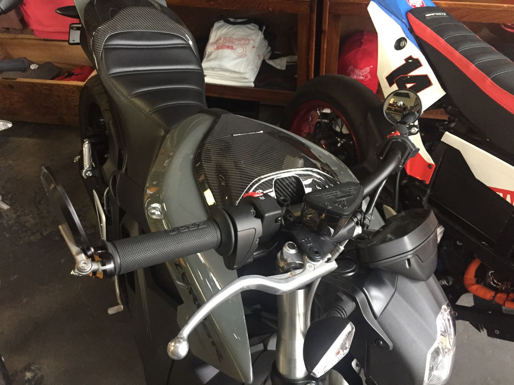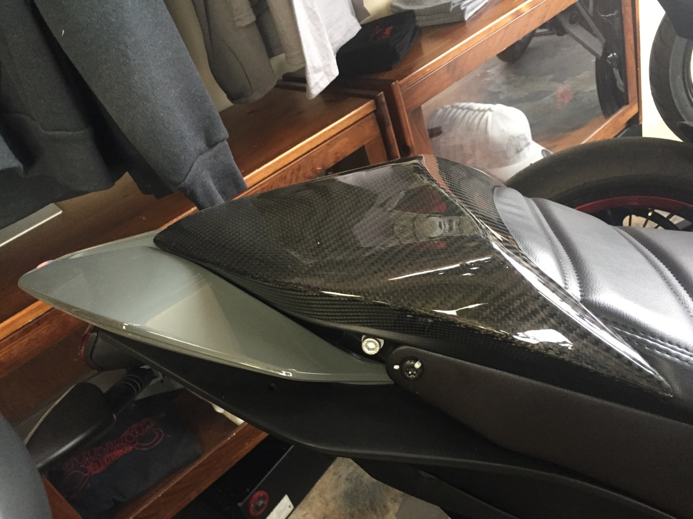

[Hollywood Electrics](https://web.archive.org/web/2025/https://zeromanual.com/wiki/Hollywood_Electrics) devised some carbon fiber body pieces:

- [Carbon Fiber Locking Tank Cover](https://hollywoodelectrics.com/product/carbon-fiber-tank-cover/)

  [Installation description with photos](http://electricmotorcycleforum.com/boards/index.php?topic=6604.0)
- [Carbon Fiber Seat Cowl](https://hollywoodelectrics.com/product/carbon-fiber-seat-cowl/)
- [Carbon Fiber Front Fender](https://hollywoodelectrics.com/product/carbon-fiber-front-fender/) for S, SR, and FXS models.

### [OEM Fly Screen](https://web.archive.org/web/2025/https://zeromanual.com/wiki/SDS_Platform/OEM_Fly_Screen)

The [OEM Fly Screen](http://www.zeromotorcycles.com/shop/index.php?main_page=product_info&cPath=15_18&products_id=176) provides 2013 Zero models with a small but reasonably good-looking hard plastic shroud around the [Koso instrument cluster](https://web.archive.org/web/2025/https://zeromanual.com/wiki/Koso_RX-1N) above the [headlamp](https://web.archive.org/web/2025/https://zeromanual.com/wiki/SDS_Platform/Headlamp).

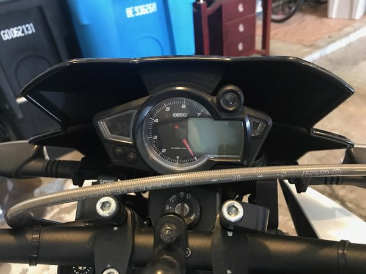 *Flyscreen over dash*

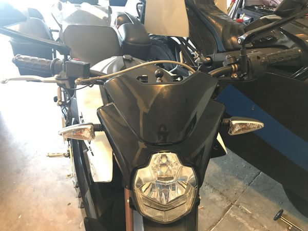 *Flyscreen installed*

Presumably this has a marginal effect on drag and energy consumption, but it probably helps smooth airflow with or without a windscreen.

2014+ S models have a plastic enclosure for the headlamp that interferes with this.

**Parts**

- Flyscreen
- Flyscreen rubber bumper with tape
- (2) spacers
- (2) M5⨉25 cap head bolts

**Tools**

- 3mm Allen key
- Cutting tool (~scissors)

**Installation**

1. Remove the upper mounting screws for the [headlight](https://web.archive.org/web/2025/https://zeromanual.com/wiki/SDS_Platform/Headlamp).
2. Place the included bolts through the holes in the side of the flyscreen.
3. Place the spacers onto the bolts on the inside of the flyscreen.
4. Carefully place the flyscreen over the headlamp, matching the bolt position to the upper headlight mounting holes.

   The bolts must be withdrawn slightly to surround the headlight mount points.
5. Engage the flyscreen mounting bolts to hold the flyscreen onto the headlight.
6. Cut the rubber bumper's two side spacers off.
7. Place the bumper against the top of the [Koso gauge instrument cluster](https://web.archive.org/web/2025/https://zeromanual.com/wiki/Koso_RX-1N).
8. Remove the tape along the top and press the flyscreen to it.
9. Tighten the flyscreen mounting bolts.

### Tank Grips

Tank grip pads are very useful for maintaining a crouched position comfortably and getting better control over the balance of the motorcycle.

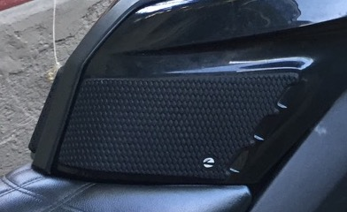 *Zero DS tank grip installed on a 2016DSR*

**OEM**

As of 2017, Zero offers soft [TechSpec](http://techspec-usa.com/) tank pads for 2013+ models on the S platform for $60:

- [ZERO TANK GRIPS BY TECHSPEC (ZERO S, ZERO SR)](http://www.zeromotorcycles.com/shop/index.php?main_page=product_info&cPath=15_2&products_id=240&zenid=i1nsi3edu8bl9fpqntb7351ui2)
- [ZERO TANK GRIPS BY TECHSPEC (ZERO DS, ZERO DSR)](http://www.zeromotorcycles.com/shop/index.php?main_page=product_info&cPath=15_2&products_id=241&zenid=i1nsi3edu8bl9fpqntb7351ui2)

**Third-Party**

[TechSpec](http://techspec-usa.com/) makes many different shapes in a soft material. Some generic shapes are suitable for customizing (1200GS pads fit the DS tank with a little adjustment) with the right cutting tools.

### Mudguard

#### [OEM Rain Guard](http://www.zeromotorcycles.com/shop/index.php?main_page=product_info&cPath=15_2&products_id=231)

This is a modest and inexpensive mudguard that mounts to the underside of the license plate tail extension.

The [Install page](https://web.archive.org/web/2025/https://zeromanual.com/wiki/OEM_Rain_Guard_Install) walks through installing it; pretty straightforward.

#### [Universal Motorcycle Rear Fenderguard](https://www.amazon.com/NICECNC-Universal-Motorcycle-Mudguards-Displacement/dp/B071HYZPRJ/)

[Recommendation with photos](https://www.facebook.com/groups/zmcowners/permalink/1340737225995482/)

**NOTE:** This has been observed to fail when encountering any non-trivial debris, and could very dangerously dig into the rear tire.

This mounts to the axle on the right side and adjustably extends over the rear upper quarter of the rear tire.

It extends far enough to easily clear the DS tires.

The bracket fits under the axle nut without compromising its fastening, although it does not snuggly conform to the axle diameter.

### Fender Eliminator

#### SDS Fender Eliminator

[R&G Racing Tail Tidy fender eliminator](http://www.twistedthrottle.com/r-g-racing-tail-tidy-fender-eliminator-for-zero-s-13-zero-ds-13)

**Video Instructions**

- [Zero Motorcycle R&G Tail Tidy Install](https://www.youtube.com/watch?v=4XI1NrNwBpg) on Youtube:

#### FST Fender Eliminator

Corbin has created per-model fender eliminator kits for the [SR/S](https://www.corbin.com/zero/zsrs20tail.shtml) and [SR/F](https://www.corbin.com/zero/zsrftail.shtml) models.

### [Front Fender](https://web.archive.org/web/2025/https://zeromanual.com/wiki/Gen2/Front_Fender)

#### [Low Sport Fender Swap](https://web.archive.org/web/2025/https://zeromanual.com/wiki/Low_Front_Fender_Swap)

**Goal**

Replace the [high dual sport front fender](https://web.archive.org/web/2025/https://zeromanual.com/wiki/Gen2/High_Front_Fender) with the [low front fender](https://web.archive.org/web/2025/https://zeromanual.com/wiki/Gen2/Low_Front_Fender) from the sport models.

**Confirmed Fits**

The S/SR front fender bolts directly onto the FXS lower forks, for those interested.

The DS/DSR/FX/FXS high dual sport front fender bolts directly onto the sport models, but this is not considered helpful.

**Adapter Brackets**

Cheap custom brackets will adapt the S/SR low front fender for the DS/DSR 19" wheel.

The brackets arrange for an offset in the mounting holes so that the fender sits higher around the top of the larger wheel.

#### [Fender Brace](https://web.archive.org/web/2025/https://zeromanual.com/wiki/Fender_Brace)

The DS/DSR/FX/FXS models have a [dual sport high fender](https://web.archive.org/web/2025/https://zeromanual.com/wiki/Gen2/High_Front_Fender) which does flex a bit at speed.

[Some research](http://electricmotorcycleforum.com/boards/index.php?topic=5464) indicates that the bolt pattern mounting the fender matches the Honda XR650L, allowing third-party fenders to replace it.

**Confirmed Fits**

[JSN Engineering's fender braces](http://www.jnsengineering.com/product/honda-xr650l-front-fender-brace/).

JSN Engineering also offers an [auxilliary LED mount](https://procycle.us/bikepages/xr650l.html#aux-led-mount) that uses the same attachment point.

**Steps**

The pattern is 4 holes in a rectangular shape 58mm (2.3in) wide and 50mm (1.95in) front to back (center to center).

The bolts are M5x15mm button head socket screw for a 3mm Allen key.

1. Remove the fender with a 3mm Allen key.
2. Install the fender brace above the fender and replace the fender.

   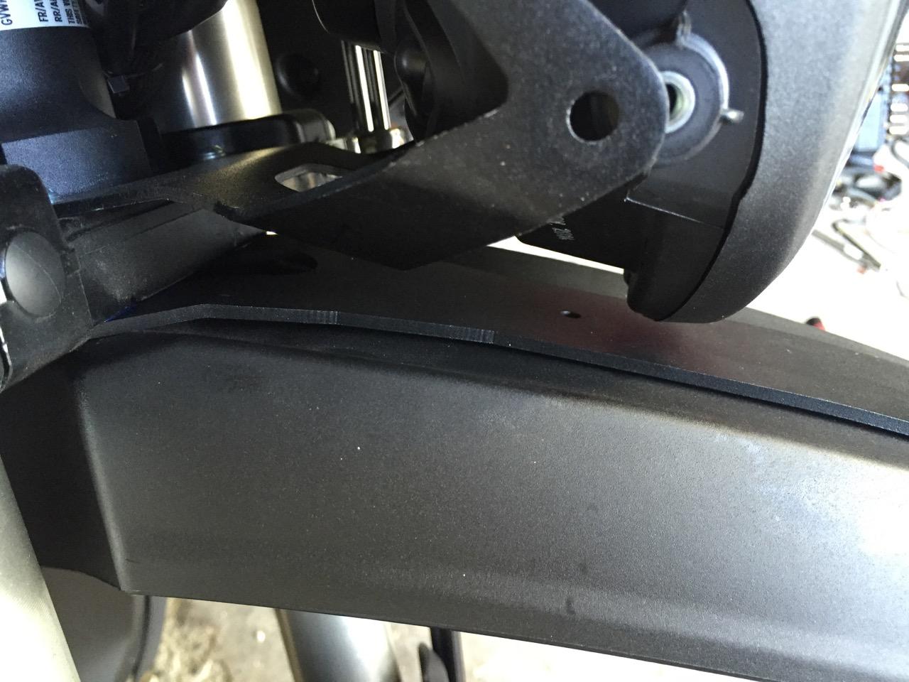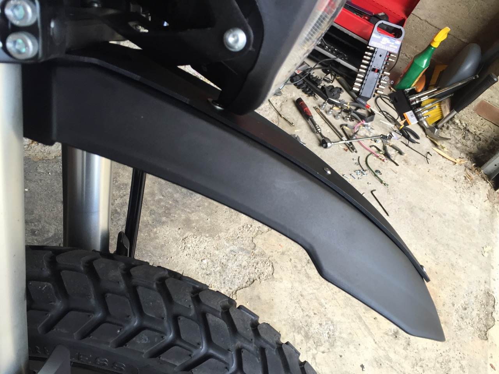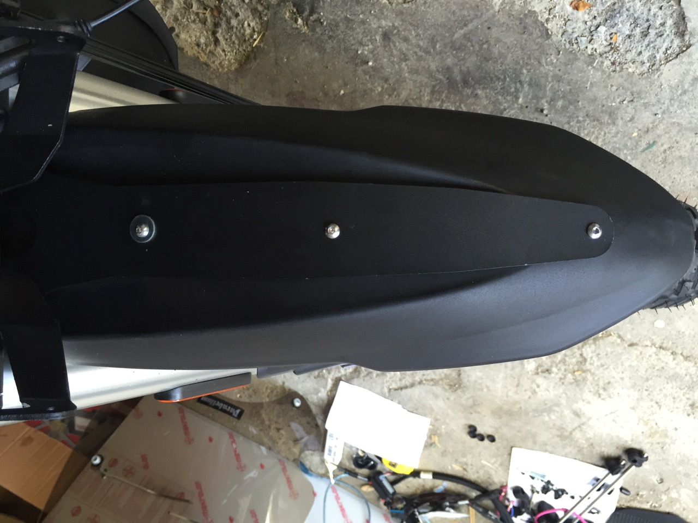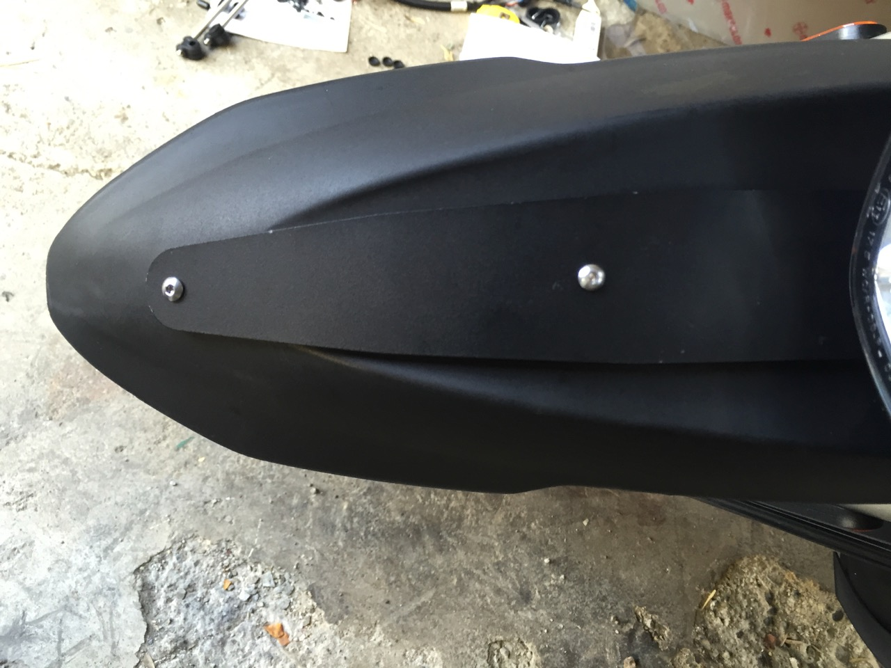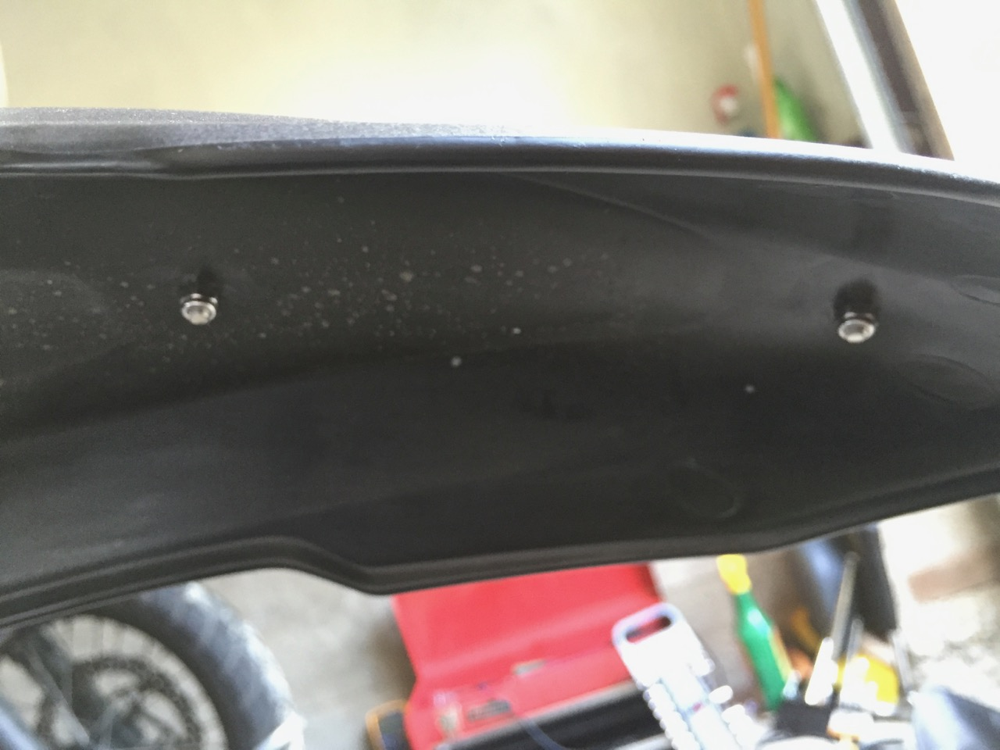
3. Flex the fender to match the fender brace while keeping the mounting bolts in the fender to hold the brace the way it will be installed.
4. Mark the fender where the holes for bracing align with the fender plastic.
5. Remove the fender and drill holes matching the marks.

   Double check how the alignment should happen since flexing will cause it to differ.
6. Replace the fender with the brace above it, and then fasten the fender to the brace.

**Trivia**

the S fork bracket has the same hole pattern as the DS, allowing it to mount hardware there.

### [Streamlining](https://web.archive.org/web/2025/https://zeromanual.com/wiki/Streamlining)

A streamlined electric motorcycle could be extremely [efficient](Efficiency.md "Efficiency") and practical.

- Terry Hershner and Craig Vetter's Zero Streamliner proved that efficiency was possible by setting several records.
- This was done at a cost of altering the frame, considered impractical by many.
- Vetter has shown that his full teardrop reduces highway speed energy use by 50%.

  It is optimized for 70 MPH with a 30 MPH headwind.

Reducing drag by mounting fairings that reduce the overall [wetted surface](https://en.wikipedia.org/wiki/Wetted_area) of the vehicle and distributing pressure over the surface of that body.

**See Also**

- [Wikipedia's Streamliner article](https://en.wikipedia.org/wiki/Streamliner) for some history.
- [Kammback](https://en.wikipedia.org/wiki/Kammback) describes the efficiency of a truncated teardrop, which is more stable in crosswinds.

**Motivation**

Context

- Loss of efficiency at speed is very high for a motorcycle and rider.
- Recharge rates for electric motorcycles will be roughly proportional to discharge rates at highway speeds for the near-term future.

So, minimizing drag changes the ratio of time spent riding to charging, which makes a Zero more suitable for travel.

#### Vetter Streamlining

[Craig Vetter](http://craigvetter.com) has been working on eco travel options for motorcycles for decades.

He recently got enthusiastic about electric motorcycle focus and helped Terry Hershner perform his streamlined cross-country trips, and has had a more conventional variant in the works for a couple of years.

However, a recent riding accident has slowed or halted this progress.

**References**

- [Streamlining a Zero SR](https://web.archive.org/web/20161128191423/http://www.craigvetter.com/pages/2015-Streamliner-pages/2015-Streamlining-a-Zero%20SR-p84.html) shows SR mockups with a proposed conventional-oriented design.
- [Tail truncation](https://web.archive.org/web/20160810074905/http://www.craigvetter.com/pages/2015-Streamliner-pages/2015-Truncating-the-tail-p85.html)
- [Terry Hershner's 2012 project bike history](https://web.archive.org/web/20170521061910/http://www.craigvetter.com/pages/2015-Streamliner-pages/2015-Terry-Streamliner-history-p86.html)
- [more modifications](https://web.archive.org/web/20170501124520/http://www.craigvetter.com/pages/2015-Streamliner-pages/2015-Fine-tuning-for-2015-Challenges-p87.html) shows some insight into how it's constructed.
- [last record setting run in 2015](https://web.archive.org/web/20160810075100/http://www.craigvetter.com/pages/2015-Streamliner-pages/2015-Terry-goes-300miles-on-one-charge-p89.html) (300 miles on a charge!)

**Goals**

[Vetter has](https://web.archive.org/web/20161128191423/http://www.craigvetter.com/pages/2015-Streamliner-pages/2015-Streamlining-a-Zero%20SR-p84.html) three major goals for a streamline fairing which have tradeoffs against each other:

1. Range
2. Comfort
3. Speed

**Availability**

The [Vetter streamliner kit](http://craigvetter.com/pages/Online_Store/Streamliner%20Superstore.html) is available for sale for $2000 plus taxes and shipping.

**Parts**

The kit consists of fiberglass pieces made by molds held by Mike Corbin at his factory for:

1. The forward nosecone in upper and lower halves.
2. A "*turret*" piece made to rotate with the steering column.
3. A "*seatback*" piece meant to smoothly re-attach turbulent air behind the rider's body onto the tail.

They require a *significant* amount of fabrication, planning, and work to mount.

All existing fitments are bespoke and unfit for even boutique level of adoption without major manufacturing commitment (a custom vehicle from the ground up).

**2013+ S Platform Fitment**

A full 2013+ fitment for an S Platform Zero has not been proven, and would require significant discovery and iteration, or a drastic change in design priorities.

Terry's streamliner Zero is a 2012 fitment that involved massive destructive modifications to the frame, and is essentially a retired experimental vehicle.

The nosecone or front fairing would reasonably mount to an extension of the [OEM crash bars](#OEM_S_Platform_Drop_Bars) along that plane in a forward diagonal arc.

The seatback assumes destructive removal of the entire tail of the vehicle, completely repositioning the seat and controller to serve the purpose of the vision (minimizing frontal area).

Since this operation would destroy the resale value of the vehicle and require significant shop expertise to carry out effectively, they are unsuitable for a kit.

#### Other Streamlining

[Airtech Streamlining](http://www.airtech-streamlining.com) offers a number of fairings that are roughly suitable for various parts of the vision:

- **[Vintage Dustbin fairings](http://www.airtech-streamlining.com/vintage/vintagefairingsdustbin.htm)**

  These are smaller than the Vetter nosecone but lightweight and effective.

  The DBL1 seems most effective, and the DBL2 has been tried with some success.

  **DBL1**

  The parabolic or egg-shell shape is stronger and more aerodynamic.

  No cutouts are provided for the wheel or headlamp.

  The side profile is somewhat wider but the fairing admits some flex to change its aspect ratio.

  **DBL2**

  Wider, allowing more clearance around the 19" DS wheel and tire.

  Includes a basic cutout for the wheel, and a broad cutout for the headlamp.

  Side nacelles allow some air cooling to pass within the fairing.

  Low height limits its benefit to airflow without additional fabrication to close up the area around and behind the steering head.

  Square frontal profile reduces lean angle significantly without bringing the fairing too high for drag reduction.

  Vertical sidewalls are not as rigid, requiring reinforcement.

  **Gilera / NSU / Agusta**

  The Gilera is small and even lower than the DBL2, so not useful.

  The NSU and Agusta fairings are narrow but may prove useful for a bike with a sport-sized (17") front wheel.

  **[Vintage Full fairings](http://www.airtech-streamlining.com/vintage/vintagefairingsfull.htm)**

  These are good conventional fairings with a streamlining design.

  Wheel covers will still be quite helpful.

  All of these dump air straight onto a radiator area, but on a Zero this dumps air straight onto the front battery face, so they are somewhat compromised.

  **[Vintage Fairing Brackets](http://www.airtech-streamlining.com/miscpages/brackets.html)**

  These help for most of these fairings where pushing the headlamp forward from the steering column is required.
- [Land Speed Record Fairings](http://www.airtech-streamlining.com/landspeed/landspeed.htm) are for a GSX1300R Hyabusa, but probably can be fit to a Zero (TBD).

## Luggage

### Tank Bags

Obviously, a stock Zero comes with a tank bag if it doesn't have a [Charge Tank](#OEM_Charge_Tank) or [Power Tank](#OEM_Power_Tank) installed, but if it does, there's a utility storage gap in front of the rider.

There's nothing explicitly fit for Zero for a number of reasons:

- The tank isn't made of metal.

  Magnetic tank bags might find a Power Tank or Charge Tank underneath it quite attractive, but it's unclear whether the magnets cause a problem for them in the long run.
- The tank is relatively small.

  Most mid-sized tank bags will seem very large on it.
- There's no gas cap to clip onto.

  Maybe a J1772 inlet would provide an anchor, but don't compromise its waterproofing.
- Running straps around the tank plastics requires a bit of finesse.

  There's room above the battery to run straps but you might want to remove the tank plastics a bit to get the straps in there.

That said, people have fit backpacks, rucksacks, and tank bags onto their Zeros, but it's all been ad hoc so far.

**Strap Mount Locations**

- Around the steering head.
- Just above the battery.
- Just under the front of the seat.

Examples:

- [laramie LC4 reports a Firstgear tank bag fitment for an FXS](http://electricmotorcycleforum.com/boards/index.php?topic=5893.msg46010#msg46010)
- [Richard230 reports a Wolfman Enduro tank bag mount on his 2012 S](http://electricmotorcycleforum.com/boards/index.php?topic=2744)
- [CrashCash reports a Cortech 10L tank bag mount on his Zero SR](http://electricmotorcycleforum.com/boards/index.php?topic=7134) [Cortech Super 2.0 10L Tank Bag](http://www.cortech.net/inc/sdetail/super_2_0_10l_tank_bag/181/572)

### [Underseat compartment](https://web.archive.org/web/2025/https://zeromanual.com/wiki/XMX_Platform/Fabricate_Underseat_Compartment)

I designed, printed and tested a customized underseat box for FX/FXS models.

The STL models are available below.

**Pictures**

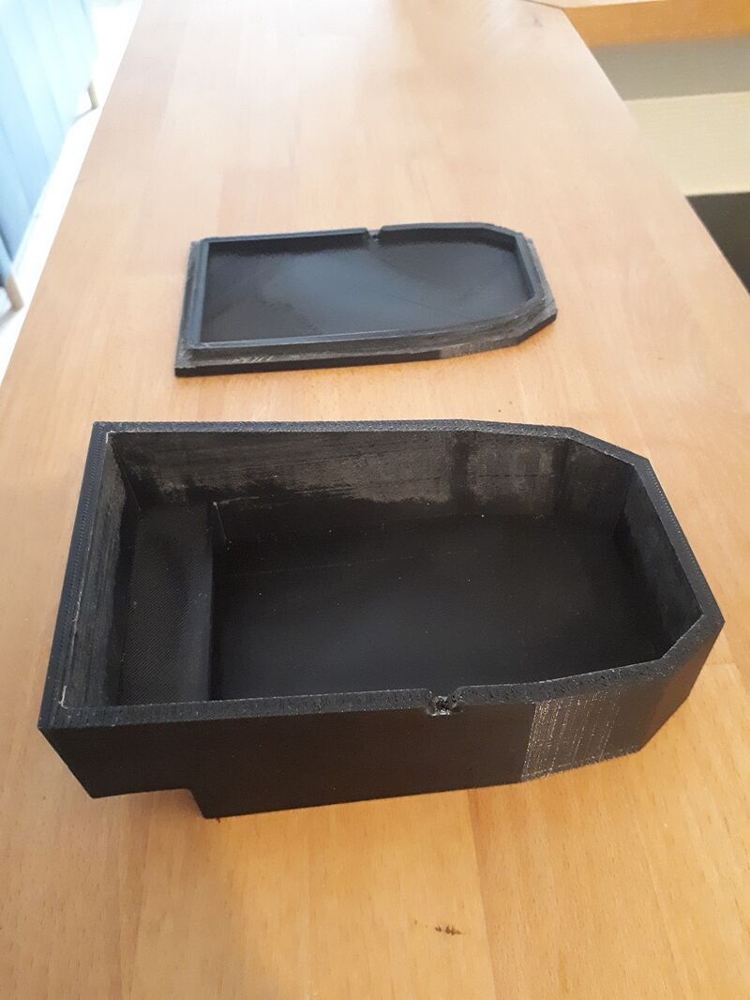 *Box with lid*

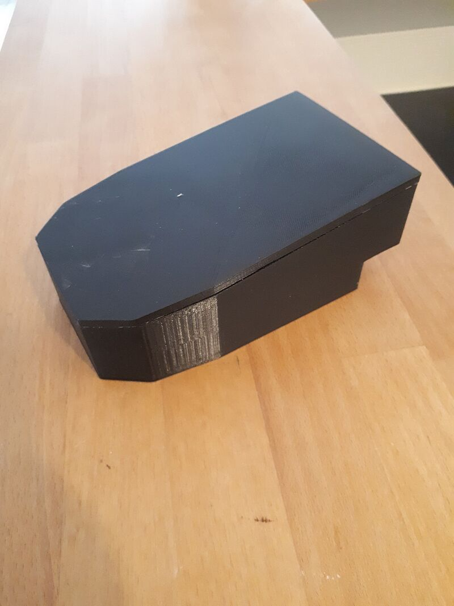 *Box assembled*

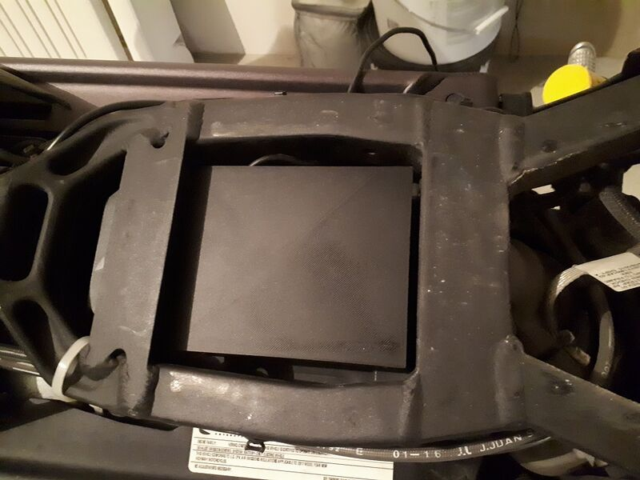 *Box installed*

**CAD files**

- [Boite.STL on Google Drive](https://drive.google.com/open?id=13s7WBBciR9uaA-Z3tHJ8xKGMI4ct0KoK)
- [Couvercle.STL on Google Drive](https://drive.google.com/open?id=1A5eeznwhENRnWEOWbCaAB1gUxgJRRXKN)

### [Soft Luggage/Cases](https://web.archive.org/web/2025/https://zeromanual.com/wiki/Aftermarket/Soft_Luggage)

In short, most soft bags can be adapted to a Zero if they are roughly fit for its size.

**Products**

- [Zero Soft Saddlebags](https://web.archive.org/web/2025/https://zeromanual.com/wiki/Zero_Soft_Saddlebags)
- [OEM Soft Saddlebags](http://www.zeromotorcycles.com/shop/index.php?main_page=product_info&cPath=15_7&products_id=218)
- [Mototrek Sport Saddlebags](http://www.motorcycle-superstore.com/28911/i/motocentric-mototrek-sport-saddlebags)
- [Cycle Case Rider Saddlebags](http://www.cyclecase.com/rider-saddlebags.html)
- [Nelson/Rigg from Amazon](https://www.amazon.com/gp/product/B0031BJDRG)
- [IKEA Briefcase](http://www.ikea.com/us/en/catalog/products/60236458/)

  This happens to be reasonably weatherproof and mountable by its straps. And very affordable.

[ongoing forum thread of recommendations](http://electricmotorcycleforum.com/boards/index.php?topic=5736)

**Hybrid Hard/Soft Bags**

- [SHAD E-48](http://www.shad.es/en/shad-usa/products/bags/touring-bags/saddle-bag-e-48/c70r140/)

  [HandMade Fixation for SHAD E-48 Saddle Bags](http://electricmotorcycleforum.com/boards/index.php?topic=7188) shows how to use common hardware to mount these to the seat pan, very clever and seems sturdy.

### Hard Cases

#### Top Rack

Zero offers the only supported top rack solution for 2013+ S platform and X platform models.

The only alternative top rack that works with a Zero is the [Givi Wingrack](http://www.hard-motorcycle-luggage.co.uk/acatalog/givi-wingracks.html) universal-fit series, which won't support OEM or other side racks that fit the Zero.

##### [OEM Top Rack](https://web.archive.org/web/2025/https://zeromanual.com/wiki/Zero_Top_Rack)

Zero offers the only supported top rack solution for 2013+ S platform and X platform models:

- [Top Box Rack Kit](http://www.zeromotorcycles.com/shop/index.php?main_page=product_info&cPath=15_7&products_id=187) for the S platform, without a case.

  [Givi Top Box and Rack Kit](http://www.zeromotorcycles.com/shop/index.php?main_page=product_info&cPath=15_7&products_id=161) with the [E340 case](http://www.giviusa.com/givi-products/cases/monolock-cases/e340na-34ltr-matte-black-case-detail) via the [Monolock Adapter Plate](http://www.giviusa.com/givi-products/mounting-hardware/top-case-mounting/z113c-monolock-universal-fit-kit-detail)

  [Givi Trekker Top Box and Rack Kit](http://www.zeromotorcycles.com/shop/index.php?main_page=product_info&cPath=15_7&products_id=209) with the [33L Trekker Top/Side Case](http://www.giviusa.com/givi-products/cases/monokey-cases/trk33n-trekker-case-33ltr-detail) via the [E251 Monokey Adapter Plate](http://www.giviusa.com/givi-products/mounting-hardware/top-case-mounting/e251-adapter-plate-universal-detail)
- [Top Box Rack Kit](http://www.zeromotorcycles.com/shop/index.php?main_page=product_info&cPath=15_7&products_id=216) for the X platform, without a case.

  [Givi Top Box and Rack Kit](http://www.zeromotorcycles.com/shop/index.php?main_page=product_info&cPath=15_7&products_id=217) with the [E340 case](http://www.giviusa.com/givi-products/cases/monolock-cases/e340na-34ltr-matte-black-case-detail) via the [Monolock Adapter Plate](http://www.giviusa.com/givi-products/mounting-hardware/top-case-mounting/z113c-monolock-universal-fit-kit-detail)

**Mounting plates**

[The Givi E251 Monokey universal mounting plate](http://www.giviusa.com/givi-products/mounting-hardware/top-case-mounting/e251-adapter-plate-universal-detail) adapts most large Givi cases to the OEM top rack.

[Monolock universal mounting plate](http://www.giviusa.com/givi-products/mounting-hardware/top-case-mounting/z113c-monolock-universal-fit-kit-detail) adapts smaller, more scooter-oriented Givi cases to the OEM top rack.

[All Givi top plate options](http://www.giviusa.com/givi-products/mounting-hardware/top-case-mounting), most not confirmed to fit.

[early forum thread about some options](http://electricmotorcycleforum.com/boards/index.php?topic=3151.msg16507#msg16507)

Other manufacturers' top plates should fit if they're meant for a Givi bolt pattern.

**Installation**

**Difficulty:** Trivial (15 minute job).

See [OEM Top Rack Install](https://web.archive.org/web/2025/https://zeromanual.com/wiki/OEM_Top_Rack_Install)

**Design Issues**

- The rack is only fastened via the two M5 bolts into the top of the frame under the seat.

  **Downside:** The strain on those bolts can accumulate if the rack has any freedom of motion.

  **Upside:** This connection makes the top rack a cheap sacrificial point if the bike goes down in a certain way, particularly with the police models' use of a rear rack bar.

  **Recommendation:** When removing the seat bolts, remove any load from the top rack (and side racks) to avoid straining these bolts and possibly breaking them.

  Don't add load to the racks without the seat bolts inserted.
- The top rack plate is smaller than a Givi Monokey or other larger vendor's case surface.

  Crafting an aluminum plate to fix to the existing plate is workable with a drill and the right machined piece of (say) aluminum.

##### SW-Motech Top Rack

The Zero DSR Black Forest Edition (roughly findable at the [Zero DS page under "Builds") appears to use a SW-Motech top rack with [https://sw-motech.com/en/products/luggage/top+case/TRAX+ION+top+case/ a boxy aluminum TraX top case (probably ION)](https://www.zeromotorcycles.com/zero-ds/).

This top rack does not appear to be separately available via SW-Motech or Zero.

#### Side Rack

| Manufacturer | Pros | Cons |
| --- | --- | --- |
| OEM | - Lightweight   - OEM-Supported | - Limited load   - Relatively fragile |
| Happy Trails | - Very sturdy   - Adapts to non-motorcycle boxy cases   - Supports inner accessory brackets | - Heavier |
| SW-Motech | - Detachable Racks   - Sturdy   - Supports adapter plates for many vendors' cases | - Heavier |

##### [OEM Side Rack](http://www.zeromotorcycles.com/shop/index.php?main_page=product_info&cPath=15_7&products_id=199)

Fits the Givi PL/PLR side case holder spec.

[Monokey side cases](http://www.giviusa.com/givi-products/cases/monokey-side) all fit EXCEPT for the V35 series which require a PLX rack (which is attractive and tries to conform around the tail).

[Boxy/sturdy Trekker side cases](http://www.giviusa.com/givi-products/cases/trekker-series) all fit.

Noticeably, there is a design revision between 2013-2014 racks and 2015+ racks.

- The tail mount is more robust, no longer using a pipe clamp to hang from the tail.
- The turn signal mounts are sturdier and well-integrated.

##### [Happy Trails Side Rack](http://www.happy-trail.com/find-your-bike/zero-motorcycle/su-side-racks.html)

Fits their "SU" holder spec, also offers some adapters for Givi PL/PLR mounting.

Designed around the 2015 DS, judging from the photos and time of release.

The rack hardware is robust:

- Primarily 1/2" diameter square and circular tubing.
- All the bolts are M8 bolts with 13mm hex heads which match the footpeg bracket bolt heads.
- The rack [mounts to the seat bolts and peg supports](https://www.happy-trail.com/Instructions/HTPZ0-1-1.1.pdf) instead of the smaller holes through the top rack which do not directly anchor to the frame.
- The rack includes a bracket anchored directly to the frame where the tail piece attaches, avoiding turn signal wiring extensions.

Confirmed to fit a 2014 SR, although the clearance against the rear brake master cylinder is very tight and might be of concern.

[All Happy Trail products vouched for the Zero fit](http://www.happy-trail.com/find-your-bike/zero-motorcycle.html), lists saddlebags, tank bags, pannier bags, etc., very good adventure options listed.

**Installation**

See [Happy Trails SU Side Rack Install](https://web.archive.org/web/2025/https://zeromanual.com/wiki/Happy_Trails_SU_Side_Rack_Install)

##### SW-Motech [QUICK-LOCK EVO Side Carrier](http://shop.sw-motech.com/cgi-bin/cosmoshop/lshop.cgi?action=showdetail&wkid=149075041132005&ls=en&nc=1490750473-32710&rubnum=brands.zero.dsr&artnum=KFT.29.860.20000/B&id=28&gesamt_zeilen=Tshowrub--brands.zero.dsr&typid=249461886)

**Features**

Has quick-release fasteners (that can be locked with an add-on) that allow the side rack to be mostly removed from the bike.

Fits a number of vendors' cases using adapters: Givi/Kappa, Shad, Hepco & Becker, Krauser, and their own TraX and Aero cases.

Other products have been confirmed fit for the DSR: [SW-Motech by model: DSR](http://shop.sw-motech.com/en/by+motorbike+or+scooter/Zero/DSR/index.htm)

[Twisted Throttle Motech Side Rack product page](http://www.twistedthrottle.com/sw-motech-quick-lock-evo-side-carriers-to-fit-many-side-case-types-for-zero-dsr-15-17)

**Tradeoff**

There appears to be some [installation conflict](https://www.facebook.com/ruud.opklompen.7/posts/253120395187242?comment_id=253211625178119&reply_comment_id=253239418508673&notif_t=feed_comment_reply&notif_id=1501187726441648) with the [OEM top rack](#Top_Rack).

**Installation**

Both racks rely on lower brackets that attach to the inside of the rear footpeg mounting brackets.

These mounts re-use the OEM bolts (13mm hex head M10 bolts) which are difficult to work on (clearance around the motor, suspension, cabling, and hydraulics is extremely tight).

The straightforward way to work on this aspect is twofold:

- For the upper bolts, use a long extension (12" or so) that can swivel a bit to reach across the underside of the frame. Use a socket wrench to operate from there.
- For the lower bolts, remove the lower side plastics and then use a low-overhead angled socket wrench from the front side of the frame vertical to reach the bolt and operate on it.

## 12V Circuit

Eastern Beaver is a good resource for motorcycle 12V electrics:

- [Eastern Beaver fuse boxes and panel wiring kits](http://www.easternbeaver.com/Main/Wiring_Kits/Fuseboxes/fuseboxes.html)
- [Posi-Lock and Posi-Tap connectors](http://www.easternbeaver.com/Main/Elec__Products/Posi-Lock/posi-lock.html) for joining two wires easily without professional equipment or tapping into one wire with a second.
- [Switches for handlebars](http://www.easternbeaver.com/Main/Elec__Products/Switches/switches.html)

### Horn

Most horn upgrades will challenge the DC converter's power load, particularly while the ABS brake pump is running.

See [the common modifications section on horns](Common_Modifications.md#Horn "Common Modifications") for some discussions about how to wire an upgraded horn in.

## Lighting

### Headlamp

#### S-Platform Headlamp

Check the [the replacement procedure](https://web.archive.org/web/2025/https://zeromanual.com/wiki/Headlamp_Bulb_Replacement_%28S-Platform%29) for fitment/replacement.

**Replacement Specification**

H4 specifically for motorcycle tolerance fit, but 9003 generally will fit.

**Brighter Halogen (often marketed as [HID](https://en.wikipedia.org/wiki/High-intensity_discharge_lamp))**

Generally, these offer much greater light spread and brightness with the same power requirement as the OEM bulb (55W/60W).

[SYLVANIA 9003 (also fits H4) SilverStar zXe High Performance Halogen Headlight Bulb](https://www.amazon.com/SYLVANIA-SilverStar-Performance-Headlight-Contains/dp/B005KDO9C2) (only need one)

[Whiter - Brighter & Safer Headlights For Your Zero - Mike Mas](http://electricmotorcycleforum.com/boards/index.php?topic=6664.0) covers the broad issues with motorcycle headlight choices, recommends and reviews the zXe.

**[Cree](http://www.cree.com/) LED**

Fanless; uses braided metal filaments for heat dissipation instead of a fan unit.

Seems easier to fit behind the headlamp assembly while still keeping the lamp cool.

Cree seems to generate some noise on the CAN bus, which can lead to start errors.

- [H4 R3 LED headlight](http://stores.advmonster.com/h4-r3-led-headlight/)
- [Astra Depot 1x 2014 High Power 30W Xenon White H4 9003 HB2 XM-L2 CREE LED Hi/Lo Motorcycle Headlight Bulb](https://www.amazon.com/Astra-Depot-Power-Motorcycle-Headlight/dp/B00PQDUOSO) (currently unavailable at Amazon) at 30W/60W.
- [SuperBrightLEDs H4 motorcycle option](https://www.superbrightleds.com/moreinfo/back-up-light-bulb/motorcycle-led-headlight-conversion-kit-h4-led-headlight-bulb-conversion-kit-with-compact-heat-sink/3930/8566/)
- [Tony Helms reports improved output](https://www.facebook.com/groups/zmcowners/permalink/1055023067900234/), although that includes accessory lighting with custom brackets.
- [Patrick Truchon](http://ptruchon.pagekite.me/wiki/zerodsmods#led_headlight) fitted a [Cree LED headlight off of EBay](http://www.ebay.ca/itm/2014-NEW-30W-3000LM-Motorcycle-Cree-LED-Headlight-Bulbs-H4-Hi-Lo-HB2-9003-/231336914711?hash=item35dcc12f17).
- [Doug S](http://electricmotorcycleforum.com/boards/index.php?topic=6938) fitted a [VXMOTOR PHILIPS Fanless LED Headlights BULB H4 - 7000LM 50W 6000K Xenon White via Amazon](https://www.amazon.com/gp/product/B01I28WNUQ/)

**[OPT7](http://www.opt-7.com/) LED**

Fan-cooled, but practically silent even for the Zero.

It's brighter than the stock bulb but has an unusual light pattern.

These appear to be more CAN-bus-friendly.

- [OPT7](https://www.amazon.com/OPT7-Motorcycle-Headlight-Arc-Beam-99-Clear/dp/B00WVJR0D8) at 20/40W. Choose the H4 (9003) Single.

  The cooling element does stick out a bit which might require some gymnastics with the rubber boot meant to protect the headlamp from moisture.

  [Some fit and light pattern notes](http://electricmotorcycleforum.com/boards/index.php?topic=4590.msg38534#msg38534)

**Wiring**

If you need anything even slightly customized about the wiring, [Eastern Beaver's various H4 kits](http://www.easternbeaver.com/Main/Wiring_Kits/H4_Kits/h4_kits.html) cover many possibilities.

#### X-Platform Headlamp

**Replacement Specification**

H3 with dual projectors

**S7 fanless H3 LEDs**

Fits well and works well, just have to decide how to deal with the braid vs the rubber dust cups. Very affordable on [Amazon](https://www.amazon.com/gp/product/B01MXSF2Z3/ref=oh_aui_detailpage_o04_s00?ie=UTF8&psc=1).

These are the right length, from base to element, to focus properly and provide a sharp and accurate cutoff on the low beam. (The high beam still looks like a flashlight.)

They are brighter than even a 50W halogen and white without being blue.

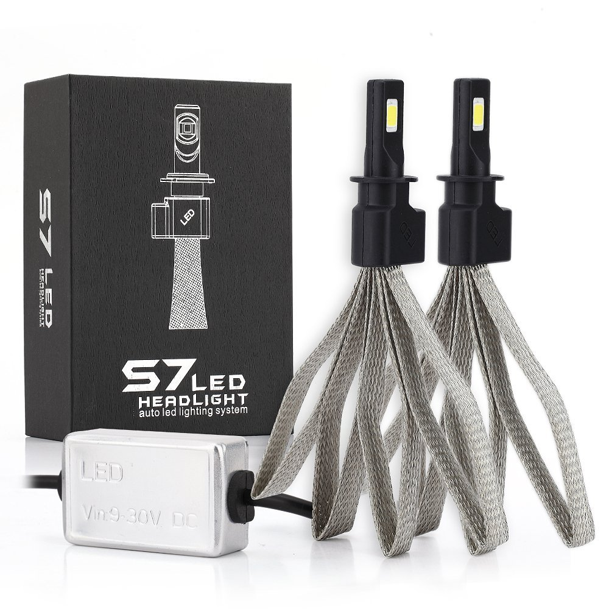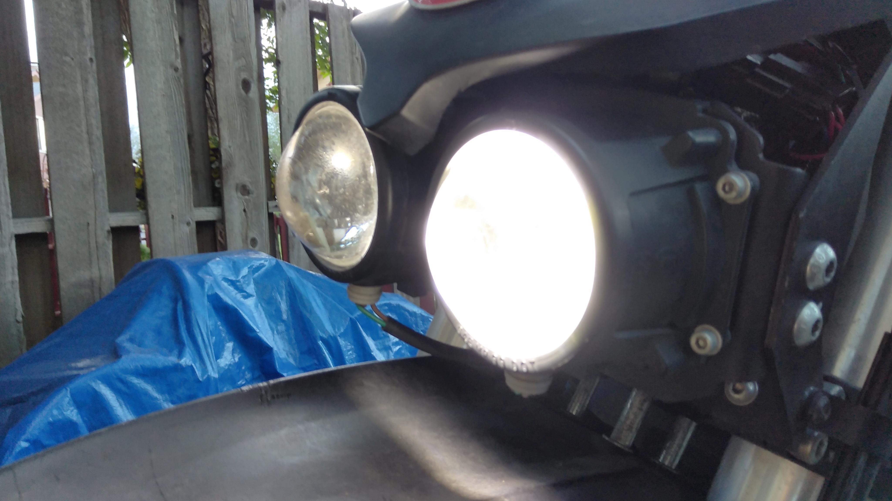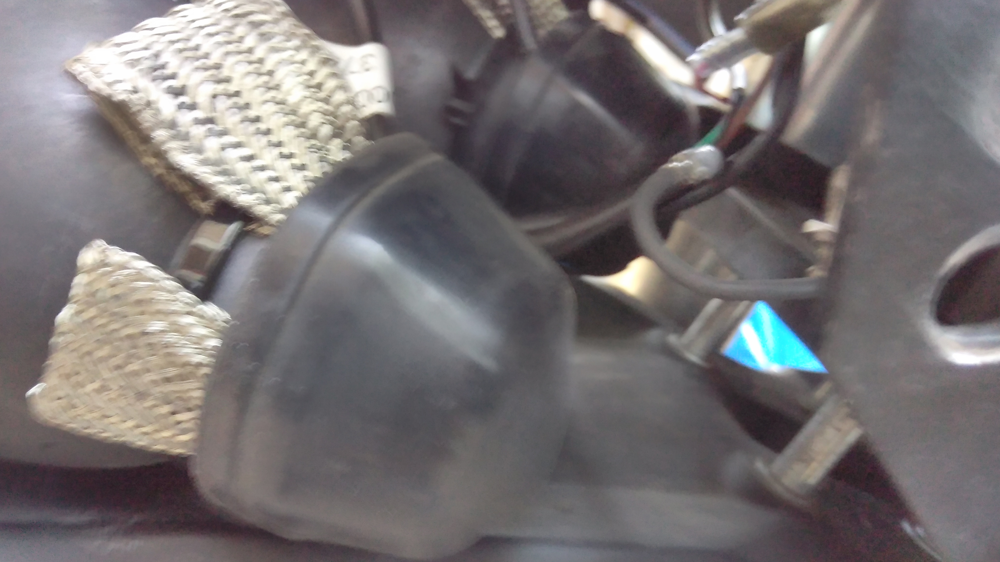

#### Headlamp Running light

**Replacement Specification**

Any W3W or W5W bulb easily swaps.

The license plate bulbs have the same spec but LEDs don't work as well there.

**Instructions**

See [Running Light Replacement](https://web.archive.org/web/2025/https://zeromanual.com/wiki/SDS_Platform/Running_Light_Replacement)

**Options**

- [Sylvania 168/194/2825 LED Premium White Miniature Bulb](https://www.amazon.com/SYLVANIA-2825-Premium-White-Miniature/dp/B00AIJY2ZM)
- [Jtech 6x T10 3W 6 SMD 5630 5730 Super Bright White 194 168 2825 W5W LED Car Lights Bulb](https://www.amazon.com/Jtech-Super-Bright-White-Lights/dp/B00CXGC8RC)
- [194 LED Light bulb, Yorkim® 2015 Newest, 5th Generation, Interior Lights for W5W 194 168 2825 T10 Wedge 5-smd 5050, Replacement and Reverse T10 White Bulbs (Pack of 10)- White](https://www.amazon.com/Yorkim®-Generation-Interior-Replacement-10/dp/B00JRE38EA)
- [T10 W5W 168 194 7.5W High Power Car Signal Tail Turn COB LED Light Lamp Bulb 12V](http://www.ebay.ca/itm/T10-W5W-168-194-7-5W-High-Power-Car-Signal-Tail-Turn-COB-LED-Light-Lamp-Bulb-12V-/371296328299?hash=item5672fc5a6b) which matches the color temperature of LED headlamps.
- [SuperBrightLEDs 194 LED bulb](https://www.superbrightleds.com/moreinfo/miniature-wedge-base/194-led-bulb-w-focusing-lens-10-smd-led-tower-miniature-wedge-retrofit-car/1701/4011/).

A number of LED and HID headlamp replacements are available that fit the Zero. The orientation and direction of the LEDs needs to match the stock headlamp's bulb to get as good a light pattern.

### Running Lights

- [Forum thread about several options](http://electricmotorcycleforum.com/boards/index.php?topic=5119)
- Denali D2 fit confirmed at least with the [Denali Fender Mount Kit For DM Driving Lights](http://www.revzilla.com/motorcycle/denali-fender-mount-kit-for-dm-driving-lights).
- [Forum report of 12W U5 Cree LED spot running lights](http://www.electricmotorcycleforum.com/boards/index.php?topic=4442.0)

### Turn Signals

**2013+**

Type PY10W, similar to 1156, but the side pins are offset by 150 degrees rather than 180.Also called BAU15S or R10W.

The glass is amber (as the lenses are clear) and smaller, since the regular 1156 glass is too big.

AF1 Racing references #AP8127489 as "amber turn signal bulb, staggered pins"

**2009-2012**

Clear 1156 incandescent bulbs, very standard.

#### [Turn Signal Flasher Relay](https://web.archive.org/web/2025/https://zeromanual.com/wiki/Turn_Signal_Flasher)

There are many LED options for replacement; the usual concern is to make sure the LED turn signal has a compensator for the flasher relay.

The Zero stock flasher relay (like most stock relays) changes its frequency/period of flashing based on the resistive load on its circuit, so a compensator adds a resistor which negates the (tiny) efficiency savings.

Better yet, replace the stock flasher with an electronic one.

The orientation is specific:

- Look at the pins with the middle L (load) pin on top.
- The left pin should be B1+ (battery positive) and the right should be E1- (battery negative, maybe "emitter"?).

Many relays are oriented with E-, L, then B+ which will reverse-bias the LED signals so won't light them up.

- Reversing the polarity of the wire-up can make it work.

Many auto parts stores stock a variety of LED specific flashers that are a cheap and simple plug in replacement.

**References**

- [LED turn signal flasher relay](http://www.electricmotorcycleforum.com/boards/index.php?topic=3608) that doesn't need a resistor, with some instructions.
- [WeiserTechnik](http://www.weisertechnik.com/shop/) offers LED turn signals with in-built resistive compensating loads that are known-fits for Zero's models.

For the FX, WeiserTechnik made a [howto video for installing their turn signals](https://www.youtube.com/watch?v=dBiJ_rePbUc) in German with English subtitles that illustrates how to get at everything.

### [Brake Light](https://web.archive.org/web/2025/https://zeromanual.com/wiki/Tail_Light_Flashers)

The stock [tail/brake light](https://web.archive.org/web/2025/https://zeromanual.com/wiki/Tail_Light) assembly is an integrated unit with LEDs.

However, products are available that connects easily into the Zero lighting wiring harness.

These can be installed under the seat behind the [motor controller](https://web.archive.org/web/2025/https://zeromanual.com/wiki/Gen2/Motor_Controller).

**Products**

- [VoloLights](http://vololights.com/)

  This positions itself as a license plate lighting replacement.

  Provides a flashing setting and a riding mode for normal/sport/touring around the license plate.
- [GearBrake Smart Brake Light Module™](http://gearbrake.com/collections/shop/products/gearbrake-smart-brake-light-module) with flashing and non-flashing options.

  [Brake Light Flasher Module](http://gearbrake.com/collections/shop/products/brake-light-flasher-module) without the accelerometer.

  [Support Documents](http://gearbrake.com/pages/support-documents) including FAQ and PDF installation instructions.

  Provides a flashing function or allows regen to trigger the brake light by orienting it so its accelerometer picks up on the deceleration correctly.

  The product page list Zero models up to 2015 model year and will likely be updated for 2016+ when the owner gets to it.

## Seat

### S-Platform Seat

#### [OEM Touring Seat](https://web.archive.org/web/2025/https://zeromanual.com/wiki/SDS_Platform/Zero_Touring_Seat)

As of late 2018, Zero now offers a [touring seat](https://www.zeromotorcycles.com/shop/index.php?main_page=product_info&cPath=15_2&products_id=260) for the 2013+ S/DS/SR/DSR models, priced at $350 USD.

#### [Corbin Seat](https://web.archive.org/web/2025/https://zeromanual.com/wiki/SDS_Platform/Corbin_Seat)

Corbin offers a [gunfighter saddle](http://corbin.com/zero/zero13.shtml) for the 2013+ Zero S/DS/SR/DSR models, priced at $497 USD (base price before customizations).

**Features**

- It offers easier standover height via narrow sculpting in front, and a firm supportive area in back for longer rides.
- The support in back works well for leaning into the wind comfortably and getting one's legs tucked closer to the frame out of the wind.

**Reviews**

Forum thread: [Corbin Seat available for 2013-2016 Zero's now](http://electricmotorcycleforum.com/boards/index.php?topic=5744.0)

#### Bagger Seat

[Bagster](http://http://www.bagster.com/) seems to offer a seat fitment for the Zero SR (2016-2017) in their [configurator](http://maselleconfort.bagster.com/seat_editor_html/index.php?langue=EN).

We have no customer reports yet.

Fitment for a 2016-2017 Zero SR should adapt to 2013-current Zero SDS platform models.

### X-Platform Seat

The [X-Platform Seat](https://web.archive.org/web/2025/https://zeromanual.com/wiki/XMX_Platform/Seat) apparently is an exact match for a Honda CRF 450 for at least the 2005-2007 year range.

One owner reports success getting an [SDG Custom Seat](http://electricmotorcycleforum.com/boards/index.php?topic=6103) by [SDG USA](http://www.sdg-innovations.com/).

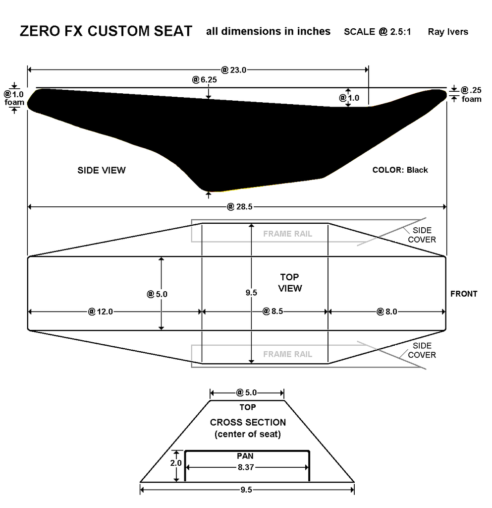
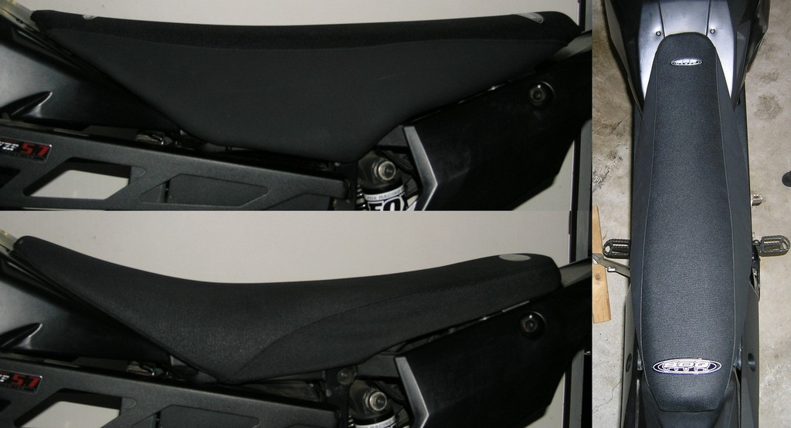

Forum user "odedmaz" reports [a successful fitting of a Honda OEM CRF 450 seat](http://electricmotorcycleforum.com/boards/index.php?topic=6103.msg59796#msg59796) after adjusting fasteners:

| | | |
| --- | --- | --- |
| 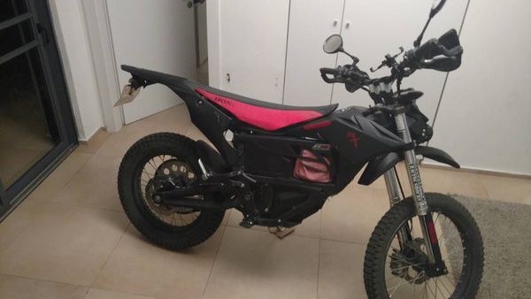 | 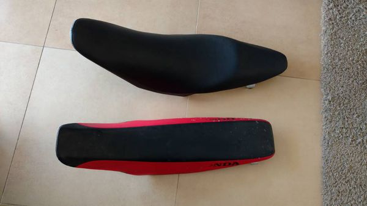 | 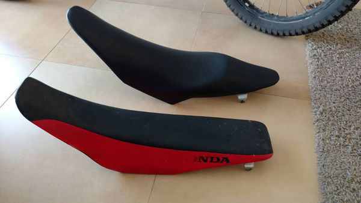 |

| | |
| --- | --- |
| 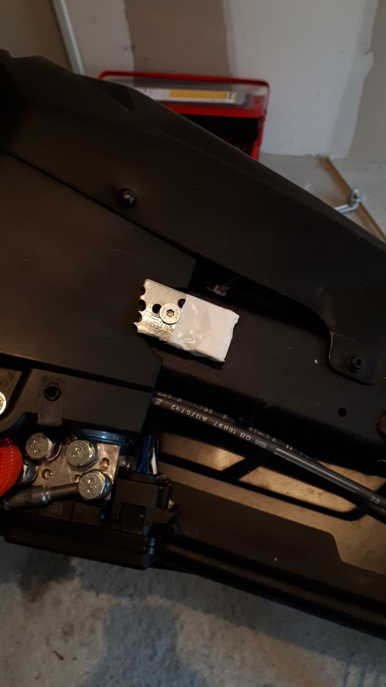 *X-platform seat fastener* | - The front fastener on the bike needs to be longer in the backward direction.     A metal plate can be used to replace the original washer.   - The two rubber bumpers under the CRF seat have to be removed.   - Two M8 nuts have to be welded on each CRF's seat's braket to be able to fit the original screws. |

**A pre-2013 Corbin low Zero seat can be fitted with minor mods:**

The stock bracket from the newer seat was attached to flat stock which was then bolted to the rearmost holes on the Corbin. The added support piece is a flat bar pop-riveted to the pan with a 1/2"x1" strip of hard rubber glued on.

| | |
| --- | --- |
| 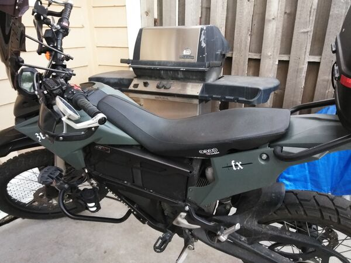 | 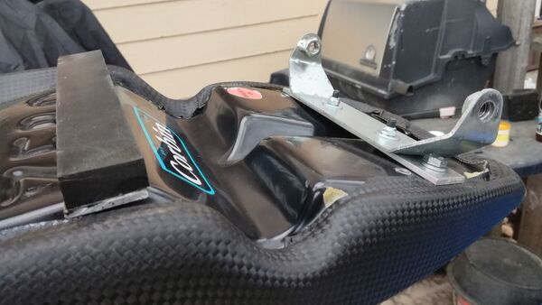 |

## Braking

### 2013 Rear Brake Upgrade

Zero offers a [2013 rear brake upgrade kit](http://www.zeromotorcycles.com/shop/index.php?main_page=product_info&cPath=15_6&products_id=211) to retrofit the more effective J Juan model on 2014 models.

### Parking Brake

**Brake lever locks**

Zero offers a [brake lever lock](http://www.zeromotorcycles.com/shop/index.php?main_page=product_info&cPath=15_4&products_id=205) for a basic parking brake.

This is a cheap solution but can strain the hydraulic system over time, and has been known to slip in hot weather.

It appears to be a branded version of a part available through other sites at comparable prices.

[The Grip-Lock](http://lockitt.com/LeverLocks.htm) is similar, but features more as a simple security device and is a little more expensive.

**OEM Parking Brake**

As of mid-2017, Zero offers an [integrated parking brake](http://www.zeromotorcycles.com/shop/index.php?main_page=product_info&cPath=15_4&products_id=243) for the rear brake system for 2014+ models.

Dealers report that they can order it, but installations are not confirmed yet.

**Maintenance**

The cable does represent a low-frequency maintenance task - cables on motorcycles should be periodically (yearly?) oiled and adjusted; the manual does have recommendations on this.

**Compatibility**

J Juan lists [a parking brake product](http://jjuan.es/by-product-type/parking-brake/?lang=en) which is likely the same thing since Zero's brake systems are sourced from them.

This implies that the Zero parking brake is compatible with 2015+ models (and 2014 S-platform models) (although the part numbers vary probably per rear brake disc diameter).

Fit against previous year models is unconfirmed, but physically the 2014+ models with the J Juan "240 x 4.5 mm disc" (and 2013 models that have received the rear brake upgrade) might work with it.

## Handlebars

Handlebars work if they fit the [handlebar](https://web.archive.org/web/2025/https://zeromanual.com/wiki/Handlebar) measurements through the middle, but require drilling to fit the switchgear anchoring. See the manual section.

### [Mirrors](https://web.archive.org/web/2025/https://zeromanual.com/wiki/Aftermarket/Mirrors)

The [Mirrors](https://web.archive.org/web/2025/https://zeromanual.com/wiki/Mirrors) are fitted Ducati/Yamaha style.

See the Mirrors manual entry for thread specifications if in doubt.

**See Also**

[Common Modifications' Third-Party Mirrors entry](Common_Modifications.md#Third-Party_Mirrors "Common Modifications") for found fitments.

[Aftermarket/Bar End Mirrors](https://web.archive.org/web/2025/https://zeromanual.com/wiki/Aftermarket/Bar_End_Mirrors)

**Vendor Support**

- [Moto Science lists some specific options for Zero](https://moto-science.com/collections/zero-motorcycle-mirrors)

### [Bar End Mirrors](https://web.archive.org/web/2025/https://zeromanual.com/wiki/Aftermarket/Bar_End_Mirrors)

Bar end mirrors (like [Bar Ends](https://web.archive.org/web/2025/https://zeromanual.com/wiki/Aftermarket/Bar_Ends)) work if they fit the [handlebar](https://web.archive.org/web/2025/https://zeromanual.com/wiki/Handlebar) ends:

**Outer diameter**

7/8" (22mm)

**Inner diameter**

5/8" (14mm)

**See Also**

[Common Modifications' Bar-End Mirrors entry](Common_Modifications.md#Bar-End_Mirrors "Common Modifications")

### [Bar Ends](https://web.archive.org/web/2025/https://zeromanual.com/wiki/Aftermarket/Bar_Ends)

Bar ends (like [Bar End Mirrors](https://web.archive.org/web/2025/https://zeromanual.com/wiki/Aftermarket/Bar_End_Mirrors)) work if they fit the [handlebar](https://web.archive.org/web/2025/https://zeromanual.com/wiki/Handlebar) ends:

**Outer diameter**

7/8" (22mm)

**Inner diameter**

5/8" (14mm)

## Controls

### Throttle

2012-2014 models are wired for a potentiometer throttle and can accept a Domino throttle to replace the stock Magura throttle.

- See the [Advanced Modifications section](Advanced_Modifications.md#Throttle_Upgrade "Advanced Modifications") for details.

### [Throttle Lock](https://web.archive.org/web/2025/https://zeromanual.com/wiki/Aftermarket/Throttle_Lock)

A throttle lock applies friction to the throttle handle to hold power demand to a specific level, as opposed to a cruise control that targets a given *speed*.

For complicated reasons, typical motorcycle throttle locks have a tricky adaptation to the Zero.

See our [Common Modifications section on throttle locks](Common_Modifications.md#Throttle_Lock "Common Modifications") for a comparison.

#### [Atlas Throttle Lock](https://www.atlasthrottlelock.com/products/zero-motorcycles-atlas-throttle-lock)

Atlas officially supports all Zero models with their throttle lock that sits on the inside of the throttle grip.

- They recommend only the Top Kit for the S and SR models because the handlebars get close to the tank plastics at full rotation.
- DS/DSR/FX/FXS models seem to be able to accommodate both the Top Kit and the Bottom Kit; check the page for how to decide between them.
- **NOTE:** The original version (before top and bottom mounts were distinguished) was thinner and easier to fit.

  [Some have reported](https://www.facebook.com/groups/zmcowners/permalink/1708192532583281/) using a fine amount of milling to fit the Magura throttle on 2013-2014 models, and even for later model years.

#### Kaoko Throttle Stabilizers

Kaoko does not offer an official fitment for Zero motorcycles, but the inner bar diameter is 14mm and at least one model has been confirmed to work.

**Reviews**

- [Kaoko throttle lock - this is the 14mm ID bar version with CRG mirror mounts for Ducati's (KAO.DUC105CRG)](https://www.facebook.com/groups/zmcowners/permalink/1797109113691622/)

### Brake Levers

#### Right Lever

Zero brake lever fit is generally unconfirmed, but the fit changes with the front brake systems, so 2013-2014 models have a different fit than 2015-2016 models.

The lever fit for a 1990-1999 Suzuki DR350SE is confirmed against a 2014 FX per [this facebook comment thread](https://www.facebook.com/groups/zmcowners/permalink/1149824368420103/?comment_id=1149915345077672&comment_tracking=%7B%22tn%22%3A%22R5%22%7D).

**Master Cylinder Replacement**

One strategy is to replace the assembly around the handbrake. Searching for *7/8" master cylinder kit* can yield some options (reported for a 2011 model).

#### Left Lever

**[TacticaMindz Rear Handbrake Kit](https://www.tacticalmindz.com/products/dual-fitting-rear-hand-brake-kit)**

- The TacticalMindz Basic kit works to replace foot-actuated rear brake with hand-actuated and has been confirmed to work on 2014 SR.
- Their Pro kit has a T connection, the foot and hand brake both activate the rear brake.
- However, left hand does not activate taillight in this configuration without additional trigger.

## Drivetrain

### Gearing

Zero offers a [Higher Speed Gearing Option](http://www.zeromotorcycles.com/shop/index.php?main_page=product_info&cPath=15_6&products_id=181) for the 2013 S and DS bikes:

"Converts from original gearing of 132/28 (95 mph, 321 ft-lbs) to 98/25 (107 mph, 267 ft-lbs). Kit consists of a 98T wheel sprocket, 25T motor sprocket and 200T belt."

There was a higher torque option but it's apparently discontinued.

**Resources**

[Zero FX Gearing calculator](http://john.rushworth.com/Zero_FX_Gearing.html)

### [Chain Kit](https://web.archive.org/web/2025/https://zeromanual.com/wiki/Chain_Kit)

Zero offers some chain kit options that include front and rear sprockets and a 520 DID X-ring chain.

- [Enhanced Chain Kit for FX/FXS models](http://www.zeromotorcycles.com/shop/index.php?main_page=product_info&cPath=15_6&products_id=192) across all 2013+ years.
- For 2017 models, a chain conversion kit is referenced as part 10-08127 (unconfirmed).

**Motivation**

[Chain vs belt comparison](http://electricmotorcycleforum.com/boards/index.php?topic=5439)

**Maintenance**

- Motorcycle chain drives are common, so generic maintenance can be quite effective:
  - [Love Your Chain: Top Maintenance Tips by Bennetts](https://www.bennetts.co.uk/bikesocial/news-and-views/advice/biking-tips/love-your-chain)
  - [How to Clean and Lube A Motorcycle Chain by Revzilla](https://www.revzilla.com/common-tread/how-to-clean-and-lube-a-motorcycle-chain)
- There's some vague agreement that for chain slack, 0.8-1.2in of deflection is appropriate.

  Chains tend to loosen as they wear, so a little tighter at the start is somewhat helpful.

  Zero's swingarm pivot is concentric/aligned with the motor shaft and countersprocket, so there's no need to check for tension changes as the swingarm squats.
- Zero's kit chain does not have O-rings, and many prefer a chain with O-rings for longer lifespan and quieter and smoother operation, so changing the chain is recommendable.

**References**

- [Chain Kit Slack](https://www.electricmotorcycleforum.com/boards/index.php?topic=9714)

#### [Install](https://web.archive.org/web/2025/https://zeromanual.com/wiki/Chain_Kit_Install)

**Overview**

This replaces the [Drive Belt](https://web.archive.org/web/2025/https://zeromanual.com/wiki/Drive_Belt) with a chain.

This installs a chain guide on the underside of the [swingarm](https://web.archive.org/web/2025/https://zeromanual.com/wiki/Gen2/Swingarm).

This replaces the pulley sprockets with toothed sprockets.

**Video Guide**

- [Zero FX/FXS Chain Kit Install](https://www.youtube.com/watch?v=_jfXixlzbf0) by [Greg Hassler on Youtube](https://www.youtube.com/user/cecilT77)

**Tools**

- [Center lift](https://web.archive.org/web/2025/https://zeromanual.com/wiki/Lift).
- 27mm socket for the rear axle nut.
- 3mm Allen key.
- 10mm Allen key socket

  Ensure at least 1" depth and a ⅜" drive sufficient to handle swingarm pivot bolt torques.
- 15mm socket wrench (S models).
- 13mm socket wrench (X models).
- Torque wrench capable of setting 75ft-lbs and driving the 27mm socket and 10mm Allen key.
- 2012-2013:
  - 2.5mm Allen key.
  - 24mm socket wrench.
- (2013-2017?) 6mm Allen key and wrench to remove the rear sprocket pulley from the rear wheel.
- (2018?) T45 Torx bit and wrench to remove the rear sprocket pulley from the rear wheel.

**Prerequisites**

1. [Remove the rear wheel](https://web.archive.org/web/2025/https://zeromanual.com/wiki/Rear_Wheel_Removal).
2. [Remove the swingarm](https://web.archive.org/web/2025/https://zeromanual.com/wiki/Swingarm_Removal).

**Recommendations**

- For any chain fitment, wait until running the chain over the sprockets (and probably through the guide) before unlinking the chain and fitting a master link for its final length.

  Any mistakes in length estimation require more chain tool use which is just adding risk.

**Steps**

- | | |
  | --- | --- |
  |   **Disclaimer:** | TBD, but the OEM should supply instructions |

**References**

- [OEM install instructions posted](http://electricmotorcycleforum.com/boards/index.php?topic=5973)

### Fat Belt Kit

[Luna Cycle](https://www.lunacycle.com) offers a [a fat belt kit, a belt and two sprockets.](https://lunacycle.com/zero-motorcycle-wide-belt-sprocket-conversion-kit/) for 2013-2016 Zero FX, DS, SR and DSR.

### Emergency Belt Kit

A generic lower-rated rubber belt has been made in a production batch for Zero owners to match the 11mm pre-2017 Zero belt.

**Reference**

Forum thread: [Emergency belt kit!](http://electricmotorcycleforum.com/boards/index.php?topic=6590.0)

[EBay posting](http://www.ebay.com/itm/Emergency-belt-for-Zero-electric-motorcycle-/282340261998?viewitem=&item=282340261998&vxp=mtr&nma=true&si=MmUhZzjilEtZF0z6rQPWabFi4hg%253D&orig_cvip=true)

EBay account: [odedmaz](http://www.ebay.com/usr/odedmaz?_trksid=p2047675.l2559)

**Installation**

This requires removing and replacing the stock belt, in any case, but the idea is to avoid a roadside repair.

1. Remove the Belt

   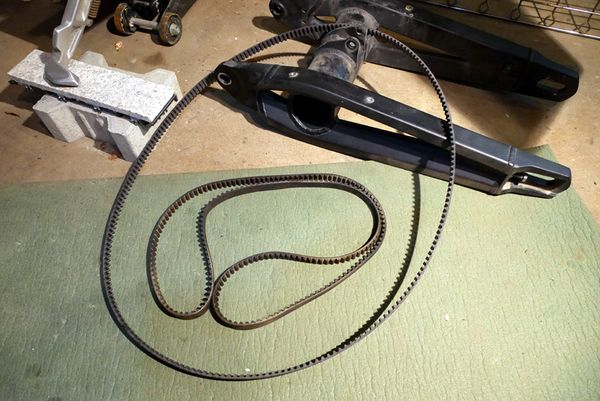 *Emergency belt (bent) compared to the stock belt*
2. Mount/coil the Emergency belt around the motor.

   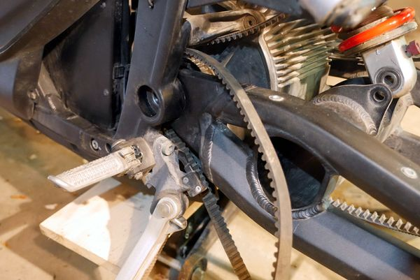 *Coiled around the motor*
3. Fasten the Emergency belt securely so it's available while riding without removing the front sprocket on the road.

   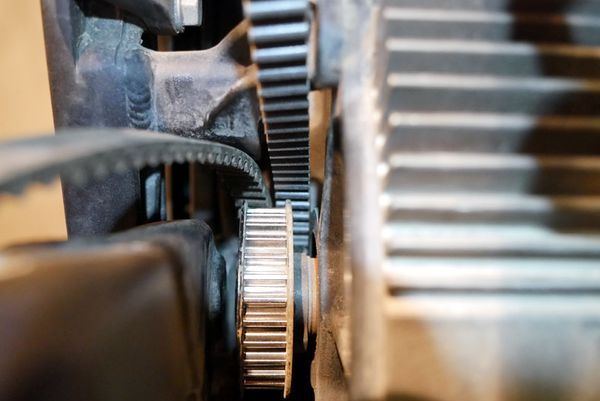 *Fastened*
4. Replace the stock belt

   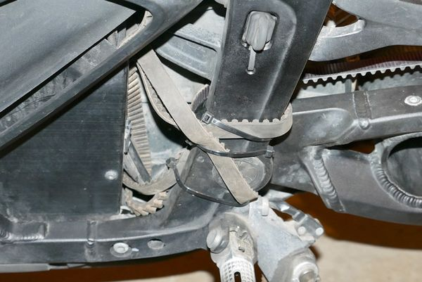 *Replace the stock belt*

**Usage**

When/if your OEM belt breaks:

1. Loosen the rear axle.
2. Unfasten and uncoil this emergency belt.
3. Loop the emergency belt around the front and rear sprockets.
4. Tighten the rear axle.
5. Ride *carefully* at low torques and speeds to home or your dealer for a real belt replacement.

## Suspension

Zero offers a [Fox rear shock upgrade](http://www.zeromotorcycles.com/shop/index.php?main_page=product_info&cPath=15_6&products_id=120) for the 2013-2014 Zero FX models.

Report your suspension upgrades here.

### Suspension Tuning

Many recommend a professional [suspension tuning](http://www.motorcyclistonline.com/how-to/adjusting-motorcycle-suspension-click-click-street-savvy) job, reporting it accomplishes a lot with the stock suspension, and should be attempted before investigating replacement options.

At the very least, learning to tune your suspension yourself will make the bike more suitable for your local road conditions and loading. The rear shock preload is easily adjustable and worth dialing up or down switching to or from 2-up riding or carrying a luggage load.

### Rear Shock

(see also [Rear Shock Specifications](https://web.archive.org/web/2025/https://zeromanual.com/wiki/Rear_Shock_Specifications) )

**[Hollywood Electrics](https://web.archive.org/web/2025/https://zeromanual.com/wiki/Hollywood_Electrics)**

[Penske Shock](https://hollywoodelectrics.com/product/penske-shock/) (contact for details)

2015+ models seem to be supported now

2013/2014 shocks are ~$850 from Penske.

They're certainly able to answer customization questions.

**[Ikon Shocks USA](https://www.ikonshocksusa.com/)**

An Ikon Shocks representative [indicates they've made a Zero-appropriate rear shock for a 2016 FXS](http://electricmotorcycleforum.com/boards/index.php?topic=6640.msg53027#msg53027) that can be ordered.

It should be appropriate for 2015 year model onwards, but ask in any case if interested.

Ikon also makes a rear shock for the S and SR "This model fits: ZERO S Series Motorcycles 2015 and later."

Ikon's shock for the 2013/2014 S has a spring that is too wide to fit properly.

[3610-ZERO-S Shock Absorber ~$650](https://www.ikonshocksusa.com/products/3610-zero-s-shock-absorber?variant=28622432206908)

**Wilbers**

They offer a rear shock upgrade for the 2013-2014 S and SR models. [Shock absorber Type 640 Road ~$450](https://www.wilbers-shop.de/en/Motorcycle/Zero-Motorcycles/Zero-S-Z1-M5/Shock-absorber-Type-640-Road.html?manufacturer=amu5e4136ae98d5a8327b54d6aadf5d7&year=2014&catname=ce486575cff2b6ffcc426f00ff9e98cb)

**[JRI Shocks, Double Adjustable](http://www.jrishocks.com/shop/powersports/double-adjustable/)**

[Confirmed working](http://electricmotorcycleforum.com/boards/index.php?topic=6936) on a 2014 Zero SR, albeit with a custom spacer from Hollywood Electrics.

**[Sunny 10 1/4" 260MM Pit Dirt Bike Motorcycle ATV Suspension Air Shock Absorber](https://www.amazon.com/Sunny-260MM-Motorcycle-Suspension-Absorber/dp/B01DXOL4PE/)**

[via Facebook report](https://www.facebook.com/groups/447979811998807/permalink/1019781808151935/?comment_id=1019839008146215&reply_comment_id=1019944354802347&comment_tracking=%7B%22tn%22%3A%22R0%22%7D): "It's bigger, but don't have the same adjustment capabilities. I needed to install it upside down and grind ~1mm of the width down to get it to sit in there comfortably." It works as a $100 bandaid until a quality shock can be installed.

**[ZXTDR Rear Shock Absorber Suspension Sensa-Trac Load Adjusting for Dirt Pit Bike Motorcycle 1200LBS (260mm 10.2*)*](https://www.amazon.com/gp/product/B074J3X2P5/ref=ppx_yo_dt_b_asin_title_o00_s00?ie=UTF8&psc=1)**

This shock physically fits the 2013 S, but the 1200lb spring is too far off spec. This is another short term $30 "fix" while you wait for a proper shock to be built.

### Lowering Kit

[Mizu (german)](https://www.mizu-shop.de/en/motorbike-parts/chassis-technology/lowering-kits/?modelAttributeFilter%5Boxhersteller%5D=ZERO&modelAttributeFilter%5Boxhubraum%5D=&modelAttributeFilter%5Boxmodell%5D=&modelAttributeFilter%5Boxbaujahr%5D=) offers a [lowering kit for 2015+ Zero DS and DSR range](https://www.mizu-shop.de/en/motorbike-parts/chassis-technology/lowering-kits/MIZU-lowering-kit-30215012.html).

Fitment not confirmed yet by an owner.

### Front Forks

**[Hollywood Electrics](https://web.archive.org/web/2025/https://zeromanual.com/wiki/Hollywood_Electrics)**

[GP Suspension Fork Cartridge Kit](https://hollywoodelectrics.com/product/gp-suspension-fork-cartridge-kit/) for track-oriented riding.

**Wilbers**

[Wilbers Forkspring Kit](https://www.wilbers-shop.de/en/Motorcycle/Zero-Motorcycles/Zero-S-Z1-M5/Wilbers-Forkspring-Kit.html?manufacturer=amu5e4136ae98d5a8327b54d6aadf5d7&year=2014&catname=ce486575cff2b6ffcc426f00ff9e98cb) for 2013+ S/SR models.

#### Fork Sliders

**Notes by User:Gmanfr8dog**

- Recently bought front fork slider from Revzilla. Because there was no Zero fitment listed I ordered [R&G fork sliders for the 2017-2019 Kawasaki Z900](https://www.revzilla.com/motorcycle/rg-racing-front-axle-sliders-kawasaki-z900-2017) (Part #FP0194BK) for my Zero SR 2019.

  They fit right out of the box.

  The only modification I made was to add extra washer to one side to keep the bolt from sticking out beyond the end of the slider.

## Security

Zeros are not yet widely attractive targets for theft because of limited numbers and specialized parts, but local circumstances can make it a risk.

### Secure Power Supply

Wire in an always-on power supply by tapping the always-on DC-DC converter's input, and use a switching power supply to convert the battery DC voltage there to 12V or 5V to power a location-tracking device or alarm.

### Disc Lock

[Perfect Alarm Disc Lock for Zero bikes](http://electricmotorcycleforum.com/boards/index.php?topic=6797.0) recommends an [Urban UR-10 lock](http://www.urbansecurityusa.com/urban-ur10-alarm-disc-lock/ProductListItem2_i9zhqi1t1182_2/Urban-UR10-Alarm-Disc-Lock) with an [Artago 30X Alarm Disc Lock Support Kit](http://www.artagosecureusa.com/online-store-security-solutions-/Artago-30X-Alarm-Disc-Lock-Support-Kit-for-Sport-Bikes-p69933077) which can mounts the lock while riding behind the rider's left leg, after a little sanding to fit the Zero frame.

## Misc

### Motorcycle Covers

**Confirmed Fits**

[Dowco Guardian Hi-Viz in size Large](http://electricmotorcycleforum.com/boards/index.php?topic=6925.msg56628#msg56628) for a 2016 DSR with OEM top and side cases.

Size medium should fit Zero bikes without cases or an FX/FXS.

**Discussions**

[Has anyone found a bike cover that they liked?](https://www.facebook.com/groups/zmcowners/permalink/1304326899636515/) (popup shelter suggestions)

[Anyone know the best size cover to get with saddle bags and top box?](https://www.facebook.com/groups/zmcowners/permalink/1215892448479961/)

### Dash/Handlebar Mounts

For your phone, tablet, or GPS device:

- [Zero Smartphone mount by RAM](http://www.zeromotorcycles.com/shop/index.php?main_page=product_info&cPath=15_7&products_id=184)
- [RAM mount](http://www.rammount.com/) has a full catalog of options and ways of figuring out a mount structure.

[Patrick Truchon's handlebar accessories are worth considering](http://ptruchon.pagekite.me/wiki/zerodsmods#handlebar_accessories):

- RAM handlebar base with U-bolt (fits 0.5-1.12" bar).
- Double-socket arm for 1" ball mount.
- RAM X-Grip holder.
- [Incredibell](http://www.mec.ca/product/4002-158/mirrycle-incredibell-micro-cycling-bell/) for low-speed interactions with cyclists and pedestrians, because the Zero makes no noise and the horn would be too alarming.

### Regular maintenance

#### Belt tension measurement

- OEM recommended belt tension meter GATES KRIKIT I V-BELT TENSION GAUGE is listed on Amazon retailer as a [Gates 91107 Belt Tension Tester](https://www.amazon.com/gp/product/B000MUTAGS) ($12 usd).
- [Krikit modification/hack](http://electricmotorcycleforum.com/boards/index.php?topic=6180.0) to make it easier to read:
  1. Place a straight edge perpendicular to the scale at 25kg, which is middle of the range.

     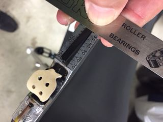
  2. Push needle up until it touches straight edge.

     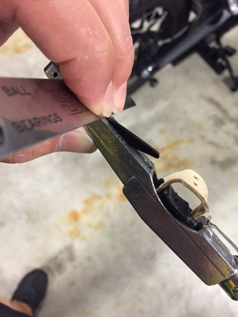
  3. Carefully scribe a line on the side of the needle.

     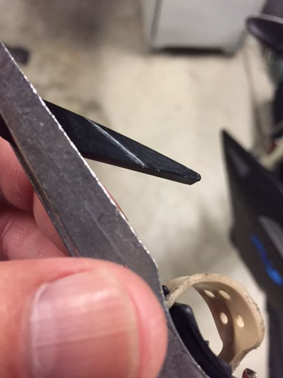
  4. Wipe some white paint into the line you scribed.

     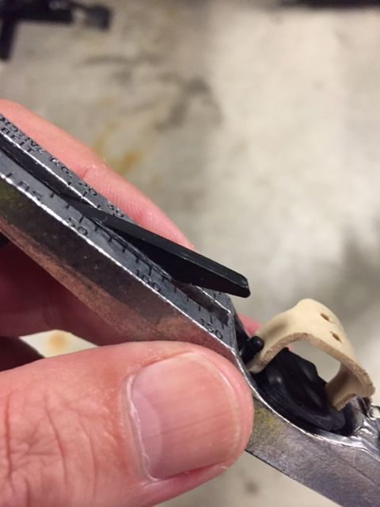

     Now it is easier to see when you have achieved the correct tension when the line is parallel to the scale.

### Diagnostics

#### OBD-II Diagnostics

##### [MBB Console](https://web.archive.org/web/2025/https://zeromanual.com/wiki/MBB_Console) via [Diginow Reaper Dongle](https://web.archive.org/web/2025/https://zeromanual.com/wiki/DigiNow_Data_Reaper_Dongle)

[DigiNow](https://web.archive.org/web/2025/https://zeromanual.com/wiki/DigiNow)'s plug-in product for bridging the OBD-II console interface to the MBB over Bluetooth.

**Product Page**

[DigiNow Reaper Dongle](http://diginow.it/zero-motorcycle-OBDII-Dongle.php)

[Product page at Hollywood Electrics](https://hollywoodelectrics.com/product/diginow-data-reaper-dongle/).

[documentation including terminal software that works with the reaper](http://riaevangelist.github.io/DigiNow-Bluetooth-Diagnostics-For-Zero-Motorcycles/)

**Features**

This dongle attaches to the OBD-II port (above the motor for pre-2015 model years, and under the seat for 2016) and offers a bluetooth serial port profile interface that connects to the [Main Bike Board](https://web.archive.org/web/2025/https://zeromanual.com/wiki/Main_Bike_Board).

**NOTE:** Connect it directly to the port and not via an extension cable, since it derives power from the very delicate 3.3V MBB circuit to drive its antenna, which any cable seems to attenuate too much.

2017+ models do **NOT** support a Bluetooth dongle because the minor power supply on pin 12 was unwired for that year onwards.

A USB connection should work.

It currently uses [Bluetooth](https://en.wikipedia.org/wiki/Bluetooth)'s [Serial Port Profile](https://en.wikipedia.org/wiki/List_of_Bluetooth_profiles#Serial_Port_Profile_.28SPP.29) instead of Bluetooth Low Energy (which can handle serial in a custom service) but does mean that iOS can't interact with the current shipping version.

**Video Guide**

- [DigiNow - OBDII Cable and Bluetooth Demo for Zero motorcycles](https://www.youtube.com/watch?v=SzuX6eySeoY) by [DigiNow](https://web.archive.org/web/2025/https://zeromanual.com/wiki/DigiNow) on YouTube:

##### CANBUS access

Some success decoding CANBUS signals from the OBD-II [is reported](http://electricmotorcycleforum.com/boards/index.php?topic=6809.0).

##### [ECMCables.com OBD-II Diagnostic Products](https://web.archive.org/web/2025/https://zeromanual.com/wiki/ECMCables)

ECMCables.com has a history making diagnostics Cables and Wireless Dongles for Buell & Harley-Davidson Motorcycles and has successfully launched and is currently marketing functionally similar products for Zero.

All products are made in North America and sold exclusively by ECMCables.com and or it's authorized Agents.

[ECMCables.com online shop](https://shop.ecmcables.com/)

**[ECMCables.com OBDLINK USB Cable](https://web.archive.org/web/2025/https://zeromanual.com/wiki/ECMCables/OBDLINK_USB_Cable)**

| | |
| --- | --- |
|   **Warning:** | This content was authored by the vendor themselves and as such constitutes a commercial self-promotion under review. |

[ECMCables](https://web.archive.org/web/2025/https://zeromanual.com/wiki/ECMCables)'s plug-in product for bridging the OBD-II console interface (exposed port) over a USB cable to connected computing devices such as PCs, Labtops, Notebooks, Tablets, SmartPhones and a variety of other commercially available or proprietary hand held devices.

**Product Page**

[ECMCables.com OBDLINK USB Cable](https://shop.ecmcables.com/tuning-cables/Zero-Cables)

[Buy Direct](https://shop.ecmcables.com/tuning-cables/Zero-Cables/Diagnostics-USB-Cable-for-ZERO-Motorcycles)

[Available on Ebay](https://www.ebay.com/itm/162891521071)

[Available on Amazon](https://www.amazon.com/OBDLINK-Diagnostics-Cable-ZERO-Motorcycles/dp/B079MH5R6K)

**Features**

OBDLink MBB Spy/Diagnostics USB Cable for ZERO Motorcycles

NEW ZERO Motorcycle MBB-ECU Spy/Diagnostic USB Cable. Fully Waterproof OBD-II Connector end w/ Higly Visible LEDs at USB end; indicates Power On & Serial Bridge Active.

Our OBDLink MBB Spy/Diagnostics USB Cable is designed to connect ZERO Motorcycles to a PC or other Smart Device for Diagnostic purposes. Our design implements a "Shielded Cable" solution to combat both EMI and extraneous power surge interference that affect unshielded cable conductors in high-noise (electrical interference) MBB/ECU Diagnostic and Tuning environments. Combining this Shielded ECM cable with freely available Serial Terminal Software provides a higher degree of accuracy when optimizing ZERO Motorcycles.

OBDLINK USB Cable cable attaches to the OBD-II port and offers a serial port interface with the [Main Bike Board](https://web.archive.org/web/2025/https://zeromanual.com/wiki/Main_Bike_Board).

Our EAS™ technology based products have been designed and tested for real-world applications; specifically in harsh environments, rugged & extreme conditions regardless of where they’re being deployed.

Serial Terminal Software is freely available on the internet, and or sold separately. No Software is included with this product. Refer to zeromanual.com website for more details. This version is compatible with Microsoft Windows XP/Vista/Win7/8/8.1/10, Android devices, iOS, MAC, and Linux OS's with supporing free driver/app installed.

- OBDLINK MBB Spy/Diagnostics USB Cable for ZERO Motorcycles for 2013-2018 All Models
- Includes Proprietary EAS™ Technology; Virtually Indestructible IP68 - Use any Free or Commercial Serial Terminal Application or Device App.
- Fully Encasuplated OBD-II Connector - Hard-Hat Tough Overmolded Electronics - Module withstands Heat, Moisture, Oils, Corrosive Fuels, Solvents and Dilute Acids
- Optimize Performance - Real Time View & Change Settings, Run Diagnostics, View Trouble Codes, Reset Battery Params
- NEW - Includes Embedded (CLEAR) Prolific USB Module w/ SHORE 75D Overmold Processed ODB-II, 90 Day Limited Warranty

**[ECMCables.com OBDDROID Bluetooth Dongle](https://web.archive.org/web/2025/https://zeromanual.com/wiki/ECMCables/OBDDROID_Bluetooth_Dongle)**

| | |
| --- | --- |
|   **Warning:** | This content was authored by the vendor themselves and as such constitutes a commercial self-promotion under review. |

[ECMCables](https://web.archive.org/web/2025/https://zeromanual.com/wiki/ECMCables)'s plug-in product for wirelessly bridging the OBD-II console interface (exposed port) over Bluetooth to (paired) connected computing devices such as PCs, Labtops, Notebooks, Tablets, SmartPhones and a variety of other commercially available or proprietary hand held devices (for all 2013-2016 Zero Models).

**Product Page**

[ECMCables.com OBDDROID Bluetooth Dongle](https://shop.ecmcables.com/wireless-tuning/wireless-tuning-zero)

[Buy Direct](https://shop.ecmcables.com/wireless-tuning/wireless-tuning-zero/Zero-Motorcycle-2013-2016-Tuning-OBDII-to-Bluetooth-Diagnostics-Device)

[Available on Ebay](https://www.ebay.com/itm/162891492933)

[Available on Amazon](https://www.amazon.com/OBDDROID-Bluetooth-Diagnostics-Device-MBB-ECU/dp/B079MD441Z)

**Features**

OBDDROID Bluetooth Diagnostics Device for ZERO MBB-ECU 2013 to 2016 All Models

NEW ZERO Motorcycle MBB-ECU Diagnostic Dongle - Fully Waterproof OBDdroid Wireless Diagnostics Dongle with Forward Facing & Highly Visible LEDs; indicates Power On, Paring Status & Heartbeat. Includes proprietary EAS™ Technology & Protection Class IP68 Rated Compliance

Our OBDDROID Bluetooth Diagnostics Dongle is designed to connect ZERO Motorcycles to a PC or Android Device for Diagnostic purposes. Our design incorporates an outward facing Antenna, strategically located furthest from the MBB-ECU. Fully Visible Blue LED indicate power and pairing status. When the unit is powered up, a distinctive Blue LED will be discreetly visible. Fast intermittent flashing indicates Pairing mode, seeking a Bluetooth Master Device (ie Smart Phone, Tablet, PC). When paired, the Blue LED flashes twice in succession, followed by a several second pause, similar to a heart-beat pattern.

OBDDROID Bluetooth Dongle attaches to the OBD-II port and offers a wireless serial port interface with the [Main Bike Board](https://web.archive.org/web/2025/https://zeromanual.com/wiki/Main_Bike_Board).

Our EAS™ technology based products have been designed and tested for real-world applications; specifically in harsh environments, rugged & extreme conditions regardless of where they’re being deployed.

Serial Terminal Software is freely available on the internet, and or sold separately. No Software is included with this product. Refer to zeromanual.com website for more details. This version is compatible with Microsoft Windows XP/Vista/Win7/8/8.1/10, Android devices, iOS, MAC, and Linux OS's with supporing free driver/app installed.

- OBDdroid ZERO Motocycle Bluetooth Diagnostics Dongle for 2013-2016 ZERO All Models
- Includes Proprietary EAS™ Technology; Virtually Indestructible IP68 - Use any Free or Commercial Serial Terminal Application or Device App.
- Fully Encasuplated OBD-II Connector - Hard-Hat Tough Overmolded Electronics - Module withstands Heat, Moisture, Oils, Corrosive Fuels, Solvents and Dilute Acids
- Optimize Performance - Real Time View & Change Settings, Run Diagnostics, View Trouble Codes, Reset Battery Params
- NEW - Includes Embedded (CLEAR) Prolific USB Module w/ SHORE 75D Overmold Processed ODB-II, 90 Day Limited Warranty

#### Electrical Measurements

**[Cycle Analyst](http://www.ebikes.ca/product-info/cycle-analyst.html)**

This allows data logging of a variety of parameters tracking voltage, current, and regen for trips.

See this [Cycle Analyst install howto](http://electricmotorcycleforum.com/boards/index.php?topic=4424.msg28658#msg28658).

