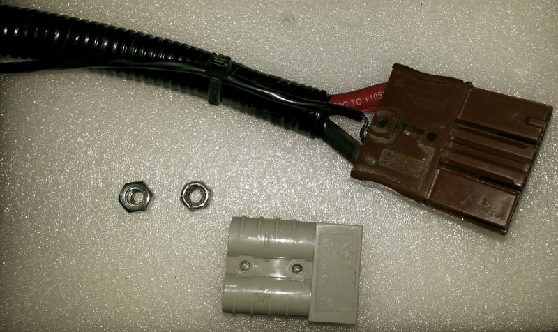
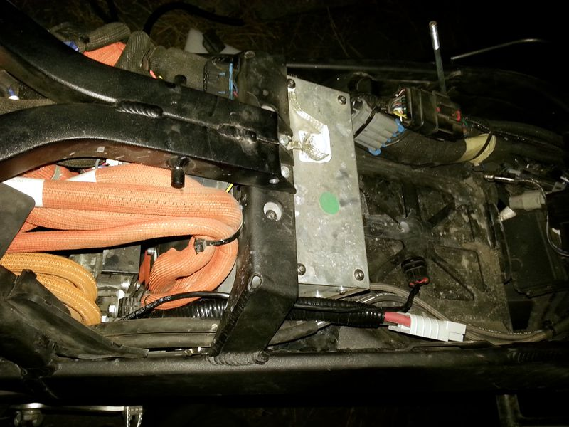
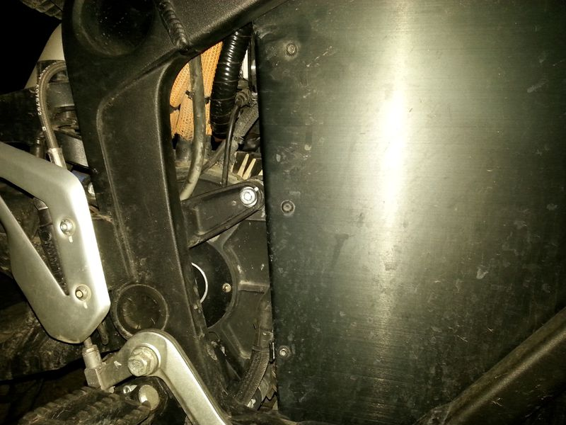
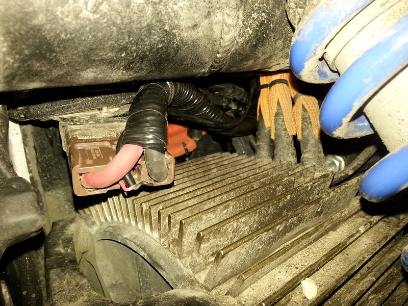
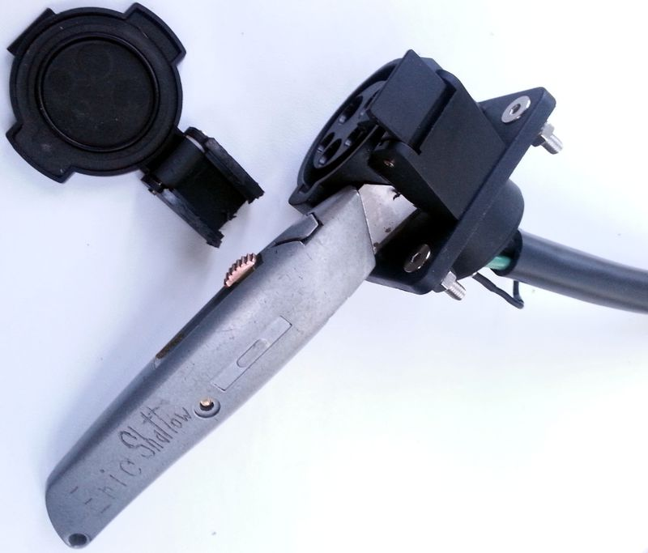
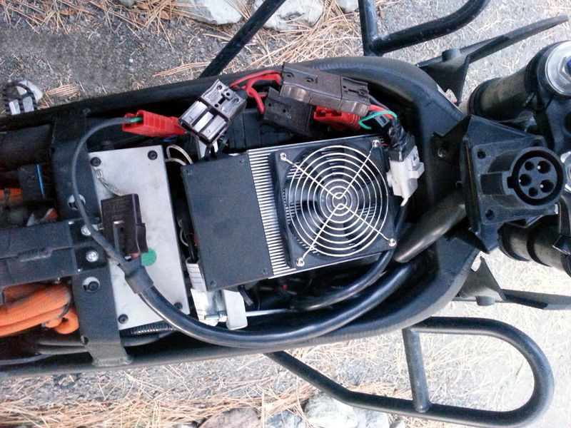
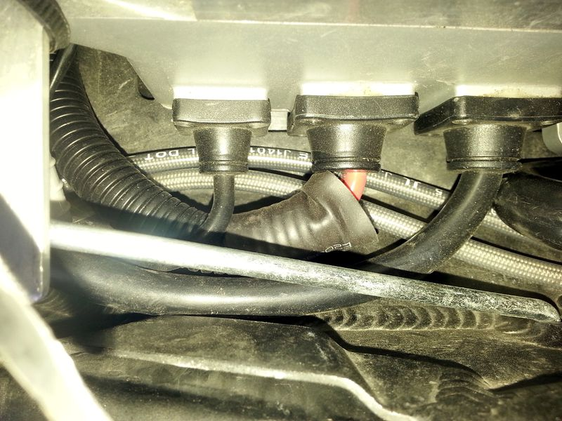
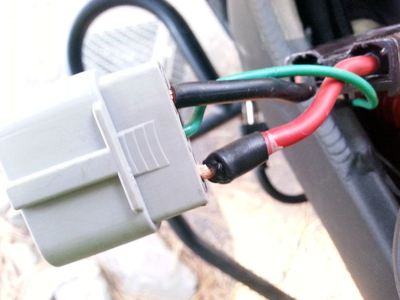
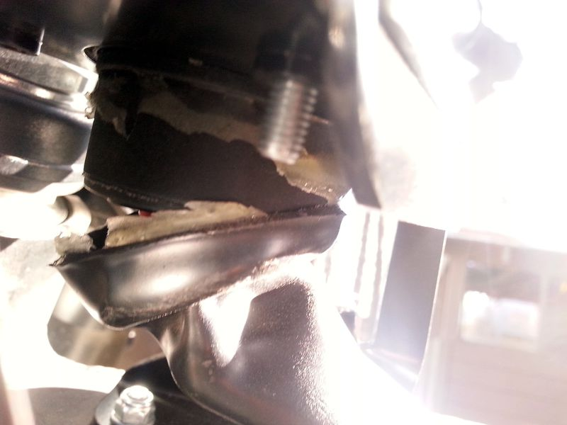
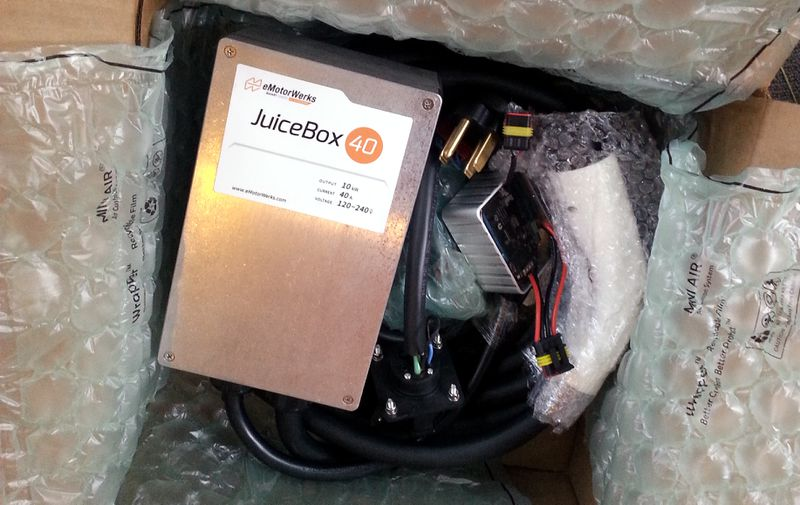

# Chargers

## Overview

Zero is the only EV manufacturer with a sizeable aftermarket for chargers for a number of reasons:

- They've achieved the largest sales volume in the electric motorcycle market *without* a high-speed charging solution until recently.
- The scooter and automobile markets are not as culturally focused on modifications, and often have 3kW solutions and live with them.
- Zero's motorcycles operate at 116V DC, which is low enough not to mandate significant electrical training.

**Requirements**

Charging systems for electric motorcycles face a number of challenging requirements:

- High-speed solid-state switching power supplies.
- Electrically homologated to match the EV's battery voltage.
- Isolated to protect from power transients both *from* and *to* the battery or other connected circuits.
- Ruggedized to survive long-term vibration on the chassis.
- Sealed to survive long-term weather exposure.
- Lightweight and compact enough not to impact riding dynamics or frame load limits.
- Responsive to dynamic conditions around the battery or other systems that demand a reduction in charging output.

## Charger Comparison

This table simplifies details for the sake of comparison. See the notes below and investigate based on your needs and allowable tradeoffs.

| Platform | Vendor | Model | Power (kW) | Weight (lb) | Density (kW/lb) | OEM Warranty | [Protection](https://en.wikipedia.org/wiki/IP_Code) | Self-Protection | Custom Orders | Tank Count | External | Inlet to Onboard | Charge mode enable | Cost (with input adapter) |
| --- | --- | --- | --- | --- | --- | --- | --- | --- | --- | --- | --- | --- | --- | --- |
| [SDS](https://web.archive.org/web/2025/https://zeromanual.com/wiki/SDS_Platform) | [Zero](Zero_Motorcycles.md "Zero Motorcycles") | [Onboard Calex 1200W](https://web.archive.org/web/2025/https://zeromanual.com/wiki/Onboard_Charger) | 1.3 | 17 | 0.08 | ✓ | IP65 for enclosure <br> IP25 for connector | ✓ | ✗ | 0 | ✗ | N/A | ✓ | 800 USD |
| 〃 | 〃 | [Delta-Q QuiQ Charger](https://web.archive.org/web/2025/https://zeromanual.com/wiki/Zero_Quick_Charger) | 1.0 | 11 | 0.09 | 〃 | IP66 | ✓ | ✗ | 0 | ✓ | ✗ | ✓ | 600 USD |
| 〃 | 〃 | 2018+ [Charge Tank](https://web.archive.org/web/2025/https://zeromanual.com/wiki/Charge_Tank) | 6.5 | 25? | 0.26? | 〃 | IP66 | ✓ | ✗ | 1 | ✗ | ✓ | ✓ | 2295 USD |
| 〃 | [Hollywood Electrics](https://web.archive.org/web/2025/https://zeromanual.com/wiki/Hollywood_Electrics) | [Elcon 2500](Chargers.md#Hollywood_Electrics_Elcon_PFC_2500 "Chargers") | 2.5 | 15.6 | 0.16 | ✗ | IP46 | ✓ | ✓ | 0 | ✓ | ✓ | ✓ | 1300 USD |
| 〃 | [DigiNow](https://web.archive.org/web/2025/https://zeromanual.com/wiki/DigiNow) | [DigiNow Super Charger](https://web.archive.org/web/2025/https://zeromanual.com/wiki/DigiNow/Super_Charger_V2.5) | 3.3 | 9 | 0.37 | 〃 | IP67 | ✓ | ✓ | 1 | ✓ | ✓ | ✓ | 1755 USD |
| 〃 | 〃 | 〃 | 6.6 | 18 | 〃 | 〃 | 〃 | 〃 | 〃 | 2 | 〃 | 〃 | 〃 | +800USD? |
| 〃 | 〃 | 〃 | 9.9 | 27 | 〃 | 〃 | 〃 | 〃 | 〃 | 3 | 〃 | 〃 | 〃 | +1500USD? |
| 〃 | [EVTricity](https://web.archive.org/web/2025/https://zeromanual.com/wiki/EVTricity) | [EVTricity Fast Charging Kit](https://web.archive.org/web/2025/https://zeromanual.com/wiki/EVTricity/Fast_Charging_Kit) | 6.6 | 13.2 | 0.50 | 〃 | None | ✗ | ✓ | N/A | ✓ | ✗ | ✗ | 1513 USD <br> \*1990 AUD |
| 〃 | 〃 | 〃 | 8.8 (tuned) | 〃 | 0.66 | 〃 | 〃 | 〃 | 〃 | 〃 | 〃 | 〃 | 〃 | 〃 |
| [FST](https://web.archive.org/web/2025/https://zeromanual.com/wiki/FST_Platform) | [Zero](Zero_Motorcycles.md "Zero Motorcycles") | [Rapid Charge Module](https://web.archive.org/web/2025/https://zeromanual.com/wiki/FST_Platform/Rapid_Charge_Module) | 3.0 | 12? |  | ✓ |  | ✓ | ✗ | 2 | ✗ | ✓ | ✓ | 1200 USD |

**Notes**

This summary compresses some assumptions together for the sake of comparison.

**Power/Cost**

- Figures are *per configuration* and do not count the onboard charger.

**Stacking**

- Multi-unit costs for non-OEM chargers is lower per unit, and **isolated** units can be stacked, up to [1C](https://web.archive.org/web/2025/https://zeromanual.com/wiki/C-Rate).
- SCv1 (eMotorWerks) and Manzanita Micro units are *not* isolated, should **not** be stacked.
- SCv2 (current DigiNow) and Quiq are isolated, *can* be stacked.

**Protection**

- [IP codes](https://en.wikipedia.org/wiki/IP_Code) are sourced from the supplier, and can be compromised by vendor kit assembly.

  DigiNow has reported separately submitting their assembly for lab testing to get an assembly rating listed below.

  EVTricity's supplier does not rate their equipment for vibration or dust ingress or vehicle usage; treat with care.

**Warranty Coverage**

Zero will not cover system failures related to unapproved chargers *if* the charger equipment or its usage is deemed related to the fault.

[DigiNow](https://web.archive.org/web/2025/https://zeromanual.com/wiki/DigiNow) and EVTricity and DIY modules operate in this grey zone.

You should disconnect any high-powered chargers that were not dealer-installed before submitting for repair.

Using chargers like these may cause early failures if not operated safely. Discuss warranty coverage with your dealer.

## Level 1 AC

The following chargers can handle 110V or 220V AC at common frequencies, but have individual power ratings that fit the common NEMA 5-15 North American outlet plug (typically 15A at 110V but it's safest to draw 1.3kW or less).

### [OEM Quick Charger](https://web.archive.org/web/2025/https://zeromanual.com/wiki/Zero_Quick_Charger)

Zero sells a custom version of the [Delta-Q QuiQ Charger](https://web.archive.org/web/2025/https://zeromanual.com/wiki/Delta-Q_QuiQ_Charger) for the Zero battery pack.

**Customizations**

Set for Zero's main [battery](https://web.archive.org/web/2025/https://zeromanual.com/wiki/Battery) pack voltage range.

DC output is packaged in an Anderson SBS-75X connector for the [accessory charging port](https://web.archive.org/web/2025/https://zeromanual.com/wiki/Gen2/Accessory_Charging_Port) with a circuit on the pins that triggers Zero's [Charging Enable Line](https://web.archive.org/web/2025/https://zeromanual.com/wiki/Charging_Enable_Line).

**Product Link**

[OEM Quick Charger](http://www.zeromotorcycles.com/shop/index.php?main_page=product_info&products_id=194)

[Delta-Q QuiQ 1000 Charger (Datasheet)](http://www.atech-antriebstechnik.de/files/datenblatt_quiq1000_de-en.pdf)

[Delta-Q QuiQ 1000 Product Page](https://delta-q.com/product/quiq-1000-industrial-battery-charger/)

**Features**

1kW per unit

Handles 110V or 220V and varying AC frequencies.

Officially-tested, certified, and warranty-supported in configurations by Zero yearly in up to 4 units per motorcycle.

Maximum DC output voltage 135V (measured voltage at approx. 90% Charge 55V, assumed 14S Battery 48V)

Deep discharge recovery (minimum voltage) 24V

Maximum DC output current 8.5A

Maximum DC output power 1000W (48V Version), 945W (96V Version) (954W input power measured)

**Physical Attributes**

Lightweight

Easily fits Zero's [Givi E21 side cases](http://www.zeromotorcycles.com/shop/index.php?main_page=product_info&cPath=15_7&products_id=232).

Ruggedized (IP66 rating) with cooling fins but no active cooling.

**Connecting**

Plugs into the [accessory charging port](https://web.archive.org/web/2025/https://zeromanual.com/wiki/Gen2/Accessory_Charging_Port).

Can be [combined](Chargers.md#Combining_Chargers "Chargers") using Y-adapter cables with other Quick Chargers for up to 4kW additional charging (4 chargers with 3 Y-adapter cables).

Maintains the bike in charging mode even when keyed off (charge-mode enable integration).

**Operation**

[How to Charge a Zero Electric Motorcycle, by Proximidude](https://www.youtube.com/watch?v=mAnBfGONwek) shows how to use one with an FX.

**[Gen1](https://web.archive.org/web/2025/https://zeromanual.com/wiki/Gen1) NOTE:** The Main Power Shutoff Switch needs to be turned on to commence charging.

**Technical**

Via Keith in EMF thread [Re: Single Eltek charger unit that does 116V 2000W](http://electricmotorcycleforum.com/boards/index.php?topic=7407.msg62912#msg62912):

> Quiq charger has a 10k pullup to 5V on the center pin. That won't start charging without the key or onboard to begin, but it will continue charging and indicating after key off and onboard off.

### [Delta-Q QuiQ Charger](https://web.archive.org/web/2025/https://zeromanual.com/wiki/Delta-Q_QuiQ_Charger)

This is the generic version of the [Zero Quick Charger](https://web.archive.org/web/2025/https://zeromanual.com/wiki/Zero_Quick_Charger), and is *not* usable as sold.

It requires programming to work with the Zero, including the enable signal.

The output voltage is fixed when bought, and cannot be adjusted; the highest is 96V, *not* directly usable for the Zero battery pack.

**Product Link**

[Delta-Q QuiQ Charger](https://delta-q.com/product/quiq-1000-industrial-battery-charger/)==

## Level 2 AC

All of the Level 2 AC options except the multi-unit diginow are single-phase oriented. Mennekes adapters provide three phases, and the Diginow sold with Mennekes adapters (Europe, NZ) are wired so one 3.3kw brick draws from each phase, up to all three phases.

Zero branded 200-240VAC Charge Tanks are based on a [J1772](https://web.archive.org/web/2025/https://zeromanual.com/wiki/J1772) inlet at this time, with a Mennekes adapter, which is necessarily single phase.

### Adapter Cord

The onboard charger will accept 208-240V AC but still charge at a 1.3kW.

Using a splitter between the onboard charger and other Quick Chargers or the Elcon is a common configuration.

**C13 Output**

The [Onboard Charger](https://web.archive.org/web/2025/https://zeromanual.com/wiki/Onboard_Charger) and [Zero Quick Charger](https://web.archive.org/web/2025/https://zeromanual.com/wiki/Zero_Quick_Charger) have C14 inlets for C13 plugs.

**C19 Output**

The [HE Elcon 2500](https://web.archive.org/web/2025/https://zeromanual.com/wiki/Hollywood_Electrics/Elcon_2500) and [EVTricity](https://web.archive.org/web/2025/https://zeromanual.com/wiki/EVTricity/Fast_Charging_Kit) external chargers had C20 inlets for C19 plugs.

#### [J1772](https://web.archive.org/web/2025/https://zeromanual.com/wiki/J1772) Adapter Cords

**OEM**

[SAE J1772 Charging Adaptor](http://www.zeromotorcycles.com/shop/index.php?main_page=product_info&cPath=15_5&products_id=122) is just the J1772 to C14 cable adapter cord, at $150 (reduced from $300 without change).

No interactive J pilot signal circuitry is included, but should not be necessary for most stations.

[SAE J1772 Charging Socket Kit](http://www.zeromotorcycles.com/shop/index.php?main_page=product_info&cPath=15_5&products_id=188) for 2013 Zero models mounts the connector in front of the left frame stanchion next to the onboard charger inlet, at $500.

After 2013, the frame shape there is slightly different and would require a different fitment.

**[TusconEV](http://www.tucsonev.com)**

TucsonEV makes plugs, inlets, wires, and cords for J1772.

They offer a specific *J1772 To Zero Adapter* product to connect to the onboard charger and a (preconfigured) number of Delta-Q QuiQ chargers officially supported by Zero (basically splits into 1-3 C14 plugs).

It's cheaper than Zero's cord, and offers a splitter option to power one or two Delta-Q QuiQ chargers in parallel with the onboard charger, up to 30A theoretically.

**EVTricity**

[J1772 to 2 x C19 + C13 adapter](http://evtricity.com.au/product/j1772-to-2-x-c19-c13-adaptor/)

#### [Mennekes](https://en.wikipedia.org/wiki/Type_2_connector) Adapter Cords

[Gradient / Type 2 adapter for Schuko socket](https://www.laadkabelfabriek.nl/product/verloop-type-2-naar-schuko-contrastekker/)

[AC02: TYPE 2 TO 3 X SCHUKO (3 X 16A)](http://eauto.si/metron-shop/?product=adapter-type-2-3-x-schuko-16-a)

**EVTricity**

[Mennekes Type 2 to 3 X C19 Adapter](http://evtricity.com.au/product/mennekes-type-2-to-3-x-c19-adaptor/)

[Mennekes Type 2 to Australia 3 phase 32A socket](http://evtricity.com.au/product/mennekes-to-australia-3-phase-32a-socket/)

### [OEM Charge Tank](https://web.archive.org/web/2025/https://zeromanual.com/wiki/Charge_Tank)

The most convenient charging option for the [SDS Platform](https://web.archive.org/web/2025/https://zeromanual.com/wiki/SDS_Platform) is the OEM-supported [Charge Tank](http://www.zeromotorcycles.com/shop/index.php?main_page=product_info&cPath=15_5&products_id=228) for 2015 models onward.

It's more convenient than an [Elcon 2500](https://web.archive.org/web/2025/https://zeromanual.com/wiki/Hollywood_Electrics/Elcon_2500), but for subtle reasons seems to be slightly less compatible with a range of charging stations (see the User Guide).

**Model Compatibility**

- 2015+ S-platform bikes only (S/DS/SR/DSR)
- Incompatible with the OEM [Power Tank](https://web.archive.org/web/2025/https://zeromanual.com/wiki/Power_Tank) accessory since it occupies the same bulky tank location.

**Station Compatiblity**

- Only available with a [J1772](https://web.archive.org/web/2025/https://zeromanual.com/wiki/J1772) inlet.
- Mennekes / [Type 2](https://web.archive.org/web/2025/https://zeromanual.com/wiki/Type_2) single-phase adapter offered for Europe, Australia, NZ.

**Location**

It only fits in the [Power Tank](https://web.archive.org/web/2025/https://zeromanual.com/wiki/Power_Tank) area (so they can't both be installed) and requires a dealer-only installation (very involved).

**Operation**

The bike must be keyed on before initiating a charge cycle with the Charge Tank.

Once charging, the bike can be keyed off; the Charge Tank and onboard charger will keep the bike in charge mode.

**Install**

- [Charge Tank Bracket Installation](https://web.archive.org/web/2025/https://zeromanual.com/wiki/Charge_Tank_Inlet_Bracket_Install)

#### [Initial 2.5kW Revision](https://web.archive.org/web/2025/https://zeromanual.com/wiki/Charge_Tank/2.5kW_Revision)

Initially, the [Charge Tank](https://web.archive.org/web/2025/https://zeromanual.com/wiki/Charge_Tank) was released supporting 2.5kW.

[2.5kW (discontinued)](http://www.zeromotorcycles.com/shop/index.php?main_page=product_info&cPath=15_5&products_id=228)

**Release**

Released 2016, discontinued late 2017 in favor of the [Charge Tank/6kW Revision](https://web.archive.org/web/2025/https://zeromanual.com/wiki/Charge_Tank/6kW_Revision) version.

**Capacity**

Provides its own charging power (2.5kW) while also engaging the [onboard charger](https://web.archive.org/web/2025/https://zeromanual.com/wiki/Onboard_Charger) in parallel, for a total of 3.8kW

**Connections**

The [accessory charging port](https://web.archive.org/web/2025/https://zeromanual.com/wiki/Gen2/Accessory_Charging_Port) circuit is not impacted by this charging circuit.

**Hardware**

The core equipment appears to be a TSM2500 charger.

#### [6.5kW Revision](https://web.archive.org/web/2025/https://zeromanual.com/wiki/Charge_Tank/6kW_Revision)

**Capacity**

Provides 6.5kW but does not engage the [Onboard Charger](https://web.archive.org/web/2025/https://zeromanual.com/wiki/Onboard_Charger) unless connected to 110V power.

If the onboard charger is separately engaged (on 110V or 220V circuits), a potential total of 7.8kW is available.

- Unless the bike is a single-long-brick bike (7.2kWh) in which case it would exceed the ~7kW limit set by the 1C rate limit on the contactor.

**Release**

released October 2017.

- Initially only available as a factory installed option for 2018+ models
- Now available as a dealer-installed accessory for 2015+ models.

**Hardware**

The hardware seems to have been developed by Zero and as such is proprietary.

**Reference**

[Zero Charge Tank User Guide](http://media.zeromotorcycles.com/resources/user-guides/2016/2016-Zero-Charge-Tank-User-Guide.pdf)

[install video by a dealer showing what it looks like under the tank](https://www.facebook.com/groups/zmcowners/permalink/1029070973828777/)

[Zero Charge Tank 6kw Installation Instructions](https://drive.google.com/file/d/1U7Y39UUoBWR6j5eCF76y37-46xcYEw9s/view?usp=sharing)

### [DigiNow Super Charger V2](https://web.archive.org/web/2025/https://zeromanual.com/wiki/DigiNow_Super_Charger_V2)

This refers to the V2 of [DigiNow](https://web.archive.org/web/2025/https://zeromanual.com/wiki/DigiNow)'s charger product as released in early 2017.

[V2.5](https://web.archive.org/web/2025/https://zeromanual.com/wiki/DigiNow/Super_Charger_V2.5) started shipping in early 2018 as a control-board upgrade of this product.

**Product link**

[DigiNow Super Charger V2](http://diginow.it/super-charger-for-zero-motorcycle.php).

**Notes**

Limited orders made for the [V1](https://web.archive.org/web/2025/https://zeromanual.com/wiki/DigiNow_Super_Charger_V1) through 2016 have been upgraded to a two module version of the V2.

Ordering is now generally available at a scaling price by having a modular assembly.

**Features**

Made of 3.3kW modules in configurable numbers, up to 11.2kW for current Zero models' charging limits.

Tank Bag cowl area fitment for one module air-cooled.

Power Tank cowl area fitment for two modules air-cooled, and three modules with a yet-to-be-designed thermal management system.

**Ordering**

DigiNow's distributor in the UK is [The English Electric Motor Co.](http://englishelectricmotorco.com/superchargers/)

DigiNow sells directly outside of Europe.

**Technology**

V2 is based on (but not identical to) the [TC HK-J 3.3 charger unit](http://www.tccharger.com/product/13170.html).

They limit themselves to lower amperage when connected to North American household voltage levels, which are typically designed for 15A at 110-120VAC.

They are made to run at full power on 208-240VAC, and they have also been tested to run at full power from ~170-360VDC

Cooling is provided by air-blowing fans; a liquid cooling system is also available by special request.

The [Elcon variant's product page](http://www.elconchargers.com/catalog/item/9034090/10295140.htm) indicates that it can communicate over CAN bus, which requires a custom control module to tell it what to do for integration with Zero's systems to be safe and reliable.

Also, these chargers are [electrically isolated](http://www.power-supply-designer.com/2011/05/isolation/), eliminating some design and handling issues with the V1 platform.

There is no controlling user interface currently provided, but [DigiNow has stated](http://electricmotorcycleforum.com/boards/index.php?topic=6557.msg51873#msg51873) they intend to add Bluetooth / BLE support (including for units already shipped), implying some kind of mobile application to communicate over a protocol.

**Video Guides**

- DigiNow's [Supercharger V2 unboxing video](https://www.youtube.com/watch?v=uAdNeARedvY) for a quick overview of the hardware:
- E Shattow's [Supercharger V2 unboxing video](https://www.youtube.com/watch?v=HQRYhf2TrzA) for a closer showing of the hardware:
- E Shattow's [Video showing the Supercharger V2's hardware connections](https://www.youtube.com/watch?v=o7z9KTMh0W0):
- [A quick introduction to the Diginow Supercharger (V2) and test charging the first time](https://www.youtube.com/watch?v=Avcy1JKcPOs) by [Dump the pump](https://www.youtube.com/channel/UCLZ9tcCrr_bq2tSdJ_a-0eg) on YouTube:

**Connections**

- J1772 primary inlet.
- [Anderson connector](https://web.archive.org/web/2025/https://zeromanual.com/wiki/Anderson_connector) (SBS75XBRN) primary outlet with a "keepalive" signal transmitter.
- (Unlisted, must ask) a controller connection with a separate Anderson "keepalive" signal transmitter.

**Optional Inlet Adapters**

- [NEMA 14-50 plug](https://en.wikipedia.org/wiki/NEMA_connector#NEMA_14) ("RV park plug").
- [Tesla destination charging](https://www.tesla.com/destination-charging) adaptor.
- [NEMA TT-30 plug](https://en.wikipedia.org/wiki/NEMA_connector#NEMA_TT-30) ("RV 30").
- [NEMA 10-30 plug](https://en.wikipedia.org/wiki/NEMA_connector#NEMA_10) ("appliance plug").
- [NEMA 5-15R plug](https://en.wikipedia.org/wiki/NEMA_connector#NEMA_5) ("North American wall outlet").

**Hardware**

[Modular Connector Q&A with photos](http://electricmotorcycleforum.com/boards/index.php?topic=6363.msg52121#msg52121)

#### [DigiNow Super Charger Installation](https://web.archive.org/web/2025/https://zeromanual.com/wiki/DigiNow_Super_Charger_Installation)

This covers a tank install of [DigiNow](https://web.archive.org/web/2025/https://zeromanual.com/wiki/DigiNow)'s [Super Charger V2](https://web.archive.org/web/2025/https://zeromanual.com/wiki/DigiNow/Super_Charger_V2).

DigiNow now ships a [version 2.5](https://web.archive.org/web/2025/https://zeromanual.com/wiki/DigiNow/Super_Charger_V2.5) and prefers a belly pan install; we will cover that separately and soon.

This charger can be ordered in a few different configurations, making it the most flexible charging option currently available.

This attempts to describe most available options and concerns.

Your charging arrangement may vary per your requested options.

**Reference**

[Supercharger Tank installation with photos](http://electricmotorcycleforum.com/boards/index.php?topic=6557)

The following photos feature a MY2016 DSR, charge tank bracket and cowl, and single module SCV2.

**Parts**

- (1) J1772 inlet wired for 2 charging units, or 1 charging unit and a split to feed the onboard charger.

  For 3 charging units, two J1772 inlets will be provided, one wired for 2 units and one for 1 unit with an onboard charger split.
- (1 to 3) Elcon HK-J charging units with 12V fans wired and mounted to a simple aluminum heat sink on one side.
- (1) Y-split cable with two (2) Brown Anderson SBS-75X connectors and one (1) downstream Red Anderson SBS-75X connector.
- (1) Potted aluminum box containing the control board. The wiring should connect to each charging unit.

**Instructions**

1. Discharge your power pack to 75% or lower.
2. Power down your motorcycle and unplug the charger, ensuring the contactor clicks open.
3. Wait 10 minutes for all components to completely discharge.
4. Connect the J1772 inlet to the chargers, and the control board to the chargers.
5. Perform an unloaded test:
   1. Connect the J1772 inlet to a source of 220V power rated for 6.6kW (30A) (via adapter if necessary).
   2. On early models, verify that the fans turn on and if a light is visible on the control box, that it is lit.
   3. Station power (if confirmable) should read a few tens of watts, like 40W.
   4. Disconnect the J1772 inlet.
6. Wait a couple of minutes for the charging units to discharge fully before connecting them to the motorcycle.
7. Connect the charging system to the vehicle: connect the output Anderson connector to the accessory charging port.
8. Turn on the bike and make sure the contactor closes.
9. Make sure the bike operates (twist throttle or roll the bike to make sure the controller is engaged).
10. Open the Zero mobile app if possible to check charging activity on the battery.
11. Repeat the test above with the battery connected and verify charging by the amount of amps reaching the battery in the Zero app Battery Screen.
12. Verify that the charge-mode enable signal works by keying the bike off.
    - Observe that the bike stays in charge mode and the app continues to report incoming current.
    - If this fails, disconnect the inlet from the upstream source and recheck connections once discharged.
13. Verify that tapering works at high states of charge by completing a charge beyond 80% SoC. The tapering should happen in concert with battery voltage reading 116V.

**[Install Chargetank Inlet Bracket](Common_Modifications.md#Chargetank_Inlet_Bracket "Common Modifications") (Optional)**

1. Prep the aux power wires to be fed through the bike frame.

   (Optional) apply wire routing conduit and electricians vinyl tape also zip tie the signal wire at the one end as a strain relief.

   
2. Going fishing!

   Stuff something insulated down one side of the frame behind the DC-DC converter.

   The 2016 model year has an advantage to use the right side, while other model years may depend on the right or left side.

   Once you're routed through, you can tightly tape the aux power and control wire ends to your insulated fishing wire and feed back up through the frame.

   

   
3. Prep the J1772 inlet assembly provided with your Super Charger V2 system

   For use with the Chargetank cowl, you will need to remove the captive dust cap and latch.

   

   Also for the Chargetank inlet bracket you will need to elongate the existing fastening holes on the J1772 inlet piece towards the center, so that they will allow for using the Chargetank inlet bracket mounting.

   If you elongate the J1772 inlet fastener mounting holes up to the center most edge of where the countersunk section visibly begins on each hole it will fit very nicely.

   Additionally, there is a circular lip on the bottom of the J1772 inlet that needs to be sanded a few light passes with a rotary tool so that it will seat correctly in the circular cutout in the top of the Chargetank inlet bracket.
4. Layout the components of the Super Charger V2 system in place.

   

   Note the J-hooks which secure the charging module

   
5. Take care to insulate or provide strain relief to any cables that might move around or encounter any forces in their lifecycle.

   

   This J1772 inlet assembly was a very early construction and failed when installed with the Chargetank inlet bracket

   

   The broken J1772 inlet assembly has been RMA'd and replaced with an assembly that has more forgiving wiring flexibility to work with the Chargetank inlet bracket.

   

   There was also delivered an EMW JuiceBox 40A charging station (previously available to order with the Super Charger V1), and a new revision of the Super Charger V2 control module that fixes some harmless warning indications induced by the oldest revision.

   The newer revision appears potted in a metal case with a clear epoxy, while the older revision seems potted in a plastic case with some RTV silicone.

**Installing a dual SCv2 under the Chargetank**

Relocate the flasher relay and the clip which holds it to the frame. It can be attached to the Chargetank inlet support bracket.

The dual modules will fit with the fans forward and the body bolt heads pointing up. If the fan wires don't exit the fans to the top, slowing work the fans out of the airbox to rotate them.

### [DigiNow Super Charger V2.5](https://web.archive.org/web/2025/https://zeromanual.com/wiki/DigiNow_Super_Charger_V2.5)

This refers to v2.5 of [DigiNow](https://web.archive.org/web/2025/https://zeromanual.com/wiki/DigiNow)'s charger product, released in early 2018, following on [V2](https://web.archive.org/web/2025/https://zeromanual.com/wiki/DigiNow/Super_Charger_V2).

This release revises the [V2](https://web.archive.org/web/2025/https://zeromanual.com/wiki/DigiNow_Super_Charger_V2) controller to integrate better with the vehicle.

There are unconfirmed claims of revisions to the charging units themselves.

Reportedly, the charging units shipped as of 2018(?) support 4kW per unit *when station voltage is high enough*, up from 3.3kW in V2.

See [DigiNow/Super Charger V2](https://web.archive.org/web/2025/https://zeromanual.com/wiki/DigiNow/Super_Charger_V2) for most details; 2.5 details are only published in various forum posts for now.

**Features**

- The v2.5 control board can upgrade an existing v2 install.
- v2.5 install defaults to a bellypan fitment (shipped to/from DigiNow) which replaces the onboard charger.
- Uses the onboard charger's CANbus connection for these features:
  - It can initiate charging from a completely keyed-off motorcycle state.
  - Balances the [Power Tank](https://web.archive.org/web/2025/https://zeromanual.com/wiki/Power_Tank) and [Monolith](https://web.archive.org/web/2025/https://zeromanual.com/wiki/Monolith).
  - Adjusts/limits charging on the fly based on BMS-reported voltages, capacities, and temperatures.
- Removes 3.3kW maximum per-unit power limit from v2.0.
- Removes the v2 limit on the number of chargers (3?).

  At higher voltage stations or plugs you *may* see up to 4kW per unit.
- There is also a text-protocol-based Bluetooth LE (BLE) interface which offers some dynamic inspection and configuration abilities.
- Can target a battery voltage limit where it will taper and then stop to target an SoC for better lifetime conditioning of the battery cells.

  Initially configured by DigiNow; changed via BLE console.

  i.e. stop at 80% (110.0V) every night or 60% (106.0V) when not riding for a month, versus a default of 100% (116.4V).

**Video Guides**

- [9.9kW charger SKID PAN final version unit for Zero Motorcycles](https://www.youtube.com/watch?v=LGu2Lfkjpuo) by DoctorBass on YouTube:
- [10kw Zero charger project almost finished!!](https://www.youtube.com/watch?v=66ax9zKkUDo) by DoctorBass on YouTube:
- [Zero Modding Updates + Pluggin in a DigiNow Supercharger at Home](https://www.youtube.com/watch?v=Z1af6NbUujM) by [NewZeroland](https://www.youtube.com/channel/UCdEMqkiM5I-98gxZKJXQ65Q) on YouTube:

**Installation**

The installation method for 2.5 is into the bellypan replacing the onboard charger, and connecting to the bike with its connector.

This is how the DigiNow 2.5 control board listens to BMS and MBB messages and act on them appropriately.

The stock bellypan is not deep enough to enclose the units, so the cooling fans are smaller and the pan is reinstalled over the chargers with bolts and offsets.

A custom-engineered pan is in development by DoctorBass, to be released, which doubles as a heatsink.

- [One loosely documented installation experience](http://electricmotorcycleforum.com/boards/index.php?topic=8769.msg74786#msg74786) by Ashnazg

**Startup**

1. Connect the power source to a J inlet.
2. Confirm startup sequence for the state:
   - Contactors (one or both installed batteries) should click shut if not already.
   - Instrument cluster engages charging green flashing indicator
   - Instrument cluster shows time to charge.

     Expect this to start as `00:00` and slowly converge from a very high number of hours to an expected value as power increases at the configured ramp rate.
3. Listen for cooling fan engagement.

**Monitoring**

1. Download a serial Bluetooth (LE) console emulator.

   **Examples**

   (Used below) [Serial Bluetooth Terminal](https://play.google.com/store/apps/details?id=de.kai_morich.serial_bluetooth_terminal&hl=en_US) app for android

   [HM10 Bluetooth Serial Pro](https://itunes.apple.com/us/app/hm10-bluetooth-serial-pro/id1221924372?ls=1&mt=8) app for iOS
2. Open the app and select the **Menu** button in the top left corner, then **Devices**, then **Bluetooth LE**
3. Plug in the charging system / motorcycle to a power source
4. Press **scan** on the app on your phone
5. You should see a device discovered which includes **SCv2** in it's name, select that device, the left side of the menu item should turn green
6. Press the **menu** button again, then **Terminal**
7. Once in the **Terminal** View, press the **connect** button on the top right hand corner to the left of the trash can icon
8. The terminal should indicate a successful connection and there will be CSV output approximately once a second

**Event Example**

For a ZF13.0 with 3.3 Power Tank and 1 DigiNow charger at 110V:

```
1032,1032,1032,957,10,3,104,26,130,20,20,21,3,9900,9900,0,50,3
```

| BMS info |  |  |  |  |  |  |  |  | Charger info |  |  |  |  |  |  |  |  |
| --- | --- | --- | --- | --- | --- | --- | --- | --- | --- | --- | --- | --- | --- | --- | --- | --- | --- |
| Voltage |  |  | Current |  |  | Capacity |  |  | Temperature |  |  |  | Power |  |  |  |  |
| Vmin | V0 | V1 | IT | I0 | I1 | C0 | C1 | CT | T1 | T2 | T3 | N | PT | P | O | ∂P | v |
| 1032 | 1032 | 1032 | 957 | 10 | 3 | 104 | 26 | 130 | 20 | 20 | 21 | 3 | 9900 | 9900 | 0 | 50 | 3 |

| Var | Label | Source | Unit |
| --- | --- | --- | --- |
| `Vmin` | Battery voltage used | min(V0, V1) | 0.1VDC |
| `V0` | Battery voltage | BMS0 | 0.1VDC |
| `V1` | Battery voltage | BMS1 | 0.1VDC |
| `IT` | Target total charging current | (Dynamic) | 0.1ADC |
| `I0` | Battery current | BMS0 | 1ADC |
| `I1` | Battery current | BMS1 | 1ADC |
| `C0` | Battery capacity | BMS0 | 1Ah |
| `C1` | Battery capacity | BMS1 | 1Ah |
| `CT` | Total battery capacity | C0+C1 | 1Ah |
| `T0` | BMS0 Lowest Cell Temperature | BMS0 | 1℃ |
| `T0` | BMS0 Highest Cell Temperature | BMS0 | 1℃ |
| `T1` | BMS1 Lowest Cell Temperature | BMS1 | 1℃ |
| `T1` | BMS1 Highest Cell Temperature | BMS1 | 1℃ |
| `N` | Number of chargers acknowledging | Configuration | 1 charger |
| `PT` | Target total charging power | Configuration | 1W |
| `P` | Requested total charging power | (Dynamic) ≤PT | 1W |
| `O` | Capacity override flag | Configuration | 1=override |
| `∂P` | Charging power ramp rate | Configuration | 1W/sec |
| `v` | Control Board Firmware Version | (Fixed) |  |

**Adjustment**

1. Use the steps above to begin monitoring the charger.
2. Enter a CSV string corresponding to the following second-hand specification:

   `Vlimit,Ilimit,N,Ptarget,O,∂P`

   - `Vlimit`: target voltage

     in units of 0.1V, so 1164 = 116.4V
   - `Ilimit`: battery current limit

     Use the contactor C-rate limit ≈ sum of Ah-rating of all BMS units attached
   - `N`: number of chargers *assumed!*

     The controller broadcasts a message that all chargers should respond to, dividing the power target below by this number.
   - `Ptarget`: target total wattage across all listening chargers
   - `O`: 1C+ flag

     **Always** use 0 unless you've bypassed the contactor!
   - `∂P`: power ramp rate (W/sec)

     This limits power level adjustments unless there's an emergent condition requiring fast ramp-down.
3. Select or compose an appropriate CSV string for your setup.
4. Input it in the entry at the bottom of the app
5. Send it to the charger by pressing the arrow button to the right of the entry
6. Observe either through the [Zero app](Official_Mobile_Application.md "Official Mobile Application") or some meter that the actual wattage is as desired.

**Example CSV config messages**

- 1.3kW wall charging

  `1164,104,2,1300,0,50`

  This charges a 104Ah pack to 116.4V, assumes 2 charging units connected, distributes 1300W=1.3kW between them, no contactor bypass, and only changes power by 50W/sec

  The controller broadcasts a 650W message and assumes 2 chargers will implement it.
- 6.6kW EV station charging

  `1164,104,2,6600,0,50`

  Per above, but targets 6600W=6.6kW across 2 chargers

  The controller broadcasts a 3300W=3.3kW message and assumes 2 chargers will implement it.
- 9.9kW EV station charging (if you have 3 units):

  `1164,104,3,9900,0,50`

  Per above, but targets 9900W=9.9kW across 3 chargers

  The controller broadcasts a 3300W=3.3kW message and assumes 3 chargers will implement it.

**References**

[EMF announcement of DigiNow SuperCharger v2.5](http://electricmotorcycleforum.com/boards/index.php?topic=8049)

[Facebook announcement of DigiNow SuperCharger v2.5](https://www.facebook.com/digiNowInc/posts/1660500230736662)

[Third-party Google Doc incompletely documenting v2.5](https://docs.google.com/document/d/1v6TCy0-hWS1JeOw3c31s_geXmEMC9xpkyGWRmE_pGYU/edit) by BrianTRice

### [EVTricity Fast Charging Kit](https://web.archive.org/web/2025/https://zeromanual.com/wiki/EVTricity_Fast_Charging_Kit) (discontinued)

Charging kit made by [EVTricity](https://web.archive.org/web/2025/https://zeromanual.com/wiki/EVTricity) (discontinued)

**Product Link**

[Fast Charging Kit](http://evtricity.com.au/shop/)

**Ordering**

Discontinued. EVTricity writes...

"On a personal note I have been splitting my time between the EVtricity Zero chargers and a new electricity comparison and energy saving service for Australian households at <https://wattever.com.au>.

I'll be devoting the majority of my working time to [wattever.com.au] over the next few months while continuing to provide support to EVtricity charger owners in 2017 and 2018.

I'm also hoping to ride my SR a little more and enjoy spring and summer in Australia.

"In terms of future charging solutions, we have some new Zero fast charging options - in addition to what we have provided in 2017 - that we will be evaluating over coming months.

In 2018, we'll assess whether there is an opportunity to again provide fast charging options for Zero motorcycles."

EVTricity assembled two options for fast charging out of stationary computer power supplies - a 3.3-4.4kW AC charger and 6.6-8.8kW AC charger.

These charging kits were fully assembled in Australia.

The units were programmed to charge Zero motorcycle models from 2013-2017.

This kit filled the niche for a mostly-stationary charger programmed for a Zero, trading off durability for cost.

**WARNINGS**

These are *not* waterproof or dust-protected and are not warranty-protected if mounted to the motorcycle.

Neither the OEM nor the vendor has submitted these for independent protection testing, so they are not rated for [protection from the elements with an IP code](https://en.wikipedia.org/wiki/IP_Code).

Treat these as stationary power supplies which may be transported at some risk.

*If transporting this charging kit*, keep these stored within a waterproof case and cushioned to protect from vibration.

**Construction**

[Emerson R48-2000e3](https://www.power-solutions.com/dc-power-systems/emerson/9906-2) rectifiers ([datasheet](https://www.vertivco.com/globalassets/products/critical-power/dc-power-systems/r48-2000e3-rectifier-data-sheet.pdf))

Custom PCBs & wiring

Anodised aluminium case.

The units are configured for Zero motorcycles maximum voltage (116V) and the AC input current limit can be specified at ordering to suit the power sources used by the Zero owner e.g. 15A/16A or 20A.

[EVTricity](https://web.archive.org/web/2025/https://zeromanual.com/wiki/EVTricity) also offers a matching [Mennekes](http://evtricity.com.au/product/mennekes-type-2-to-3-x-c19-adaptor/) or [J1772 adaptor](http://evtricity.com.au/product/j1772-to-2-x-c19-c13-adaptor/) to allow two 3.3kW chargers and an onboard to be plugged in simultaneously or one 6.6kW charger and an onboard charger.

The [6.6kW unit](http://evtricity.com.au/product/double-fast-charging-kit/) is effectively two single chargers placed in one case with independent AC input and DC outputs providing modularity in case only lower current (15A) power supplies are available.

The unit is **not weatherproof** so needs to be carried on the bike in weatherproof luggage and kept away from rain/dust when charging or in storage.

The charging kits do include DC output cables to plug into the Zero fast charge port but do not include the AC input power cables required for each location e.g. NEMA to C19 cables, Schuko to IEC C19 cables etc.

The units have IEC C20 sockets - an international standard socket - and power cables with a matching IEC C19 plug are readily available in most countries.

| Configuration | Power | Dimensions | Weight |
| --- | --- | --- | --- |
| [Double Fast Charging Kit](http://evtricity.com.au/product/double-fast-charging-kit/) | 3.3kW (up to 4.4kW customized) | 29cm x 18cm x 5cm (excl. cable glands and cables) | 3kg |
| [Single Fast Charging Kit](http://evtricity.com.au/product/single-fast-charging-kit/) | 6.6kW (up to 8.8kW customized) | 29cm x 18cm x 10cm (excl. cable glands and cables) | 6kg |

Ref. [Products Page](http://evtricity.com.au/shop/)

**Variants**

Default input limits vary by Level 2 AC standards per region (EU = 16A, US = 15A, AU = 15A) and custom AC input levels up to 20A per input (two inputs on the 6.6+kW charger) are available on order.

[J1772 to C19/C13 adapter](http://evtricity.com.au/product/j1772-to-2-x-c19-c13-adaptor/)

[Mennekes to C19 adaptor](http://evtricity.com.au/product/mennekes-type-2-to-3-x-c19-adaptor/)

### [DigiNow Super Charger V1](https://web.archive.org/web/2025/https://zeromanual.com/wiki/DigiNow_Super_Charger_V1) (discontinued)

This was [DigiNow](https://web.archive.org/web/2025/https://zeromanual.com/wiki/DigiNow)'s initial aftermarket charger product, with a limited release in 2016 and eventually recalled / withdrawn in 2017 with the introduction of the [V2](https://web.archive.org/web/2025/https://zeromanual.com/wiki/DigiNow_Super_Charger_V2).

**Product link**

[DigiNow Super Charger V1](http://web.archive.org/web/20161024080448/http://diginow.it/super-charger-for-zero-motorcycle.php) (courtesy of Internet Archive's wayback machine).

**Production**

This charging product went through an intense development and testing phase in late 2015.

Due to manufacturing quality and contractual issues, this is now discontinued and has been replaced by the [DigiNow Super Charger V2](https://web.archive.org/web/2025/https://zeromanual.com/wiki/DigiNow_Super_Charger_V2) sourced from a different vendor with more reliable technology.

**Historical Notes**

After an initial private testing phase by Terry Hershner and others, Brian Rice was contracted to document the product and help beta-test in an in-kind compensation deal.

- This documentation effort aimed to help guide Zero dealers and owners through the installation and safe operation of the equipment.
- This documentation also predates this wiki, and the wiki arose from the complications necessary in describing Zero's systems to people without Zero dealership licenses.
- For these reasons, its development is controversial but overall instrumental in community growth.

**Features**

Monolithic 12kW charging capability.

Power Tank area fitment with forced-air cooling.

WiFi access point serving up a simple JS+HTML web application to monitor and control the unit.

**Ordering**

Product is discontinued.

**Technology**

V1 was assembled as a homologated single 12kW high powered switching power supply derived from an existing generic unit to fit in the Zero tank area.

V1 was not a solid state switching power supply, but a full wave bridge rectifier with an embedded controller board, limited circuit protections, and adequate if slightly flawed ingress protection.

[eMotorWerks product page for generic/programmable version](https://emotorwerks.com/index.php/store-juicebox-ev-charging-stations/dc-charging-systems/1657-mini-smartcharge-12000-a-12kw-universal-voltage-ev-charger-fully-assembled-tested/category_pathway-17)

[Patrick Truchon described some more general information about it](http://ptruchon.pagekite.me/wiki/zerodsmods#charge_tank)

The control board sets up a WiFi access point with a mobile-web application server for adjusting how it operates once it's supplying power.

The control board is powered from the external charging source.

[DigiNow has indicated](http://electricmotorcycleforum.com/boards/index.php?topic=6363.msg49603#msg49603) that the V1 situation was difficult for some reason involving the supplier, but specifics are not commented on publicly yet.

Enough V1 units worked reliably for customers in the field to provide a reasonable development platform for understanding the parameters of operation and compatibility issues with various charging station technologies, that fed into the [V2](https://web.archive.org/web/2025/https://zeromanual.com/wiki/DigiNow_Super_Charger_V2) platform.

### [Hollywood Electrics Elcon PFC 2500](https://web.archive.org/web/2025/https://zeromanual.com/wiki/Hollywood_Electrics/Elcon_2500)

Harlan at [Hollywood Electrics](https://web.archive.org/web/2025/https://zeromanual.com/wiki/Hollywood_Electrics) sold a customized, programmed [Elcon](https://web.archive.org/web/2025/https://zeromanual.com/wiki/Elcon) [PFC 2500 charger](http://www.elconchargers.com/catalog/item/7344653/7638094.htm) to work well with the Zero battery pack.

**Product Page**

[Elcon Quick Charger](https://hollywoodelectrics.com/portfolio-view/elcon-quick-charger/)

The [Elcon Quick Charger product page](https://web.archive.org/web/20160506100236/https://hollywoodelectrics.com/product/elcon-quick-charger/) is no longer available (this link is form archive.org's wayback machine).

Presumably it can be ordered specially or serviced but it seems like the latest TC 3.3kW Charger (which Elcon also offers) in the 3.3kW configuration is considered a better value and the way to go forward.

**Customizations**

It is programmed for the Zero voltage range and performs smooth charging cutbacks as a full voltage is approached.

The output leading to the [accessory charging port](https://web.archive.org/web/2025/https://zeromanual.com/wiki/Gen2/Accessory_Charging_Port) uses the signal pins (Enable Line) to ensure that the motorcycle stays in charging mode once charging has started, even without the onboard charger or leaving the motorcycle keyed on.

The input plug is an [IEC 60320 C20 coupler](https://en.wikipedia.org/wiki/IEC_60320#C19.2FC20_coupler) instead of Elcon's stock NEMA 5-15P plug (for US 110V outlets).

**Cabling**

See [Custom J1772 Adapter](https://hollywoodelectrics.com/product/custom-j1772-adapter/)

This includes a splitter for the [onboard charger](https://web.archive.org/web/2025/https://zeromanual.com/wiki/Onboard_Charger), for conveniently reaching 3.8kW for a single Elcon or 6.6kW for dual Elcon inputs.

A single Elcon or a pair may be accommodated.

[NEMA 14-50](https://en.wikipedia.org/wiki/NEMA_connector#NEMA_14) (typical RV park 50A plug) support is also available.

Other customizations can be accommodated on request.

DIY assembly of power cables and adapters is possible and can be cheaper than purchasing, but should be learned and performed carefully to avoid high power electrical faults that could cause damage or injury. Crimping should be performed by a professional with the best possible tool for the connectors and cable gauge to avoid dangerous bad connections.

**Product Information**

[Elcon PFC 2500](http://www.elconchargers.com/catalog/item/7344653/7638094.htm)

It is very flexible and robust, but requires programming to adapt it to a specific vehicle.

It performs at 2.5kW at 220V AC input or at 1.2kW at 110V AC input (effectively current-limited).

It is primarily designed for use in electric forklifts and light industrial trucks.

As delivered, it takes power in through a NEMA 5-15P plug and outputs through a grey Anderson connector.

The [Elcon PFC product range](http://www.elconchargers.com/products.html) offers a variety of power outputs; the 2500 happens to be the most powerful that can be effectively carried on a Zero in a Givi case.

### [Elcon 3.3KW UHF CAN bus charger](http://www.elconchargers.com/catalog/item/9034090/10295140.htm)

The HK-J charger is a newer model that outputs 3.3kW at 220V AC or 1.6kW at 110V AC. It's smaller and lighter than Elcon's PFC 2500. It would require significant programming and customization to be used with a Zero.

Product link: [Elcon's HK-J series 3.3kW charger](http://www.elconchargers.com/catalog/item/9034090/10295140.htm)

The Diginow Supercharger v2 is based on similar chargers plus a sensor and canbus controller unit.

### [3.3kw chargers with little interfacing](http://electricmotorcycleforum.com/boards/index.php?topic=7483)

"newbie" user Josh reports that similar units can be ordered without canbus control.

He proposes a group buy. I'd be wary of sending money to a person without a track record.

### [TSM2500 Charger and Controller](http://www.thunderstruck-ev.com/tsm2500-and-charge-controller.html)

[Thunderstruck EV](http://www.thunderstruck-ev.com/chargers-ev.html) sells a non-homologated assembly of what appears to be the same charger as used in the pre-2018 OEM Charge Tank with a separate generic controller. Naturally, this requires using quite a bit of programming and configuration to set up successfully. It's a 2.5kW charger with ample air cooling.

## Combining Chargers

One can combine chargers to feed the [Accessory Charging Port](https://web.archive.org/web/2025/https://zeromanual.com/wiki/Gen2/Accessory_Charging_Port) using the right cable.

Zero's Y-Cable below is designed to do this. It's intended for their Quick Charger but can be used on an Elcon 2500 or other isolated charger able to work with the enable pins.

**Notes**

- There are 2 enable pins on the Accessory Charging Port.

  You have to use two chargers to each pin.

  One pin can't drive more than 2 chargers.

  If one pin drives two chargers, the other pin must drive 2 chargers or none at all.

  So, 1, 2, or 4 chargers can be supported, but [not 3](https://youtu.be/xOrgLj9lOwk?t=1m25s)...

  *UNLESS* you add a jumper and pin to the Anderson connector to bring both pins on the same sensor wire.
- 2013 and earlier models accessory charging port have a 30A current limit, so can't handle 4 Quick Chargers.

**Steps**

1. Join a pair of chargers with a Y-cable.
2. For a second pair, join them with a second Y-cable.

   To combine the pairs, you need a *third* Y-cable that output can be connected with your bike.

Ref. [If I add the third QuiQ charger, it cancels out one of the other two leaving one QuiQ charger working, along with the onboard charger (about 2000 watts)](https://www.facebook.com/groups/zmcowners/permalink/1232969076772298/)

### [Y-Cable](http://www.zeromotorcycles.com/shop/index.php?main_page=product_info&cPath=15_5&products_id=196)

Zero sells a splitter input cable for combining their [Quick Chargers](#OEM_Quick_Charger) into the [Accessory Charging Port](https://web.archive.org/web/2025/https://zeromanual.com/wiki/Gen2/Accessory_Charging_Port).

It can be used on any charger rated for the [Anderson connector](https://web.archive.org/web/2025/https://zeromanual.com/wiki/Anderson_connector) ([SBS75XBRN](http://www.andersonpower.com/us/en/products/sbs/sbs-75x.aspx)).

**Alternative**

[DIY Charger Y-Cable](Advanced_Modifications.md#Charger_Y-Cable "Advanced Modifications") procedure.

## DC

DC charge stations are conceptually just offboard AC chargers programmed for higher voltages.

DC charging works differently than AC to DC charging. The power output is based on voltage rise. A CHAdeMO can only charge 6.2 kW at 50v *if* it follows the spec, which most do not.

Most DC chargers (ChaDeMo and CCS, in practice) do not go below 200V, meaning the Zero has to fake the system out. In doing so, you get an immediate voltage rise causing the DC charger to think you have completed your charge nearly immediately.

A CHAdeMO station is no different from an offboard high power charger which would also result in the same thing.

- If you plugged the output of one charger into the input of another charger, the first charger, which is powering the second charger would turn on and off again immediately.
- The nature of DC charging uses the battery itself as a load causing voltage drop.
- This is the premise of how DigiNow controls the Supercharger power and voltage output, and how it knows when to slow down and by how much.

**Cost**

Inlet hardware which can handle reasonable power run around 800 for the incomplete plug alone excluding control board's, wiring harnesses etc.

For this reason, DC charging hardware still costs more than AC charging hardware.

Ref. [DC-DC charger](http://electricmotorcycleforum.com/boards/index.php?topic=6624.msg52761#msg52761)

### [CHAdeMO](https://en.wikipedia.org/wiki/CHAdeMO)

**OEM**

Zero offered a CHAdeMO solution for the 2013 models that placed an inlet on the left side of the frame behind the battery and installed a custom charging path to the battery. Unfortunately, they had enough troubles with charging station implementation for Zero battery voltage that they abandoned support for this solution.

[Comments from Aaron at Zero](http://electricmotorcycleforum.com/boards/index.php?topic=3637.msg21348#msg21348)

There is controversy about this action from Zero. The core feature of the problem is that some earlier implementations of CHAdeMO charger stations did not provide DC voltage in the range that the Zero battery operates in. The lowest voltage that is supposed to be supported in a CHAdeMO implementation is 50VDC, however, most other CHAdeMO consumers operate at above 200VDC, so some implementations were made only to support that voltage range. Unfortunately, Zero's range is around 96VDC-118VDC depending on the state of charge. If properly implemented, a CHAdeMO charging station and a Zero Motorcycle are compatible. To compound this, most of the charging stations that were installed that were only 200VDC+ compatible were installed within the stomping grounds of Zero's HQ, so they received an inordinate level of reinforcement of their incompatibility worries. Later implementations of charging stations, done in other areas of the country, were much more consistently compatible. [[1]](http://electricmotorcycleforum.com/boards/index.php?topic=4617.msg43691)

[Charged EVs magazine story about Zero and CHAdeMO](https://chargedevs.com/features/zero-motorcycles-was-forced-to-abandon-a-dc-fast-charging-option-in-2013-better-interoperability-testing-is-needed/) has the most detail of any explanation so far.

[station compatibility summary on the forum](http://electricmotorcycleforum.com/boards/index.php?topic=3308.msg17650#msg17650)

**Third-Party**

[TusconEV CHAdeMO inlet](http://www.tucsonev.com/chademo.html) at $650 could be the first component in the a DIY CHAdeMO solution. Signaling logic would probably have to be added.

[QuickChargePower CHAdeMO products](http://shop.quickchargepower.com/Fast-Charging_c5.htm) are promising, between an available CHAdeMO inlet at $800 and the JdeMO setup for the RAV4 EV. There are reports that the owner plans to develop a solution for the Zero.

### SAE/Combo

### [CCS](https://en.wikipedia.org/wiki/Combined_Charging_System)

CCS builds on the J1772 plug to add a DC plug.

CCS is actually more complex than ChaDeMo by far, but that complexity also makes it much more secure. It uses encrypted TCP sockets over the power lines themselves with security certificate transfers, etc. Whereas CHAdeMO works via simple CAN bus messages.

## DIY Chargers

A thread on DIY charging on a budget: [Charging solution for $2k or less?](http://electricmotorcycleforum.com/boards/index.php?topic=5194.0)

[QuickChargePower](http://shop.quickchargepower.com/) offers a number of components at reasonable prices (relative to the market and electronics sophistication).

Building a series of two high-density 48 V DC power supplies is a way to get a custom charge assist, although computer power supplies are not ruggedized or weatherproof. The power supply will need adjustment to produce a higher voltage of 54-55 V DC so that in series the pack produces 108-110 V DC, sufficient to run through most of a battery charge cycle.

**Meanwell**

[Burton's RSP-2000 build](http://electricmotorcycleforum.com/boards/index.php?topic=3987)

[A howto on building a Level 2 charger from the RSP-1000's](http://blog.evmotoblog.com/2016/06/how-to-build-diy-quick-charger-for-your.html)

**Eltek**

[Eltek Flatpack S 48V](http://www.eltek.com/wip4/detail_products.epl?id=1291844)

