# Common Modifications

Procedures on this page are low-risk, OEM-supported, and widely desirable for everyday use.

## 12V Electrical System

### [12V Accessory Power](https://web.archive.org/web/2025/https://zeromanual.com/wiki/12V_Accessory_Power_Circuit)

All modern Zero models have a 12V accessory power circuit fed from the [DC-DC 12V Converter](https://web.archive.org/web/2025/https://zeromanual.com/wiki/DC-DC_12V_Converter), ending in plugs under the tank plastics in front of the area reserved for the tank bin or power/charge tank, behind the front wheel.

They can be accessed by hand without removing plastics but are easier with plastics removed. Both plugs are fed power from the same 10-amp circuit.

**12V Circuit**

The 12v system on a Zero is very fault tolerant.

It operates at a very consistent 14 volts, which provides up to 140W (10A) of power available on the accessory circuit.

The circuit altogether provides 300W total to 2013-2014 models. 2015+ models offer up to 500W but that excess is mostly required for the ABS pump.

Some owners have used increased size fuses such as 12.5 or 15 amp for even more accessory power.

**Powertrain Impact**

The wattage pulled by the accessory power has a negligible, almost immeasurable affect on range.

Even at the maximum 140 watt output over 2 hours of straight riding, the 12v accessories would use 0.28 kWh of the total capacity of the battery, which for a ride under 2 hours is about 2-2.5% of the total power available.

For reference, a heated jacket at full power will typically draw 90W, greater than the stock headlamp at 60W. The impact on the battery is greater if making a very long, slow use of the battery (say, under 35mph for at least 4 hours).

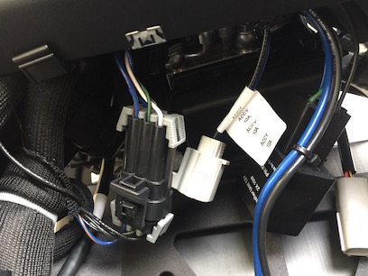 *S model connectors in the forward tank area*

**Sumitomo Connector**

All 2013+ models have a Sumitomo power connector which is weather sealed.

Zero's 12v accessories will plug directly into the Sumitomo connector.

- [OEM 12V outlet](http://www.zeromotorcycles.com/shop/index.php?main_page=product_info&cPath=15_5&products_id=143)
- [OEM Accessory power splitter](http://www.zeromotorcycles.com/shop/index.php?main_page=product_info&cPath=15_5&products_id=193)

[Eastern Beaver makes motorcycle 12V circuitry parts](http://www.easternbeaver.com/Main/main.html) including Sumimoto connectors:

- [Sumitomo TS090 Sealed Connectors](http://www.easternbeaver.com/Main/Elec__Products/Connectors/Sealed/SMTS/smts.html)

**SAE Connector**

2014+ models also include a standard [SAE connector](https://www.peigenesis.com/images/content/pei_tabs/amphenol/ac-series/5015-ac-threaded.pdf) in the same area on the same circuit and fuse.

The SAE connector is more common for third party accessories and can be easily adapted to other plugs (such as coaxial for heated gear) very easily.

[Patrick Truchon wrote up his 12V port enhancement](http://ptruchon.pagekite.me/wiki/zerodsmods#volt_port):

- [dual USB adapter](http://www.ebay.ca/itm/Weatherproof-Universal-USB-Charger-Adapter-Socket-12-V-to-5-V-Outlet-Power-Jack-/121412406017?hash=item1c44be4b01)
- He shows how he built a splitter and USB outlet into the plastic tank bin.

**Accessing Ports on the S/DS/SR/DSR**

Tools

- Torx T45 wrench (MY2015+) or 5mm allen key (MY2013-2014) to [remove the seat](https://web.archive.org/web/2025/https://zeromanual.com/wiki/Seat_Removal).
- 3mm allen key wrench to remove plastics.

Steps

1. [Remove the seat](https://web.archive.org/web/2025/https://zeromanual.com/wiki/Seat_Removal).
2. [Remove the tank plastics](https://web.archive.org/web/2025/https://zeromanual.com/wiki/SDS_Platform/Tank_Plastics/Removal).
3. Tucked under the frame near the helmet lock, you will see a Sumimoto connector with a cap installed and a SAE 2-pin connector with some dielectric grease on the end.

   With a Power Tank or Charge Tank installed, accessing the plugs and signal relay forward is impeded from behind and above.

   We recommend accessing them from below, using a flashlight and possibly needlenose pliers.

   The Power Tank can be pulled out more easily than the Charge Tank but is very heavy.

**[12V Accessory Socket Kit Install (S Platform)](https://web.archive.org/web/2025/https://zeromanual.com/wiki/12V_Accessory_Socket_Kit_Install_%28S_Platform%29)**

This installs [12V Accessory Socket Kit](http://www.zeromotorcycles.com/shop/index.php?main_page=product_info&products_id=206) for 2014+ S Platform models.

[12V Accessory Wiring Harness](http://www.zeromotorcycles.com/shop/index.php?main_page=product_info&products_id=193) for 2013+ S Platform models also applies.

**Reference Video**

- [AIKI Rob's Zero DSR usb accessory and helmet mods](https://www.youtube.com/watch?v=vRN2ZtbXeNw):

**Steps**

1. Loosen collet from accessory kit and set aside

   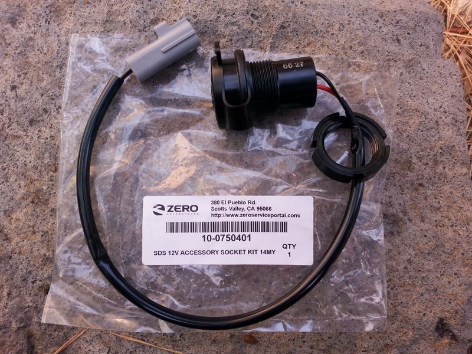 *12V accessory kit with loosened collet*
2. Remove rubber blank from the right-side plastic shoulder piece around the instrument cluster.

   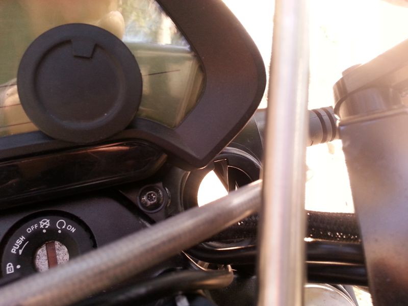 *12V port rubber blank removed from the shoulder piece*

   This is now an extra part you will not be needing while the accessory power kit is installed.
3. Feed the wire assembly through the hole in dash and align the 12v socket key into the keyway of the hole in the dash.

   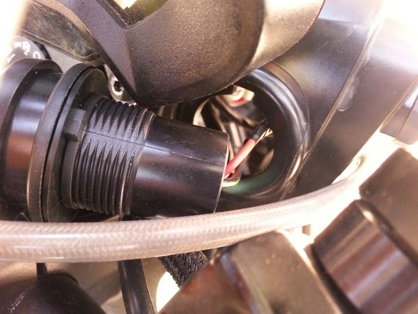 *wire fed through hole*

   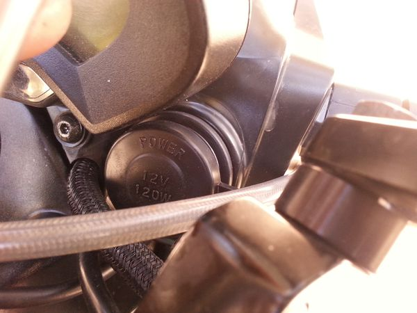 *port aligned in hole*

   You may want to undo the right-hand turn signal light 2x 3mm mushroom socket head bolts, to get better access and visibility.
4. Return collet over wire assembly and rotate to fasten the 12v socket into place.

   Take care not to pinch the turn signal wires.

   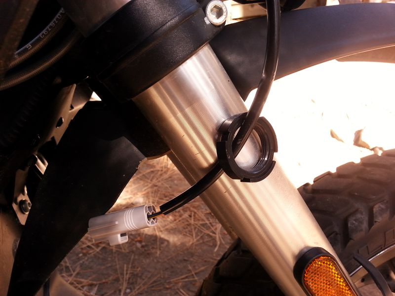 *collet along wires*
5. Route wires to left-hand side and into compartment.

   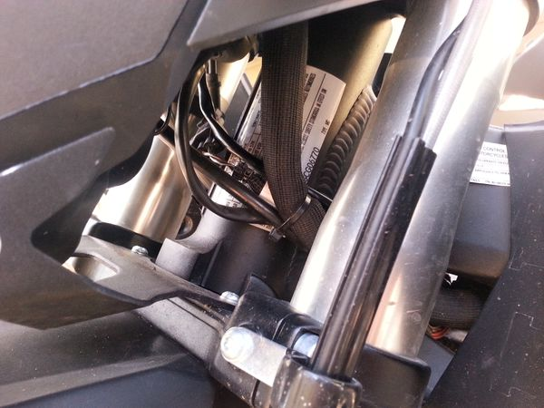 *routing the wires across to the left*
6. Remove rubber protective boot from Sumitomo socket and connect to 12v accessory socket wiring Sumitomo plug.

   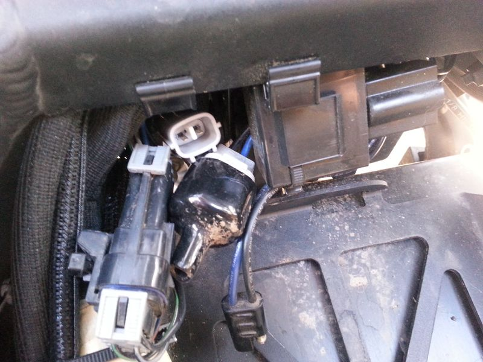 *Sumitomo location*

   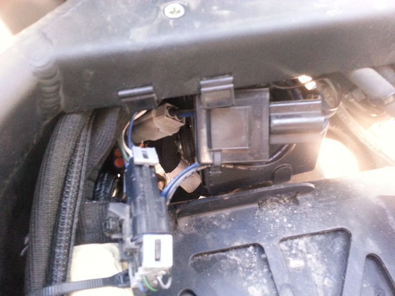 *Sumitomo connected*
7. Button up everything. You are done!

**[12V Accessory Socket Kit Install (X Platform)](https://web.archive.org/web/2025/https://zeromanual.com/wiki/12V_Accessory_Socket_Kit_Install_%28X_Platform%29)**

This installs the [12V Accessory Socket Kit](http://www.zeromotorcycles.com/shop/index.php?main_page=product_info&products_id=143) for 2013+ X Platform models.

**References**

[Installing a USB adapter for the SAE port on an FX](http://electricmotorcycleforum.com/boards/index.php?topic=6235)

[Installing a USB adapter (post about the FX on a more general thread)](http://electricmotorcycleforum.com/boards/index.php?topic=3777.msg41542#msg41542)

### Heated Accessories

Heated handgrips and heated seats were offered from 2013-2014 but have since been discontinued. The handle bar changes in 2015 made the handgrips non-transferrable.

Aerostitch [noted some interesting details](http://www.aerostich.com/blog/zero-winter-test-bike-preparation/) while installing these heated grips:

- [Bikemaster 7/8" heated handgrips](http://www.aerostich.com/a-to-b-utilities/rider-comfort/grips-accessories/bikemaster-7-8-heated-grips.html)

### New Circuits

How to tie into +12v and bypass the fuses for [SDS Platform](https://web.archive.org/web/2025/https://zeromanual.com/wiki/SDS_Platform) models.

**Instructions**

1. [Remove the seat](https://web.archive.org/web/2025/https://zeromanual.com/wiki/Seat_Removal)

   The fuse box will be under the left side of the Y-arm under the seat that connects the frame's tail to the crossmember around the battery.
2. Remove the bolt on the left that holds the fuse box in place.

   This will allow the box to swing towards you and out from under the frame.

   On top of the fuse box are a bunch of blue connectors.

   They're the female side of spade connectors, covered by a rubber boot.

   The male side comes out of the top of the fuse box.
3. Pick a connector and pull the blue boot straight up and off.

   Underneath, you'll see the male connector, with a small hole in the end.
4. Connect your circuit's wire.

   If you're daring, you can try to thread your connector wire through this hole.

   You might instead strip off an inch or so of the wire from the new circuit, make a loop, and drape it around the male connector.
5. Twist, wrap, tape or solder your loop once it's around the connector so it's reasonably tight.
6. Replace the female connector in the blue boot back onto the male connector.

   Push hard so it goes all the way down and presses the wire loop down against the top of the fuse box.
7. Test your new circuit/load.
8. Apply electrical tape as you see fit.
9. Replace the left bolt in the fuse box.
10. Replace the seat.
11. Test your new circuit/load again.

### Horn

**Install reports**

One installation with pictures, for a [Screaming Banshee](https://screaming-banshee.com/): [Air horn on the DSR 2016](http://electricmotorcycleforum.com/boards/index.php?topic=6383)

One simpler install of [Hella Supertones](http://www.myhellalights.com/index.php/products/horns/twin-supertone-horn/): [Horn mod](http://electricmotorcycleforum.com/boards/index.php?topic=4294)

[Stebel Nautilus Horn Connection Question](http://electricmotorcycleforum.com/boards/index.php?topic=6910)

**Other discussions**

[Has anyone replaced their horn with something people will actually hear?](http://electricmotorcycleforum.com/boards/index.php?topic=5962)

## Frame

### Plastics/Bodywork

#### Swap Colors

Zero S/DS/SR/DSR plastics are all interchangeable, aside from DS/DSR plastics being a different shape around the thighs (to allow for an easy transition to/from a standing position).

Zero doesn't make this clear on their website, but you can order any plastics that they offer through the dealer network - so, any color that has been offered for a model-year is probably in stock and can be shipped.

The default tank plastics are the cheapest ($100 for a tank), the Power Tank plastics are slightly more expensive, and Charge Tank plastics are closer to a few hundred dollars.

[Tank plastics exchange](https://web.archive.org/web/2025/https://zeromanual.com/wiki/SDS_Platform/Tank_Plastics/Replacement) is very quick, along with the front fender.

[Tail plastics exchange](https://web.archive.org/web/2025/https://zeromanual.com/wiki/Tail_Plastics_Removal) is more involved, but are just as easily ordered.

The front fender plastics only apply to S/SR/FXS models - DS/DSR/FX models have a 19-inch front wheel which does not accommodate it without creating offset brackets.

#### [Splitting Up Tank Plastics](https://web.archive.org/web/2025/https://zeromanual.com/wiki/SDS_Platform/Tank_Plastics/Splitting)

The centerpiece of the [tank plastics](https://web.archive.org/web/2025/https://zeromanual.com/wiki/SDS_Platform/Tank_Plastics) is plastic welded with retaining lock washers through/around holes in the side pieces.

The lock washers can be detached either with very focused heat application (a soldering iron works; a hot air gun will be less precise) or just taking a pair of pliers and carefully twisting each weld back and forth until it deteriorates and can be broken off.

The centerpiece you remove will no longer be joinable the same way, but you can take a fresh one and make plastic welds to join it to the side pieces.

As of mid-2017, the Charge Tank plastic centerpiece is separately available under part number 24-08137 for $40 (without the plug bracket that is about $100, and without the retaining washers). The Power Tank plastics might presumably be separately available.

#### Applying Vinyl

Get a professional to do it if you're not very patient, unless you have experience working vinyl. The compound curves of the tank plastics are not too easy to wrap with.

#### Plastidip

#### Painting

#### Lidded Tank Waterproofing

2017 S platform models introduced a nicer-designed locking-lid tank compartment for the stock tank plastics.

**Problem**

The enclosed storage bin has a drainage hole for moisture, but the lid rim is not waterproof.

**Solution**

Apply an appropriate gasket seal (to be determined) to the edge of the lid.

Ref. [tank storage sr 2017 not waterproof?](http://electricmotorcycleforum.com/boards/index.php?topic=7118)

### Luggage Rack Installation

#### [OEM Top Rack](https://web.archive.org/web/2025/https://zeromanual.com/wiki/OEM_Top_Rack_Install)

This is for installing the [Zero Top Rack](https://web.archive.org/web/2025/https://zeromanual.com/wiki/Zero_Top_Rack) on [SDS Platform](https://web.archive.org/web/2025/https://zeromanual.com/wiki/SDS_Platform) models.

This process takes about 15 minutes and is very easy.

 *Top rack package label*

**Video Guide**

[Zero motorcycle - How to install a top case mount and case](https://www.youtube.com/watch?v=mvpENk5ddhY) by [Alternative Standard on YouTube](https://www.youtube.com/channel/UCw9faNzFHkqXDsybkH7Qqig)

**References**

Adapted from this forum thread: [Zero top rack and GIVI case install](http://electricmotorcycleforum.com/boards/index.php?topic=5887).

**Parts**

- (2) Hex socket button-head bolts (M6⨉16-8.8)
- (1) Rack steel hardware
- (1) Rubber bumper
- *for 2013-2014 models* (2) replacement seat bolts M8⨉50 with rounded ends

**Tools**

- M4 Allen key for the button-head bolts
- *for 2013-2014 models* M5 Allen key for the replacement seat bolts
- *for 2015-2018 models* T45 Torx wrench for the seat bolts.

**Instructions**

1. [Remove the seat](https://web.archive.org/web/2025/https://zeromanual.com/wiki/Seat_Removal).
2. Place the rubber bumper over the tab that extends from the top plate.

   This will rest on the end of the tail plastics, and avoids scratching them.

   
3. Set the rack hardware onto the tail.

   The tab that extends from the top plate should point downwards and rest on top of the end of the colored tail plastics.
4. At the front of the rack, align the bolt holes:
   - Align the side holes with the seat bolt holes.
   - Align the top holes with the holes on top of the frame's tail members.
5. Ensure the front and back of the rack rest in contact simultaneously.

   The goal is to minimize the dynamic load on the small mounting bolts while riding.

   Hitting bumps at highway speed (if the tail can move freely) can add up over time and break the mounting bolts.

   - Place a washer under the front part of the bracket, *or*
   - Put some adhesive firm padding on the tail to support the tab.

   
6. Fasten the top-front of the rack with M6 bolts to anchor the rack bracket to the top of the frame under the seat.

   Use a light thread-locker fluid to secure these bolts.

   Torque the bolts to 6 ft-lb.

   
7. [Replace the seat](https://web.archive.org/web/2025/https://zeromanual.com/wiki/SDS_Platform/Seat_Install) and tighten the T-45 Torx bolts (MY2015+) or 5mm socket head bolts (MY2013/MY2014; extras are provided) back in through the rear rack frame.

   Torque the bolts to 16 ft-lb.

   

**Loading**

Once the top rack is installed, the bolts holding the seat on are load-bearing.

If the tab under the tail rack does not directly contact the tail plastics while unloaded, going over bumps at speed can wear on the mounting bolts over time and might break them.

Fixing a cushioned (rubbery) spacer underneath it will dampen this dynamic load.

If you need to remove the seat, take off the top case or remove any heavy contents to avoid stressing the rack over time.

[Side racks](https://web.archive.org/web/2025/https://zeromanual.com/wiki/Zero_Aftermarket) (both OEM and Happy Trails) are installed in a way that somewhat stabilize the dynamic load on the top rack, but it's still fundamentally vulnerable to a lever effect on the bolts holding it down.

**Plate Adapter Compatibility**

The Givi M5 adapter does not fit the Zero factory rack without having made some hardware modifications to the plate.

Non-Givi adapters will likely require similar customizations unless they are made for the same fastener geometry.

The plate is made of steel so make sure to coat any exposed surfaces from drilling with paint etc to minimize corrosion.

#### [Givi Monokey adapter plate E251](https://web.archive.org/web/2025/https://zeromanual.com/wiki/Givi_Monokey_Adapter_Plate_Install)

To install any Givi box, get the universal Monokey (part E251) top case adapter.

Zero's top rack is set up for Monolock cases, which are fine but simpler and often smaller.

**Tools**

- M5 hex key wrench
- 10mm hex socket wrench

  Both a deep and shallow socket are helpful for reaching under the rack near the tail and behind it.
- Philips Head (PH1) screwdriver for fastening the cover.
- Blue Loctite threadlocker to keep the fasteners tight in all weather.

**Parts**

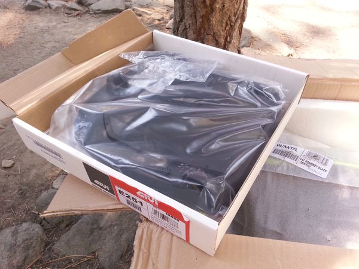

- 1 adapter plate
- 1 thin cover for the adapter plate
- 4 5mm Allen head socket bolts.
- 4 10mm hex nylon locknuts.
- 4 square slotted washers.
- 4 universal clamp brackets.

  The clamps are not needed for the Zero OEM top rack, just the square washers.
- 6 Philips head (PH1) screws for the cover

  2 of these are smaller and only fasten the center of the cover

**Steps**

1. Place the square washers as indicated to match the Zero top rack plate holes.

   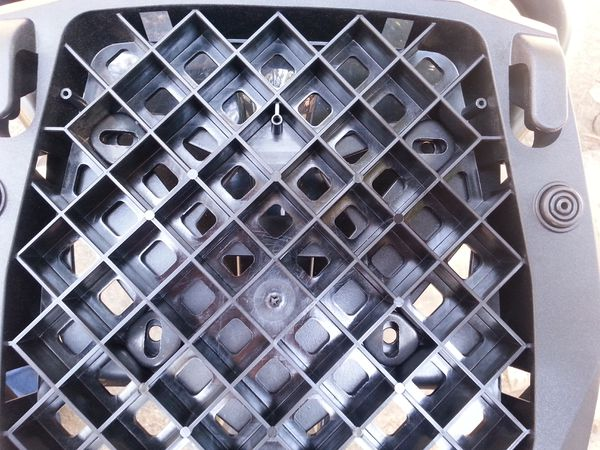

   The square washers can be placed one slot forward or back to position the adapter on the plate.

   A forward position can impede a passenger but provides an easier load on the rack in case that is a priority.

   Rotate two of the square washers so that the slots alternate direction.

   This firmly secures the adapter in the lateral and forward-to-back directions.
2. Install the bolts through the washer slots into the top plate.

   

   These bolts experience heavy weathering from the wheel below, and then the moisture sticks around.

   It helps to use some Blue Loctite threadlocker and corrosion inhibitor on the screws and bolts.
3. Fasten the cover plate with the four corner PH1 screws.

   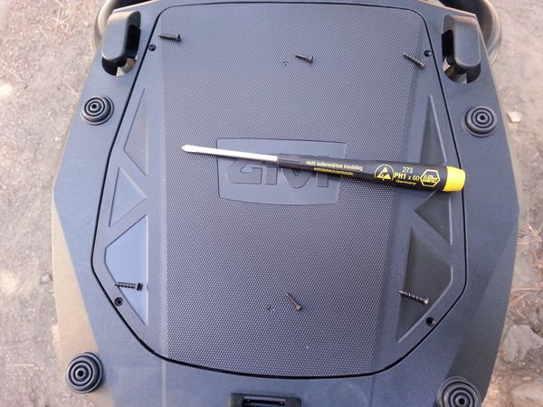
4. Fasten the central two much smaller PH1 screws.

   The smaller screws seem to be free spinning and the threads do not engage when installed.

   A work-around is to stuff some plastic bag material or other filler into the plastic column underneath in the mounting plate where each fastener should attach to.

   This seems like an oversight by Givi and it is not mentioned anywhere in the instruction sheet.

#### [OEM Side Racks](https://web.archive.org/web/2025/https://zeromanual.com/wiki/OEM_Side_Rack_Install)

This installs the [OEM Side Rack](https://web.archive.org/web/2025/https://zeromanual.com/wiki/Zero_Aftermarket).

**Notes**

This process is a little complicated.

My kit did not come with any printed instructions. I found them here: <https://www.af1racing.com/store/ProdImages/st3/ZM10-08119_d7.pdf>

The rack kit comes with reasonably good instructions so for now this only addresses the complications to be aware of:

- The lower mounts are a pair of brackets that bolt to the inside of the frame where the passenger pegs are installed.

  The 2018 Zero S bracket installs inside of the bracket that holds the footpeg (not against the frame as a previous author wrote above, which could be true for other models).

  There is very little clearance in this area, because it faces the motor.

  A telescoping ratcheting wrench or a small open ended socket wrench will be necessary to tighten the bolts.

  Removing the lower side plastics yields some clearance from the front for working with these bolts using a flat wrench.

  Do not fully tighten these bracket mounts until the entire assembly is in place, and then tighten them evenly.
- The assembly that holds the turn signals will be projected rearwards to clear the cases.

  This requires some work with the wiring to re-run them through the new bracket and is slightly awkward but can be finished with a little patience.
- The rubber bumpers needed to dampen side case vibration might fall out if you ride without the cases.

  Maybe apply a little rubber glue or such to hold them in place if this is a concern.
- On the 2018 S (at least, maybe others) there is no ferrite box as described in the instructions.
- The hole through which the rear blinker light wires go is small enough that I taped a string to the wires before I removed them, so I could use it to pull the wires back through during reassembly. You won't be able to get your hand down into the space under the tail fairing to pull them back through. I just used masking tape and was careful to be sure the two connectors were end-to-end so they would fit through the wire-diameter hole one at a time. It worked well and was glad I took the time to use the pull string method.
- When I tried to remove the seat, the right side bolt would not clear the hole in the top box rack tube. I had to use the side of a drill to ream out the hole until the head of the bolt would clear. Zero could have been more careful in this manufacturing step, evidently.

### [OEM Crash Bars](https://web.archive.org/web/2025/https://zeromanual.com/wiki/SDS_Platform/Zero_Drop_Bars/Install)

The police models (SP/DSP) include some [drop bars](https://web.archive.org/web/2025/https://zeromanual.com/wiki/SDS_Platform/Zero_Drop_Bars) with bracketing to mount law enforcement specific equipment like a siren and flashing lights.

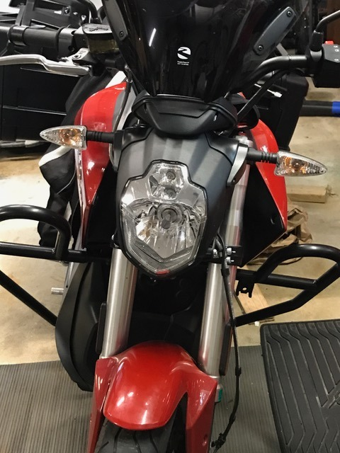 *Installed on an SR (front)*

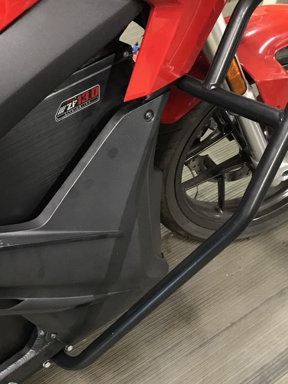 *Installed on an SR (side)*

Both the police versions of these drop bars and less expensive drop bars without the bracketing are available to all owners.

The width is broad; about 7 inches on the top half (for a total 26" width around the frame there), but they taper to the bottom so lean angle is not affected.

Zero does not list all drop bar options on their website, but dealers can request them by part number.

Instructions have not been observed included yet.

**Construction**

Steel tube of 1" outer diameter with a black finish.

**Upper Fastening**

The bars attach to each other via a crosspiece just in front of the frame.

The crosspiece is held to the frame by shoulder brackets on each side.

**Lower Fastening**

The bars have a flange that bolts directly to collared inserts in the metal skid plate.

The metal skid plate is provided on the DS/DSR.

The plastic skid plate provided on the S/SR is swapped for the DS/DSR metal skid plate during installation.

| Part Number | Name | Price | Notes |
| --- | --- | --- | --- |
|  | Police Drop Bars   Includes mounts for siren and lights | $450 |  |
| 10-08062XX | Dual Sport Drop Bars | $250 | 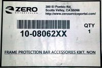 |
| 10-0806203   Rev. 10-08123XX | Frame Protection Bar Accessories Kit, Non-Police, 13-16 MY   Rev. Frame Protection Bar Accessories Kit, Non-Mat(?)   Includes 20-07053-01 skid plate 1PCS PO10224 | 〃 | 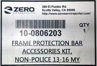    |
| 10-08028 | Zero FX Drop Bars | $175 |  |

**Install Variations**

**2015+:** the frame is predrilled to mount them, but the lower mount varies slightly per model year and may require modification to the belly pan.

**2014:** the belly pan required drilling, and use of Rivnuts. Zero was not cooperative in acquiring, but parts from a downconverted SP were found.

**2015+ DS,DSR:** The skidplate included in the 10-08062XX kit is redundant.

It is the exact same one already on a factory new DSR, with plastic plugs in the threaded inserts that need removed.

**Parts**

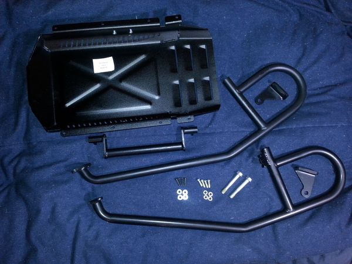 *Non-police drop bar parts*

 *Drop bar fasteners*

 *Included fasteners*

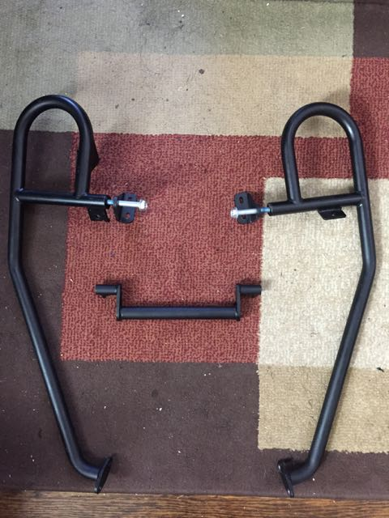 *Structure layed out in installation form*

- (2) Side bars (left and right).
- (1) Crossmember piece.
- (1) Metal skid plate; identical to DS/DSR original skid plate, and must replace an S/SR plastic skid plate.
- (2) Shoulder brackets (left and right).
- (2) Heavy hex head M10x70mm stay bolts - 30mm thread with 40mm shoulder. Stamped "FMI 10.9" on the head.

  These join the crossmember to the bars through the shoulder brackets.
- (4) Shoulder mount bolts: M5x20mm cap head bolts (replacements can have a 5mm long shoulder that is 6mm diameter).
- (5) Wide washers: 6mm ID, 14mm OD
- (4) Narrow washers: 6.5mm ID, 12mm OD
- (2) Toothed lock washers: 5mm ID

  These may be mistakenly included when recorded? No known application
- (4) Lower mount bolts: M6?x15mm hex head bolts.

**Tools**

- Allen wrenches for M5 and M6 bolts (depends on what is chosen).
- 10mm hex socket wrench for the stay bolts.
- *Optional:* Plastic rivet removal tool

  

**Steps**

1. **Pre-2015:** Create frame holes for the upper and lower pair of bolts on each side of the frame.

   Installing rivet nuts as Zero started doing for 2015+ frames is a good practice.

   Zero chose M5 rivet nuts with a 5mm deep, 6mm diameter shoulder space above it. M6 might be a more robust choice.

   One pair goes into the rear/top of the angled bar before it comes to the frame shoulder, 30mm between hole centers.

   One pair goes into the side of the belly pan / bash plate. The DS' metal bash plate is more suitable for this.
2. **S/SR:** [Remove the original plastic skid plate](https://web.archive.org/web/2025/https://zeromanual.com/wiki/Belly_Pan_Removal) and install the included metal skid plate.

   
3. Remove the plastic threaded cover inserts in the pair of holes on each side of the bash plate.

   You may need to remove the plate to rotate them out from the inside. Remount after.
4. Detach the horn bracket (via a hex nut and lock nut) and set it aside.

   You may relocate it closer into the front of the frame or move it to the side (no recommendation here).

   **DS/DSR:** The front fender will interfere with this and the next step. Detach it and set it aside.
5. Install the small shoulder brackets on each side of the frame shoulder area, using the pair of holes to anchor the brackets.

   Each side will have a pair of collared holes in the frame arms near the front of the tank plastics.

   Slide the brackets in from below and behind.

   The holes for the bars will be in front of the frame arms on the outside.

   Do not tighten the bolts until all pieces are in place.

    
6. Take the cross member and place it between shoulder brackets.

   It has a flat edge which should rest against the front of the diagonal frame bars.

   The bar will be very close to the plastics covering the front of the battery, and recessed upward.

   The shoulder brackets might be under tension once the bar is in between the brackets. This is normal.

   
7. Hold the cross member in place by running the M10x70mm bolts through the main holes.
8. Attach each drop bar:
   1. Place the bar against the shoulder bracket with the lower end hanging back but under the bike.
   2. Thread the M10 bolt through the shoulder bracket into the bar's top opening to support the bar.
   3. Rotate the supported bar's bottom end to cover the skid plate.
   4. Thread M6 bolts through the lower end's flange into the collared holes on the side of the skid plate.

       *Lower mount*
9. Tighten the bolts (M10 at top and M6 at bottom) in concert.

   The M10 bolt at top could benefit from either a telescoping socket across the bike behind the forks, or a shallow side socket wrench.

   The M6 bolts below can use a hex socket with an extension.

    *Tightening the crosspiece bolts*
10. Re-mount the horn by either:
    - Re-attaching the horn bracket:

      
    - Attaching the horn to the left bar bracket:

       
11. Once both crash guard bars are fastened tightly, check and tighten the bolts holding the small shoulder brackets.

     *Shoulder bracket fastened*
12. **DS/DSR:** replace the front fender if you removed it before.

**References**

- [Zero Drop Bar Installation on DSR with Pics](https://www.electricmotorcycleforum.com/boards/index.php?topic=8358)

### [Helmet Lock Removal](https://web.archive.org/web/2025/https://zeromanual.com/wiki/Helmet_Lock_Removal)

This removes the helmet lock from the bike.

**Notes**

The following photos feature a *2016-DSR* bike.

**Tools**

- 3mm Allen key
- ...

**Parts**

**Instructions**

1. Remove the front fender
2. Remove the cowl
3. Loosen the bolt holding the ABS module in place from underneath, located above where the front fender was.

   The ABS module appears to be mounted on two or three of these bolts with rubber vibration isolation around the bolts.

   When this bottom bolt is free, the ABS module can be rotated from within the under-cowl area for better access to the innards.

   
4. Drop the flasher relay and accessory power plugs out of the way and, using a mirror, locate the bolt holding the helmet lock in place.

   
5. Loosen the bolts holding the helmet lock in place.

   The left one is more easily accessible.

   Clearances for the right bolt are very tight and it may not be possible to rotate any tool to loosen the right bolt.

   After removing the left bolt, it can be possible to loosen the right bolt by holding the right bolt in place and rotating the helmet lock itself.

   | | |
   | --- | --- |
   |   **Warning:** | The left side bolt will have a ground strap ring and bite washer attached, take extra care DO NOT lose these. |

    *Helmet lock ground strap bolt*

    *Helmet lock mirror tool*
6. *Optional:* [Chargetank Bracket Installation](Common_Modifications.md#Chargetank_Inlet_Bracket "Common Modifications")
7. Reinstall the bottom bolt for the ABS unit bottom bolt, cowl, and front fender.
8. **Advanced:** [Relocate the helmet lock](Advanced_Modifications.md#Helmet_Lock_Relocation "Advanced Modifications")

### [Chargetank Inlet Bracket](https://web.archive.org/web/2025/https://zeromanual.com/wiki/Charge_Tank_Inlet_Bracket_Install)

This is for a DIY installation for the [Charge Tank](https://web.archive.org/web/2025/https://zeromanual.com/wiki/Charge_Tank)'s inlet bracket, useful for many aftermarket charging solutions.

**Parts**

Bracket p/n 12-08047XX (formerly p/n 12-0804713; might also be 26-08096) special order $106 USD

| | | |
| --- | --- | --- |
|  |  |  |
|  |  |  |
|  |  |  |

**Steps (Used MY2016 DSR)**

1. [Remove helmet lock](Common_Modifications.md#Helmet_Lock_Removal "Common Modifications")
2. Thread the grounding strap onto the studded bracket and reinstall it through the frame.

   **Suggestion:** Use a short section of painters masking tape stuck around the thread of the studs to itself like a "flag" to keep the ground strap secure in its position until the studded bracket can be fully seated to where the helmet lock used to be secured.

   The "flag" can be pulled up through the bolt holes in the frame and removed when ready.

   **FIXME:** There is an alternative way to secure the ground strap which is easier and recommended by the OEM.

   
3. ?? Take a guess. There's a bag of parts.

   **FIXME:** Describe what all the parts are and how they should be installed.

   

   
4. With the inlet bracket installed, two of the top mounting holes on the bracket are meant to be fastened through the chargetank cowl and into the inlet bracket.

   You only need to mount the J1772 inlet itself to the bracket using the rear top two locations.

   The front top two locations will be further secured when the chargetank cowl is mounted.

## Handlebars and Controls

### Third-Party Mirrors

Any aftermarket "stalk" mirrors or mirror extenders with the Yamaha/Ducati-style left-hand-threaded right mirror will fit.

The bolt/thread specification appears to be M10 with x 1.25 pitch, left-hand-threaded on the right side.

#### Bar-End Mirrors

**2013-2014**

7/8" bar-end mirrors are generally compatible, including offset and fold-away models, but the rubber grips must be cut to give access for installation.

**2015-current**

7/8" bar-end mirrors are likewise compatible.

The bar ends are sealed with a round nub at the end.

Pull the nubs off with pliers to remove.

[Installation is straightforward](http://electricmotorcycleforum.com/boards/index.php?topic=6091.msg46348#msg46348) and doesn't deviate from the manufacturer's instructions.

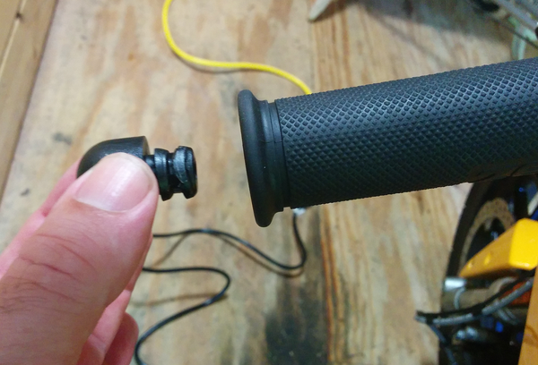

Owners have reported that bar-end mirrors by [Constructors Racing Group (CRG)](http://constructorsrg.com/mirrors/arrow.html), Ferrara and [Astra Depot](https://smile.amazon.com/dp/B01DIHK7TU) work.

**With Cycra Hand Guards**

Mirrors of this type ([Cheap Amazon Mirrors](https://www.amazon.com/gp/product/B01MY5HROM/ref=oh_aui_detailpage_o02_s00?ie=UTF8&psc=1)) work very well by putting them outboard of the hand guards and securing with a longer screw (M8-1.25 x 70mm, SS philips head from Home Depot will do).

An alternative, and perhaps less elegant approach, can be found at this video link, using a Bike Master product (3" round mirror) and a 10-24 x one inch machine screw:

### Bar Risers

Zero S/DS/SR/DSR models have 1⅛" diameter (28mm), 2" length clamps which are common dimensions so can be supported by most vendors.

**References**

[Handlebar Riser install slideshow walkthrough on YouTube](https://www.youtube.com/watch?v=UTjSncCgRt0)

### Clip-On Handlebars

**Video Walkthrough**

[NewZeroland by Sam Baker shows the process of getting clip-ons onto his Zero SR](https://www.youtube.com/watch?v=stx-5wEIgDs):

- One hack is to [rotate the handlebars](http://electricmotorcycleforum.com/boards/index.php?topic=3884.msg23752#msg23752) (or rotate a compatible replacement set) to get the desired height/angle.

### Disable ABS

Options for disabling ABS, particularly for offroading with downhill runs:

- Per the official manual, you can disable ABS once per active session.
  1. Place the kickstand down.
  2. Turn off the Motor Stop switch.
  3. Key the bike on.
  4. On the dash, press and hold both the ADJ and MODE buttons simultaneously.

     Wait about 4 seconds until the ABS light starts flashing slowly, then release both.
  5. Restore by getting the contactor to open, by keying the bike off without being plugged in.
- Remove power to the ABS pump (works basically permanently).
  - Remove the ABS pump fuse under the seat.
  - Disconnect the power connector to the pump itself.

    Cover the connector to prevent electrical problems, and tape it to prevent wear from shaking while riding.

### Brake Lever

A 2014 Zero FX brake lever replacement [was found on Ebay](http://electricmotorcycleforum.com/boards/index.php?topic=6252.0). It seems that the Suzuki DR350 has a compatible shape or even the same system as the front 13-14 brakes:

- [Emgo 30-64881 Emgo Brake Lever Suzuki DR350SE 90-99](http://www.ebay.com/itm/Emgo-30-64881-Emgo-Brake-Lever-Suzuki-DR350SE-90-99/311672704832)
- General instructions: [Front Brake Lever Replacement](https://web.archive.org/web/2025/https://zeromanual.com/wiki/Front_Brake_Lever_Replacement)

### [Brake Lever Regens before Pad Contact](https://web.archive.org/web/2025/https://zeromanual.com/wiki/Brake_Lever_Adjustment_to_Regen_Before_Pad_Contact)

This is a variation of the [Brake Lever Adjustment](https://web.archive.org/web/2025/https://zeromanual.com/wiki/Brake_Lever_Adjustment) procedure to allow better regen and coasting control on a Zero.

**Goal**

While using **Custom Mode**, touch the brake lever gently to get the **Custom max regen brake** regen level without using the brake pads.

This exercises more control over when to coast and when to slow down, particularly when using the economizing hack of 0% **Custom max regen** and 100% **Custom max regen brake**.

**Mechanism**

The **brake light switch** on the side of the right hand switch assembly also activates the **Custom max regen brake** regen level.

- The brake lever at rest normally presses it down (i.e., when you're not squeezing the lever to stop).
- Squeezing the lever increases the distance between it and the switch and the switch gets *released* to activate the brake light.

The brake lever depresses the hydraulic cylinder from the front via a **push pin**, which has an adjustment knob to change the brake lever distance.

- See the **Front Brake Lever Adjuster** section of the [Official Owners Manual](Official_Owners_Manual.md "Official Owners Manual") for a basic diagram and description.

Adjust the front brake lever to release the **brake light switch** before the **push pin** contacts the hydraulic actuating cylinder.

**Risk/Warning**

- The pressure from the master cylinder is what supports the lever to keep the **brake light switch** pressed down.
- So, when shortening the **push pin**, the lever becomes more wobbly and more likely to accidentally trigger the **brake light switch** due to vibrations or wind.

  See [Lurching/jerking issue, as if pumping brake](http://electricmotorcycleforum.com/boards/index.php?topic=6224.0).
- Also, the brake lever needs to be squeezed closer to the throttle.

  Don't shorten the **push pin** so much that the lever contacts the throttle too easily, limiting full braking power.

  With good brakes that should not happen, but if you have air in the system your front brake might be squishier than normal and you might not be able to pressurize it fully, thus you may not stop as fast as it would be possible otherwise.

If your disk brake doesn't engage immediately upon contact with the hydraulic actuating cylinder, you can set the regenerative brake activation immediately after the lever contacts the cylinder.

Other preventative measures:

- Using a longer or stronger spring.
- Placing something in the spring slot to (slightly) shorten it.
- Increase the friction between the brake lever and its seat by coating the contact areas with paint, etc.

**Tools**

(Optional) 7/64 wrench for the **brake lever adjustment knob**.

Small flat-blade screwdriver for the **brake light switch** set screw.

(Optional) Light thread-lock compound (Blue Loctite, say).

**Steps**

1. Adjust the **brake lever adjustment knob** to engage the brake as loose as seems comfortable.
2. Then, adjust the set screw to activate the **brake light switch** earlier in the engagement pull.
   - Or, per [this forum thread for an FX](http://electricmotorcycleforum.com/boards/index.php?topic=5837), add a 0.5mm thick washer to the brake line switch.
3. Test ride to calibrate this.
   - Ensure it is safe to engage and release.
   - Ensure it is not difficult to fully engage the brake pads themselves.
4. (Optional) use thread-lock compound to ensure the set screws stay where desired.

**References**

- See [Re: Solved: Full regen instead of 50%](http://electricmotorcycleforum.com/boards/index.php?topic=6805.msg55069#msg55069) for the thought process framing this documentation.
- See also the [third-party brake light modifications](https://web.archive.org/web/2025/https://zeromanual.com/wiki/Zero_Aftermarket) that help alert drivers when using regen.

### Footpegs

A [photo from "Say10"](https://electricmotorcycleforum.com/boards/index.php?topic=5202.0) shows that the ProTaper footpegs made for Zero are the same part number ([Protaper 023203](https://www.protaper.com/product/4/23-platforms-footpegs/steel)) as their footpegs for the 2010+ Suzuki RM-Z 250/450.

### Handguards

#### [OEM Handguards](https://web.archive.org/web/2025/https://zeromanual.com/wiki/OEM_Handguards)

**Products**

[OEM Cycra handguards for 2013-2014](http://www.zeromotorcycles.com/shop/index.php?main_page=product_info&cPath=15_2&products_id=178)

[OEM Cycra handguards for 2015+](http://www.zeromotorcycles.com/shop/index.php?main_page=product_info&cPath=15_2&products_id=221)

**Details**

Zero provides versions of Cycra handguards [customized to fit around the Zero brake lever geometry](http://electricmotorcycleforum.com/boards/index.php?topic=5381.msg38545#msg38545).

The brake lever customization is why the part numbers vary from 2013-2014 models and 2015+ models - the front brake system and reservoir differ.

Fitment for DS/DSR/FX/FXR are identical. S/SR fitment is likely.

Cycra equivalent parts:

- [Cycra Black Anodized CRM Bar Set with Plastic Bumpers](http://cycraracing.com/cycra-7006-12-black-anodized-aluminum-probend-crm-bars-black-plastic-bumpers/) (requires bending for right side)
- [Cycra Black Anodized Handguard CRM Clamp Set Oversize 1-1/8 Bars](http://cycraracing.com/cycra-1361-12-probend-crm-center-reach-mount-1-1-8-handlebar-clamps-black/)
- [Cycra Bar Ends](http://cycraracing.com/cycra-1053-02-probend-bar-end-set-for-composite-and-alloy-probend-handguards/)
- [Cycra Black Handguard Shields](http://cycraracing.com/cycra-1015-12-replacement-classic-enduro-handshields-black/) (multiple colors available)

**Inventory**

**[Cap Screw Corrosion](http://electricmotorcycleforum.com/boards/index.php?topic=6532.msg51655#msg51655)**

Both Cycra and Zero's customized handguard kits come with socket cap bolts that corrode too easily.

Replace them with equivalent stainless socket cap screws for better weather resistance.

Example replacements: [M5X25 Socket Head Cap Screw FT Stainless Steel A2 DIN 912](http://www.mrmetric.com/M10628)

**Installation**

MY2016 DSR used for photos.

See also [Zero FX Handguard Installation](http://electricmotorcycleforum.com/boards/index.php?topic=6532)

**Tools**

PH2 bit, 6mm hex bit, 13mm socket, 4mm hex bit, channel locks pliers (optional).

**Contents**

(Ref kit 10-0806001 SDS HAND GUARDS BLACK)

Smaller left/right plastics, Self-tapping PH2 fasteners approx 12mm length (4 qty), thick metal washer, thin metal washer, handlebar mounting inserts (2 qty), alternative inserts for larger I.D handlebar tube (2 qty).

Larger left/right plastics, mounting brackets, metal washers (6 qty), self-tapping PH2 fasteners approx 12mm length (6 qty).

Handlebar left/right mounting clamps

**Steps**

1. For left and right assemblies each, align the plastic end cover with matching bracket.
2. Affix with self-tapping PH2 (approx 12mm length) fasteners

   Use moderate pressure and be sure to drive the screw straight into the bracket.

   This can be tricky because the plastics do not conform exactly to the metal bracket.

   

   **Note:** It seems easier to start with the inside corner fastener first and then working outside to the end of the bracket.
3. For each of the six PH2 self-tapping screws, insert one screw through washer then plastic hand guard and into hole on aluminum bracket.

   

   **Note:** Again it seems easier to start with the fastener on the inside corner first, and then follow with the two fasteners on the straight run towards the end of the bracket.
4. Remove 6mm hex bit bolts from handlebar mounting insert hardware as shipped.

   Insert bolt into end of assembled guard bracket, then a washer (thick for throttle / right side and thin for non-throttle / left side), an appropriate expansion insert for the diameter of your handlebar tube, and a cone nut.

   - Do not tighten too much, but be sure this is snug fitting so that friction allows the 6mm bolt to be tightened without supporting the pieces that will be free-standing in the tube.
   - If this is too lose, you would insert the assembly into the tube and not be able to tighten.
   - If it is too tight, the cone nut will expand the mounting insert and it won't fit into the tube.

   

   **Note:** The washers look to have a bit of a cone shape. Best guess is to point the narrower end towards the head of the bolt.
5. Using a channel locks pliers or maybe just pull with your hands, remove plastic plugs from handlebar ends.

   
6. Insert the appropriate handlebar guard assembly that has been prepared.

   
7. While holding the handlebar guard assembly true and flush with the end of the handlebar, tighten the 6mm hex bit bolt until the assembly is secure.

   This took a bit of wrenching and not sure about torque specifications so be careful there;

   tighten until the assembly doesn't wiggle around too much and is positioned where you want the outside end of it to be for the install.

   
8. Lay out the handlebar clamp assembly: 4mm hex bit bolts (4 qty) in tapered cap end bracket, tapered bracket clamp, bushing, 13mm hex socket bolt. R is right side and L is left side.

   The manufacturer imprint should read upside-down (this is obvious when you notice the taper of the clamp and how the Zero handlebars are a wider diameter at the fork clamps and tapering down to a smaller diameter outward towards the handlebar grips).

   Set aside the bushing and 13mm hex socket bolt for the final step.

   
9. Install the handlebar clamp bracket to the handlebar tube and tighten the 4mm hex bit bolts.

   Use a 16mm socket for reference of the gap between the fork handlebar clamps and the handlebar guard clamps.

   Don't worry about trying to make the open threaded end line up with the slot in the handlebar assembly, the assembly will be bent into place to meet the clamp later.

   Try to install the clamp so it is at a reasonable angle (for this install it kind of points towards the middle of the height of the dashboard display).

   
10. Grab that bushing and 13mm hex socket bolt from earlier.

    Install the bolt through slot in the handlebar guard assembly, then the bushing, and bend the whole contraption into place so you can get threaded into the clamp bracket.

    **Note:** To avoid cross-threading the clamp bracket, take your time and use your hands to get it started.

    **Note:** For this install, it was attempted with the bushing to the inside and to the outside of the two metal brackets versus the head of the bolt; Bushing sandwiched between the two metal brackets seems to be the best but you may want to throw a washer on the head of the bolt and perhaps some Loctite on the threads. *(Needs to be verified against the original instructions if anyone has these?)*

    
11. Done! Tighten everything again to your liking.

**Left-over parts**

Plastic handlebar caps, alternative handlebar inserts.

#### Barkbuster

**[Barkbuster Storm Handguards](http://www.barkbusters.net/products/storm)**

These use bar-end mounts only, avoiding handlebar modifications.

Revzilla has them at a good price. [BikeWorld review](http://www.webbikeworld.com/r5/barkbusters-storm-hand-guards-review/)

Confirmed fit on a 2017 Zero SR with stock handlebars.

**[Barkbuster Blizzard Universal Handguards](http://www.revzilla.com/motorcycle/barkbusters-blizzard-universal-handguards)**

Provides additional coverage for cold/wet weather.

The Blizzard handguards fasten directly over top the Storms for less defection at speed while keeping your hands warmer.

.jpg)

#### Powermadd

**[Powermadd Star Series Handguards](http://www.powermadd.com/products/starserieshandguard.html)**

Confirmed fit for 2014 S using their ATV and Motorcycle Mount Kit.

Extensions are inexpensively available for a little more protection from the wind and elements.

**[Powermadd Star Series Handguard Extension](http://www.powermadd.com/products/Handguards/star/StarSeriesHandguardExtension.html)**

### Handgrips

Zero handlebars are 7/8" near the controls and grips, so any handgrips for that size should work.

[Forum thread on grip size and options](http://electricmotorcycleforum.com/boards/index.php?topic=6024.0)

[Crampbusters](http://www.crampbuster.com/) are a very good and cheap solution ($10 USD) for grip ergonomics if the existing grips are acceptable but your hands get tired in traffic or on the highway.

### Handlebars

Zero handlebars are 1 1/8" through the risers, so many handlebars will be suitable to adapt (e.g. ProTaper).

**Confirmed fit**

[ProTaper EVO Adventure Bars](http://protaper.com/default/controls/handlebars/handlebars/evo-adventure-bars.html)

**Installation**

Remove the handlebar clamps.

Remove the controls from the stock bars.

Take measurements from the stock handlebars for what hole pattern the controls mount to.

You will have to drill one hole to mount the throttle and potentially three holes for the switch gear.

Install the controls over the new set of bars.

Mount the handlebars with the clamps. Make sure to use thread-locker fluid to hold them in place once the positioning is verified.

### [Throttle Lock](https://web.archive.org/web/2025/https://zeromanual.com/wiki/Throttle_Lock)

**Goals**

Generally, a throttle lock is a cheap way to get a basic cruise control mechanism.

Electric motorcycles never stall and have a broad torque curve, so throttle locks are very effective despite their simplicity.

A Zero with a cruise control will speed up and slow down to maintain an overall constant power/torque output, which makes range and power consumption much more predictable.

5% range gain can be had just from removing wrist adjustments from the throttle.

Holding a throttle steady is a source of fatigue, so a lock helps minimize that.

**Hazards**

Any traction loss with an electric motor while using a throttle lock is dangerous.

The rear wheel could spin up rapidly, faster than one's reaction time.

This wastes precious seconds when the bike could lose stability and go down, when the throttle should be immediately eased off and balance recentered.

For this reason, using a throttle lock should be limited to highway stretches with good visibility and no traction risks.

Make sure, otherwise, that you can release the throttle lock very quickly and easily to avoid an emergency.

**Tested Options**

- Brian Rice found and installed an [Atlas throttle lock](http://www.atlasthrottlelock.com/) which seems to suit the Zero well, particularly because it avoids taking up valuable handgrip space and has a generic fitment. The Magura throttle's space for the Atlas to fit into is extremely narrow, though.

  Atlas nicely posted a [comparison chart](http://www.atlasthrottlelock.com/pages/throttle-lock-comparison-chart) illustrating how different throttle lock mechanism approaches have tradeoffs.

  **NOTE:** The original version (before top and bottom mounts were distinguished) was thinner and easier to fit.

  [Some have reported](https://www.facebook.com/groups/zmcowners/permalink/1708192532583281/) using a fine amount of milling to fit the Magura throttle on 2013-2014 models, and even for later model years.
- [Go Cruise throttle lock](http://www.2wheelride.com/throttle_pro.html) is generic and easy to use, but does take up space on the inside of the throttle grip, which can make the throttle and mode switches harder to use.
- [Kaoko throttle locks](http://www.kaoko.com/) operate as bar ends with a dial and are good if the bike fit is confirmed, which Zero does not have.

### [Cruise Control](https://web.archive.org/web/2025/https://zeromanual.com/wiki/Cruise_Control)

Only available on [Gen3](https://web.archive.org/web/2025/https://zeromanual.com/wiki/Gen3) [SRF Model](https://web.archive.org/web/2025/https://zeromanual.com/wiki/SRF_Model).

For [Gen2](https://web.archive.org/web/2025/https://zeromanual.com/wiki/Gen2), see Crampbusters or the [Throttle Lock](https://web.archive.org/web/2025/https://zeromanual.com/wiki/Throttle_Lock) options.

### Windscreen

**OEM options**

[Zero OEM Touring Screen 10-08058 MY2016 S, SR, DS, DSR](http://www.zeromotorcycles.com/shop/index.php?main_page=product_info&products_id=230) $250.00

#### [OEM Touring Screen](https://web.archive.org/web/2025/https://zeromanual.com/wiki/OEM_Touring_Screen_Install)

This installs the [OEM Touring Windscreen](https://web.archive.org/web/2025/https://zeromanual.com/wiki/Zero_Aftermarket) on any Zero model.

**Notes**

Used a MY2016 DSR

OEM Screens are from MRA; most MRA screens for naked bikes have the same hardware type, so these instructions apply to the commuter screen as well, aside from the spoiler.

**Tools (common to many MRA mounts' hardware)**

- 6mm Allen key wrench for the handlebar clamp bolts and replacements.
- 3mm Allen key wrench for the screen mounts.
- (Optional) flat blade screwdriver to set spoiler adjustment tension/firmness.

**Contents of kit (TOURING SCREEN 10-08058 $250 usd)**

- Windscreen assembly, plastic edge piping trim and two metal clips.

- A lot of these things are shrink wrapped to a card.

**Steps**

1. Assemble ball socket windscreen things to be tensioned by nuts and socket head bolts

   
2. Orient ball mount assemblies and slide on handlebar mounting brackets

   
3. Prepare windscreen through-mount pieces and affix to windscreen

   
4. Mount to handlebars using provided bolts to replace the top stock handlebar clamp bolts. Torque per the owner's manual.

   
5. Add piping

   Begin with one end

   

   Add a clamp

   

   Trim to length and add the other clamp. If enough is left over you could attach some to the bottom.

   

**Left-over parts**

- Handlebar clamp bolts
- Piping scrap.

## Lighting

### Headlamps

The entire headlamp may be replaced with some work.

 *Front view of Zero SR 2014 with new LED headlamp*

The picture shows the [TruckLite 7" LED Headlight](http://www.truck-lite.com/webapp/wcs/stores/servlet/ProductDisplay?storeId=10001&urlLangId=-1&productId=48710).

It is necessary to replace or remove the existing Zero headlamp housing.
This also means adding another possibility to mount the new headlamp.

 *Side view of Zero SR 2014 showing the headlamp bracket*

In this case, as shown in the picture, I chose the [Highsider headlamp bracket set Z-STYLE](http://www.highsider-germany.de/produkt/highsider-z-style-alu-headlight-bracket/?lang=en).

**Headlamp Housing**

You will also need a cover/encasing for the 7" headlamp.

This is what I did: I bought a cheap [7" British Style Cafe Racer Flat Black Headlight](http://www.motorcyclesunited.eu/7-british-style-cafe-racer-flat-black-headlight.html) and replaced the old lamp with the LED.

 *Details of the remaining bracket holding the dashboard in place*

I only removed some parts of the original bracket, because it also holds the dashboard in place.

With changes to the mounting bracket or some DIY, it should be easily possible to mount the LED headlamp higher to provide better coverage of the innards.

**Pro tip:** don't enter "innards" to google's image search.

For the final adjustments, add a [windscreen](#Windscreen) for round headlights.

#### Headlamp Products

**Headlamp**

[TruckLite 7" LED Headlight (SKU 27270C)](http://www.truck-lite.com/webapp/wcs/stores/servlet/ProductDisplay?storeId=10001&urlLangId=-1&productId=48710)

[TruckLite 7" LED Headlight (SKU 27270C) on Amazon](https://www.amazon.com/Truck-Lite-27270C-Headlamp/dp/B007K8AA7I)

**Headlamp Housing**

[7" British Style Cafe Racer Flat Black Headlight](http://www.motorcyclesunited.eu/7-british-style-cafe-racer-flat-black-headlight.html)

[7" Headlight (DE)](https://www.louis.de/artikel/hauptscheinwerfer-7-zoll/10033015?list=298430225)

["motorcycle headlight housing" Google search](https://www.google.com/search?q=motorcycle+headlamp+housing)

**Brackets**

[Highsider headlamp bracket set Z-STYLE](http://www.highsider-germany.de/produkt/highsider-z-style-alu-headlight-bracket/?lang=en)

## FX/FXS Specific

### [Chain Kit](https://web.archive.org/web/2025/https://zeromanual.com/wiki/Chain_Kit)

Zero offers some chain kit options that include front and rear sprockets and a 520 DID X-ring chain.

- [Enhanced Chain Kit for FX/FXS models](http://www.zeromotorcycles.com/shop/index.php?main_page=product_info&cPath=15_6&products_id=192) across all 2013+ years.
- For 2017 models, a chain conversion kit is referenced as part 10-08127 (unconfirmed).

**Motivation**

[Chain vs belt comparison](http://electricmotorcycleforum.com/boards/index.php?topic=5439)

**Maintenance**

- Motorcycle chain drives are common, so generic maintenance can be quite effective:
  - [Love Your Chain: Top Maintenance Tips by Bennetts](https://www.bennetts.co.uk/bikesocial/news-and-views/advice/biking-tips/love-your-chain)
  - [How to Clean and Lube A Motorcycle Chain by Revzilla](https://www.revzilla.com/common-tread/how-to-clean-and-lube-a-motorcycle-chain)
- There's some vague agreement that for chain slack, 0.8-1.2in of deflection is appropriate.

  Chains tend to loosen as they wear, so a little tighter at the start is somewhat helpful.

  Zero's swingarm pivot is concentric/aligned with the motor shaft and countersprocket, so there's no need to check for tension changes as the swingarm squats.
- Zero's kit chain does not have O-rings, and many prefer a chain with O-rings for longer lifespan and quieter and smoother operation, so changing the chain is recommendable.

**References**

- [Chain Kit Slack](https://www.electricmotorcycleforum.com/boards/index.php?topic=9714)

#### [Install](https://web.archive.org/web/2025/https://zeromanual.com/wiki/Chain_Kit_Install)

**Overview**

This replaces the [Drive Belt](https://web.archive.org/web/2025/https://zeromanual.com/wiki/Drive_Belt) with a chain.

This installs a chain guide on the underside of the [swingarm](https://web.archive.org/web/2025/https://zeromanual.com/wiki/Gen2/Swingarm).

This replaces the pulley sprockets with toothed sprockets.

**Video Guide**

- [Zero FX/FXS Chain Kit Install](https://www.youtube.com/watch?v=_jfXixlzbf0) by [Greg Hassler on Youtube](https://www.youtube.com/user/cecilT77)

**Tools**

- [Center lift](https://web.archive.org/web/2025/https://zeromanual.com/wiki/Lift).
- 27mm socket for the rear axle nut.
- 3mm Allen key.
- 10mm Allen key socket

  Ensure at least 1" depth and a ⅜" drive sufficient to handle swingarm pivot bolt torques.
- 15mm socket wrench (S models).
- 13mm socket wrench (X models).
- Torque wrench capable of setting 75ft-lbs and driving the 27mm socket and 10mm Allen key.
- 2012-2013:
  - 2.5mm Allen key.
  - 24mm socket wrench.
- (2013-2017?) 6mm Allen key and wrench to remove the rear sprocket pulley from the rear wheel.
- (2018?) T45 Torx bit and wrench to remove the rear sprocket pulley from the rear wheel.

**Prerequisites**

1. [Remove the rear wheel](https://web.archive.org/web/2025/https://zeromanual.com/wiki/Rear_Wheel_Removal).
2. [Remove the swingarm](https://web.archive.org/web/2025/https://zeromanual.com/wiki/Swingarm_Removal).

**Recommendations**

- For any chain fitment, wait until running the chain over the sprockets (and probably through the guide) before unlinking the chain and fitting a master link for its final length.

  Any mistakes in length estimation require more chain tool use which is just adding risk.

**Steps**

- | | |
  | --- | --- |
  |   **Disclaimer:** | TBD, but the OEM should supply instructions |

**References**

- [OEM install instructions posted](http://electricmotorcycleforum.com/boards/index.php?topic=5973)

### [FX Dual to Single Battery](https://web.archive.org/web/2025/https://zeromanual.com/wiki/XMX_Platform/Switch_Dual_to_Single_Battery)

If you want to use your dual [brick](https://web.archive.org/web/2025/https://zeromanual.com/wiki/Brick) FX/FXS with a single [module](https://web.archive.org/web/2025/https://zeromanual.com/wiki/Power_Pack_Module), you need to place a special [dummy plug](https://web.archive.org/web/2025/https://zeromanual.com/wiki/Loopback_Blanking_Plug) in place of the missing battery to ride.

The FX/FXS are delivered with this plug zip-tied under the front of the seat.

**Reference**

[am i stupid? FXS w/ single battery question...](http://electricmotorcycleforum.com/boards/index.php?topic=6090.0)

**Construction**

Here is the plug wiring.

It consists of a single jumper between pins 5 and 7 on the Auxiliary Contact Housing, Anderson Part Number: 3-6018P1.

The high current contacts are not used.

### Charging Packs Off Bike

See the [off-bike charging article for XMX platform motorcycles](https://web.archive.org/web/2025/https://zeromanual.com/wiki/XMX_Platform/Charging_Off-Bike).

