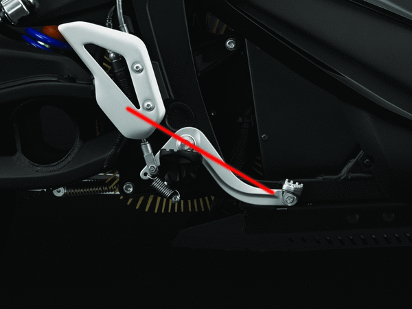
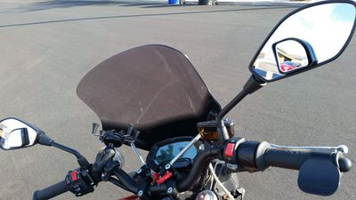

# Ergonomics

## Overview

This covers ergonomic characteristics of Zero models and what adjustments various people have made.

**References**

A good reference which has some Zero modeling is [Cycle Ergo](http://cycle-ergo.com/).

[How and Why We Measure Motorcycle Ergonomics](http://www.motorcyclistonline.com/why-and-how-we-measure-motorcycle-ergonomics)

## Standover Height

Standover height is the height of the seat when the bike is unloaded (but balanced upright).

There is a trend of models becoming shorter year by year from 2012-2014, after which the models' height stabilized through 2017.

|  |  | Height |  |
| --- | --- | --- | --- |
| Years | Models | in | mm |
| 2012 | S | 33.1 | 841 |
| 〃 | DS | 35.3 | 897 |
| 〃 | X/MX | 34.3 | 870 |
| 〃 | XU | 31.5 | 800 |
| 2013 | S | 31.8 | 807 |
| 〃 | DS | 34.4 | 873 |
| 〃 | FX | 35.4 | 899 |
| 〃 | XU | 31.1 | 790 |
| 2014+ | S/SR | 31.8 | 807 |
| 〃 | DS/DSR | 33.2 | 843 |
| 〃 | FX/FXS | 34.7 | 881 |

### Reducing Seat Height

**Discussions**

[Has Anyone Lowered Their Zero Yet?](http://electricmotorcycleforum.com/boards/index.php?topic=4786)

[Has Anyone Lowered Their Zero Yet?](http://electricmotorcycleforum.com/boards/index.php?topic=6304) redux

[2016 FXS Lowered Ride Height Ikon Shock, Dual Use Tires, Drop Bars, Hand Guards,](http://electricmotorcycleforum.com/boards/index.php?topic=6640)

[30mm rear lowering, the hard way (no loss of travel)](http://electricmotorcycleforum.com/boards/index.php?topic=6721)

**Issues**

Not enough third-party fitments are known for shocks or lowering links.

**Seat Solutions**

2013 Zero FX and XU models offered an unlisted "[low seat accessory](http://www.zeromotorcycles.com/zero-fx/2013/specs.php)" which reduced seat height by 2" (41mm).

The [Corbin Gunfighter seat for Zero](http://corbin.com/zero/zero13.shtml) is customizable and does provide easier leg reach to the ground in front, less than an inch by default.

Carving out seat foam can be done with the stock seat to some extent (1 inch again?).

If you do this, check the underside of the seat for flexing.

High powered cables underneath should not be under load for any reason and this area needs to be reinforced by the "Y-bracket" or an equivalent that bolts across the frame sections there.

**Suspension Solutions**

See [the aftermarket section on suspension](Aftermarket.md#Suspension "Aftermarket").

**Front Fork**

([From a 2013 FX report](http://electricmotorcycleforum.com/boards/index.php?topic=4786.msg32176#msg32176)) The front fork can be slid up in the clamp by one inch.

**Rear Shock**

For the rear, have a local shock repair / re-build for racing shop put a 3/4" spacer inside the shock, to stop its extension length by 3/4".

Since it is about 2:1 lever ratio from the shock mount to the rear axle this would lower the rear of the bike by about 1 1/2".

### Raising Seat Height

This is less commonly discussed.

## [Seat](https://web.archive.org/web/2025/https://zeromanual.com/wiki/Seat) to [Footpeg](https://web.archive.org/web/2025/https://zeromanual.com/wiki/Footpegs)

- 2013+ Zero S Platform models all have the same (or nearly so) seat to footpeg distances.
- DS footpegs, because of their construction, actually offer *less* legroom than the S footpegs.

  A swap can be accomplished easily.

## [Handlebar](https://web.archive.org/web/2025/https://zeromanual.com/wiki/Handlebar) Distance

Shortening or changing the distance to the bars can be done by rotating the bars, adding risers, or installing a differently-shaped set of bars.

- Bars are 7/8" at the grips, but that tapers from 1 1/8" or 28mm at the stem, e.g. Protapers brand tapered handlebars at CycleGear, which come in various angles.

## Handlebar Rise

- S model bars typically have higher rise but are shorter and angled back.
- DS bars are wider, somewhat lower rise, and straighter.

  2013-2014 shape differs from 2015+ shape.

## [Seat](https://web.archive.org/web/2025/https://zeromanual.com/wiki/Seat)

**References**

[Are Zero seats comfortable?](http://electricmotorcycleforum.com/boards/index.php?topic=7275)

### Seat Angle

The Zero stock seat is relatively flat/neutral, perhaps a few degrees angled forward.

## Cockpit

The Zero cockpit is relatively short among motorcycle forms.

### [Instrument Cluster](https://web.archive.org/web/2025/https://zeromanual.com/wiki/Instrument_Cluster)

The instrument cluster is not typically visible when looking at the horizon from an upright position.

- Riding in a crouched position makes viewing the instrument cluster easier for some, but strains the neck and shoulders.
- The handlebars are at the same height, which means that a phone mount typically will not rise much higher than that into the rider's field of view.
- On 2012-2013 models, the Koso instrument cluster makes ignition access more difficult.

### [Mirrors](https://web.archive.org/web/2025/https://zeromanual.com/wiki/Mirrors/Ergonomics)

**2011-2014**

These mirrors have adjustable pivots at the mirror ball with a set screw.

The stalks are adjustable but have a relatively low possibility of raising their heights.

Their angular shape does limit visibility somewhat; some flip the mirrors over to get a little more angular visibility.

**2015+**

These mirrors have a fixed stalk that rises higher but is less adjustable.

The mirror shape is more curved and generous, but with limited positioning can be a problem for some.

**Alternatives**

The mirror mounting for 2011+ models is in the Yamaha family (left and right threaded opposite) so third-party options are not hard to find.

- Bar-end mirrors can be fitted easily, as one alternative.

  For early [Gen2](https://web.archive.org/web/2025/https://zeromanual.com/wiki/Gen2) models, this requires cutting holes in the grips at the bar ends.

  A sharp knife or single-edged razorblade works well for this.

**Blind spot add-on mirrors**

Dan Ponce > ‎Zero Motorcycles Owners Group

[GreyJoy 2" x 2" Corner Wedge Blind Spot Mirror 15 Degree Angle Adjustable](https://smile.amazon.com/gp/product/B00XV4Z8D6/)

I'm very happy with this 2nd set of blind spot mirrors. (The first set were chrome and I didn't like where I put them.) When I'm traveling straight and upright, the main mirrors are set so I can see just behind to the sides, slightly beyond my peripheral vision. The spot mirrors are tilted to see directly behind, without my elbows being in the way.

