# FST Platform/Unofficial Service Manual

## Overview

This describes the Zero [FST Platform](https://web.archive.org/web/2025/https://zeromanual.com/wiki/FST_Platform) and includes as many service tasks not described (or incompletely described) in the [Official Owners Manual](../Official_Owners_Manual.md "Official Owners Manual") as customers have identified.

Relevant Models: [SRF Model](https://web.archive.org/web/2025/https://zeromanual.com/wiki/SRF_Model) and [SRS Model](https://web.archive.org/web/2025/https://zeromanual.com/wiki/SRS_Model).

Some information might be hearsay or not completely communicated, but attempts have been made to verify as much as possible.

As with anything in a wiki environment, whatever you undertake with this as a guide is your own responsibility.

### [Platform](https://web.archive.org/web/2025/https://zeromanual.com/wiki/FST_Platform)

Zero motorcycles benefit from some commonality around the powertrain. The [motor](#Motor), [controller](#Controller), [BMS](#Battery_Management_System) and [MBB](#Main_Bike_Board) are more or less shared across all models, along with handlebars and controls.

This is the [Gen3](https://web.archive.org/web/2025/https://zeromanual.com/wiki/Gen3) platform listed for the [SRF Model](https://web.archive.org/web/2025/https://zeromanual.com/wiki/SRF_Model) and [SRS Model](https://web.archive.org/web/2025/https://zeromanual.com/wiki/SRS_Model).

## General Information

### VIN

The [VIN](https://en.wikipedia.org/wiki/Vehicle_identification_number) is inscribed on the front head tube of the frame per the official manual.

See the [VIN Guide](https://web.archive.org/web/2025/https://zeromanual.com/wiki/VIN_Guide) to understand how the VIN describes your vehicle, as compiled across manual revisions.

### Systems

This is a very simplified way of looking at the bike’s systems functions and general purposes, linking to relevant sections.

#### Mechanical Systems

- [Frame](#Frame)
- [Steering](#Steering)
- [Suspension](#Suspension)
- [Wheels](#Wheels)
- [Final Drive](#Final_Drive)
- [Brakes](#Brakes)

#### Powertrain Systems

- [Throttle](#Throttle)
- [MBB](#Main_Bike_Board)
- [Controller](#Controller)
- [Motor](#Motor)

#### Energy Systems

- [Battery](#Battery)
  - [BMS](#Battery_Management_System)
  - [Contactor](#Contactor)
- [CCU](#Charging_Control_Unit)
- [Charger](#Charger)

#### Electrical Systems

- [DC-DC 12V Converter](#DC-DC_12V_converter)
- [Fuse Block](#Fuse_Block)

## General Maintenance

Mostly, refer to the [Official Owners Manual](../Official_Owners_Manual.md "Official Owners Manual") for regular and general maintenance.

### [Lift](https://web.archive.org/web/2025/https://zeromanual.com/wiki/Lift)

Some maintenance tasks are better performed with the wheels off the ground.

The armored pan under the battery that protects onboard charging units is strong enough and positioned well to use a center lift.

**Recommendation**

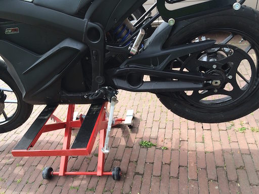 *Center lift under S model belly pan*

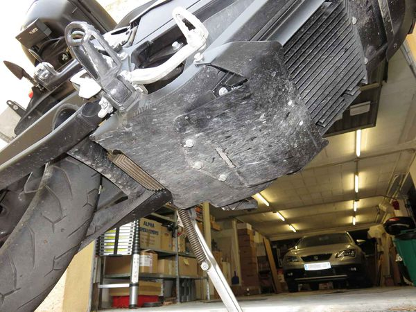 *FXS from below.*

Using a scissor lift center stand is an easy method to lift the bike.

[Rage Powersports BW-1604A](http://www.ragepowersports.com/motorcycle-products/black-widow-center-jack-and-dolly/) has been spotted at Zero HQ, but other manufacturers make very equivalent stands.

A center lift is easier than a rear stand to operate solo, and it is more compact than the rear stand although much heavier.

**Location (S Platform)**

Use a center lift under the battery compartment.

- Orient the center stand so that it runs side-to-side to provide lateral stability.
- Place it under the *rear* of the battery compartment to lift the bike's front and rear equally.
- Place it under the *front* of the battery compartment to lift the bike's front and leave the rear tire in floor contact.
- Strap the bike securely (through the center frame tube, say) to avoid toppling it.

**Confirmed fits**

- [Drag Specialties Center Jack](http://www.dragspecialties.com/products/?productId=121879) (all models) uses a 15/16 hex wrench to raise and lower the lift.
- [Generic Lift](https://www.amazon.com/gp/product/B0196PAZ1S/ref=oh_aui_search_detailpage?ie=UTF8&psc=1) uses a 7/8 hex wrench/socket; should work for all models, confirmed for 2014 SR.

**Location (X Platform)**

The FXS (at least) has three bolts sticking out from the pan under the bike.

- Orient the center stand so that it runs side-to-side to provide lateral stability.
- You can put a rubber pad on your lift to make it easier to use it over the bolts.

**Confirmed fits**

- [MSR Pro Lift Stand](http://www.motorcycle-superstore.com/28665/i/msr-pro-lift-stand) for the FX, but not other models (even FXS) because of height issues.

**References**

- [Discussion thread](http://electricmotorcycleforum.com/boards/index.php?topic=6589)
- [Video of DSR lifted by scissor jack.](https://www.youtube.com/watch?v=6wrPLi9Yags)
- [Rage Powersports BW-1604A scissor jack unboxing](https://www.youtube.com/watch?v=TnqBsha33bs) by [E Shattow on YouTube]:

### [Front Stand](https://web.archive.org/web/2025/https://zeromanual.com/wiki/Front_Stand)

**When To Use**

A front stand is the easiest way to:

- Perform [Front Wheel Removal](https://web.archive.org/web/2025/https://zeromanual.com/wiki/Front_Wheel_Removal).
- Remove and replace the [Belly Pan](https://web.archive.org/web/2025/https://zeromanual.com/wiki/Belly_Pan).

**Spool Stands**

- The Zero does not offer axle attachment points for spools for a front stand.

**Steering Head Pin Stands**

- 2014+ models(?) have a steering pin diameter of 5/8".
- 2012-2013 Zero models have an 8mm diameter (from a 2013 Zero S report and some checking around), with no vendor match.
- The DS/DSR/FX models' high front fender must be removed (or drilled through) to use a pin for the front steering head.

**Confirmed fits**

- Pit Bull offers [Pin #7, Front](https://www.pit-bull.com/pin-7-front-f0001-007) to fit the 5/8" steering pin diameter.
- [Pit Bull Hybrid Dual Lift Stand Zero S/SR/DS/FX (Order should automatically include pin #7)](https://www.revzilla.com/motorcycle/pit-bull-hybrid-dual-lift-stand-zero-s-sr-ds-fx).

  Verify your steering stem before ordering.

  [Front Stand Chart](https://www.revzilla.com/assets/0001/8394/20150516_FL-Pitbull_Front_Stand_Chart_1_NON_BRANDED.pdf).

| Years | Platform | Front Pin | Rear Pin | Rear Supports | Restraint |
| --- | --- | --- | --- | --- | --- |
| 2013 | S & X | None! (8mm ⌀) | [Pin Fitting Only - Zero Motorcycles (Axle: 23-04736)](https://www.pit-bull.com/zero-motorcycles/trailer-restraint-pin-fitting-only-zero-motorcycles-axle-23-74036-f0075nf-001) | [Top Supports (Pair), Standard Rear Stand](https://www.pit-bull.com/zero-motorcycles/top-supports-pair-standard-rear-stand-f0002-001) <br> [Top Supports (Pair), SS Rear Stand](https://www.pit-bull.com/zero-motorcycles/top-supports-pair-ss-rear-stand-f0028-001) | [Trailer Restraint System - Zero Motorcycles (Axle: 23-04736)](https://www.pit-bull.com/zero-motorcycles/trailer-restraint-system-zero-motorcycles-axle-2304736-f0075nf-000) |
| 2014 | 〃 | [Pin #7, Front](https://www.pit-bull.com/pin-7-front-f0001-007) | 〃 | 〃 | 〃 |
| 2015+ | 〃 | 〃 | [Pin Fitting Only - Zero Motorcycles (Axle: 23-08032)](https://www.pit-bull.com/zero-motorcycles/trailer-restraint-pin-fitting-only-zero-motorcycles-axle-2308032-f0075kj-001) | 〃 | [Trailer Restraint System - Zero Motorcycles (Axle: 23-08032)](https://www.pit-bull.com/zero-motorcycles/trailer-restraint-system-zero-motorcycles-axle-2308032-f0075kj-000) |

### [Rear Stand](https://web.archive.org/web/2025/https://zeromanual.com/wiki/Rear_Stand)

**Inexpensive Jack Stands and a 2x4**

- Will Burk shared his technique [Cheap and Easy Motorcycle Lift](https://www.youtube.com/watch?v=_iBNLDCyRbs) for raising the rear wheel off the ground with a pair of jack stands and a 2x4:

**Swingarm attachment**

The Zero does not offer [swingarm](https://web.archive.org/web/2025/https://zeromanual.com/wiki/Swingarm) attachment points for spools for a rear stand.

A rear stand can work if it cradles the underside of the swingarm snugly.

This can work but takes a little care to operate single-handedly.

**Confirmed fits**

- [Pit Bull Standard Rear Stand](https://www.revzilla.com/motorcycle/pit-bull-standard-rear-stand)
- [Pit Bull Forward Handle Standard Rear Stand](https://www.revzilla.com/motorcycle/pit-bull-forward-handle-standard-rear-stand)
- [Haul-Master 1000 Lb. Capacity Motorcycle Swingarm Rear Stand (Harbor Freight)](https://www.harborfreight.com/motorcycle-swingarm-rear-stand-65620.html)

**Axle Attachment**

Custom Fabrication

An axle stand can be fabricated, like this [Home made rear axle stand on Zero FXS](http://electricmotorcycleforum.com/boards/index.php?topic=6985).

| Years | Platform | Front Pin | Rear Pin | Rear Supports | Restraint |
| --- | --- | --- | --- | --- | --- |
| 2013 | S & X | None! (8mm ⌀) | [Pin Fitting Only - Zero Motorcycles (Axle: 23-04736)](https://www.pit-bull.com/zero-motorcycles/trailer-restraint-pin-fitting-only-zero-motorcycles-axle-23-74036-f0075nf-001) | [Top Supports (Pair), Standard Rear Stand](https://www.pit-bull.com/zero-motorcycles/top-supports-pair-standard-rear-stand-f0002-001) <br> [Top Supports (Pair), SS Rear Stand](https://www.pit-bull.com/zero-motorcycles/top-supports-pair-ss-rear-stand-f0028-001) | [Trailer Restraint System - Zero Motorcycles (Axle: 23-04736)](https://www.pit-bull.com/zero-motorcycles/trailer-restraint-system-zero-motorcycles-axle-2304736-f0075nf-000) |
| 2014 | 〃 | [Pin #7, Front](https://www.pit-bull.com/pin-7-front-f0001-007) | 〃 | 〃 | 〃 |
| 2015+ | 〃 | 〃 | [Pin Fitting Only - Zero Motorcycles (Axle: 23-08032)](https://www.pit-bull.com/zero-motorcycles/trailer-restraint-pin-fitting-only-zero-motorcycles-axle-2308032-f0075kj-001) | 〃 | [Trailer Restraint System - Zero Motorcycles (Axle: 23-08032)](https://www.pit-bull.com/zero-motorcycles/trailer-restraint-system-zero-motorcycles-axle-2308032-f0075kj-000) |

### Tools

See the separate [Tool Kits](../Tool_Kits.md "Tool Kits") article for a curated short list of tools with their purposes.

NOTE: integrate or meld notes below with that article.

[Tools and parts to support your bike](http://electricmotorcycleforum.com/boards/index.php?topic=5878)

A travel kit for a motorcycle is always a good idea, but Zero doesn't include a default set. They do sell a [tool kit](http://www.zeromotorcycles.com/shop/index.php?main_page=product_info&cPath=15_4&products_id=128) which covers many common tasks.

**Tools for Everyday Riding**

- Torx T45 for MY2015+ to remove the [seat](#Seat) for [fuse block](#Fuse_Block) access.
- 3mm allen key for [tank plastics](#Tank_Plastics) and [headlamp](#Headlamp) upper mount screws.
- 4mm allen key for [headlamp](#Headlamp) lower mount screws.
- 5mm allen key for the [front brake lever](#Front_Brake_Lever) and front wheel pinch bolt.
- Tire pressure gauge.
- 10mm, 13mm wrench (or monkey wrench) for [belt tension adjustment](#Belt_Tension_Adjustment) and front brake calipers.

### [Consumables](https://web.archive.org/web/2025/https://zeromanual.com/wiki/FST_Platform/Consumables)

These collect useful spare parts for [FST Platform](https://web.archive.org/web/2025/https://zeromanual.com/wiki/FST_Platform) models.

**Spare Parts for Everyday Riding**

- 12V fuses (10A, 15A typically).
- Tire patch kit, suitable for tubed (pre-2015 DS or FX bikes) or tubeless tires (all others).
- Cable ties and electrical tape for wiring.

**Spare Parts for Travel**

- [Belt](https://web.archive.org/web/2025/https://zeromanual.com/wiki/Drive_Belt)

  ~$90, only available from Zero.

  Expect to eventually use it as replacement; avoids a delay waiting on delivery.

### [Pre-Ride Checklist](https://web.archive.org/web/2025/https://zeromanual.com/wiki/Pre-Ride_Checklist)

|  | Item | What to Check | Look For | Check Off |
| --- | --- | --- | --- | --- |
| Tires And Wheels | Tires | Condition | Tread depth, wear, weathering, evenly seated, bulges, embedded objects. | [Front](#Front_Wheel) & [Rear](#Rear_Wheel) |
| 〃 | 〃 | Air Pressure | Check When Cold; Adjust to Load | 〃 |
| 〃 | Wheels | Spokes | Bent/broken/missing. Check tension at top of wheel: "ring" is okay, "thud" means loose. | 〃 |
| 〃 | 〃 | Cast | Cracks or dents | 〃 |
| 〃 | 〃 | Rims | Out of round by more than 5mm. Spin the wheel against a stationary pointer | 〃 |
| 〃 | 〃 | Bearings | Grab the tire and flex it; no freeplay (click) between the hub and axle; no growl or squeak when spinning. | 〃 |
| 〃 | 〃 | Seals | Cracked or torn, no grease | 〃 |
| 〃 | [Brakes](#Brakes) | Function | Each brake alone can hold the bike stationary | 〃 |
| 〃 | 〃 | Condition | Worn [pads](#Brake_Pads) or discs | 〃 |
| Controls | [Handlebars](#Handlebars) | Condition | Bars are straight, turn freely, handgrips and bar ends are secure. |  |
| 〃 | [Brake Lever](#Brake_Lever) / [Brake Pedal](#Rear_Brake_Actuator) | Condition | Not broken/bent/cracked; adjusted properly. |  |
| 〃 | 〃 | Pivots | Lubricated |  |
| 〃 | Brake Hoses | Condition | No cuts/cracks/leaks/bulges/chafing/deterioration. |  |
| 〃 | 〃 | Routing | No interference or pull at the steering head; no sharp angles; support clamps in place. |  |
| 〃 | [Throttle](#Throttle) | Operation | Moves freely; snaps closed. |  |
| Lights & Electrics | [Headlamp](#Headlamp)/[Running light](#Running_Light) | Condition | Turns on; no cracks; mounted securely; clean reflector. |  |
| 〃 | 〃 | Aim | Just below horizontal and not skewed left or right. |  |
| 〃 | [Tail Lights](#Tail_Light) | Condition | No cracks; clean and bright. |  |
| 〃 | 〃 | Operation | Running light always on; brighter with front or rear brake pressed. |  |
| 〃 | Switches | Operation | All switches function correctly: motor cut-out, hi/low beam, turn signal, hazard switch. |  |
| 〃 | [Turn signals](#Turn_Signals) | Operation | No cracks; flashes with left and right turn signal switch usage; resets per switch. |  |
| 〃 | [Mirrors](#Mirrors) | Condition | No cracks; clean, mount and swivel joints are tight |  |
| 〃 | 〃 | Aim | Check/adjust while seated on the bike off the kickstand. |  |
| 〃 | Wiring | Condition | No fraying or chafing; insulated. |  |
| 〃 | 〃 | Routing | No pinching, interference, or pulling at the steering head or suspension; wire looms and ties in place; connectors tight and clean. |  |
| Oil & Fluids | Hydraulic Fluid | Level | Check front and rear reservoirs |  |
| 〃 | 〃 | Cleanliness | Check whether the fluid is very dark, foamed, or has water |  |
| Chassis | [Frame](#Frame) | Condition | No cracks at gussets or accessory mounts; no paint lifting |  |
| 〃 | 〃 | [Steering-Head Bearings](#Steering_Head_Bearing) | No detent or tight spots through full travel; raise front wheel and check for play by pulling/pushing forks. |  |
| 〃 | 〃 | [Swingarm](#Swingarm) Bushings | Raise the rear wheel and check for play by pulling/pushing swingarm. |  |
| 〃 | Suspension | [Front Forks](#Front_Forks) | Smooth travel, equal air pressure/damping, anti-dive settings. | Left & Right |
| 〃 | 〃 | [Rear Shock](#Rear_Shock) | Smooth travel, equal pre-load/air pressure/damping settings, linkage moves freely and is lubricated. |  |
| 〃 | [Belt](#Belt) | [Tension](#Belt_Tension_Check) | Check at tightest point |  |
| 〃 | 〃 | [Alignment](#Belt_Tension_Check) | Check position on rear sprocket; spin the wheel to check changing position |  |
| 〃 | 〃 | [Sprockets](#Sprocket) | Teeth not hooked or chipped; clean and securely mounted |  |
| 〃 | Fasteners | Threaded | Tight; none missing; check for corrosion |  |
| 〃 | 〃 | Clips and Pins | None broken or missing |  |
| Stands | [Side Stand](#Kickstand) | Condition | No cracks; not bent; cutout switch equipped and working |  |
| 〃 | 〃 | Retention | Springs into place; tension holds position up or down |  |

### [Fastener Maintenance](https://web.archive.org/web/2025/https://zeromanual.com/wiki/Fastener_Maintenance)

To maintain the fasteners (bolts and screws), always check for loose or corroding bolts.

**Torque**

- For torques, see [Fastener Specifications](../Fastener_Specifications.md "Fastener Specifications"), which gathers all the officially recommended torque and other settings for various fasteners.

**Locking**

- Use blue Loctite threadlocker for non-conductive bolts.

**Corrosion**

TODO: recommend a corrosion inhibitor.

## Frame/Bodywork

### [Frame](https://web.archive.org/web/2025/https://zeromanual.com/wiki/FST_Platform/Frame)

This describes the frame for the [FST Platform](https://web.archive.org/web/2025/https://zeromanual.com/wiki/FST_Platform).

**[Forward Frame](https://web.archive.org/web/2025/https://zeromanual.com/wiki/FST_Platform/Forward_Frame)**

The forward frame (or main frame) consists of a steel tube trellis, 29mm OD for the main spars, 20mm for the smaller spars.

**[Tail Subframe](https://web.archive.org/web/2025/https://zeromanual.com/wiki/FST_Platform/Tail_Subframe)**

The tail subframe bolts to the forward frame and supports the 12V battery, the seat, and of course the tail lighting.

**Powertrain Mounting**

The [motor](https://web.archive.org/web/2025/https://zeromanual.com/wiki/FST_Platform/Motor) is a structural member joining the swingarm to the frame by heavy bolt fasteners and a pair of brackets labeled ["frame doubler"](https://web.archive.org/web/2025/https://zeromanual.com/wiki/FST_Platform/Frame_Doubler).

#### [Forward Frame](https://web.archive.org/web/2025/https://zeromanual.com/wiki/FST_Platform/Forward_Frame)

The forward frame (or main frame) consists of a steel tube trellis, with two main spars extending back from the head tube.

**Mounting**

The frame joins to the main power pack monolith via a few bolts on each side.

The frame joins to each of the [frame doublers](https://web.archive.org/web/2025/https://zeromanual.com/wiki/FST_Platform/Frame_Doubler) on the outside of the motor at the lower ends of the main spars.

The frame supports the tank, its contents, and forward plastics.

The head tube supports the triple tree and forward steering and suspension.

**Measurements**

- 29mm OD for the main spars
- 20mm OD for the smaller/truss spars.

#### [Tail Subframe](https://web.archive.org/web/2025/https://zeromanual.com/wiki/FST_Platform/Tail_Subframe)

The tail subframe is a single structure, supporting only the tail, that joins to the [forward frame](https://web.archive.org/web/2025/https://zeromanual.com/wiki/FST_Platform/Forward_Frame).

**Mounting**

The tail subframe joins to the [forward frame](https://web.archive.org/web/2025/https://zeromanual.com/wiki/FST_Platform/Forward_Frame) via two major pivot bolts and what seem to be 3 anchor bolts below the rider's seat.

The tail subframe supports the 12V battery, the rider and passenger seat, grab handles, tail rack, and of course the tail lighting.

The tail subframe also has a plastic enclosure and fairing plastics.

The onboard charging inlet bracket at the base of the tank seems to join to both the [tank support plate](https://web.archive.org/web/2025/https://zeromanual.com/wiki/FST_Platform/Tank_Support_Plate) and the tail subframe.

#### [Frame Doubler](https://web.archive.org/web/2025/https://zeromanual.com/wiki/FST_Platform/Frame_Doubler)

The frame doublers are a set of circular-oriented cast plates that *bracket* the motor and join it to the [forward frame](https://web.archive.org/web/2025/https://zeromanual.com/wiki/FST_Platform/Forward_Frame).

[Doubler plate definition](https://www.wartsila.com/encyclopedia/term/doubler-doubler-plate)

**Mounting**

It joins to the [forward frame](https://web.archive.org/web/2025/https://zeromanual.com/wiki/FST_Platform/Forward_Frame) via ... bolts.

It supports the [rearsets](https://web.archive.org/web/2025/https://zeromanual.com/wiki/FST_Platform/Rear_Sets) via ... bolts.

It supports the [swingarm](https://web.archive.org/web/2025/https://zeromanual.com/wiki/FST_Platform/Swingarm) via a large circumferential bearing laid into a bracket that the swingarm bolts onto.

### [Kickstand](https://web.archive.org/web/2025/https://zeromanual.com/wiki/Kickstand)

Zero's models' kickstands are made from cast aluminum and swings outward from the left side.

There is a safety interlock Hall sensor [switch](https://web.archive.org/web/2025/https://zeromanual.com/wiki/Kickstand_Switch) at the pivot that prevents the motor from operating when the kickstand is down.

| Years | Model | Length | Part no |
| --- | --- | --- | --- |
| 2013-2014? | S/SR | shorter than the DS/DSR | 20-05660 03 |
| 〃 | DS/DSR | 10.8" / 275mm | 20-05661 03 |
| 〃 | FX | 15.0" / 380mm | 20-05662 03 |
| 〃 | FXS |  |  |
| 2015+ | FX | 13.5" / 343mm |  |
| 〃 | FXS | 11.8" / 300mm |  |

Both DS and FX kickstands are identical from the spring screw up to the pivot, and should interchange.

All the 2013+ kickstands uses the same pivot pin & spring.

**References**

[Re: 2016 FXS Lowered Ride Height OEM Shock, Dual Use Tires, Drop Bars, Hand Guards,](http://electricmotorcycleforum.com/boards/index.php?topic=6640.msg53545#msg53545)

[Help needed: Kickstand "bent"](http://electricmotorcycleforum.com/boards/index.php?topic=6800.msg54953#msg54953)

**Mounting**

[3/8" E clip, Zero part no 90-0283700](http://electricmotorcycleforum.com/boards/index.php?topic=6800.msg55011#msg55011), also available generically.

[Clevis pin custom, Zero part no 90-0279900](http://electricmotorcycleforum.com/boards/index.php?topic=6800.msg55011#msg55011).

Mounting bracket, custom

**Maintenance**

The official manual recommends keeping the pivot greased as necessary with a six-month check interval.

**Problems**

A [Loose Kickstand](https://web.archive.org/web/2025/https://zeromanual.com/wiki/Loose_Kickstand) can result from inadequate greasing over time.

**[Replacement](https://web.archive.org/web/2025/https://zeromanual.com/wiki/Kickstand_Replacement)**

This replaces the [Kickstand](https://web.archive.org/web/2025/https://zeromanual.com/wiki/Kickstand).

See [Kickstand Removal](https://web.archive.org/web/2025/https://zeromanual.com/wiki/Kickstand_Removal) and [Kickstand Install](https://web.archive.org/web/2025/https://zeromanual.com/wiki/Kickstand_Install) for now.

**[Install](https://web.archive.org/web/2025/https://zeromanual.com/wiki/Kickstand_Install)**

**Tools**

- [Center lift](https://web.archive.org/web/2025/https://zeromanual.com/wiki/Lift) or stand.
- Large flat-blade screwdriver or specialized tool like [drum brake spring pliers](https://www.google.com/search?q=drum+brake+spring+pliers) for spring removal and replacement.
- E-clip tool (or needlenose pliers) for the 3/8" E-clip.

**Steps**

1. *(When replacing)* Remove the allen bolt securing the springs to the old kickstand.
2. *(When replacing)* Transfer the 2 bronze bushings from the old kickstand:
   1. Remove the 2 bronze bushings from the old kickstand.
   2. Clean and grease bushings.
   3. Insert bushings into new kickstand and replace chamfered bolt with springs.

      My chamfered bolt was not very tight and I assume it was being held in from the spring tension.

      I went to tighten it all the way in but that seemed to push the springs out too far.

      I put blue Loctite on it and threaded it about half way in.

      I will check this after a few rides to ensure it does not fall out!
3. Place the new kickstand onto the pivot.
4. Install the pin and spring

   **Pin Before Spring**

   1. Insert the pin.
   2. Raise the kickstand to its stowed/horizontal position.

      This minimizes the amount of force/extension to install the new spring.
   3. Install the spring over the kickstand hook with a suitable tool (see tools requirements).

   **Spring before pin**

   Have the pin and a tapered punch that fits nicely in the hole ready to go.

   1. Clean the pin and apply fresh grease to it.
   2. Hook the springs onto the frame, grip the kickstand with both hands, put your shoulder into the bike so it won’t tip.
   3. While pushing straight down on the kickstand, get it onto the frame and insert the tapered punch.
   4. Now raise the kickstand into the stowed/horizontal position.
   5. Remove punch.

      The hole will be almost aligned.
   6. Insert the pin as far as it will go, mine stopped at the frame.
   7. With the kickstand still in the up position, tap the bottom of the kickstand pivot area up towards the frame with a dead blow hammer while pushing the pin in.

      This should align the hole and allow the pin to go right in.

      Insert the pin and fasten it with a new 3/8" E-clip.

   **Note:** This is the most difficult and dangerous part of the job.

   Use eye protection while doing this and ensure your hands won't be damaged if the spring flies back while getting it over the hook.

   Focus on applying steady force with as much leverage as possible to extend the spring back along the swingarm.

   - One trick is to use a strong line looped through the hook as a pulley.
   - Another trick is to bend the spring enough back and forth to insert pennies between the coils, which holds it in an extended position.

     Then loop the spring over the hook and pull the pennies out with pliers.
5. Check the operation of the kickstand a few times.

   Ensure that it operates smoothly.

   Ensure the kickstand sensor detects the position of the kickstand, by checking the interlock indication on the dash while the bike is keyed on.
6. Put the kickstand down before letting the motorcycle off the lift to rest on it.

**[Removal](https://web.archive.org/web/2025/https://zeromanual.com/wiki/Kickstand_Removal)**

**Tools**

- [Center lift](https://web.archive.org/web/2025/https://zeromanual.com/wiki/Lift) or stand.
- Large flat-blade screwdriver or specialized tool like [drum brake spring pliers](https://www.google.com/search?q=drum+brake+spring+pliers) for spring removal and replacement.
- E-clip tool (or needlenose pliers) for the 3/8" E-clip.

**Steps**

1. Place the motorcycle on a center lift or stand.

**Spring Before Pin**

1. Pull the spring off of the kickstand hook with a large flat blade screwdriver or a specialized kickstand spring release tool.

   Raise the kickstand to the stowed/horizontal position, to reduce spring tension.

   | | |
   | --- | --- |
   |   **Warning:** | Be extremely careful working with the kickstand spring as it is under high tension. |

   A specialized tool makes this easier.
2. Remove the pivot pin.
3. Remove the kickstand.

**Pin Before Spring**

1. Remove the pivot pin.
   1. Pull the E-clip off of the inside of the pivot.
   2. Raise the kickstand to the stowed/horizontal position, to reduce spring tension.
   3. Go to the left side of bike.
   4. Wiggle the kickstand while tapping the pivot pin from underneath with *for example* a soft faced hammer.
   5. Continue to wiggle the kickstand while gripping the pin until it slides out.

      Often comes out by hand with a rag.
2. Carefully slide kickstand away from frame and unhook springs from frame.

   The kickstand will still be under some tension from both springs, inner and outer.

### [Footpegs](https://web.archive.org/web/2025/https://zeromanual.com/wiki/Footpegs)

Zero footpegs are cast aluminum pieces, mounted on identical hinges so are interchangeable across models.

**Mounting**

The mount bracket uses a custom clevis (10mm ⌀ with 40mm working length and 45mm overall length), secured with a retaining E-clip (3/8" or 9.5mm inner ⌀).

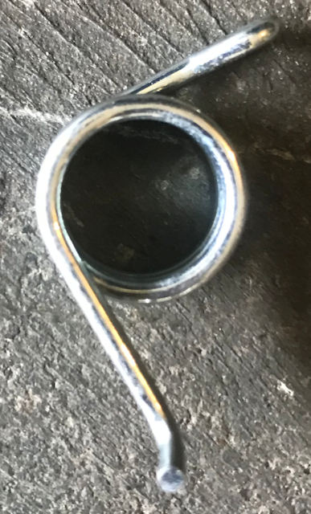 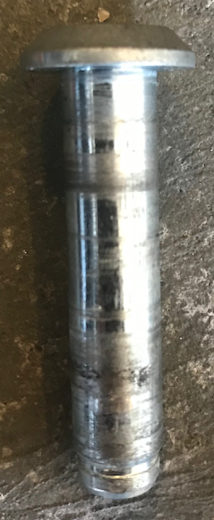

**Repair**

The footpegs' aluminum casting is relatively brittle, and the pegs tend to break rather than bend.

See [Footpeg Replacement](https://web.archive.org/web/2025/https://zeromanual.com/wiki/Footpeg_Replacement).

**Reference**

["The pegs are the exact same part used by the Buell XB models (except for the Ulysses), and as the passenger pegs on the 1125R models. They are "sacrificial lambs" to protect the rest of the frame."](http://electricmotorcycleforum.com/boards/index.php?topic=7851.30)

["Any pegs made for the 2008-2009 Suzuki RMZ450 should fit the DS,DSR,FX models"](https://www.electricmotorcycleforum.com/boards/index.php?topic=9937)

#### [Rider Footpegs](https://web.archive.org/web/2025/https://zeromanual.com/wiki/Rider_Footpegs)

These [Footpegs](https://web.archive.org/web/2025/https://zeromanual.com/wiki/Footpegs) are only installed for the rider, versus [Passenger Footpegs](https://web.archive.org/web/2025/https://zeromanual.com/wiki/Passenger_Footpegs).

| | |
| --- | --- |
| **Sport Footpegs** <br> Installed on S/SR/FXS models. <br> Constructed as a cylindrical smooth-surfaced cast aluminum piece with a corrugated upper surface for some grip. <br> They are spring-loaded. <br> There is a hole at the end of the rider footpegs, with/for feeler stud measuring M6X16 with a DIN 1587 M6 18-8 cap/acorn nut. <br> 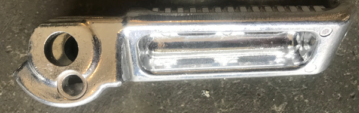 *Sport Footpegs underside* <br> **Dual Sport Footpegs** <br> Installed on DS/DSR/FX models. <br> Constructed as a mildly-cleated rough-finish cast aluminum piece with a wide flat surface mounted horizontally. <br> They are spring-loaded. <br> Because of their construction, these actually offer less legroom than the sport footpegs. | 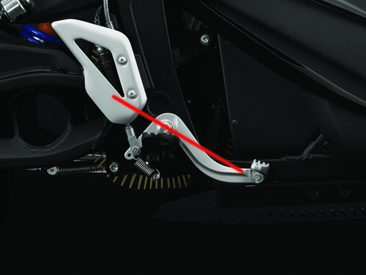 *S and DS footpegs compared* |

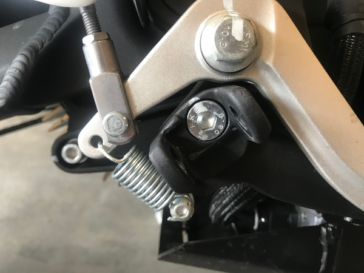 *Rider footpegs mounting bracket*

##### [Rider Footpeg Removal](https://web.archive.org/web/2025/https://zeromanual.com/wiki/Rider_Footpeg_Removal)

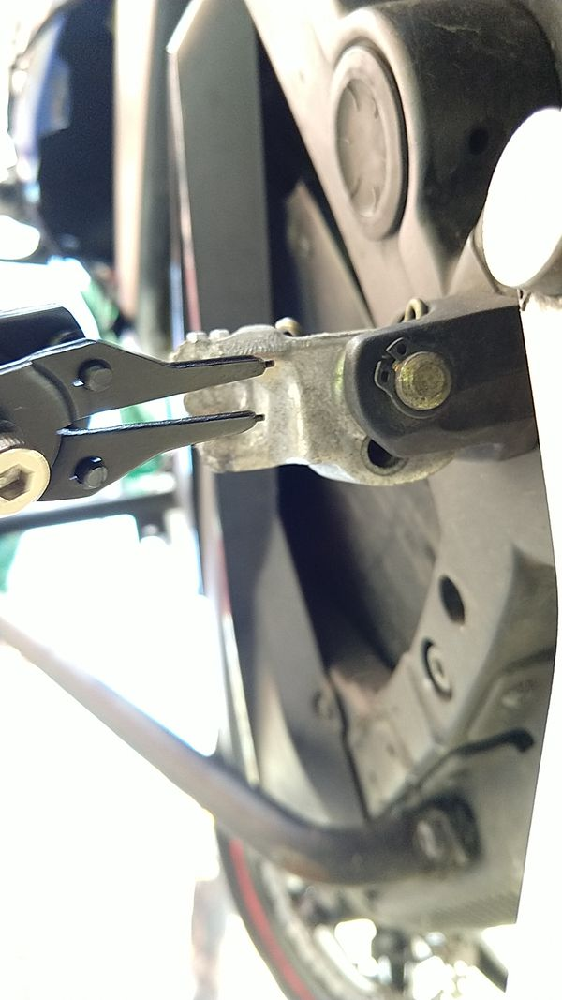 *footpeg retaining clip and tool*

**Tools**

- Snap Ring / E-Ring pliers (needlenose pliers are a common if less easy substitute).
- (Optional) 7mm Allen key to remove the clevis bracket from the frame.

**Steps**

1. Gently spread the gap in the retaining E-ring using the pliers until it slides over the end of the pin, and remove it.

   This clip is on the lower end of the footpeg retaining pin.
2. Pull the retaining pin up and out.

   Hold and pull the pin spring and footpeg as the pin comes out.
3. (Optional) Use the 7mm Allen key to remove the bolt through the clevis bracket that fastens it to the frame.

**References**

[How to Remove Zero Footpegs + Relocation Ideas](https://www.youtube.com/watch?v=9OdBkfS_qbs) by NewZeroLand on Youtube

#### [Passenger Footpegs](https://web.archive.org/web/2025/https://zeromanual.com/wiki/Passenger_Footpegs)

Passenger [footpegs](https://web.archive.org/web/2025/https://zeromanual.com/wiki/Footpegs) are ergonomically identical to the sport [rider footpegs](https://web.archive.org/web/2025/https://zeromanual.com/wiki/Rider_Footpegs), since passenger geometry requires reduced legroom and a forward foot angle on the rest.

They are not spring-loaded.

They lack the hole for the feeler stud that the rider footpegs use.

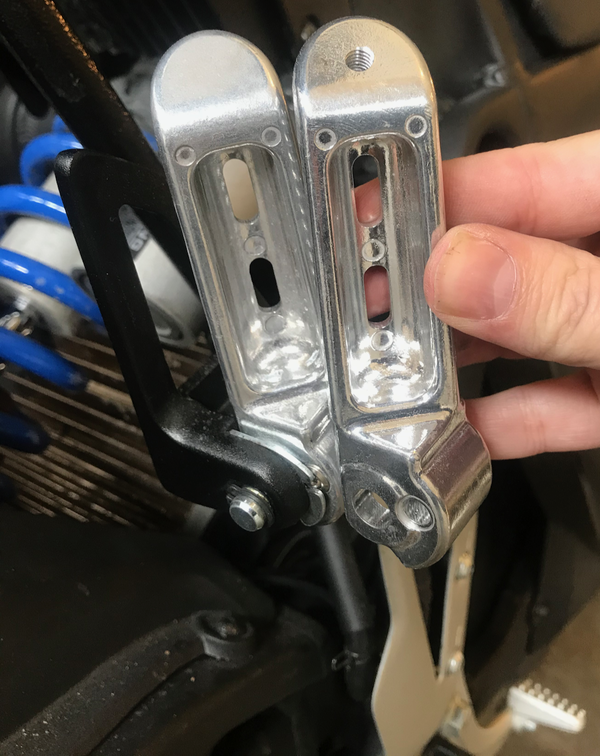 *Sport Rider Footpegs vs Passenger Footpegs*

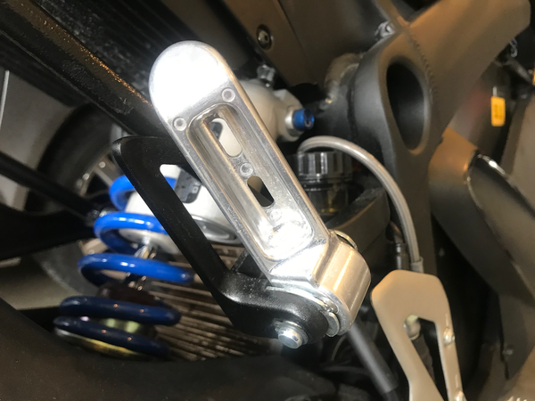 *Passenger Footpegs Stowed*

**Mounting**

The passenger footpegs hinge on the [passenger footpeg bracket](https://web.archive.org/web/2025/https://zeromanual.com/wiki/SDS_Platform/Passenger_Footpeg_Bracket) which mounts to the frame.

They use an additional installed pin and custom clip plate to secure the passenger pegs in either the stowed or out position (vertical and horizontal, respectively).

##### [Passenger Footpeg Removal](https://web.archive.org/web/2025/https://zeromanual.com/wiki/Passenger_Footpeg_Removal)

 *footpeg retaining clip and tool*

**Tools**

- Snap Ring / E-Ring pliers (needlenose pliers are a common if less easy substitute).
- 13mm hex side or socket wrench (for the bracket).

**Steps**

1. Gently spread the gap in the retaining E-ring using the pliers until it slides over the end of the pin, and remove it.

   This clip is on the lower end of the footpeg retaining pin.
2. Pull the retaining pin up and out.

   Hold and pull the pin spring and footpeg as the pin comes out.
3. (Optional) Remove the bracket
   1. Loosen the upper bolts mounting the footpeg brackets to the frame.

      **S-platform:** Reaching these bolts from the rear is easiest since they are on the inside of the frame.
   2. Loosen the lower bolts mounting the footpeg brackets to the frame.

      **S-platform:** These face the motor and allow very low overhead.

      A side wrench is recommended, and a ratcheting version preferred.
   3. Remove the bolts and then the brackets.

**References**

[How to Remove Zero Footpegs + Relocation Ideas](https://www.youtube.com/watch?v=9OdBkfS_qbs) by NewZeroLand on Youtube

### [Seat](https://web.archive.org/web/2025/https://zeromanual.com/wiki/FST_Platform/Seat)

The seat is provided in a rider seat section and a passenger seat section.

The passenger seat can be released with the key, revealing a small tray (for tools, perhaps) and hooks for locking a helmet on each side of the tail.

The rider seat can be released by Torx (T15?) bolts that are at the front of the area under the passenger seat.

The SR/S seat differs from the SR/F seat, apparently in being broader and longer especially for the passenger.

#### [Seat Removal](https://web.archive.org/web/2025/https://zeromanual.com/wiki/Seat_Removal)

This removes the [seat](https://web.archive.org/web/2025/https://zeromanual.com/wiki/SDS_Platform/Seat) from [SDS Platform](https://web.archive.org/web/2025/https://zeromanual.com/wiki/SDS_Platform) bikes.

**Video Guide**

[Zero motorcycle - How to remove your seat](https://www.youtube.com/watch?v=T80siAHG7Z8) by [Alternative Standard on YouTube](https://www.youtube.com/channel/UCw9faNzFHkqXDsybkH7Qqig)

**Notes**

- Unload any luggage racks before taking the seat off for an extended period of time to avoid stressing the racks.

  When luggage racks are installed, the seat bolts are load bearing (or at least damping).
- An M8-1.25×55mm socket cap bolt with a 6mm Allen head can be used if the kit bolt is lost.

**Tools**

- **2015+:** T45 Torx wrench (for seat bolts).
- **2013-2014 (with top or side racks):** 5mm Allen key (for seat bolts).

**Steps**

1. *When luggage racks are installed* Remove the top case and/or side cases to ensure the rack is unloaded.
2. Remove the M8-1.25×55 seat bolts.

   Push the seat down and forward as needed to help ease out the bolts.

   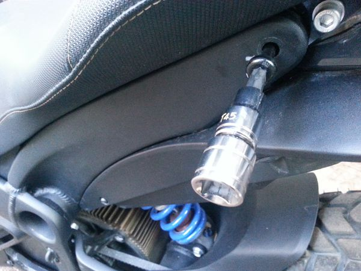 *Seat Fasteners*

   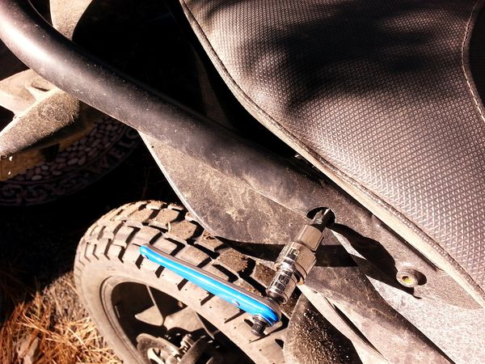 *Seat Fasteners with Top Rack Installed*
3. Pull the seat back a couple of inches and then upwards.

#### [Seat Install](https://web.archive.org/web/2025/https://zeromanual.com/wiki/Seat_Install)

This installs the [SDS Platform](https://web.archive.org/web/2025/https://zeromanual.com/wiki/SDS_Platform) models' [seat](https://web.archive.org/web/2025/https://zeromanual.com/wiki/SDS_Platform/Seat).

**Tools**

- **2015+:** T45 Torx wrench (for seat bolts).
- **2013-2014 (with top or side racks):** 5mm Allen key (for seat bolts).

**Steps**

1. *When luggage racks are installed* Remove the top case and/or side cases to ensure the rack is unloaded.
2. Place the seat on the tail slightly to the rear of where it will sit.

   Ensure that the pan's horn-shaped catches will slip under the frame's Y-shaped centerpiece pins.
3. Push the seat forward and down to sit in place.
4. Visually align the holes of the seat bracket with the seat bolt holes.

   Align the seat's bracket with the frame holes to avoid wear.

   Align the seat's tabs between the frame rails to avoid stressing the seat pan and marring the frame.

   If the top rack is installed, too, check the alignment of that as well to avoid wear trying to thread the bolts.
5. Insert the seat bolts, gently engaging while checking for cross-threading.

   Check for alignment again while the bolt head encounters the seat bracket.

   Press down and forward on the seat as needed to help align and tighten the bolts.

    *Seat Fasteners*

    *Seat Fasteners with Top Rack Installed*
6. Tighten the bolt head against the frame surface to hold it in place but do not over-tighten.
7. *When luggage racks are installed* Re-install the top case and/or side cases.

### Panel Material

FST Platform/Bodywork Material

### Tank Plastics

FST Platform/Tank Plastics

### Tail Plastics

FST Platform/Tail Plastics

#### Tail Plastics Removal

FST Platform/Tail Plastics Removal

## Steering

### [Ignition Lock](https://web.archive.org/web/2025/https://zeromanual.com/wiki/Ignition_Lock)

The ignition lock operates the [Ignition Switch](https://web.archive.org/web/2025/https://zeromanual.com/wiki/Ignition_Switch).

**Location**

The ignition lock is mounted on the tripe clamp top in the center between the steering head and the dash.

The [Ignition Switch](https://web.archive.org/web/2025/https://zeromanual.com/wiki/Ignition_Switch) connects to a [ZADI](http://www.zadi.com) motorcycle lock with a steering lock feature and parking light enable (although the parking light enable is not connected on the Zero).

**Key Blanks**

Key blanks can typically be ordered from a dealer.

Key blanks appear to be available generically as [JMA ZA9P1 FOR ZADI ZD23RCP](http://www.mrlock.com/jma-zadi-motorcycle-key-blanks/jma-key-blank-zadi-zd23rcp-za-9-p1).

In USA, calling them "Triumph" keys may help a locksmith find the right blank.

**Maintenance**

Occasional lock lubrication is recommended, and inspection of the wires for startup enable on the underside of the lock for reliability.

**Troubleshooting**

See [the faulty ignition switch troubleshooting guide](https://web.archive.org/web/2025/https://zeromanual.com/wiki/12V_Power_Always_On) for issues with this.

### [Tank Lock](https://web.archive.org/web/2025/https://zeromanual.com/wiki/FST_Platform/Tank_Lock)

The tank lock on the [FST Platform](https://web.archive.org/web/2025/https://zeromanual.com/wiki/FST_Platform) is accessed on the left side of the tank, and is keyed the same as the ignition and the [seat lock](https://web.archive.org/web/2025/https://zeromanual.com/wiki/FST_Platform/Seat_Lock).

### [Mirrors](https://web.archive.org/web/2025/https://zeromanual.com/wiki/Mirrors)

| | |
| --- | --- |
| 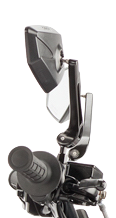 *2012-2014 Mirrors (side) on a DS* | 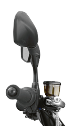 *2015+ mirrors (side) on a DSR* |

**Design**

Pre-2015 ([Gen1](https://web.archive.org/web/2025/https://zeromanual.com/wiki/Gen1)) Zeros use an angular mirror with a ball mount joint that allows rotating the mirrors 360 degrees.

Many riders turn the mirrors upside down for a little wider visibility around the shoulder/arms.

2015+ ([Gen2](https://web.archive.org/web/2025/https://zeromanual.com/wiki/Gen2) and [Gen3](https://web.archive.org/web/2025/https://zeromanual.com/wiki/Gen3)) Zeros use a mirror stalk with an inboard ball mount with about 30 degrees of freedom from the stalk.

**Mount**

Zero mirrors are mounted from the handlebars with Yamaha/Ducati-style bolt fitting.

The bolt/thread specification is M10x1.25, left-hand-threaded on the right side and standard right-hand-threaded on the left side.

**Maintenance**

(pre-2015) Check that the set screw holding mirror position holds it firmly.

Use a corrosion inhibitor or thread-locker for the set screws and the mount threading since these are weather-exposed.

See [Third-Party Mirrors](../Common_Modifications.md#Third-Party_Mirrors "Common Modifications") for workable/tested replacements.

### [Handlebar](https://web.archive.org/web/2025/https://zeromanual.com/wiki/Handlebar)

Zero's models all steer with a [handlebar](https://en.wikipedia.org/wiki/Motorcycle_handlebar).

S/SR and FXS models share a shorter, sportier handlebar shape.

DS/DSR and FX models share a wider, straighter handlebar shape.

Both S/FXS and DS/FX style handlebars are standard through-bars.

**Diameters**

- 1 1/8" (28mm) ⌀ center bar.
- 7/8" (22mm) ⌀ outer bar.

| Models | Years | Width | Rise | Pullback |
| --- | --- | --- | --- | --- |
| S,SR,FXS | 2013-present |  |  |  |
| DS,DSR,FX | 2013-present |  |  |  |
| SRF,SRS | 2020-present |  |  |  |

**Control-Indexing Holes**

- (1) 3/16" ⌀ on the left for the switchgear, 6.5" from the end of the bar.
- (1) 3/16" ⌀ on the *right inner* for the [throttle](https://web.archive.org/web/2025/https://zeromanual.com/wiki/Throttle), 7 3/16" from the bar end.
- (1) 5/32" ⌀ on the *right outer* for the switches, 6" from the bar end.

**References**

- [Changing to non OEM handlebars (‘15 FX)](https://www.electricmotorcycleforum.com/boards/index.php?topic=10043)

#### Handlebar Clamps

The SDS and XMX platform handlebar clamps are 2" by 1 1/8" (28mm) for the entire line of models, clamped with M10 cap screw bolts (35mm length; possibly 50mm?).

#### Handlebar Switch Assemblies

The switch assemblies are fastened with TT20 (1/4") tamper-resistant Torx bolts through the underside.

#### Handgrips

Handgrips have a Zero logo on them but otherwise are reasonably good stock grips for the 7/8" (22mm) handlebar width at the end of the bars.

#### Bar Ends

For 2014+ models, any bar end accessories that match the 14mm inner diameter will fit.

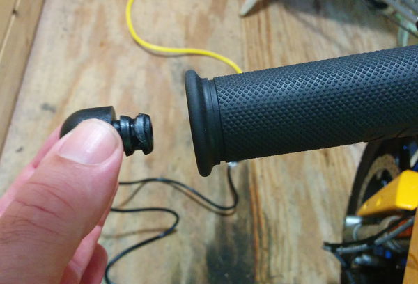 *2014+ stock bar end plugs*

The stock bar ends are round plastic bumpers held in by plastic threads, so can be removed with a little twisting and pulling.

**2013 models**

Bar ends are covered by the grip so are not easily changed without changing the grips.

Zero did offer heated grips for these models but dropped them after changing the bars in 2014.

### [Brake Lever](https://web.archive.org/web/2025/https://zeromanual.com/wiki/Front_Brake_Lever)

Zero motorcycles have a right-hand lever for the front brake, as is common for motorcycle designs.

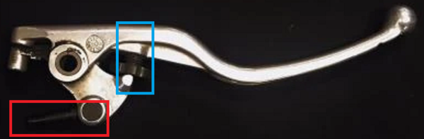 *Brake Lever*

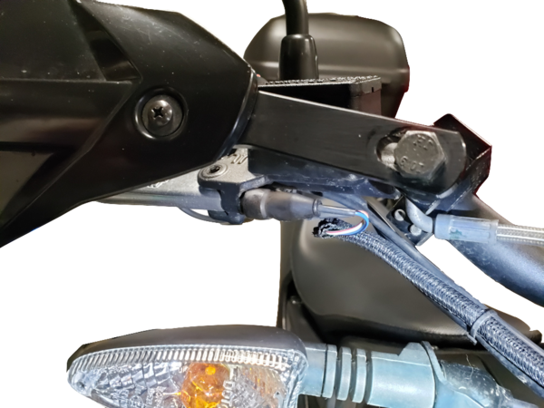 *Brake Lever Switch*

**Primary adjustment**

The brake lever has a dial for adjusting the lever position relative to pad pressure and rider finger reach.

Set it however lets you operate it comfortably and safely.

**Brake Light and Regen Switch**

A set screw on the inside of the lever adjusts how a micro-switch is depressed.

The micro-switch is what activates the rear brake light and the "braking regen" mode at the same time.

Any adjustment or replacement of the brake lever should be followed by recalibrating this set screw to get the desired effect.

Too much free play and the switch will activate when going over bumps and result in a slightly jerky ride.

There is some guidance on how to adjust this: [Brake Lever Adjustment to Regen Before Pad Contact](https://web.archive.org/web/2025/https://zeromanual.com/wiki/Brake_Lever_Adjustment_to_Regen_Before_Pad_Contact).

**NOTE:** It seems like there's small difference in how this set screw is secured in stock lever compared to replacement lever (2016 SR), even though they look identical.

I wasn't able to adjust this screw on stock lever, however replacement lever adjusts with no issues.

You will need 7/64 SAE hex key to adjust.

Use some light threadlock compound (Blue Loctite will do) to fix the set screw in the desired position if it seems to move too freely out of the desired range.

**References**

- [Front brake tightness?](https://www.electricmotorcycleforum.com/boards/index.php?topic=9755)

**Adjustment**

See [Front Brake Lever Adjustment](https://web.archive.org/web/2025/https://zeromanual.com/wiki/Front_Brake_Lever_Adjustment)

**Removal, Repair**

See [Front Brake Lever Replacement](https://web.archive.org/web/2025/https://zeromanual.com/wiki/Front_Brake_Lever_Replacement)

### Triple Clamp

FST Platform/Triple Clamp

### Steering Head

FST Platform/Steering Head

#### Steering Head Bearing

FST Platform/Steering Head Bearing

### Front Fender

FST Platform/Front Fender

## Wheels

### Wheel Maintenance

#### [Tire Pressure Check](https://web.archive.org/web/2025/https://zeromanual.com/wiki/Tire_Pressure_Check)

Maintain minimum pressure per the [official manual](../Official_Owners_Manual.md "Official Owners Manual").

**General guidelines**

- *Higher* tire pressures help *stability* and *reduce rolling resistance* with a passenger or a lot of luggage, but *lower* pressures help on rougher/gravel surfaces.

  Excessive tire pressure can make the tire too sensitive to sharp debris or potholes, and increases the risk of a puncture.

  45psi is where this definitely becomes a concern; modulate depending on your riding, and definitely use much lower pressures for offroading.
- Official recommendations are for *cold* tires, which means when they haven't been ridden in a few hours.

  As tires warm up from riding, pressure increases due to the interior air heating from friction and mechanical work on the tire by the road against the wheel.

### Front Wheel

FST Platform/Front Wheel

#### [Front Wheel Removal](https://web.archive.org/web/2025/https://zeromanual.com/wiki/Front_Wheel_Removal)

**Video Instruction**

[Zero DS front wheel removal](https://www.youtube.com/watch?v=ihYVS3E0NVs) by Nigel Morris on YouTube:

[Zero Motorcycles: Front Wheel Removal 2016 DSR](https://www.youtube.com/watch?v=6wrPLi9Yags) by [E Shattow on YouTube](https://www.youtube.com/channel/UC3JGiY70BCPHoecAGEYEvTA):

**Tools**

6mm Allen Wrench - Axle bolt (M17)

5mm Allen Wrench - Pinch

13mm Socket - Brake calipers

**Steps**

1. Loosen both brake caliper bolts using the 13mm socket.
2. Loosen both *right* pinch bolts using the 5mm allen wrench.

   Alternate slightly, turning each counter-clockwise.
3. Loosen the axle bolt using the 6mm allen wrench.
4. Loosen both *left* pinch bolts using the 5mm allen wrench.

   Alternate slightly, turning each counter-clockwise.
5. *Securely* lift the front wheel.
6. Remove both brake bolts using the 13mm socket, and lift and secure the [brake caliper](https://web.archive.org/web/2025/https://zeromanual.com/wiki/Brake_caliper) without stressing the brake lines.
7. Continue to back off the pinch bolts, but do not remove, using the 5mm allen wrench.
8. Remove the axle bolt and outer spacer using the 6mm allen wrench.
9. Replace the axle bolt with the 6mm allen bolt, turning several turns inward, without the outer spacer.
10. Push on the axle bolt while encouraging the *left* side of the axle out.

    Support the wheel to reduce binding!
11. Remove the axle.
12. Remove the wheel.

#### Front Axle

**TODO measurements**

#### Front Tire

See [Stock Tires](https://web.archive.org/web/2025/https://zeromanual.com/wiki/Stock_Tires).

#### Front Bearings

FST Platform/Front Bearings

#### [Front Bearing Replacement](https://web.archive.org/web/2025/https://zeromanual.com/wiki/Front_Bearing_Replacement)

This replaces the [front wheel bearings on Gen2 models](https://web.archive.org/web/2025/https://zeromanual.com/wiki/Gen2/Front_Bearings).

**Tools**

- 6mm Allen Wrench - Axle (M17)
- 5mm Allen Wrench - Pinch
- 13mm Socket - Brakes
- Bearing Press Tool/Kit

**Steps**

1. [Remove the Front Wheel](https://web.archive.org/web/2025/https://zeromanual.com/wiki/Front_Wheel_Removal)
2. Remove the spacers, then the dust seals, from each side and clean.
3. Press the bearings out from the opposite side.

   A socket extension works well, alternating around the perimeter.
4. Clean the inner wheel.
5. Press the new bearings in, aligning with the inner axle tube.

   A large socket works well to press only on the *outer* bearing.
6. Replace the dust seals.
7. Return the wheel to the bike.
8. Aligning the axle with the spacers, press the axle back into the forks.
9. Expand the brake calipers to prepare for remounting.
10. Remount brake caliper with the 13mm socket to the correct torque.
11. Return the outer spacer and make the axle bolt snug with the 6mm allen wrench.
12. Alternate tightening each 5mm pinch bolt.
13. Ensure proper wheel movement.
14. Tighten *left* pinch bolts to the correct torque using the 5mm allen wrench.
15. Tighten the 6mm Axle bolt to the correct torque.
16. Tighten *right* pinch bolt to correct torque using the 5mm allen wrench.
17. Ensure smooth movement.
18. Pump the brakes to return to proper action.
19. Lower the front wheel.
20. Confirm torques.
21. *Test ride!*
22. Reconfirm torques.
23. Paint the bolt heads to so that any loosening is detectable.

### Rear Wheel

FST Platform/Rear Wheel

#### Rear Tire

See [Stock Tires](https://web.archive.org/web/2025/https://zeromanual.com/wiki/Stock_Tires).

#### [Rear Wheel Removal](https://web.archive.org/web/2025/https://zeromanual.com/wiki/Rear_Wheel_Removal)

Pulling out the axle and removing the rear wheel is straightforward; the complexity is in re-assembly: see [Rear Wheel Install](https://web.archive.org/web/2025/https://zeromanual.com/wiki/Gen2/Rear_Wheel_Install).

**Items to note for re-assembly**

Note how the caliper sits against the swingarm.

Note the order and arrangement of the spacers.

**Video Guide**

[Zero Motorcycles: Rear Wheel Removal 2016 DSR](https://www.youtube.com/watch?v=CiZem4Q9uh4) by [E Shattow](https://www.youtube.com/channel/UC3JGiY70BCPHoecAGEYEvTA)

**Tools**

- 27mm socket
- Breaker bar

**Instructions**

1. Place the motorcycle on a [lift or rear stand](https://web.archive.org/web/2025/https://zeromanual.com/wiki/Lift) so the wheel spins freely.
2. Mark/photograph where the alignment marks reside on each side of the axle for re-alignment when re-installing the wheel.

   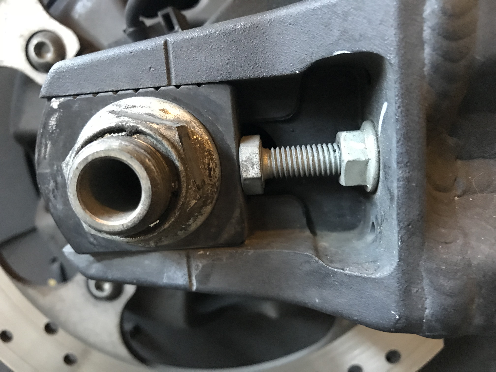 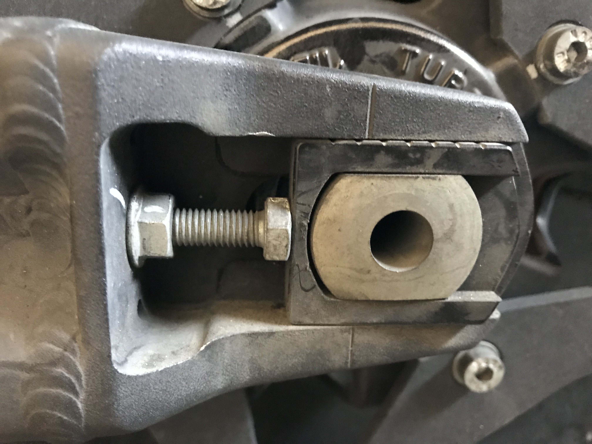
3. Loosen the rear axle nut on the right side (27mm) with the breaker bar.
4. Remove the rear axle nut.
5. Pull the axle part-way out so that the wheel can be moved forward enough to loosen the belt.
6. Pull the belt off of the rear sprocket and let it hang outside of the swingarm slightly to avoid interfering with the wheel.
7. Pull the axle through the wheel from the left side.

   Pay attention to the brake caliper: it's attached via the axle, and when the axle is removed the caliper, etc, will come loose.
8. Set aside the spacers with alignment marks, noting which goes on which side.
9. Set aside the axle and axle nut.
10. Pull the wheel out behind the swingarm.

    The license plate tail holder will likely require rolling the wheel out at an angle to clear it.

#### [Rear Wheel Install](https://web.archive.org/web/2025/https://zeromanual.com/wiki/Rear_Wheel_Install)

Re-installing the rear wheel requires somewhat careful fitment of the wheel, spacers, ABS sensor (2015+), and brake calipers within the swingarm.

Pay attention while removing the wheel to have this arrangement in mind to avoid confusion.

Any play in the caliper position or the wheel itself could have a dramatic and damaging effect on the motorcycle while riding.

**Tools**

- 27mm socket
- Torque wrench set to 75ft-lbs (102Nm)
- (Optional) rubber mallet to nudge the axle

**Instructions**

- Also see [Belt Adjustment](https://web.archive.org/web/2025/https://zeromanual.com/wiki/Belt_Adjustment)

1. Ensure that the axle has grease applied if it is dry, to minimize friction and wear against it under load.
2. Push the axle through the alignment bracket and left swingarm until flush on the inside of the left swingarm.
3. Place the rear brake caliper holder onto the right swingarm.
4. For 2015+ models, place the ABS rear wheel speed sensor on the inside of the rear brake caliper holder.

   Route the wire feeding the speed sensor around the caliper holder bracket and ensure that the sensor and wire will install without tension or excessive bending.
5. Roll the wheel into position inside of the axle.

   Ensure the speed sensor on the right side mates with and covers the rear wheel bearing before it aligns with the rear brake caliper holder on the right side, as this "sandwiches" together.

   Ensure that the brake calipers are pushed to maximum expansion, then place them around the rear wheel brake disc on the right side.
6. Push the axle through the wheel by hand or use a rubber mallet to gently nudge the axle through the wheel.

   You may need to give the wheel a wedge underneath to rest on to minimize any stress on the axle while aligning it fully.
7. Align the right side of the wheel with the swingarm axle hole and brake caliper holder on the right side.
8. Again, manually push or nudge with a rubber mallet the axle through the speed sensor, rear brake caliper holder, and right swingarm.
9. Run the belt over the rear sprocket.

   Center the belt over the sprocket so it has about 1mm on either side.
10. Ensure that all components are aligned correctly before attempting to tighten the axle or even before mating the left axle end with the swingarm (which tightens the belt).
11. Place the axle nut onto the right side of the axle by hand.
12. Note the alignment of the left and of the axle's rectangular tabs; hold it in a horizontally aligned position so that tightening the axle nut places it inline with the swingarm slot.
13. Tighten the axle nut (27mm) with the torque wrench to 75ft-lbs.

    Ensure the alignment of the axle head on the left side is horizontal and pulls the belt under tension smoothly.

    Check belt tension per the [belt adjustment procedure](https://web.archive.org/web/2025/https://zeromanual.com/wiki/Belt_Adjustment).

#### Rear Bearings

FST Platform/Rear Bearings

#### [Rear Bearings Replacement](https://web.archive.org/web/2025/https://zeromanual.com/wiki/Rear_Bearings_Replacement)

**[Rayivers on Wheel bearing replacement ('14 FX, 6904 bearings)](http://electricmotorcycleforum.com/boards/index.php?topic=6692.0)**

Removal was pretty straightforward with a Motion Pro blind bearing removal kit.

Pullers like these are the only way I know of to remove wheel bearings without risk of damage to the hub or center spacer

They pull against the small chamfer on the inner-race I.D.

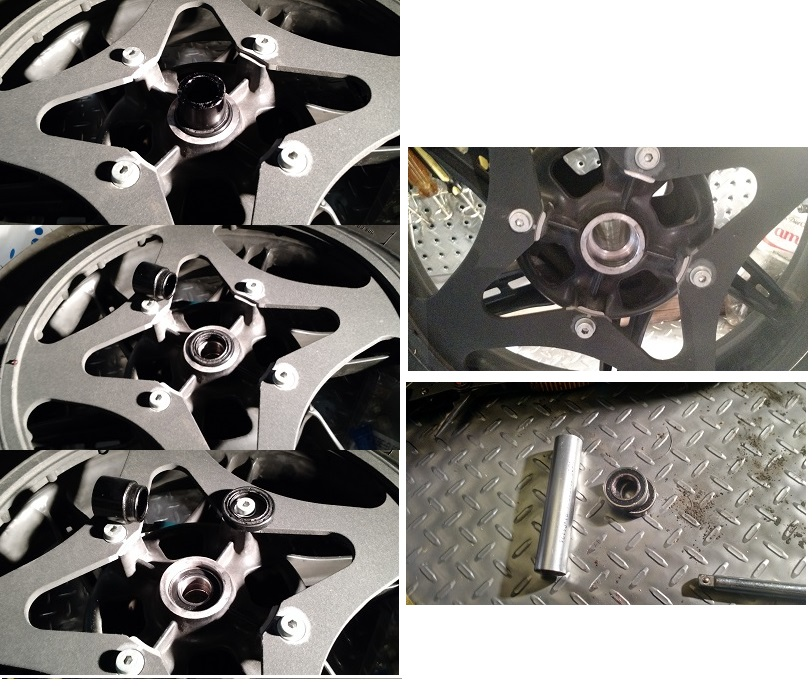
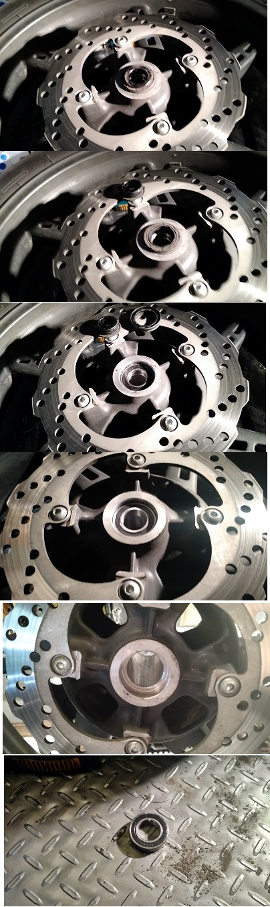

**Greg Hassler reports**

"I use my brake caliper piston puller, 20mm size works great." <https://www.klsupply.com/general-equipment/brake-caliper-pist-puller-set-35-6885.asp>

**Togo found this tool to work well for 6904-2RS on 2014 Zero SR**

<https://smile.amazon.com/Wheels-Manufacturing-Sealed-Bearing-Extractor/dp/B00NIPRNA4/>

**See Also**

- [Rear Wheel Removal](https://web.archive.org/web/2025/https://zeromanual.com/wiki/Gen2/Rear_Wheel_Removal)
- [Rear Wheel Install](https://web.archive.org/web/2025/https://zeromanual.com/wiki/Gen2/Rear_Wheel_Install)

## Suspension

### Front Suspension

Zero's motorcycles all feature [telescoping fork](https://en.wikipedia.org/wiki/Telescopic_fork) front suspension.

#### [Front Suspension Specs](https://web.archive.org/web/2025/https://zeromanual.com/wiki/Front_Suspension_Specifications)

|  |  | Fork |  |  |  |  |  |  | Shock |  |  |
| --- | --- | --- | --- | --- | --- | --- | --- | --- | --- | --- | --- |
| Years | Manufacturer | Description | Material | Model | Part# | Travel | Measurements | Oil | Material | Part# | Measurements |
| 2009-2010 | [FastAce](http://www.fastace.com/) |  |  | DS/X |  |  |  |  |  | BDA53AR ([discontinued](http://www.fastace.com/pro.php?m=sh&keyword=BDA)) |  |
| 2012-2013 | 〃 | 38mm (from Zero website/manual) inverted forks with adjustable compression and rebound damping | [6061-T6](https://en.wikipedia.org/wiki/6061_aluminium_alloy#6061-T6) Forged Aluminum (per [this thread](http://electricmotorcycleforum.com/boards/index.php?topic=3288.msg17395#msg17395)) <br> Chrome-Moly inner tube; Alloy steel spring wire | S | ALX07RC ([discontinued](http://www.fastace.com/pro.php?m=sh&keyword=ALX)) 22-05418-03 <br> **Right** <br> 22-04464-05 <br> **Left** <br> 22-04463-05 | 140mm | Compression 12 clicks; Rebound 21 clicks |  | [6061-T6](https://en.wikipedia.org/wiki/6061_aluminium_alloy#6061-T6) Forged Aluminum (per [this thread](http://electricmotorcycleforum.com/boards/index.php?topic=3288.msg17395#msg17395)) | BDA58RC ([discontinued](http://www.fastace.com/pro.php?m=sh&keyword=BDA)) |  |
| 〃 | 〃 | 〃 | 〃 | DS | **Left** <br> 22-06093-02? <br> **Right** <br> 22-06094-02? <br> (APX05RC? or APX10AR? ([discontinued](http://www.fastace.com/pro.php?m=sh&keyword=APX))) | 7.00 in (178 mm) | clarification? <br> **Distance** <br> 900 mm <br> **Travel** <br> 220 mm |  | 〃 | BFA57RC ([discontinued](http://www.fastace.com/pro.php?m=sh&keyword=BFA))) | **Rebound Adjustment** <br> 12 clicks |
| 〃 | 〃 | 〃 | 〃 | FX/MX/XU | XU - ALX07RC AP18A0179-B002 22-02749-01 | **XU** <br> 51mm (manual) <br> 130mm (website) <br> **MX** <br> 82mm (manual) <br> 240mm (website) <br> **FX** <br> 240mm |  |  | 〃 |  |  |
| 2014 | 〃 | 43 mm inverted forks with adjustable compression and rebound damping | [6061-T6](https://en.wikipedia.org/wiki/6061_aluminium_alloy#6061-T6) Forged Aluminum (per [this thread](http://electricmotorcycleforum.com/boards/index.php?topic=3288.msg17395#msg17395)) <br> Chrome-Moly inner tube; Alloy steel spring wire | S/SR |  | 6.25 in (159 mm) |  |  | [6061-T6](https://en.wikipedia.org/wiki/6061_aluminium_alloy#6061-T6) Forged Aluminum (per [this thread](http://electricmotorcycleforum.com/boards/index.php?topic=3288.msg17395#msg17395)) | BDA58RC ([discontinued](http://www.fastace.com/pro.php?m=sh&keyword=BDA)) |  |
| 〃 | 〃 | 〃 | 〃 | DS | APX16RC - 22-06867-05 <br> **Right** <br> 22-06869-05 <br> **Left** <br> 22-06868-05 | 7.00 in (178 mm) | Compression 11 clicks; Rebound 20 clicks |  | 〃 | BFA57RC ([discontinued](http://www.fastace.com/pro.php?m=sh&keyword=BFA))) | **Rebound Adjustment** <br> 12 clicks |
| 〃 | 〃 | 〃 | 〃 | FX |  | 230mm |  |  | 〃 |  |  |
| 2015-2020 | [Showa](http://www.showa1.com/en/product/motorcycle/shock_absorber_f.html) | 41 mm inverted cartridge forks, with adjustable spring preload, compression and rebound damping | **Outer Tube Finish** <br> Natural Anodized (silver) <br> **Slide Tube Finish** <br> Nickel - Hard Chrome <br> **Rebound (Tension) Finish** <br> Black Anodized <br> **Compression Finish** <br> Black Anodized | S/SR |  | 6.25 in (159 mm) | **Free length** <br> 461.5mm. <br> **Outer diameter** <br> 36.2mm. <br> **Stock spring rate** <br> 7.4 N/mm | **Type** <br> SS-8 <br> **Level** <br> 117 mm | **Body Finish** <br> Natural Anodized (silver) <br> **Rod Finish** <br> Nickel - Hard Chrome <br> **Rebound (Tension) Finish** <br> Black Anodized <br> **Compression Finish** <br> Black Anodized |  |  |
| 〃 | 〃 | 〃 | 〃 | DS/DSR |  | 7.00 in (178 mm) |  |  | 〃 |  |  |
| 〃 | 〃 | 〃 | 〃 | FX | **Left** <br> 22-05868-02 <br> **Right** <br> 22-05869-02 |  | **Free Length** <br> 789.1±2.0mm <br> **Max Length** <br> 798mm <br> **Min Length** <br> 580mm <br> **Stroke** <br> 218mm <br> **Spring Rate** <br> 5.4 N/mm <br> **Rebound (Tension)** <br> Max - 9 clicks <br> **Compression** <br> Max - 5 clicks <br> **Preload** <br> Min + 3.0 turns | **Type** <br> [SS-8](https://transmoto.com.au/comparative-oil-weights-table/) <br> **Volume** <br> 442±2.5cm3 <br> **Level** <br> 103mm | 〃 | 22-05879-02 | **Spring Rate** <br> 73.6-82.4 N/mm <br> **Free Length** <br> 320±2.0mm <br> **Max Length** <br> 320.5mm <br> **Min Length** <br> 246mm <br> **Stroke** <br> 74.5 <br> **Rebound (Tension)** <br> Max - 12 clicks <br> **Compression** <br> Max - 9 clicks <br> **Preload** <br> 2nd Position |
| 〃 | 〃 | 〃 | 〃 | FXS |  |  |  |  | 〃 |  |  |

#### [Fork Oil Change and Spring Replacement](https://web.archive.org/web/2025/https://zeromanual.com/wiki/Fork_Oil_Change_and_Spring_Replacement)

**Fork Oil Level Note**

Measure from outer tube end to oil surface (Condition: spring, spring joint, spring collar, seat rubber, slider, fork bolt are removed and dust seal touches axle holder)

**Reference**

[FastAce fork oil change / spring replacement](http://electricmotorcycleforum.com/boards/index.php?topic=4929)+ [part 2](http://electricmotorcycleforum.com/boards/index.php?topic=5323) by Ray Ivers

**Tools**

- 7mm Allen wrench for riser bolts.

**Steps**

1. Put the motorcycle on a stand.
2. Remove the risers and handlebars using a 7mm Allen wrench.
3. Loosen the fork caps, front axle, and brake caliper bolts while the front wheel is on the ground.
4. Fork cap / spring removal...
5. Oil change...
6. Fork spring / cap replacement...

**Notes**

| What | Torque | Bolt |
| --- | --- | --- |
| Handlebar clamps | 15 ft/lb | M8 |
| Handlebar risers | 25 ft/lb | M10 |
| Triple clamps (all) | 15 ft/lb | M8 |
| Fork caps | 15 ft/lb | M46 |
| F caliper bolts | 18 ft/lb | M8 |
| F axle end cap | 15 ft/lb | M8 |
| F Axle clamps | 9 ft/lb | M6 |

#### Fork Cartridge Revalving

[Fast Ace fork revalving](http://electricmotorcycleforum.com/boards/index.php?topic=7737) by Ray Ivers

The procedure is described in great detail for FastAce (2013-2014) suspension but could be adapted for the newer Showa suspension.

#### [Verify Fork Spring Rate](https://web.archive.org/web/2025/https://zeromanual.com/wiki/Fork_Spring_Rate_Verification)

**Reference**

[How to Verify Fork Spring Rate](http://electricmotorcycleforum.com/boards/index.php?topic=5320.msg39353#msg39353)

**Tools**

- A tip-tie long enough to wrap around the fork tube.

**Steps**

1. Add a zip-tie to the the fork tube.
   - Make sure it is snug so it stays in the place it was last pushed too.
   - Once the zip-tie is on the fork tube, you push it up to rest it against the upper fork.
2. Measure *bike sag* (unloaded)

   Lift the front fork off the ground and measure the gap (zip-tie to fork gap) created by the front weight of the bike.
3. Measure *rider sag* (loaded)
   1. Now push zip-tie back up the fork, then sit on the bike and raise your feet so all of your weight is carried through the suspension.
   2. Then carefully dismount and put kickstand down.
   3. Measure the gap (zip-tie to fork) created by your weight.
   4. Add this gap measurement to the *bike sag* measurement, this is the *total sag*.

   This measurement should be around 25% of the working range of the front suspension.

   Now that is a guideline; it can be higher or lower than 25%.

   It depends on what is happening when you are loading up the suspension (upper end).
4. Checking the upper end by using the zip-tie.

   After riding, check the location of the zip-tie: the gap from the fork to the zip-tie.

   Lets say the measurement is 5". Then you would know the total max travel used was 5" + *bike sag* measurement.

That total measurement should never equal the total suspension travel amount (6", I think based on your posting).

- If it equal, then you are bottoming out. Increase the preload and see if this keeps you from bottoming out.
- If you use max preload and are still bottoming out, you will need stronger springs.
- If you find you are only using 75% to 80% of the max suspension travel, you can reduce the preload spacer length some or you can live with this.
- If you are only using ~50% or less of the suspension travel, your springs are probably too stiff. You should swap springs to a lower rate spring.

### [Rear Shock](https://web.archive.org/web/2025/https://zeromanual.com/wiki/Rear_Shock)

Zero motorcycle models use a [single shock absorber](https://en.wikipedia.org/wiki/Motorcycle_suspension#Single_shock_absorber) rear suspension, joining the [Swingarm](https://web.archive.org/web/2025/https://zeromanual.com/wiki/Swingarm) to the [Frame](https://web.archive.org/web/2025/https://zeromanual.com/wiki/Frame).

#### Rear Shock Mounting

The rear shock fastens to the [Swingarm](#Swingarm)'s right side arched arm.

The upper mount reaches the frame ahead of the tail area.

#### [Rear Shock Specifications](https://web.archive.org/web/2025/https://zeromanual.com/wiki/Rear_Shock_Specifications)

| Years | Brand | Model | Description | Media | Specs | Models | Travel | Length |
| --- | --- | --- | --- | --- | --- | --- | --- | --- |
| 2013-2014 | [FastAce](http://fastace.com/index_moto.html) | BDA58RC | Piggy-back reservoir shock with adjustable spring preload, compression and rebound damping | 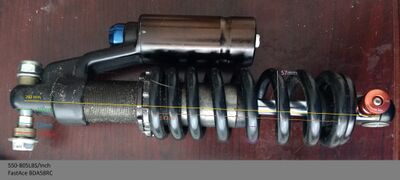 *2013 S Rear Shock FastAce BDA58RC* | **Spring Rate** <br> 550 ~ 805 lbs/in <br> **Spring** <br> Length 142mm, Diameter 57mm <br> **Bottom bushing width** <br> 11/16" <br> **Top bushing width** <br> ~1.25" | S/SR | 6.35 in (161 mm) | 10.25-10.5 in (260mm) |
| 〃 | 〃 | 〃 | 〃 | 〃 | 〃 | DS | 7.03 in (179 mm) |  |
| 〃 | 〃 | BFA57RC <br> Part 22-06105-03 | 〃 |  | - 319mm / 12.56" eye-eye <br> - 17.9mm / .705" eye width (top & bottom) <br> - 31.95mm / 1.258" bushing width (top & bottom) <br> **Resevoir** <br> offset angle ('clocking angle'): 242° CW / 118° CCW from 12 o'clock <br> offset width (shock centerline to far LH side of reservoir): @ 90mm / 3.60" <br> **Spring Rate** <br> 475-585 lbs/in. <br> **Spring** <br> 181mm / 7.125" length (on shock, no load, min. preload) | FX |  |  |
| 2015-2020 | [Showa](http://www.showa1.com/en/product/motorcycle/shock_absorber_r.html) |  | 40 mm piston, piggy-back reservoir shock with adjustable spring preload, compression and rebound damping |  |  | S/SR | 6.35 in (161 mm) |  |
| 〃 | 〃 | 〃 | 〃 | 〃 | 〃 | DS/DSR | 7.03 in (179 mm) |  |

#### [Rear Shock Adjustment](https://web.archive.org/web/2025/https://zeromanual.com/wiki/Rear_Shock_Adjustment)

**Notes**

The [Official Manual](../Official_Owners_Manual.md "Official Owners Manual") section on Rear Shock Adjustment illustrates how to measure preload and check sag.

**Compression**

The official manual's description here is adequate and this can be done readily by hand on the right side of the bike at the top of the shock.

**Rebound**

The adjustment knob is at the bottom of the shock facing rear, as described in the manual, and can be worked by hand or with a wrench with a careful reach into that area.

**Spring Preload**

The official manual illustrates the collar and procedure for spring preload adjustment, but does not recommend a specific tool, and there are clearance issues in that area for tools.

The adjuster sleeve diameter is 58mm (2.3").

A Stockton spanner wrench was found to be suitable for the job if modified as follows (per [2017 DSR Showa rear shock spanner wrench](http://electricmotorcycleforum.com/boards/index.php?topic=6674.msg53551#msg53551)):

- Grind the nose of the wrench to fit the notches.
- Bend the wrench a couple of degrees to clear the Sevcon motor controller fins.

Obviously, a better solution is still worth seeking.

A small suspension wrench / ER collet spanner size 30/32 can be use even with the lack of clearance

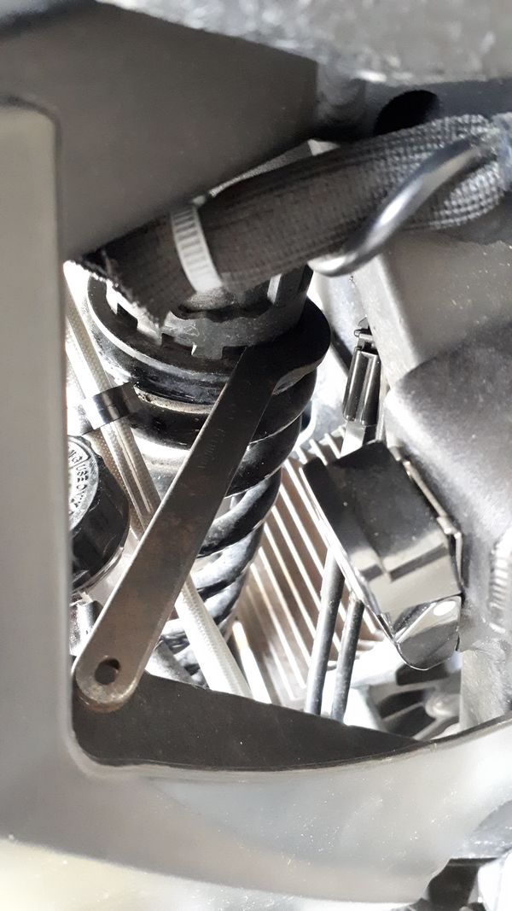 *Suspension wrench around the collar*

## Final Drive

### [Swingarm](https://web.archive.org/web/2025/https://zeromanual.com/wiki/FST_Platform/Swingarm)

The [swingarm](https://en.wikipedia.org/wiki/Swingarm) supports the rear wheel and pivots around the motor centerline.

**Mounting**

- The swingarm joins to the [frame doublers](https://web.archive.org/web/2025/https://zeromanual.com/wiki/FST_Platform/Frame_Doubler) via large diameter bearings and a kind of bracket that it bolts to.
- The rear shock connects to the right side of the swingarm crosspiece, on the hump of an arch, making the swingarm asymmetrical.
- The swingarm has threaded holes (M8x1.5mm pitch) for rear stand spools.
- The swingarm supports the rear axle with an adjustment slot for belt tensioning and alignment.

### [Rear Axle](https://web.archive.org/web/2025/https://zeromanual.com/wiki/Rear_Axle)

The rear axle is hollow, threaded on the right side and capped on the left for swingarm fitment.

| Years | Inner Diameter | Outer Diameter | Pitch |
| --- | --- | --- | --- |
| 2013-2014 |  |  |  |
| 2015+ | 11mm | 20mm | 1.25mm |

#### [Removal](https://web.archive.org/web/2025/https://zeromanual.com/wiki/Gen2/Rear_Axle_Removal)

This removes the [Rear Axle](https://web.archive.org/web/2025/https://zeromanual.com/wiki/Rear_Axle) part of [Rear Wheel Removal](https://web.archive.org/web/2025/https://zeromanual.com/wiki/Rear_Wheel_Removal).

**Tools**

- 27mm socket
- Breaker bar

**Instructions**

1. Place the motorcycle on a [lift or rear stand](https://web.archive.org/web/2025/https://zeromanual.com/wiki/Lift)

   Raise just enough that the rear wheel spins freely.
2. Mark/photograph where the alignment marks reside on each side of the axle for re-alignment when re-installing the wheel.
3. On the right side, loosen the rear axle nut (27mm) with the breaker bar.
4. Remove the rear axle nut.
5. Pull the axle part-way out so that the wheel can be moved forward enough to loosen the belt.
6. Pull the belt off of the rear sprocket.

   Let it hang outside of the swingarm slightly to avoid interfering with the wheel.
7. From the left side, pull the axle through the wheel.

#### [Install](https://web.archive.org/web/2025/https://zeromanual.com/wiki/Gen2/Rear_Axle_Install)

To replace the [rear axle](https://web.archive.org/web/2025/https://zeromanual.com/wiki/Gen2/Rear_Axle), see [rear wheel replacement](https://web.archive.org/web/2025/https://zeromanual.com/wiki/Gen2/Rear_Wheel_Install).

### [Belt](https://web.archive.org/web/2025/https://zeromanual.com/wiki/Drive_Belt)

Zero uses a belt for primary transmission of torque to the rear wheel. It's quiet and lightweight but is a proprietary design that can wear out. If you plan to put a lot of miles on a Zero or risk the belt often, buy a spare belt ahead of time and mind its maintenance.

#### [Belt Risks](https://web.archive.org/web/2025/https://zeromanual.com/wiki/Drive_Belt/Risks)

Drive belts fail by snapping or by stripping the teeth.

**On Landing**

The most common situation for a belt snap is when going over a major bump or jump where the rear wheel leaves the ground.

- If, while airborne, the throttle is not immediately relaxed, the rear wheel will rapidly spin up.
- A wheel that is moving extremely quickly in the air will get jerked back to its regular speed on landing. This is transmitted to the belt through the rear sprocket and can easily strip teeth.

**From Debris**

Gravel or sand that gets thrown between sprocket teeth and the belt will force the belt to expand quickly under load, and can cause it to snap.

Reportedly, sand is a much more reliable path to belt failure than gravel.

The sprocket tooth design is meant to deflect gravel to the inside of the swingarm towards the wheel.

The bike has an upper debris guard made of soft ABS plastic, but does not have a lower guard.

**From Mis-Alignment**

An unaligned belt can wear really badly and break sooner.

#### [Belt Specifications](https://web.archive.org/web/2025/https://zeromanual.com/wiki/Drive_Belt/Specifications)

Zero's final drive is a custom-designed [Gates](http://www.gates.com/) [HTD (high torque drive)](http://www.gates.com/products/industrial/industrial-belts/synchronous-belts/powergrip-htd-belts) [Poly Chain Carbon](http://www.gates.com/products/industrial/industrial-belts/synchronous-belts/poly-chain-htd-belts) toothed carbon fiber belt.

- It's never been available outside of Zero's parts system.
- It's been the same part for 2012-2016 models.

  2017 models shifted to a wider belt that can accommodate more torque/loading.

| Years | Width | Pitch | Models | Sprockets | Number of Teeth | Length | OEM Part No. | Photo |
| --- | --- | --- | --- | --- | --- | --- | --- | --- |
| [2010-2011](http://electricmotorcycleforum.com/boards/index.php?topic=7439.0) | 14mm | 8mm | S/DS | 98T / 28T | 200 |  | 30-02641 |  |
| 2012-2016 | 〃 | 〃 | S/SR | 132T / 28T | 220 |  | 30-03673 (old logo) <br> 30-08084 (new logo) | 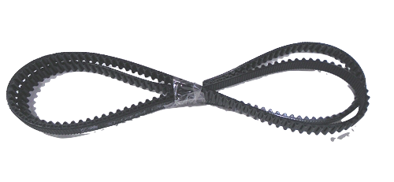 |
| 〃 | 〃 | 〃 | DS/DSR | 130T / 28T | 〃 | 〃 | 〃 | 〃 |
| 2017- | 17mm | 14mm | S 13.0 | 130T / 28T | 〃 | 〃 | 〃 | 〃 |
| 〃 | 〃 | 〃 | FX/FXS <br> DS/DSR <br> SR/S6.5 | 90T / 20T | 158 |  | 30-08086 | 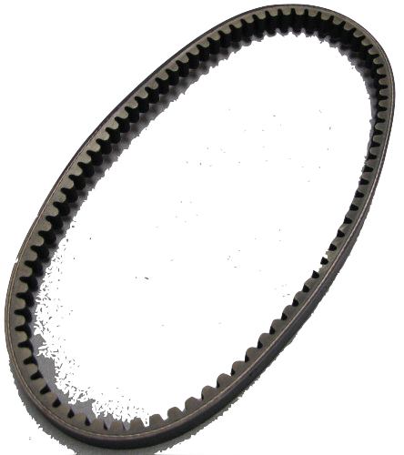 |
| 2020- | 20 | 11 | SRF | 90T / 20T | 151 |  | 30-08226 |  |

**Part**

[Gates GT Carbon, 14mm wide, 8mm pitch, 220 teeth](http://electricmotorcycleforum.com/boards/index.php?topic=5846). It's only available from Zero.

P/N's are 30-03673 ("Belt Drive, 220T, 8mm Pitch, 14mm Wide") and also 30-08084 (same belt w/new Zero logo).

One rough match for reference: [Gates 8MGT-1760-12 Belt](http://www.biedlers-belts.com/gates-8mgt-1760-12-belt.html)

Another Gates product page that highly indicates a product/technology match: [Poly Chain® GT® Carbon™ synchronous belts](https://www.gates.com/us/en/power-transmission/synchronous-belts/poly-chain-synchronous-belts/poly-chain-gt-carbon-belts/p/9268-000000-000045) per [Gates drive belts (EMF Thread)](https://www.electricmotorcycleforum.com/boards/index.php?topic=9702)

#### [Belt Tension Check](https://web.archive.org/web/2025/https://zeromanual.com/wiki/Drive_Belt/Tension_Check)

**Krikit Tension Gauge**

Zero recommends the [Gates Krikit belt tension gauge](http://www.zeromotorcycles.com/shop/index.php?main_page=product_info&cPath=15_4&products_id=191) to check belt tension.

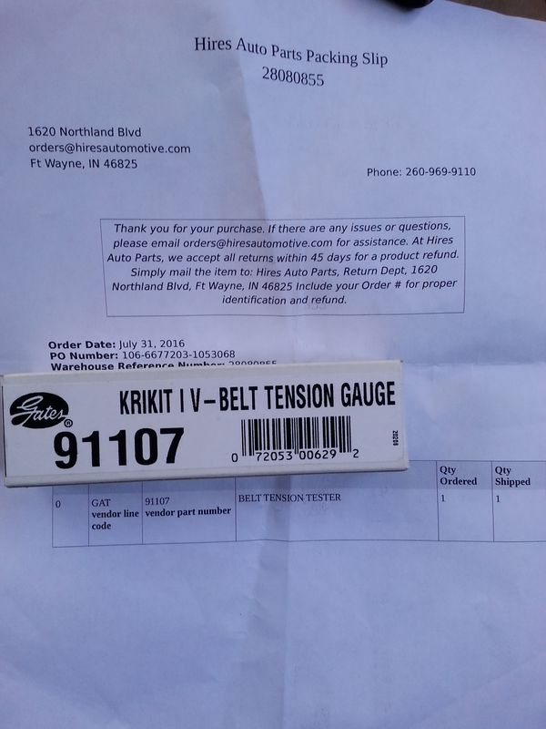 *Krikit Tension Gauge invoice and box*

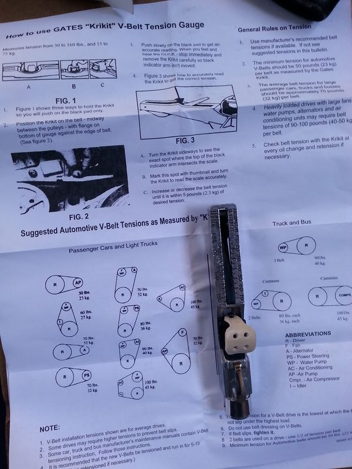 *Krikit Tension Gauge gauge and instructions*

**Video Guide**

MostlyBonkers made a [How-to video](https://www.youtube.com/watch?v=aifDR4jWG0E):

**Tips**

- Turning the back wheel backwards before measuring will give different readout compared to turning the wheel forwards before measuring using the same spot.

  The difference may be significant to the (pre-2017) 20-30kg belt tension specification.

  For wide-belt 2017+ models, the tension specification is very wide (~25-75kg) and thus has a lot of leeway but seems worth a rotational check anyway.
- The center of the belt can be reached from below, without removing the mudguard.

  This is described as a note in 5.14 in the 2015 manual

**Steps**

[More detailed generic instructions for the Krikit deflection device](http://www.newenglandbelting.com/bt_method3.asp)

1. Ensure the blue indicator arm is pressed down.
2. Place the gauge in the center of the belt span, such that it is aligned longitudinally with the belt length.
3. Place a finger on the blue pressure pad and depress this pressure pad.
4. Keep pressing the blue pressure pad until you feel and hear a distinct 'click'. When this 'click' sound is heard, do not press any further.
5. Remove the gauge and read the belt tension by observing the point where the top side of the blue indicator arm crosses the numbered scale on the gauge body.

- Care must be taken to ensure that the gauge is not 'rocked' when pressing down on the blue pressure pad. The strap above the pressure bar is provided to attach snugly over the finger and prevent any 'rocking' motion.
- Due to the fact that this device requires some amount of practice and operator skill, the accuracy and repeatability of the tension readings are not high.

**Improvement**

Because this procedure is not trivial to perform consistently, there is a modification to [make the tension gauge easier to align](https://web.archive.org/web/2025/https://zeromanual.com/wiki/Zero_Aftermarket)

**Gates' Carbon Drive mobile app**

As of 2017, the [Official Owners Manual](../Official_Owners_Manual.md "Official Owners Manual") also includes a procedure using [Gates' Carbon Drive mobile app](http://www.gatescarbondrive.com/products/tools) to check belt tension.

- [iOS version](https://itunes.apple.com/us/app/carbon-drive-bicycle-calculator/id438346486?mt=8)
- [Android version](https://play.google.com/store/apps/details?id=com.gates.carbondrivecalculator&hl=en)

**Usage**

- Use the application in a quiet environment.
- Pluck the belt near the center of the lower belt span, so it vibrates like a guitar string.

| Belt Type | Years | Resonant Frequency | Tension Range |
| --- | --- | --- | --- |
| Narrow | 2013-2016 | 96.3 Hz – 124 Hz | 20 – 30kg |
| Wide | 2017+ (except S 13.0) | 42.5 Hz – 73.6 Hz | 25 – 76.5kg |

The frequency can also be checked with instrument tuning apps such as [Tuner-gStrings](https://play.google.com/store/apps/details?id=org.cohortor.gstrings) for Android.

#### Belt Adjustment

FST Platform/Drive Belt Adjustment

#### [Belt Wear](https://web.archive.org/web/2025/https://zeromanual.com/wiki/Drive_Belt/Wear)

Generally, watch for belt damage and try to anticipate when to replace the belt to avoid an incident on the road where the belt snaps.

**What to Check**

- Check the teeth for wear and cracks.

  If you see cracks in the tooth forming, the belt is getting old.

  If you see deep cracks starting, it's time to [replace the belt](#Belt_Replacement) ASAP.

  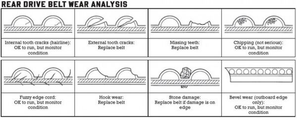 *Rear Drive Belt Wear Analysis*

**When to Replace**

- When it snaps.
- When any teeth have been ground off.

**Hard Skips**

- If the belt experiences a "hard skip" from debris between the belt and a sprocket, it is likely to fail soon after. Watch it carefully if this happens.

**Tension with aging**

Apparently, [per forum user JaimeC](http://electricmotorcycleforum.com/boards/index.php?topic=5693.msg42069#msg42069), belts don't wear like chains.

As they get older they'll actually get tighter, not looser like a chain.

- When a chain ages, the little bearing points between the links and rollers wear causing the chain to hang looser.
- When a belt ages, the rubber on the inner/toothed side begins to swell.

Since the Kevlar belt on the outer circumference won't stretch, the inner circumference will shrink making the belt tighter around the sprockets.

Generally, you want to make sure the belt hasn't gotten any tighter since you brought it home.

**References**

- [Drive Belts](https://www.electricmotorcycleforum.com/boards/index.php?topic=10293)

#### Belt Replacement

FST Platform/Drive Belt Replacement Procedure

### Sprocket

#### [Sprocket Specifications](https://web.archive.org/web/2025/https://zeromanual.com/wiki/Sprocket_Specifications)

| Belt |  |  |  | Front |  |  |  | Rear |  |  |  |  |
| --- | --- | --- | --- | --- | --- | --- | --- | --- | --- | --- | --- | --- |
| Width | Pitch | Years | Models | Teeth | Depth | Bore | Other | Teeth | Depth | Bore | Other | Ratio |
| 14mm | 8mm | 2012-2016 | SR | 30 | 15mm | 1" | key measurements? | 130 | 15mm | 1" |  | 4.33:1 |
| 〃 | 〃 | 〃 | FX/FXS | 25 | 〃 | 〃 | 〃 | 132 | 〃 | 〃 | 〃 | 5.28:1 |
| 〃 | 〃 | 〃 | S/DS/DSR | 28 | 〃 | 〃 | 〃 | 130 | 〃 | 〃 | 〃 | 4.64:1 |
| 〃 | 〃 | 2017-2018 | S 13.0 | 〃 | 〃 | 〃 | 〃 | 〃 | 〃 | 〃 | 〃 | 〃 |
| 17mm | 11mm | 〃 | FX/FXS/DS/DSR/SR/S6.5 | 20 | 17mm |  | spline measurements? | 90 | 17mm |  |  | 4.50:1 |
| 〃 | 〃 | 2019 | S/DS/SR/DSR/FX/FXS | 〃 | 〃 | 〃 | 〃 | 〃 | 〃 | 〃 | 〃 | 〃 |

**Reference**

[2013 DS chain drive](http://electricmotorcycleforum.com/boards/index.php?topic=6689.msg53623#msg53623)

[Re: Big belt Kits for pre-2017 bikes.](http://electricmotorcycleforum.com/boards/index.php?topic=6538.msg51446#msg51446)

#### [Sprocket Wear On Belt](https://web.archive.org/web/2025/https://zeromanual.com/wiki/Drive_Belt/Wear_From_Sprocket_Debris)

Wear debris from the tire or the road can accumulate on sprocket teeth, putting pressure on the belt which can wear it out faster.

**Recommendation**

Keep the sprocket teeth clean to minimize wear on the belt.

A non-abrasive brush should be effective.

#### [Front Sprocket Removal / Swap](https://web.archive.org/web/2025/https://zeromanual.com/wiki/Front_Sprocket_Replacement)

Removing or replacing the front sprocket on S and X platforms.

**Video Guide**

Some guidance from Terry in this [motor removal thread](http://electricmotorcycleforum.com/boards/index.php?topic=6230):

- Basically, if you are doing this to try to get more acceleration by moving from a 28 tooth to a 25 tooth, Harlan recommends trading in the DS on a 2015+ SR or 2016 DSR if you need the off road capabilities. You will get much much more acceleration and not hurt your top end performance.
- On the drive belt side, the upper rear 5mm bolt takes **extreme** care to remove. It is tapered to locate the motor. There is a very strong chance of stripping the head and have to drill it out. Make sure to have a machine shop close by just in case.
- On the other hand, removal of the motor may not be necessary.

- The other 7 bolts, 3 on the sprocket side and 4 on the rear brake side are the only thing simple and straight forward.

  You will need a special 3" or longer 6mm allen head socket for sticking in the hole through the frame at the front of the motor.

  1. Remove the rear brake pedal and assembly to get the heel guard out of the way of the top right rear motor bolt.

     Be careful not to strip these bolts either.

     They have Loctite; use a torch.

     And make sure your local hardware store has these replacement bolts handy in case you have to drill them out.

     The rear brake pedal needs to move anyway to get the right swingarm bolt out.
- Also the sprocket bolt itself, as well as removing and installing the new sprocket on the shaft can be very difficult. Some of the best professionals have had trouble.

  Loctite has been used on everything and you will need a torch to remove them.

  Even so, you will need a strap wrench with an old belt as the strap to hold the sprocket and a high power impact wrench.
- Even with all that right, you have a chance of stripping or breaking the bolt. The sprocket is pressed pretty tight.
- Be very careful not to permanently damage the motor bearings by prying between the motor itself and the sprocket to try to remove it, and also by tapping with a hammer to try to fit the new one on. You will be tempted to do both, but you need to find another way.

  A gear puller would be much better.
- There are other things to watch for:
  - Mark your phase leads and pay special attention to the routing.
  - Don't over-tighten the motor jack nuts and bolts until you have the swingarm back in place as it can pull the frame together slightly making it impossible to get the swingarm in place.
  - Make sure you unplug the 8 way motor encoder harness and it doesn't get yanked and pull a wire.
  - The top shock mounting bolt is a 15 and 17 mm and can be done with ratchet wrenches 1/32 of a turn at a time, or without ratchet wrenches if you are known to have extreme patience. It can take a while. The 2014 is a little easier and is (seems to be a) dual 17mm bolt and nut.
  - The swingarm bolts are 10mm allen head and can be extremely hard to relocate even when working with someone else, a rubber hammer, and a flashlight. Those who have replaced their own belt before can vouch for this.
- Again, I doubt too many on this forum have done this, and those who did I'll bet agree with me that it makes more sense after they did it and perhaps had their bike out of commission to work through the things that didn't go right, and would agree to just upgrade to the SR or DSR first vs trying to change the front sprocket.
- Also the 25 tooth sprocket will break belts easier as less teeth are engaged than the 28 tooth, which can make it more likely to sheer teeth in the event of a wheelspin, and it bends the belt at a sharper radius which can possibly fatigue the carbon strands more. The SR actually uses a 30 tooth front sprocket which is even nicer to the belt than the 28 tooth.

## Brakes

FST Platform/Brakes

### [Brake Maintenance](https://web.archive.org/web/2025/https://zeromanual.com/wiki/Brake_Maintenance)

- Check for pad wear or debris.

  Keep the pads and discs clean.

  An occasional brushing of the disc holes is worth doing maybe once a year.
- Check hydraulic fluid level.

  Make sure the brake fluid is in good shape and the type/specs you need.

  If in doubt, replace with fresh fluid (not from an already opened bottle).
- Make sure the brake fluid reservoir is not over-filled (top).

  There has to be some empty space, or your bike will be lightly "braked" and your disk/pads will deteriorate prematurely...and you will get less range.

### [Brake Systems](https://web.archive.org/web/2025/https://zeromanual.com/wiki/Brake_Systems)

|  | Front |  |  | Rear |  |  |  |
| --- | --- | --- | --- | --- | --- | --- | --- |
| Year | Manufacturer | Rotor | Caliper | Manufacturer | Rotor | Caliper | Notes |
| 2013 | Nissin | 313mm (listed) / 310mm (actual) ⌀ <br> - floating <br> - matches KTM 450SMR |  | Nissin | 221mm ⌀ <br> - fixed |  | relatively weak <br> [J Juan upgrade](http://www.zeromotorcycles.com/shop/index.php?main_page=product_info&cPath=15_6&products_id=211) available for rear brake. |
| 2014 | 〃 | 〃 | 〃 | J Juan | 240mm ⌀ | S: 34mm <br> X: 30mm | Same pad sizes as 2013. |
| 2015 | J Juan | 320mm ⌀ <br> - non-floating <br> M8x23mm shoulder screw fasteners | S: 32/30mm <br> X: 27mm | 〃 | 〃 | 〃 | Bosch Gen 9 ABS; New pad sizes. |
| 2016 | 〃 | 〃 | 〃 | 〃 | 〃 | 〃 | Bosch Gen 9 ABS |
| 2017 | 〃 | 〃 | 〃 | 〃 | 〃 | 〃 | 〃 |
| 2018 | 〃 | 〃 | 〃 | 〃 | 〃 | 〃 | 〃 |
| 2019 | 〃 | 〃 | 〃 | 〃 | 〃 | 〃 | 〃 |
| 2020 | 〃 | 〃 | 〃 | 〃 | 〃 | 〃 | 〃 |

### [Brake Hydraulics](https://web.archive.org/web/2025/https://zeromanual.com/wiki/Brake_Hydraulics)

| Models |  | Front |  |  |
| --- | --- | --- | --- | --- |
| Platform | Years | Caliper Piston Area | MC Piston Area | Hydraulic-Advantage Ratio |
| S | 2015 | 1509 mm² (total) | 126 mm² | 11.9:1 |
| 〃 | 2016 | 〃 | 〃 | 〃 |
| 〃 | 2017 | 〃 | 〃 | 〃 |
| 〃 | 2018 | 〃 | 〃 | 〃 |
| 〃 | 2019 | 〃 | 〃 | 〃 |
| 〃 | 2020 | 〃 | 〃 | 〃 |

**[Regarding Brake Upgrades:](http://electricmotorcycleforum.com/boards/index.php?topic=6631.msg52829#msg52829)**

A 9.5mm-piston master cylinder - like the Nissin 3/8 I put on my 'MX' bike - would give the SR a 21.1:1 ratio, or @ 78% more pad pressure than the OEM 12.7mm master cylinder.

Any Brembo, Nissin, etc. 9.5mm / .375" master cylinder w/switch should drop right in and make a huge difference, and you won't have to touch anything else.

On the rear, the 11mm master cylinder from the FX (Zero part# 25-06731) has 49mm M6 bolt spacing / rear reservoir hose / top output / clevis, and should give @ 19% more pad pressure than the SR 12mm master cylinder.

This won't be a night-and-day difference like the front master cylinder change, but it should still be very noticeable.

### Rear Brake Actuator

FST Platform/Rear Brake Actuator

### ABS System

2015+ models have a Bosch ABS system installed.

#### ABS Unit

#### ABS Wheel Sensors

### [Brake Pads](https://web.archive.org/web/2025/https://zeromanual.com/wiki/Brake_Pads)

Zero Motorcycles models use disc brakes with consumable brake pads applied by calipers to the rotors.

**General Reading Material**

[Top 10 Questions About Motorcycle Brake Pads](http://www.bikebandit.com/blog/post/top-10-questions-about-motorcycle-brake-pads)

[Motorcycle Brake Pads & Rotors Explained, by Galfer USA](http://www.bikebandit.com/blog/post/motorcycle-brake-pads-and-rotors-explained-by-galfer-usa)

[Sintered vs Organic Brake Pads](http://powersports-blog.denniskirk.com/5573/powersports/motorcycle-brake-pads-sintered-vs-organic/)

**General Brake Pad Replacement Suggestions**

- **2013+ ([Gen2](https://web.archive.org/web/2025/https://zeromanual.com/wiki/Gen2), [Gen3](https://web.archive.org/web/2025/https://zeromanual.com/wiki/Gen3)):** Try to not use synthetics pads or "sintered", but organic or semi sintered ones.

  Sintered are better for very aggressive riding/braking, but are generally noisier.
- **2012 and earlier ([Gen1](https://web.archive.org/web/2025/https://zeromanual.com/wiki/Gen1)):** Keep the sintered pads

  Brake pump is very weak on these models; you need all the braking power you can get in spite of noise.

Sand the pads.

Grease the back of the pads lightly with ceramic grease (copper grease can interfere with ABS sensors).

Check caliper position.

Check caliper springs, if any.

Check the wheel for trueness.

Sand the disk; it could have lightly crystalized.

Make sure all the bolts in the system (including wheel) are properly tightened.

After all of this has been preformed and before riding, clean everything exposed to dirt/grease with isopropyl alcohol

When riding again, try to not brake very aggressively the first 20-30 miles.

#### [Brake Problems](https://web.archive.org/web/2025/https://zeromanual.com/wiki/Brake_Problems)

This covers general problems with brake pads, in terms of typical symptoms.

**Brake Squeak**

Brake *squeak* (pad front against the disc) happens occasionally and is relatively quiet and noticeable but not anomalous.

**[Brake Squeal](https://web.archive.org/web/2025/https://zeromanual.com/wiki/Brake_Squeal)**

Brake *squeal* (pad back resonating against caliper cylinder) can be very loud and annoying. Squeal does not technically impact performance but it's very unpleasant and might cause the rider to hesitate before fully braking which is a safety issue.

**Solutions**

- Clean the pads and/or discs for squeaking.
- Try a [different brake pad](https://web.archive.org/web/2025/https://zeromanual.com/wiki/Brake_Pad_Lookup) (attractive if you want a different pad feel or performance in the first place).
- LocTite Disc Brake Quiet stick applicator for the backs of the pads.
- [Chamfer the brake pads](https://www.facebook.com/groups/zmcowners/permalink/1329769437092261/?comment_id=1334269306642274&comment_tracking=%7B%22tn%22%3A%22R%22%7D)

  File the edges of the pad to put a 45 degree edge on them

  You only need 1-2mm

#### [Brake Pad Fit](https://web.archive.org/web/2025/https://zeromanual.com/wiki/Brake_Pad_Fitment)

**Nissin (2013 on rear, and 2013/2014 front)**

**J Juan (2014+ on rear, 2015+ on front)**

[Front pad shape FDB892](http://ecat.ferodoracing.com/motorcycle/brake-pads-and-shoes/FDB892)

[Rear pad shape FDB539](http://ecat.ferodoracing.com/motorcycle/brake-pads-and-shoes/FDB539)

Past forum threads of highly varying quality / ability to clarify:

- This [forum discussion](http://electricmotorcycleforum.com/boards/index.php?topic=5650) starts with the 14FX and brings up lots of issues.
- Another forum thread on [brake pad alternatives to OEM/stock](http://electricmotorcycleforum.com/boards/index.php?topic=5829).
- One [exhaustive listing from Burton](http://electricmotorcycleforum.com/boards/index.php?topic=3370.msg18646#msg18646) which unfortunately have the wrong EBC fitment numbers.

**EBC**

The [EBC brake catalog](https://ebcbrakes.com/Assets/ecatalogues/EBC_2017_US_MC_Catalog/EBC_2017_US_MC_Catalog.html#p=220) covers Zero models.

However, it has always had the wrong shape recommendation for 2013-2014 models, and for the FX entirely! Double-check any recommendation.

Their Carbon X pads can eliminate front brake squeal. [EBC Carbon X page](https://ebcbrakes.com/product/carbon-x-or-tt-brakes/)

**SBS**

offers a [brake search engine](http://uk.sbs.dk/business-areas/motorcycle.aspx) which covers Zero models.

**Goldfren**

offers a good [cross reference](http://www.goldfrenusa.com/includes/pdf/GOLDFREN_BrakePadsCrossReference.pdf) between brands.

**[Brembo](http://moto.brembo.com/en/)**

Brembo's [Motorcycle Brakes Configurator](http://moto.brembo.com/en/) has reasonably usable Zero model lookup.

Their Carbon Ceramic pads are reported to resolve brake squeal issues.

#### [Front Brake Pad Replacement](https://web.archive.org/web/2025/https://zeromanual.com/wiki/Front_Brake_Pad_Replacement)

See [Brake Pad Lookup](https://web.archive.org/web/2025/https://zeromanual.com/wiki/Brake_Pad_Lookup) to ensure a brake pad match.

| | |
| --- | --- |
|   **Warning:** | Avoid touching the pad and rotor surfaces with sharp tools and anything dirty or greasy. Avoid applying one-sided pressure to the rotor. |

**2013-2014 S-platform**

Actual bike used was a 2014 SR (Nissin 313mm). Likely applicable to S/DS/DSR.

**Tools**

- 13mm hex socket
- Torque wrench
- 4mm Allen key
- Size 1 flat head screwdriver
- Sandpaper
- Brake cleaner
- Ceramic grease (copper grease can interfer with the ABS sensors)

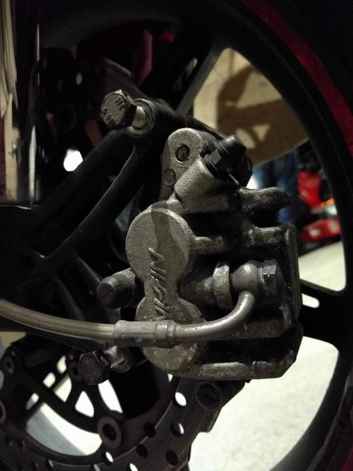 *Nissin front brake 2014SR loosen bolts*

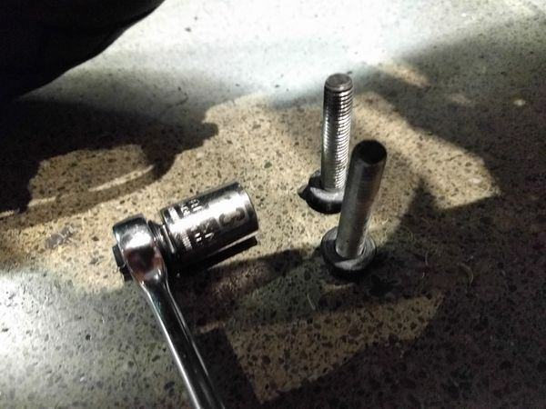 *Nissin front caliper bolts 13mm hex 2014SR*

**Steps**

1. Clean the slave cylinder to prevent forcing damaging detritus into the seal.
2. Gently force the brake pads away from the disk, to ensure room for the new pads, which will be thicker than the worn pads.

   Apply pressure evenly by hand or with a soft-surfaced tool.
3. **Pre-2015:** Using the Size 1 flat blade screwdriver, remove the cap to expose the head of the pin.

   | | |
   | --- | --- |
   |   **Warning:** | Penetrating oil may be necessary, and it's important to use the right size flat blade, as smaller ones can strip the slot as you apply pressure. |

   | | |
   | --- | --- |
   |   **Warning:** | Rely on the caliper bolts' anchoring to the disc to ensure leverage. |
4. Remove the pin using a 4mm Allen key.

   | | |
   | --- | --- |
   |   **Warning:** | Rely on the caliper bolts' anchoring to the disc to ensure leverage. |
5. Remove the 13mm hex bolts holding the caliper to the fork bracket.
6. Remove the caliper from the brake disc; inspect and clean.

   It may be possible to change the brake pads without removing the calipers from the disk, but removal is more thorough to check for wear and keep it clean.
7. Remove the plate with the brake pads, inspect and clean, and put in fresh pads.
8. Apply ceramic grease to the slave cylinders and sand the front surface of the pads.
9. Re-install the pin through the brake pads to anchor them in place.

   Apply a drop of blue Loctite to prevent it coming loose.
10. Re-install the calipers against the rotor:
    1. With the pads separated sufficiently, slide the caliper over the front disc.
    2. Align the caliper mounting holes with the fork bracket and thread the 13mm hex bolts to hold in place.
    3. Apply some blue Loctite to each caliper mounting bolt and tighten with the 13mm hex socket to the right torque ([2014+: 19ft-lb, 2013: 12ft-lb](../Fastener_Specifications.md "Fastener Specifications")).
    4. **Pre-2015:** Using the Size 1 flat blade screwdriver and a drop of blue Loctite, re-install and tighten the cap over the head of the pin.
11. Squeeze the front brake lever a few times to build up pressure in the hydraulics and press the pads up to the disc.
12. Test the brakes
    1. Rotate the front wheel to check that the caliper doesn't impede the wheel.
    2. Roll the bike and test the brake lever action.
    3. If there are no obvious problems, gear up and slowly ride the bike to test the brakes.
    4. If possible, gradually increase the speed of the braking tests to seat and smooth the pads.
    5. Perform an initially very slow test ride (walking speed up to 25mph), checking brake function and ensuring they are seated and performing adequately.

**2015+ S Platform**

Actual bike used was a 2016 SR

1. Locate the bolt used to pin the low side of the brake pads.

   Remove the clip on the inside of the bolt.
2. Detach the ABS wire from the brake line, by carefully unclipping the lower three fasteners holding the ABS wire to the brake line.
3. Remove the bolt pinning the pads with a #25 Torx bit.
4. Back out the caliper bolts with a 8mm hex bit on a 12-inch or longer wrench.
5. Remove the caliper from the rotor.
   1. Complelely remove the caliper bolts and slide the caliper as far as possible off the rotor.
   2. With a flat screwdriver about 8-inches long, drop the inside pad out of the caliper.
   3. After the inside pad clears the caliper, remove the caliper.
6. Temporarily hold the old pads against the pistons by loosely replacing the bolt that pins the pads.
7. Fully push back the pistons, by using a C-clamp with at least 2x2-inch opening and 1-inch heads, clamping the old pads to the outside caliper body.
8. Remove the clamp and old pads.
9. Test fit the new pads.
10. Insert the outside pad in the caliper.
11. Hold the caliper against the rotor and insert the inside pad.
12. Re-install the calipers against the rotor:
    1. Position the caliper to insert the caliper bolts, and tighten a little more than finger-tight.
    2. Carefully drive the pad-pinning bolt until it stops, and reinstall the inboard clip.
    3. Remove the caliper bolts one at a time, apply Loctite 242 or equivalent, and retighten.
    4. Torque the caliper bolts to 19 lb-ft (26 Nm).
    5. Re-attach the ABS wire to the brake line (via the 3 clips).
13. Squeeze the front brake lever a few times to build up pressure in the hydraulics and press the pads up to the disc.
14. Test the brakes
    1. Rotate the front wheel to check that the caliper doesn't impede the wheel.
    2. Roll the bike and test the brake lever action.
    3. If there are no obvious problems, gear up and slowly ride the bike to test the brakes.
    4. If possible, gradually increase the speed of the braking tests to seat and smooth the pads.
    5. Perform an initially very slow test ride (walking speed up to 25mph), checking brake function and ensuring they are seated and performing adequately.

#### [Rear Brake Pad Replacement](https://web.archive.org/web/2025/https://zeromanual.com/wiki/Rear_Brake_Pad_Replacement)

**Tools**

- T25 Torx bit screwdriver

  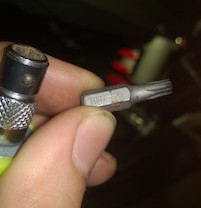 *Torx T-25*
- Flat blade screwdriver
- Small pliers
- 200 grit sand paper (optional)

**Steps**

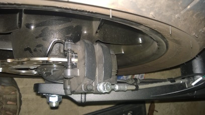

1. Remove safety spring-clip from the rear of the bolt (on the side of the wheel).

   Just push it out with a flathead screwdriver.

   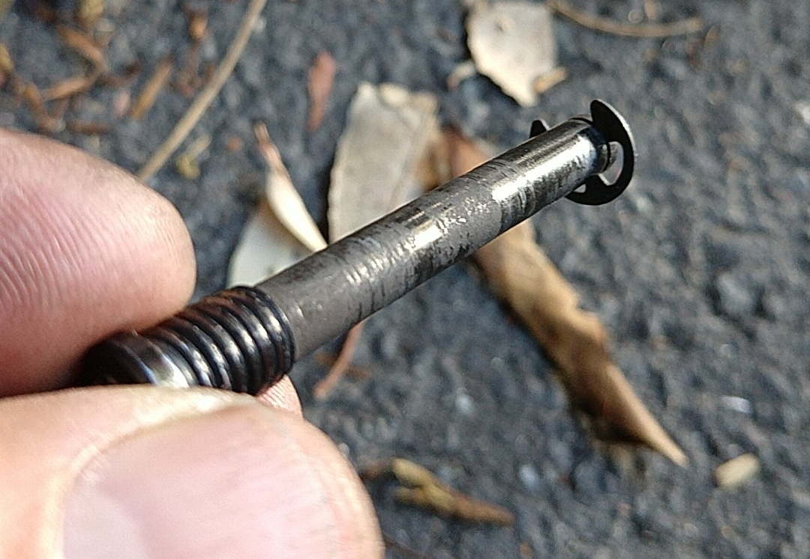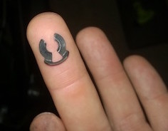
2. Remove the bolt that goes through the "eye" of the brake pads (using #25 torx driver).

   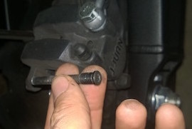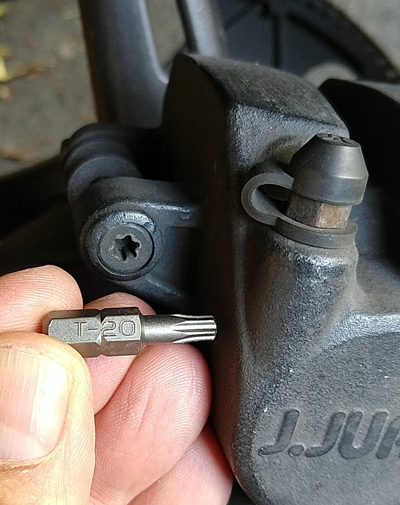
3. Pull out the pads.

   They just come out when pulled gently by hand towards the rear of the bike.

   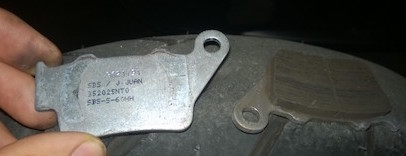  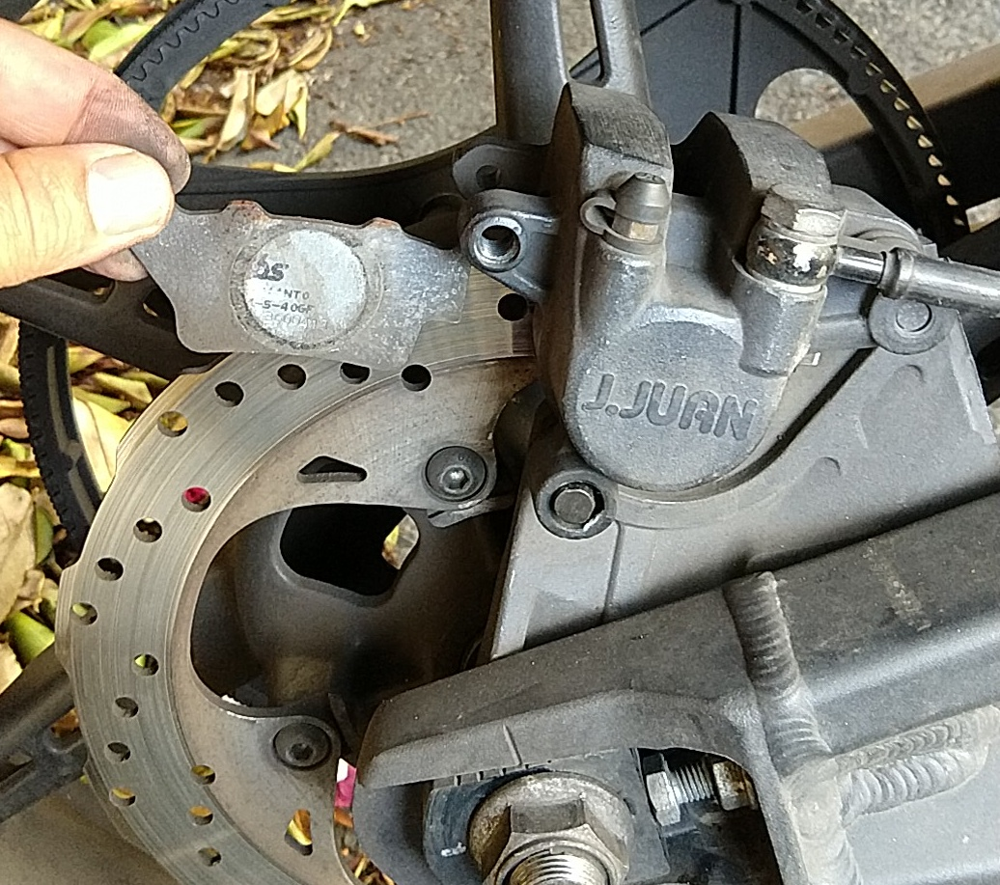
4. If there's any debris like paint on the pad material, you may want to sand them flat/clean gently over some 200 grit sandpaper on a flat surface.
5. Put in new pads.

   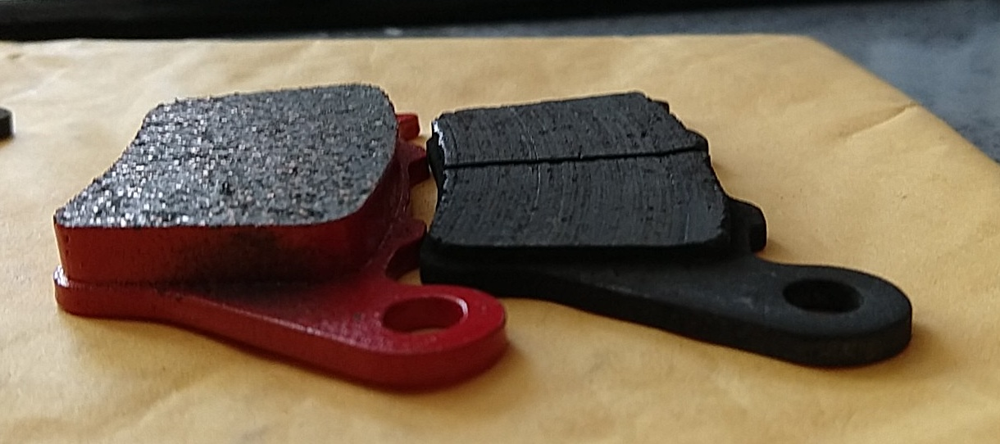
6. Screw-in the bolt.

   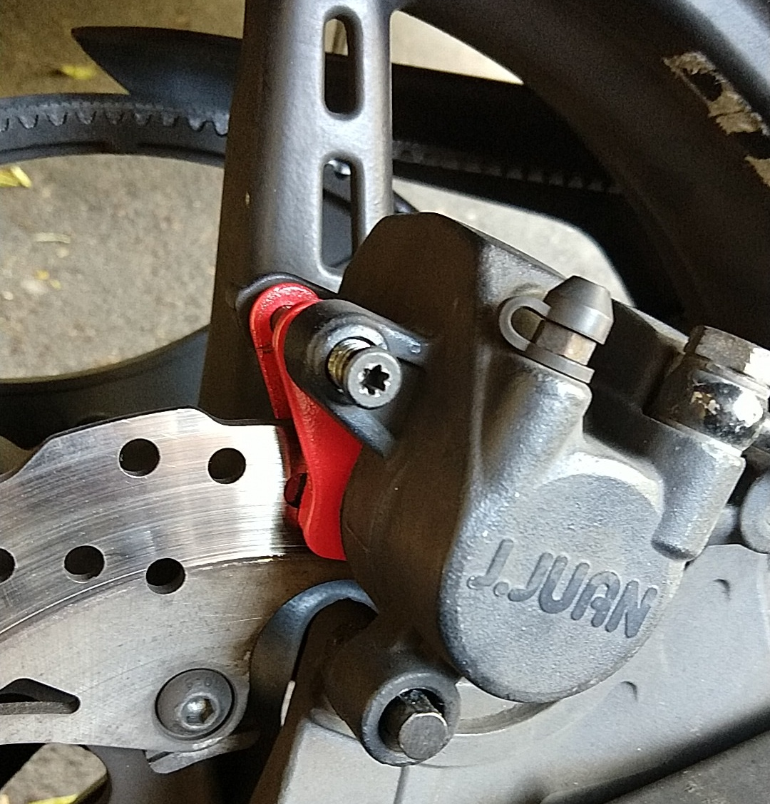

   It maybe good to use some anti-seize paste if not present from the factory.

   Torque value unknown, but be quite gentle - probably something like 10lb/ft (hand-tighten firmly with a regular screwdriver kind of torque).
7. Reinstall safety clip.
8. Test your ride carefully!

**References**

Per [Rear Pad Replacement](http://electricmotorcycleforum.com/boards/index.php?topic=5933.0) for J Juan rear brakes (2014+)

## Powertrain

The powertrain includes all of Zero's power storage and delivery components including the battery, but this section focuses on the [motor](#Motor), power delivery via the [controller](#Controller), and their inputs via [throttle](#Throttle) and drive mode configurations.

**Licensing**

- For a time, Zero openly offered powertrain components in a licensed manner for prototyping and other uses.
- Currently, probably for reasons of liability and support overhead, this is not publicly offered but does seem available on request for companies wanting to develop products where Zero's powertrain is a good fit.
- See Zero's [Z-Force Powertrain Solutions](https://www.zeromotorcycles.com/powertrains/) page which has a contact form.

### [Throttle](https://web.archive.org/web/2025/https://zeromanual.com/wiki/Throttle)

The Zero throttle is a very straightforward twist-grip motorcycle control that operates a sensor instead of pulling on a mechanical cable or operating hydraulics.

Zero switched the throttle supplier from a [Magura](https://web.archive.org/web/2025/https://zeromanual.com/wiki/Magura_Throttle) with a linear potentiometer to a [Bitron](https://web.archive.org/web/2025/https://zeromanual.com/wiki/Bitron_Throttle) with a Hall-effect sensor in 2015 which changed how the wiring works.

**Connections**

The Zero throttle connects directly to the [controller](https://web.archive.org/web/2025/https://zeromanual.com/wiki/Gen2/Motor_Controller), so anything you do related to the throttle signal can compromise the operation of the bike if there's an electrical fault or discrepancy.

**Example:** [Sudden braking followed by no motor/throttle response on highway[2016 FXS](http://electricmotorcycleforum.com/boards/index.php?topic=6548)]

**Customization**

See [Drive Modes](https://web.archive.org/web/2025/https://zeromanual.com/wiki/Drive_Modes) to customize throttle input interpretation as an owner.

Use the mode control for "Custom" mode on 2014+ or "Eco" on earlier models to set the maximum torque the throttle applies.

This also directly changes how quickly torque ramps up for a given throttle twist/position.

**Advanced Customization**

The Sevcon motor [controller](https://web.archive.org/web/2025/https://zeromanual.com/wiki/Gen2/Motor_Controller) settings are where most of the throttle interpretation happens.

**Replacement**

TODO...

**Assembly**

The return spring cannot be tensioned while disassembled throttle is on the handlebar. Throttle must be removed to place the spring end correctly. see video from Harlan Flagg: <https://www.facebook.com/harlanflagg/videos/1364143910276196/>

**Troubleshooting**

[One report of a "snatchy" throttle](http://electricmotorcycleforum.com/boards/index.php?topic=6382.msg49746#msg49746) turned out to have this explanation:

There is a black adjusting screw which holds the pinion gear of the throttle in place or for adjustment.

The pinion gear had moved to the right and caused the spring clip for throttle return to pop out of the slot.

This was clicking through the gears and causing a notchy throttle feel.

Resolution: Reset the pinion location and tighten the screw.

#### [Bitron Throttle](https://web.archive.org/web/2025/https://zeromanual.com/wiki/Bitron_Throttle)

2015+ models use a new HAL-based (Hall-effect active device) sensor from [Bitron](http://www.bitron.net) which can't be replaced easily by Domino or similar

Product reference: [Bitron HAL-based throttle](http://www.bitron.net/index.php?option=com_k2&view=itemlist&task=tag&tag=accelescooter&Itemid=231)

**Connectors**

Via [Keith's investigation](http://electricmotorcycleforum.com/boards/index.php?topic=6966.msg57299#msg57299)

8 wire output, bundled into two pairs of 3 wires for potentiometer outputs.

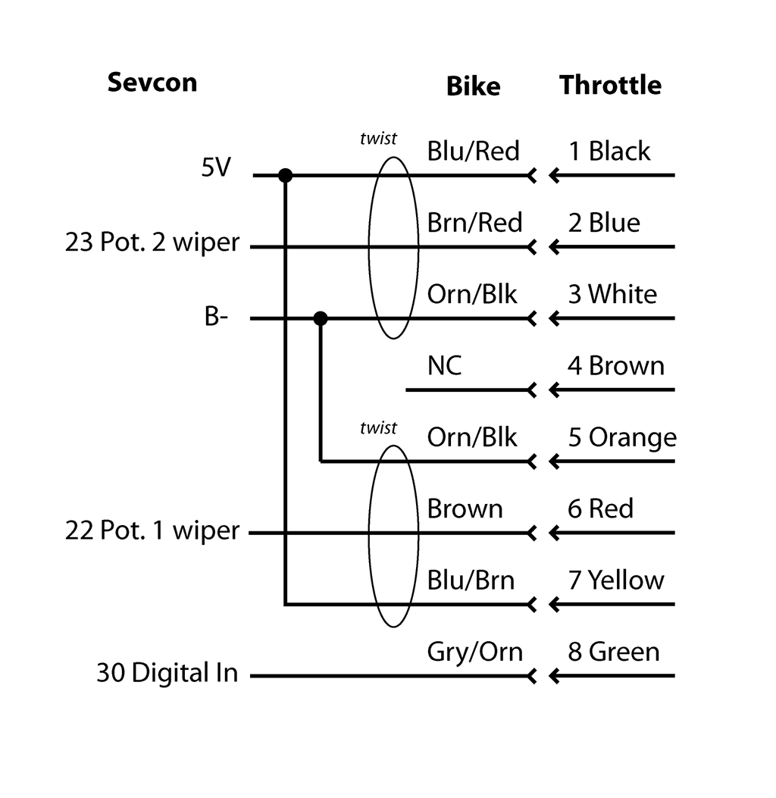

[Sumitomo connector 6188-0779](http://prd.sws.co.jp/components/en/detail.php?number_s=61880779)

[Sumitomo connector 6189-1240](http://prd.sws.co.jp/components/en/detail.php?number_s=61891240)

The hall-effect sensor may be a potentiometer wired up as a voltage divider as follows:

| Wire | Twist | Voltage |
| --- | --- | --- |
| Brown | None | 0.5 |
| 〃 | Full | 4.5 |
| Brown/Red | None | 4.5 |
| 〃 | Full | 0.5 |

### Regen

FST Platform/Regen

### [Drive Modes](https://web.archive.org/web/2025/https://zeromanual.com/wiki/Drive_Modes)

The Zero platform has always offered a simple control for switching throttle and regen mappings through MBB-Sevcon interaction.

**[Gen1](https://web.archive.org/web/2025/https://zeromanual.com/wiki/Gen1) (2009-2013)**

- Through 2013, only Eco and Sport modes were available, where Eco was the customizable mode but had the Eco default as listed below.
- The modes are selected with a rocker switch on the left part of the steering head bracket forward from the handlebars.

**[Gen2](https://web.archive.org/web/2025/https://zeromanual.com/wiki/Gen2) (2014-)**

- 2014 models introduced a separate Custom mode and made Eco mode fixed.
- Modes are selected by pressing a selector button on the right hand switch assembly; the selected mode then activates when the throttle is released for a couple of seconds.

**[Gen3](https://web.archive.org/web/2025/https://zeromanual.com/wiki/Gen3)**

- The [SRF Model](https://web.archive.org/web/2025/https://zeromanual.com/wiki/SRF_Model) introduced "Street, Sport, Eco, Rain and up to 10 programmable custom modes".
- Custom traction control modes were also introduced.

| Mode | Max Speed | Max Torque | Max [Regen](https://web.archive.org/web/2025/https://zeromanual.com/wiki/Gen2/Regen) | Max [Regen](https://web.archive.org/web/2025/https://zeromanual.com/wiki/Gen2/Regen) Brake |
| --- | --- | --- | --- | --- |
| Eco | 70 mph | 40% | 66% | 100% |
| Custom | 70 mph | 100% | 40% | 66% |
| Sport | 98 mph | 100% | 40%? | 66%? |

**[Gen2](https://web.archive.org/web/2025/https://zeromanual.com/wiki/Gen2) Customization**

Many riders make their own Custom mode settings. There are many options that all involve tradeoffs.

- 0% (-20%) Max Regen

  This enables a "coasting" mode which is very efficient, in allowing the rider to let the bike's momentum carry it forward for a while.

  This also helps transition the bike from accelerating to decelerating, since the regen levels come on in a step-wise fashion, which minimizes the dive on the suspension by providing an intermediate step.

  **NOTE:** This has one disadvantage at 0%: in extremely low traction scenarios, this can lead to dangerous fishtailing where the rear wheel starts to slip, in that it can be very difficult to slow it down.
- 100% Max Brake Regen

  Most riders seem to leave this setting at 100% in order to get the most out of their rear brake.
- Lower Top Speed (60 or 70mph, say)

  This creates a "poor man's" cruise control, where the throttle has no effect at the top end, only ensuring that a specific speed is met.

  This can be useful when trying to get a maximum or ensured amount of range.
- Lower Max Torque (30% or less)

  This can be useful in wet or reduced traction conditions.

  Torque setting is mostly about the torque ramp rate (how much torque achieved with a given amount of throttle twist).

  By reducing the ramp rate, the onset of a loss of traction is much easier to control and recover from.

  Most riders just switch to Eco mode in the rain, but using Custom mode for this can also be effective.

### [Motor](https://web.archive.org/web/2025/https://zeromanual.com/wiki/Motor)

All of Zero's motors are air-cooled and mounted on a shaft that is aligned with the front pivot of the swingarm so that transmission tension is perfectly aligned with swingarm movement.

| Gen | Brand | Designation | Years | Models |
| --- | --- | --- | --- | --- |
| [Gen1](https://web.archive.org/web/2025/https://zeromanual.com/wiki/Gen1) | [Agni/Saietta](http://www.saiettaengineering.com/motors/) | [95-R](http://www.robotcombat.com/products/EMS-AGNI-B-95R.html) [alt](http://www.asmokarts.com/index.cfm?pageID=24) | 2009-2011 | S/DS/X/MX |
| 〃 | [Motenergy](https://web.archive.org/web/2025/https://zeromanual.com/wiki/Motenergy) | [ME0810](http://www.evdrives.com/product_p/mot-me0810.htm) | 2011-2012 | X/MX |
| 〃 | 〃 | [ME0913](http://www.motenergy.com/me0913.html) | 2012 | S/DS |
| [Gen2](https://web.archive.org/web/2025/https://zeromanual.com/wiki/Gen2) | [Z-Force Motor](https://web.archive.org/web/2025/https://zeromanual.com/wiki/Z-Force_Motor) | [75-5](https://web.archive.org/web/2025/https://zeromanual.com/wiki/Z-Force_Motor/75-5) | 2013 | FX/MX/XU |
| 〃 | 〃 | 〃 | 2014-2015 | FX |
| 〃 | 〃 | 〃 | 2016 | FX/FXS |
| 〃 | 〃 | [75-7](https://web.archive.org/web/2025/https://zeromanual.com/wiki/Z-Force_Motor/75-7) | 2013-2016 | S/DS/MMX |
| 〃 | 〃 | [75-7R](https://web.archive.org/web/2025/https://zeromanual.com/wiki/Z-Force_Motor/75-7R) | 2014-2015 | SR |
| 〃 | 〃 | [75-7R](https://web.archive.org/web/2025/https://zeromanual.com/wiki/Z-Force_Motor/75-7R) ([IPM](https://web.archive.org/web/2025/https://zeromanual.com/wiki/Z-Force_Motor/IPM_Update)) | 2016-present | SR/DSR |
| 〃 | 〃 | [75-5](https://web.archive.org/web/2025/https://zeromanual.com/wiki/Z-Force_Motor/75-5) ([IPM](https://web.archive.org/web/2025/https://zeromanual.com/wiki/Z-Force_Motor/IPM_Update)) | 2017-present | FX/FXS/S/DS ([Longbrick](https://web.archive.org/web/2025/https://zeromanual.com/wiki/Longbrick)) |
| [Gen3](https://web.archive.org/web/2025/https://zeromanual.com/wiki/Gen3) | 〃 | [75-10](https://web.archive.org/web/2025/https://zeromanual.com/wiki/Z-Force_Motor/75-10) ([IPM](https://web.archive.org/web/2025/https://zeromanual.com/wiki/Z-Force_Motor/IPM_Update)) | 2020-present | SRF/SRS |

#### [Z-Force Motor](https://web.archive.org/web/2025/https://zeromanual.com/wiki/Z-Force_Motor)

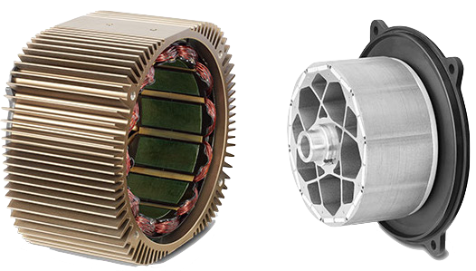


For the 2013+ models ([Gen2](https://web.archive.org/web/2025/https://zeromanual.com/wiki/Gen2) and [Gen3](https://web.archive.org/web/2025/https://zeromanual.com/wiki/Gen3)), Zero has [their own motor design](http://www.zeromotorcycles.com/technology/), trademarked "Z-Force".

**Features**

- Sealed
- Air-cooled (via finned casing)
- Brushless
- Permanent-magnet rotor

**Operation**

It is a 3-phase [*brushless DC* (BLDC) electric motor](https://en.wikipedia.org/wiki/Brushless_DC_electric_motor) which is [roughly described](http://electricmotorcycleforum.com/boards/index.php?topic=3640) as a *permanent magnet AC synchronous* (PMAC) motor since the controller is continuously adjusting the phase angle of the field to the rotor's current position and speed.

The field must apply synchronously to the rotor, so the calibration between the position sensor and the [controller](#Controller) is critical for efficiency, minimizing wear on the bearings, and minimizing heating of the windings and magnets.

**Motenergy's Clone**

[Motenergy](http://www.motenergy.com/) makes [an unlicensed generic derivative](http://www.motenergy.com/mepmbrmo.html), the [ME1507](http://ev-power.com.au/webstore/motors/motenergy-me1507.html), of the same form factor, rated for much lower outputs and seems to differ from Zero's motor in key ways.

From [Motenergy's ME1507 product page](http://ev-power.com.au/webstore/motors/motenergy-me1507.html), it's clear that they're advertising a model on par with the 2016 IPM update:

> The ME1507 is an Radial Air Gap, Permanent Magnet Synchronous Motor (PMSM) with an Internal Permanent Magnet Rotor (IPM). Designed for battery pack voltages of 100 VDC or less. Maximum rotor speed of 6000 rpm. Continuous current of 200 amps, and continuous power of 17 kw. Weight of 44 pounds.

**Motor theory**

[IPM vs SPM](http://www.motioncontrolonline.org/content-detail.cfm/Motion-Control-Technical-Features/Interior-Permanent-Magnet-Motors-Power-Traction-Motor-Applications/content_id/789) for a different motor control regime but some principles translate to the Z-Force motor.

**Efficiency**

[forum thread](http://electricmotorcycleforum.com/boards/index.php?topic=4070)

[Range vs Speed by Patrick Truchon](http://ptruchon.pagekite.me/wiki/rangevsspped) discusses the theory and measurements in depth.

[Does Gear Size Affect Range? by Patrick Truchon](http://ptruchon.pagekite.me/wiki/blog/2015-09-19/does_gear_size_affect_range) with more theory!

#### [Z-Force Motor 75-10](https://web.archive.org/web/2025/https://zeromanual.com/wiki/Z-Force_Motor/75-10)

The [FST Platform](https://web.archive.org/web/2025/https://zeromanual.com/wiki/FST_Platform)/[Gen3](https://web.archive.org/web/2025/https://zeromanual.com/wiki/Gen3) uses the 75-10 variant, which has a new construction in addition to being wider.

- Cooling ridges run along the circumference of the cylinder rather than axially parallel to the shaft.

  These ridges align with directional airflow from under the frame where the motor controller enclosure guides it.
- The construction therefore is no longer an extrusion as in previous casings.

  Possibly there are lathe-like methods involved in machining.
- The finish in the first model with the motor is bronze, probably indicating something about an alloy change.
- **-10** suffix indicates 10cm length.

**Features**

- The motor encoder position sensor is now housed in a servicing-accessible enclosure, opposite the shaft, on the right side.
- The motor mounts are now more structural, joining the swingarm to the rear of the main frame.

  TODO review for a better structural description.

**Notes**

- There was a comment about lamination improvements inside the motor for better heat transfer which will probably get a cutaway illustration soon.
- The team were also proud of designing the new motor; it seems to be fabricated in a relatively distinct way, perhaps even unique.

  They regretted that their existing extrusion method went by the wayside, because they relished being able to "just lengthen the motor" to get different performance levels out of it, and the new motor design does not afford that in the manufacturing implementation.

#### Motor Mounting

FST Platform/Motor Mounting

#### Motor Removal

FST Platform/Motor Removal

#### [Motor Bearing Replacement](https://web.archive.org/web/2025/https://zeromanual.com/wiki/Motor_Bearing_Replacement)

This replaces the [motor bearings on Gen2 Z-Force motors](https://web.archive.org/web/2025/https://zeromanual.com/wiki/Z-Force_Motor/Bearings).

**Tools**

- C-clip pliers
- M10 tensioner
- Loctite 648
- Hub puller (to extract the bearings)
- Replacement bearings (front and rear are both 6006-2RS on an FX used below)

**Notes**

- In these instructions, the *front* of the motor is the left/shaft-side, and the *rear* of the motor is the right/encoder-side.

**Steps**

1. Prepare a clean workspace, removing all debris and metal tools that you are not directly using.

   | | |
   | --- | --- |
   |   **Warning:** | The rotor magnets are so strong they rip tools out of your hand and they attract every single metal filing that might be near by. |
2. [Remove the motor](https://web.archive.org/web/2025/https://zeromanual.com/wiki/Motor_Removal) from the bike.
3. Removed the belt pulley:
   1. Remove the M10 countersunk bolt.
   2. Put two thin pieces of metal under the pulley, and drive two M6x1? bolts into the two threaded holes of the pulley to lift the pulley off.
4. Gently pry the front cover off.

   It will most likely be stuck on the rotor so you'll be lifting the rotor out of the housing with it.

   It is actually quite straighforward to pull apart, but requires a lot of force.

   You can built a little chair (width of the plate, you put it on the cooling wings) with an M10 tensioner.

   Then you bolt an M10 eye-bolt (or T-handle) on the pulley so you can pull on the shaft really hard (about 200lbs), and the rotor will pull out on the shaft along with the drive plate and bearings.

   | | |
   | --- | --- |
   |   **Warning:** | Once you have the shaft and rotor out, be careful as it is highly magnetic and you can get your fingers pinched quite easily on it. |

   At that point, the rotor should be loose on the shaft.
5. If you have to remove the rear bearing, remove the c-clip holding the rotor laminations on the shaft, use a marker or something to mark the front and back of the rotor and how it is aligned on the shaft because you are going to take it off.

   The end of the rotor on the back side is aluminum so do **not** press on it.

   It houses tiny magnets that the motor position sensor (encoder) reads; damage to this will ruin the rotor.

   | | |
   | --- | --- |
   |   **Warning:** | It is important that it goes on in the exact same direction, otherwise the motor could spin backwards. |
6. Once you have the rotor and the shaft labeled so you can get them back together exactly the same way, slide the rotor laminations off the shaft.
7. Clean the shaft and the inside of the laminations.
8. Apply a lot of loctite 648 on the shaft and lamniations, then slide them back together.

   Ensure that they go together the same way that they were before.

   Endure that the loctite 648 gets well-distributed between the shaft and the laminations to make a solid bond.
9. Press the rotor out of the front cap

   The bearing is held into the cap by a retainer so the rotor is pressed from the bearing.
10. Remove the front bearing retainer and press the bearing out of the cap.
11. Put the c-clip back on, put the bearing back on (or put a new bearing on since removing a bearing without damaging it is quite hard, the front and rear bearings are both 6006-2RS).

    | | |
    | --- | --- |
    |   **Warning:** | When you put the new bearing on, make sure you just push on the inner race for the press fit, if you push on the outer race it will transfer the force through the balls and likely damage them. |

    The bearing should be a press fit; if it slips on or off easily, you should glue it on with the loctite 648.
12. Let the 648 cure for a few hours before putting the motor back together.
13. To put the motor back together, just do the same thing you did to pull it apart, but opposite.

    Ensure that the wave-spring is still in the bottom of the bearing pocket at the bottom of the motor.

    | | |
    | --- | --- |
    |   **Warning:** | Be careful to not let the rotor slam back into place, that could damage the bearing |

    Temporarily lining the inside of the stator with a plastic sheet can prevent damage to the stator and rotor.

    Make sure you control the rotor: use the little chair and unscrew the tensioner to let the magnetic forces pull it back in slowly.

    Once it is almost all the way in, the bearing will catch on the bearing pocket.

    At that point, it might take a little jiggling around and some force on the end of the shaft to get it to pop into place, then it could take a bit more force to get the drive-plate to re-engage with the stator case.

#### [Motor Shaft](https://web.archive.org/web/2025/https://zeromanual.com/wiki/Z-Force_Motor/Shaft)

**Pre-2017**

The motor shaft is keyed; the key has a square cross section.

**Measurements**

- Dimensions seem to be ¼” square ⨉ 2.0” length (expressed in metric on drawings).
- Ends 5mm from shaft end.
- Shaft diameter is ⌀28.275mm+0-0.021
- Shaft length extends 66.675mm beyond the motor face minus 4mm for raised parts of the face.

2013 models had a minor [recall](../Recalls.md "Recalls") about the shaft key coming loose, but this was a design revision that has not recurred.

**2017+**

The motor shaft is splined to allow higher torque transmission.

Rumor has it (via [Harlan at Hollywood Electrics](http://electricmotorcycleforum.com/boards/index.php?topic=7010.msg59925#msg59925)) that the spline is supposed to match a Kawasaki KX250F as well as a Yamaha YZ450F.

#### Motor Sounds

##### [Motor Whirring](https://web.archive.org/web/2025/https://zeromanual.com/wiki/Motor_Whirring)

The [motor](https://web.archive.org/web/2025/https://zeromanual.com/wiki/Z-Force_Motor) on 2013+ models makes a white noise sound at very slow speeds when rotated (by the wheels or shaft).

This is also described as a "whirring sound".

This is alluded to by the term "[cogging](https://en.wikipedia.org/wiki/Cogging_torque)".

This is normal as long as it sounds like white noise and occurs as described below.

**Video Guide**

- [Strange noise Zero DS 2017](https://www.youtube.com/watch?v=UtKvr9d35VU) provides a reference for comparison:

**Related Confirming Symptoms**

- The noise should *only* occur while the motor is rotated by external input (pushing the bike around or rotating the shaft).
- The noise should *not* while under power (when the motor is driving its own rotation).
- The bike should gently resist being pushed while the noise is audible.

**Causes**

- The direct cause is the [controller](https://web.archive.org/web/2025/https://zeromanual.com/wiki/Gen2/Motor_Controller) applying a white noise field to the motor at very slow speeds.
- At least one connected battery's [contactor](https://web.archive.org/web/2025/https://zeromanual.com/wiki/Main_Contactor) *must* have been engaged for this to occur.

  This can occur while keyed on, or while charging.

**Effects**

- There are no detrimental effects, when the sound occurs by design.
- The purpose is for the [controller](https://web.archive.org/web/2025/https://zeromanual.com/wiki/Gen2/Motor_Controller) to detect and maintain precise knowledge of the motor's rotor angle.
- This ensures that, if the throttle demands operation, the controller will apply the field correctly to the rotor.
- You may infer that *at least one contactor is engaged* to power the controller.
- If the bike is keyed on, you may infer that the motorcycle should be ready to drive.

  (aside from the [kickstand](https://web.archive.org/web/2025/https://zeromanual.com/wiki/Kickstand_Switch) and [kill switch](https://web.archive.org/web/2025/https://zeromanual.com/wiki/Kill_Switch) safety interlocks).

##### [Motor Whine](https://web.archive.org/web/2025/https://zeromanual.com/wiki/Motor_Whine)

While moving, the [motor](https://web.archive.org/web/2025/https://zeromanual.com/wiki/Z-Force_Motor) tends to make a solid smooth tone resonant with the motor's rotational speed.

**Related Confirming Symptoms**

- Typically, this occurs while the motorcycle is traveling at speeds above 10mph.
- Most noticeable between 15-30mph (30-50kph).

**Causes**

- The motor shaft bearings are likely the primary generator of this resonant noise.

**Effects**

- None; this is normal and expected.

#### [Motor Wiring](https://web.archive.org/web/2025/https://zeromanual.com/wiki/Z-Force_Motor/Electrical_Connections)

The Z-Force motor's stator is connected to the [controller](https://web.archive.org/web/2025/https://zeromanual.com/wiki/Gen2/Motor_Controller) for power and position feedback.

| | |
| --- | --- |
| 3-phase / Y-shaped (120° phase offset) power inputs from the controller. <br> 1. A (M1) <br> 2. B (M2) <br> 3. C (M3) | 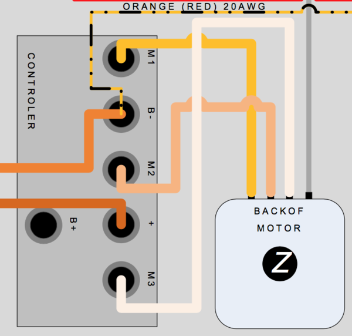 *Motor-controller power connections* |

| | |
| --- | --- |
| 8-pin Metri-Pack 150 ([Mouser p/n 829-12047937](http://www.mouser.com/ProductDetail/Delphi-Connection-Systems/12047937/)) <br> - Terminal: [Mouser p/n 829-12084200](http://www.mouser.com/ProductDetail/Delphi-Connection-Systems/12084200/) <br> - Retainer: [Mouser p/n 829-15324525](http://www.mouser.com/ProductDetail/Delphi-Connection-Systems/15324525/) <br> - Seal: [Mouser p/n 829-15324973](http://www.mouser.com/ProductDetail/Delphi-Connection-Systems/15324973/) <br> - Seal: [Mouser p/n 829-12059168-B](http://www.mouser.com/ProductDetail/Delphi-Connection-Systems/12059168-B/) <br> 1. Motor Position (Cosine) / white <br> 2. Motor Position (Sine) / blue <br> 3. Motor Position (Ground) / black <br> 4. *unused* <br> 5. [VDD](https://en.wikipedia.org/wiki/IC_power-supply_pin) (5V) / red <br> 6. Shield / green <br> 7. Temperature (negative) / yellow <br> 8. Temperature (positive) / yellow | 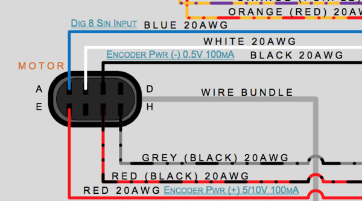 *2013 motor sensor connectors* |

#### Motor Alignment

FST Platform/Motor Alignment

#### [Motor Commissioning](https://web.archive.org/web/2025/https://zeromanual.com/wiki/Motor_Commissioning)

Motor commissioning refers to aligning the controller's sine wave programming against the motor using its position sensors.

**Benefits**

Maximum efficiency (avoids current applied wastefully)

Avoid any slippage.

Avoid misapplied torque which might wear on the bearings.

#### [Motor Limits](https://web.archive.org/web/2025/https://zeromanual.com/wiki/Z-Force_Motor/Limits)

The following regards what engineering constraints limit the power and RPM of the (IPM) Z-Force motor. Pre-IPM motors generated more heat for a given amount of power, so cooling was usually the first concern, but the IPM design pushes the frontier further so the topic is worth addressing.

**RPM**

The Z-Force motor is design-limited to 6,000 RPM as follows.

RPM is primarily limited by the inductance of the motor windings.

At low RPM, under full throttle, the current through the driven phase(s) of the motor ramps up from 0 to the maximum allowed by the controller pretty quickly, and you get full torque because you've got full current.

But the faster the motor turns, the faster the motor controller has to cycle the phases of the motor on and off, and eventually, you reach a point where there's not enough time (because of the inductance of the motor windings) for the current to ramp up to maximum before that phase has to be turned off and the next phase cycled on.

At that point, power starts to drop off, so very shortly after that, the motor won't have enough torque or power left to drive the load.

The mechanics of the motor could easily have been designed for higher RPM, but there's no point since you'll be current-limited anyhow.

**Torque / Power**

The easiest way to get more torque, and thereby more power (since power is proportional to torque times RPM), is to pump more current through the motor.

Several things can bottleneck that effort:

- First, the motor windings have a DC resistance because they're copper wires with fixed gauges and lengths.
- The bike's wiring external to the motor also has some DC resistance in it.
- If you apply more voltage to a fixed DC resistance, you'll get more current, but the batteries only give you ~110VDC to play with....and of course, the battery has a current limit of its own.
- You'll need to be sure the controller can handle the current as well; you won't go very fast once you smoke the controller.
- Since the motor rotates and therefore the windings have to be commutated (driven on and off in the proper sequence and speed), the motor's inductance also comes into play as discussed above about RPM.
- You could change some of this stuff fairly easily (higher-gauge wiring is pretty simple, though might be tough to fit in some of the tight confines the Zero's wiring is routed through), but other things are more difficult.
- To reduce the motor winding's DC resistance, you'd want to use heavier wire, but you wouldn't be able to get as many turns onto the same coil form.
- Fewer turns would create less inductance, which also helps allow higher current levels, but fewer turns also results in a weaker magnetic field for the same current, so you might actually reduce the torque the motor puts out.
- Then you'd also need to be sure you don't over-current the controller, or the batteries, and cooling everything involved becomes an additional topic.

It's kind of like asking what's the highest VO2 max an athlete can put out.

- It's not just about his lungs, it's about his heart, his muscles, his metabolism at a microscopic level, even about his mental attitude.
- Tweak any one thing and the system's whole balance shifts.
- That's why engineers make the medium-sized bucks!

**Speed**

Vehicle top speed can only be altered by the gearing (sprocket ratios).

Power output is not affected by gearing; only torque is.

So, a ratio yielding a higher top speed will result in lower torques throughout the range, resulting in slower accelerations from start.

**References**

[What is the limit of a Zero motor?](http://electricmotorcycleforum.com/boards/index.php?topic=7208.0)

### Controller

FST Platform/Motor Controller

#### Controller Operation

FST Platform/Motor Controller/Operation

#### Controller Alignment

FST Platform/Motor Controller/Alignment

#### Controller Versions

FST Platform/Motor Controller/Versions

#### Controller Mounting

FST Platform/Controller Mounting

#### Controller Uncovering

FST Platform/Controller Uncovering

#### Controller Heatsink

FST Platform/Motor Controller/Heatsink

#### Controller Connections

FST Platform/Motor Controller/Connections

#### Controller Feature Usage

FST Platform/Motor Controller/Feature Usage

#### Controller CAN Diagnostics

FST Platform/Motor Controller/CAN Diagnostics

#### Controller Configuration

FST Platform/Motor Controller/Configuration

#### Controller Cover

FST Platform/Motor Controller/Cover

##### Controller Cover Removal

FST Platform/Controller Uncovering

## Electronic Systems

### [Instrument Cluster](https://web.archive.org/web/2025/https://zeromanual.com/wiki/FST_Platform/Instrument_Cluster)

### [Charger](https://web.archive.org/web/2025/https://zeromanual.com/wiki/FST_Platform/Onboard_Charger)

The onboard charger is a single or pair of [Rapid Charge Modules](https://web.archive.org/web/2025/https://zeromanual.com/wiki/FST_Platform/Rapid_Charge_Module), fed through the onboard power inlet (J1772 or Type 2).

The [MBB](https://web.archive.org/web/2025/https://zeromanual.com/wiki/MBB) manages this system in concert with the [BMS](https://web.archive.org/web/2025/https://zeromanual.com/wiki/BMS) of the main power pack and possibly a [Power Tank](https://web.archive.org/web/2025/https://zeromanual.com/wiki/Power_Tank).

#### [Rapid Charge Module](https://web.archive.org/web/2025/https://zeromanual.com/wiki/FST_Platform/Rapid_Charge_Module)

The Rapid Charge Module is a 14A (3kW at 220V AC or 1.5kW on 110V AC) charging unit used as stock equipment on the [FST Platform](https://web.archive.org/web/2025/https://zeromanual.com/wiki/FST_Platform) introduced for [SRF Model](https://web.archive.org/web/2025/https://zeromanual.com/wiki/SRF_Model)'s introductory model year 2020.

It appears to be developed by Zero, and made by a manufacturing company on contract.

**Features**

- The modules are definitely CAN-enabled, and compose via Zero's charging harness at least as a pair.

##### Charger Behavior

FST Platform/Onboard Charger/Behavior

#### Charger Operation

FST Platform/Onboard Charger/Operation

#### Charger Power Cord

FST Platform/Charger Power Cord

#### Charger Connections

FST Platform/Onboard Charger/Connections

#### Charger Replacement

FST Platform/Onboard Charger/Replacement

### [Main Bike Board](https://web.archive.org/web/2025/https://zeromanual.com/wiki/Gen2/Main_Bike_Board)

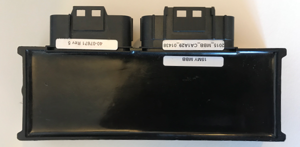 *2016 Zero MBB Front*

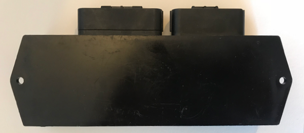 *2016 Zero MBB Back*

The Main Bike Board (MBB) controls the overall system, implements safety interlocks, and directs the controller.

It is also the entry point for configuring these systems, performing diagnostics, and examining operational events.

When referring to "the firmware", or "the logs", people are referring to this board primarily, and possibly the BMS.

It is enclosed within a fully-potted plastic-like container with multi-pin connectors along the top side.

**Location (S Platform)**

Below the front area of the seat under cable runs.

It is located aft of (and above) the [DC-DC 12V Converter](https://web.archive.org/web/2025/https://zeromanual.com/wiki/DC-DC_12V_Converter) with a bracket sandwiched between them.

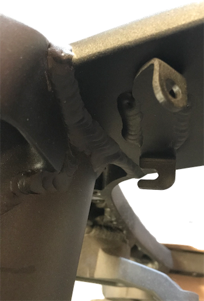 *Board Plate Mounting Bracket (Left)*

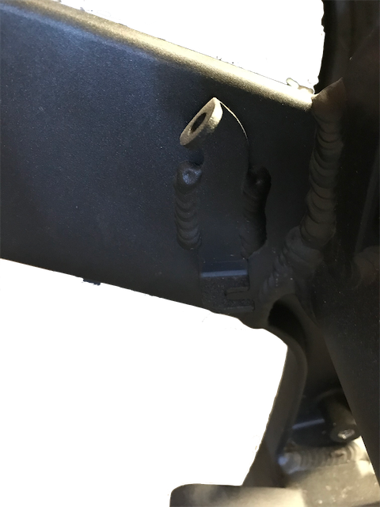 *Board Plate Mounting Bracket (Right)*

**Location (X Platform)**

Below the front modular battery (or front half of a longbrick battery) in the triangular bay above the controller.

**Mounting (S Platform)**

Two socket head bolts with washers fasten the enclosure to a vertical plate.

The bolts enter the plate in the forward direction but offer very limited clearance for manipulating them.

**NOTE:** on the right, the cables from the controller to the motor run past.

A very small angled 3mm Allen Key wrench is best for unmounting the board.

**[Diagnostics](https://web.archive.org/web/2025/https://zeromanual.com/wiki/MBB_Console)**

When using the OBD2 port, the board's application firmware supplies the interactive [console](https://web.archive.org/web/2025/https://zeromanual.com/wiki/MBB_Console).

[Playing with the 2012 MBB](http://electricmotorcycleforum.com/boards/index.php?topic=3057) shows Doctorbass' transcript using 2012 firmware.

- 2013 models' interface differs quite a bit from this but the general logic and experience are the same.

**Protections**

The board appears to be permanently sealed and potted within the enclosure to protect it from dust and a certain amount of moisture ingress.

**Interlock Troubleshooting**

Use careful electrical isolation measures when troubleshooting electrical switches used as inputs for interlocks enforced by the firmware.

**Replacement**

The board must have its firmware setup specific to the bike in question.

Major firmware difference exist across model years such that the firmware binary in question must be selected to prevent major problems on replacement.

- **NOTE:** *Apparently* only the manufacturer can perform this provisioning (probably imaging the base kernel, userland, and application-container management).

A dealer must select the correct and latest applicable *application* firmware to apply to the bike per its basic parameters:

- Year
- Model
- Battery configuration

Information from the bike's [VIN](https://web.archive.org/web/2025/https://zeromanual.com/wiki/VIN_Guide) is necessary to select the right programming by the dealer or manufacturer.

This information may not be sufficient, if it requires coding in the presence of a [Power Tank](https://web.archive.org/web/2025/https://zeromanual.com/wiki/Power_Tank) or [Charge Tank](https://web.archive.org/web/2025/https://zeromanual.com/wiki/Charge_Tank).

The board settings require model information to be set per above, and the BMS must agree about this information.

#### [Main Bike Board Limitations](https://web.archive.org/web/2025/https://zeromanual.com/wiki/Gen2/Main_Bike_Board/Limitations)

The board design is very modest and seems to prioritize light weight and simplicity over robustness.

Take as much care as possible when troubleshooting in and around this module.

A professional-grade application of dielectric grease around the connectors seems advisable.

- **NOTE:** Ensure that the entire connector and pins are clean and dry before applying.

**Performance and Lockup**

The board communicates with the bike's other systems via [CAN Bus](https://en.wikipedia.org/wiki/CAN_Bus), which is a 2-wire [Multi-master bus](https://en.wikipedia.org/wiki/Multi-master_bus).

- This means that multiple nodes on the bus must initiate a transfer.

The board also has limited memory, I/O dispatching, and computational performance.

- So, it can get clogged with requests for data outside its designed parameters.
- So, running any telemetry while in drive mode through the OBD-II serial console or using the Bluetooth transmitter will meaningfully increase the load on the board.

  In some cases prevent it from acting on rider inputs, including safety interlocks like the cutout switch or kickstand interlocks.

Reportedly, 2017 and newer models have increased performance and doubled memory capacity.

- This enables an onboard upgrade with an atomic swap of versions by holding new and old firmware versions simultaneously.
- There's no known means of using these in older models.

**Electrical Vulnerability**

The circuits connected to the pins seem to lack significant protection against shorting faults, which could be a source of breakages while dealing with connected systems.

**OBD-II Serial Output**

The use of the non-standard OBD-II port most easily draws power from a very limited internal circuit.

The OBD-II port as a result is typically not usable over a long cable without an external power supply and good quality connections.

#### [Main Bike Board Connections](https://web.archive.org/web/2025/https://zeromanual.com/wiki/Gen2/Main_Bike_Board/Connections)

The board has a 34-pin and 40-pin connector exposed through the top of the enclosure, making them relatively accessible and a way to identify the component.

Both are made by [JAE Electronics](http://www.jaeusa.com/).

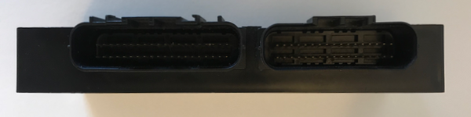 *2016 Zero MBB Top*

| Connector | Harness-side | MBB-side | Notes |
| --- | --- | --- | --- |
| 34-pin connector "MBB 1" | [JAE Electronics MX23A34SF1](https://www.mouser.com/ProductDetail/JAE-Electronics/MX23A34SF1/) | [JAE Electronics MX34A34NF1](https://www.mouser.com/ProductDetail/JAE-Electronics/MX23A34NF1/). | 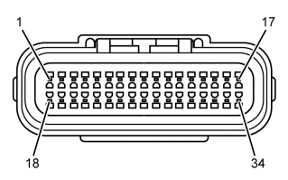 *Harness-side pinout; MBB side mirrored* <br>  *2013 MBB 1 connector Wiring Diagram image* |
| 40-pin connector "MBB 2" | [JAE Electronics MX23A40SF1](https://www.mouser.com/ProductDetail/JAE-Electronics/MX23A40SF1/) | [JAE Electronics MX34A40NF1](https://www.mouser.com/ProductDetail/JAE-Electronics/MX23A40NF1/) |  *2013 MBB 2 connector Wiring Diagram image* |

| Component | Function | Wire | MBB Pin | Role |
| --- | --- | --- | --- | --- |
| [Kickstand Switch](#Kickstand_Switch) | Safety Interlock | Red (2013) 20AWG | 27 | Colors are different for 2016 models: |
| 〃 | 〃 | Orange (2013) (black) 20AWG | 12 | Blue (5v power), Pinkish Red (measure signal TODO), Black. <br> Do **not** short these directly. That is not how you bypass. |
| 〃 | 〃 | Yellow (2013) (black) 20AWG | 11 | [Kickstand Switch](#Kickstand_Switch) |
| [Kill Switch](#Kill_Switch) | Safety Interlock | Red 20AWG | 23 |  |
| 〃 | 〃 | White 20AWG | 24 |  |

| Component | Function | Wire | MBB Pin | Function | Notes |
| --- | --- | --- | --- | --- | --- |
| DC-DC Converter | Enable Signal | Orange (Red) 18AWG | 21 (2013) <br> 20 (2015) |  |  |

### [DC-DC 12V converter](https://web.archive.org/web/2025/https://zeromanual.com/wiki/DC-DC_12V_Converter)

The DC-DC 12V converter is a solid state switching power DC step-down converter designed to produce low voltage DC power from the pack voltage.

The converters mentioned here are used on [Gen2](https://web.archive.org/web/2025/https://zeromanual.com/wiki/Gen2) and [Gen3](https://web.archive.org/web/2025/https://zeromanual.com/wiki/Gen3) models.

| Years | Platform | Manufacturer | Model | Replacement Options |
| --- | --- | --- | --- | --- |
| 2013-2014 | S and X | Sevcon | [Sevcon DC-DC 300W converter](http://www.sevcon.com/products/dcdc-converters/dcdc-300w/) | OEM or [via Thunderstruck Motors](http://www.thunderstruck-ev.com/sevcon-72-80v-dc-dc-en.html) <br> - **NOTE:** Select the 300W model! connector hardware is an extra |
| 2015+ | 〃 | 〃 | [Sevcon DC-DC 500W converter](http://www.sevcon.com/products/dcdc-converters/dcdc-500w/) | OEM or [via Thunderstruck Motors](http://www.thunderstruck-ev.com/sevcon-72-80v-dc-dc-en.html) <br> - **NOTE:** Select the 500W model! connector hardware is an extra |

**Appearance**

It's about the size of a long box of soap with a black surface, but for 2013-2014 models will be covered entirely with Nashua aluminum ducting tape, so will appear silver.

| | | |
| --- | --- | --- |
|  *500W Sevcon DC-DC converter - top* |  *500W Sevcon DC-DC converter - connector* <br>  *500W Sevcon DC-DC converter - connector side* |  *500W Sevcon DC-DC converter - side* <br>  *500W Sevcon DC-DC converter - backplate (upside down)* <br>  *500W Sevcon DC-DC converter - backplate (as installed)* |

**[SDS Platform](https://web.archive.org/web/2025/https://zeromanual.com/wiki/SDS_Platform) Location**

Below the front of the seat under cable runs, between the [MBB](https://web.archive.org/web/2025/https://zeromanual.com/wiki/MBB) (separated by a bracket) and the back of the battery frame area.

[Quick and dirty illustrative video of how to find and access the converter](https://www.youtube.com/watch?v=yig2RtRuIoY)

**[XMX Platform](https://web.archive.org/web/2025/https://zeromanual.com/wiki/XMX_Platform) Location**

Below the removable battery compartment. See [our FX teardown layout guide](https://web.archive.org/web/2025/https://zeromanual.com/wiki/XMX_Platform/Electrical_Routing).

**[FST Platform](https://web.archive.org/web/2025/https://zeromanual.com/wiki/FST_Platform) Location**

Inside the tank, on the right of the bin, on the [board mounting plate](https://web.archive.org/web/2025/https://zeromanual.com/wiki/FST_Platform/Board_Mounting_Plate).

**Protections**

- Ingress: IP67
- Short circuit overload
- Reverse polarity
- Fully isolated
- Can parallel with diode safeguard

**Mounting**

The Sevcon 500W DC-DC converter is mounted to its own baseplate via 4 Torx T10 cap head screws and there are 3 additional Torx T15 cap head screws in the middle.

The Sevcon baseplate is then bolted to Zero's [board mounting plate](https://web.archive.org/web/2025/https://zeromanual.com/wiki/SDS_Platform/Board_Mounting_Plate) with 4 10mm hex head bolts which have 6mm outer diameter, 16mm length, and 1mm pitch.

**Removal**

1. [Remove](https://web.archive.org/web/2025/https://zeromanual.com/wiki/Board_Mounting_Plate_Removal) the [board mounting plate](https://web.archive.org/web/2025/https://zeromanual.com/wiki/SDS_Platform/Board_Mounting_Plate).
2. Remove the converter from the board using a 10mm hex socket wrench.
3. Disconnect the connector if appropriate.

**Installation**

1. Attach the converter to the [board mounting plate](https://web.archive.org/web/2025/https://zeromanual.com/wiki/SDS_Platform/Board_Mounting_Plate) with a 10mm hex socket wrench.
2. Install the [board mounting plate](https://web.archive.org/web/2025/https://zeromanual.com/wiki/SDS_Platform/Board_Mounting_Plate) with the converter back into the bike.

**Connections**

There is a 5-pin connector controlling the converter, facing the left as installed on the bike, connected as follows:

| Pin | Function | Measurement | Component | Years | Wire | MBB Pin | Illustration |
| --- | --- | --- | --- | --- | --- | --- | --- |
| 1 | Enable signal | Battery voltage when key is on | [MBB](https://web.archive.org/web/2025/https://zeromanual.com/wiki/MBB) | 2013 | Orange (Red) 18AWG | 21 |  |
| 〃 | 〃 | 〃 | 〃 | 2015 | 〃 | 20 | 〃 |
| 2 | Input (Positive) | 116V | [Battery](#Battery) | 2013 | Orange (Blue) 16AWG | 7 | 〃 |
| 3 | Input (Negative) | 〃 | 〃 | 2013 | Orange (Black) 20AWG | 5 | 〃 |
| 4 | Output (Positive) | 13.5V | [Fuse Block](#Fuse_Block) | 2013 | Blue (16AWG, 14AWG) wires |  | 〃 |
| 5 | Output (Negative/Ground) | 〃 | [12V return conduits](#Routing) | 2013 | Black 10AWG |  | 〃 |

**Output**

It is configured to output 13.5V DC; usually produces ~13.8V DC.

There is very little ripple that is typical of a gas-power motorcycle's alternator-driven DC supply.

Capacity is 300W (20-25A) for pre-2015 bikes and 500W (35-40A) for 2015+ models, with most of that excess needed to run ABS pumps, etc.

**Operation**

The input side is always-on DC from the battery, upstream of the contactor.

This is the best place to tap for an always-on power supply.

The converter is enabled by a 12V signal from the [MBB](https://web.archive.org/web/2025/https://zeromanual.com/wiki/MBB).

**Environmental Vulnerability**

- The Sevcon DC-DC converter is rated to IP67 for intrusion protection and seems very robust as such.
- However, the connector is not sealed, faces the left side of the inside of the frame arms with not much splash protection from beneath; on 2015+ models, it is also vulnerable to debris and splash impact from the rear near the motor and belt.
- No sealed connector option is currently available for Sevcon's DC-DC converter models that Zero uses.
- Connector looseness could age and wear the converter prematurely due to sporadic voltage input or output changes.
- Leakage across pins could cause the enable signal to activate inadvertently.

**Connector Inspection**

Try to inspect the pins' tabs to ensure they are in the right shape to clamp that enable pin securely.

The connector is not well-sealed, and the pins are too easy to bend into not-connecting if there's any tension/tugging on the wires.

If the connector seems grimy, remove and clean it while de-energized; then apply grease once dry before re-seating it.

Test the connector before fully re-assembling the bike.

**Failure to De-energize Condition**

The converter can fail in a way where it shorts its enable line and will not turn off even if the bike is keyed off.

- If this condition happens in rain:
  1. Let the bike dry out until it clears.
  2. Attempt a dielectric grease application to the inputs while de-energized.

If the DC system output disappears:

- Check DC voltage upstream of the fuse block in case the fuse block is faulty.
- Check the continuity and snugness of the connectors and pins.
- Check for the enable signal from the MBB

  Continuity: < 1Ω between pins.

  Not shorted to B+?: > 151kΩ from pin 20 to pin 7.

  Not shorted to ground?: > 1MΩ from pin 20 to 18.

**Protection Recommendations**

- Splash protection around the left-side's connector from all sides is worth considering.

**References**

[Re: My DC-DC converter has died again, local dealer has gone bust](http://electricmotorcycleforum.com/boards/index.php?topic=6904.msg57973#msg57973)

[Re: A puddle, some rain and some problems](http://electricmotorcycleforum.com/boards/index.php?topic=7041)

### Power Harness

The power cables and signal wiring that connects the MBB to the BMS units intended for that platform and year are collectively bundled and referred to as a “power harness”.

#### [Loopback Blanking Plug](https://web.archive.org/web/2025/https://zeromanual.com/wiki/Loopback_Blanking_Plug)

The loopback blanking plug is a Zero electrical connector cap that wires two pins together in a *[loopback](https://web.archive.org/web/2025/https://zeromanual.com/wiki/BMS_CANBus_Loopback)* circuit.

This meant to emulate a basic connectivity feature for the BMS1 connection so that the vehicle's CAN Bus can operate properly.

If you own a non-longbrick X platform model or an S-platform model with a [Power Tank](https://web.archive.org/web/2025/https://zeromanual.com/wiki/Power_Tank), retain this blanking plug in case your second BMS fails to connect or issues errors that prevent your motorcycle from operating.

#### [Loopback](https://web.archive.org/web/2025/https://zeromanual.com/wiki/BMS_CANBus_Loopback)

BMS CANBus loopback is a function of the built-in cable communications support for the [Power Tank](https://web.archive.org/web/2025/https://zeromanual.com/wiki/Power_Tank) or the second [Power Pack Module](https://web.archive.org/web/2025/https://zeromanual.com/wiki/Power_Pack_Module) in a non-longbrick X platform model (labeled *BMS1* by the MBB).

The cabling ends in a multi-pin connector and should either:

1. Terminate with a [Loopback Blanking Plug](https://web.archive.org/web/2025/https://zeromanual.com/wiki/Loopback_Blanking_Plug) that wires two pins together in a *loopback* circuit.
2. Connect to a [Power Tank](https://web.archive.org/web/2025/https://zeromanual.com/wiki/Power_Tank)'s corresponding communications cable.

If one of the above conditions do not hold, the MBB is configured to issue [error code 35](../Error_Codes.md#35 "Error Codes").

It is unconfirmed what purpose the loopback mechanism serves.

*Hypothesis:* This is a hardware debugging mechanism for a loose connector.

### [Firmware Update](https://web.archive.org/web/2025/https://zeromanual.com/wiki/Firmware_Update)

Firmware update refers to the process of acquiring and installing newer [firmware versions](https://web.archive.org/web/2025/https://zeromanual.com/wiki/Firmware_Versions) from Zero onto the [MBB](https://web.archive.org/web/2025/https://zeromanual.com/wiki/MBB), [BMS](https://web.archive.org/web/2025/https://zeromanual.com/wiki/BMS), and the motor controller.

**Dealership Updates**

Firmware update for pre-2017 models must be performed by a dealership with a license with Zero and the hardware kit to connect a Windows computer to the motorcycle's data ports (OBD-II, the BMS serial port, and the Sevcon 34-pin connector).

**Mobile App Self-Service Updates**

On 2017 and newer Zeros, it's possible for the user to [upgrade the firmware via the Zero Motorcycles mobile app](../Official_Mobile_Application.md#Firmware_Update "Official Mobile Application").

### [Firmware Versions](https://web.archive.org/web/2025/https://zeromanual.com/wiki/Firmware_Versions)

Using the Zero App to download the logs, and Phreak's Log Parser Utility ([forum](http://electricmotorcycleforum.com/boards/index.php?topic=5020.0), [Github](https://github.com/KimBurgess/zero-log-parser), [online](http://home.hasslers.net/zerologparser/)), different users have reported the latest firmware versions to be:

|  | MBB |  | BMS |  |
| --- | --- | --- | --- | --- |
| Board Year | Revision | Version | Revision | Version |
| 2013 | 1 | 67 |  |  |
| 2014 | 1 | 44 | 1 | 43 |
| 2015 | 3 | 25 |  |  |
| 2016 | 3 | 51 | 3 | 39 |
| 2017 | 12 |  | 21 |  |

The online log parser has a list of the most recent firmwares that have been uploaded to the server:
[Latest Firmware Versions](http://home.hasslers.net/zerologparser/firmware-summary.php)

Feel free to update this section as you discover new available updates.

| Version Changes |  |  |  |
| --- | --- | --- | --- |
| Component | Version | Release Date | Notes |
| BMS |  |  |  |
| MBB | 48 | spring 2017 |  |
| 〃 | 49-51 | 49 Build Date: 06Jul2016 <br> 51 Build Date: 25Apr2017 | Confirmed: SoC improvements, particularly for pre-2016 model years. <br> Observed: 2016 SoC is significantly more pessimistic in v51 than in v49. <br> Guess: Throttle remapping to a smoother roll-on curve. <br> Guess: Regen seems to apply more broadly. |

**Problems**

- Firmware mismatch problems (bms on power tank versus ZF pack)
- SoC problems
- Which versions are known safe?
- Observed changes
- Differences by year/model
- MBB
- BMS0
- BMS1

**Upgrading Firmware**

As of 2017, Zero models are capable of performing remote firmware updates by the customer [using the mobile app](#Using_Mobile_App).

Apparently this doesn't transfer to older models because the older boards did not have enough storage space to perform an atomic/reversible update.

This means holding both firmware versions and being able to toggle which version to use.

So, if anything goes wrong with a firmware update, the system can roll back to the previous version without requiring a dealer visit.

**ChangeLog**

Zero Motorcycles on their website now [lists changes of Zero Motorcycles vehicle firmware](https://www.zeromotorcycles.com/owner-resources/firmware/)

## Battery

The following guidance includes advice adapted from [MostlyBonkers' research summary](http://electricmotorcycleforum.com/boards/index.php?topic=4280.0) and [Battery Notes from a Farasis Engineer](http://electricmotorcycleforum.com/boards/index.php?topic=5314).

### [Battery Concepts](https://web.archive.org/web/2025/https://zeromanual.com/wiki/Battery/Concepts)

**Basic Concepts**

Metaphorically speaking, think of a river and a reservoir.

**Volts**

water pressure.

**Amps**

volume of water flowing.

**Charge (Kwh)**

how much water is behind the dam.

**Power (kW)**

the rate at which water is flowing.

### [Charge Tips](https://web.archive.org/web/2025/https://zeromanual.com/wiki/Battery/Charge_Tips)

Generally, refer to the [Charger Operation](https://web.archive.org/web/2025/https://zeromanual.com/wiki/Gen2/Calex_Charger/Operation) section, but for battery concerns, the following are relevant:

1. If you run your bike to empty, do your best to give it at least a partial charge (ideally to 40-50%) as soon as you can.
2. Charge and discharge your bike freely and at your convenience.
3. Don't worry about keeping the bike topped up, like standard car batteries.
4. Don't feel you have to run the bike to empty before re-charging; it's fine to charge if you've only used 10%, for example.
5. If you can afford extra chargers to reduce charging time, Zero's fast chargers won't hurt the batteries.
6. Use the bike as much as you can. If you aren't using it for a regular commute or aren't lucky enough to have the freedom to ride regularly then it will work out a lot cheaper to own a conventional motorbike.
7. Zero's engineers have done the work to ensure a long service life from their battery packs and have backed it up with a five year warranty with the 2014 model range onwards. That should be enough to drop any anxiety you may have and just concentrate on enjoying the bike.

### [Battery Capacity](https://web.archive.org/web/2025/https://zeromanual.com/wiki/Battery/Capacity)

[Battery capacity](https://en.wikipedia.org/wiki/Electric_battery#Capacity_and_discharge) is a measure of the charge a battery can deliver at an intended voltage.

Cells themselves are usually rated for a current amount delivered over an interval of time (going from maximum voltage to a rated minimum).

Batteries as banks of cells aggregate that measure across the cells.

Because of a number of factors including *internal resistance*, a higher discharge rate effectively *lowers* the usable capacity of the battery during that cycle.

This variance in the usable capacity of the battery has meaning for how an electric motorcycle performs with different riding styles.

Normally, the energy a battery can store is estimated by taking nominal voltage (V) times the current capacity of the battery's cells (Ah) = the energy delivery capacity (Wh) (divide by 1000 for kWh).

```
PackVoltagenominal (V) × CellCapacity (Ah) = EnergyCapacity (Wh)
```

However, based on industry convention, Zero calculates battery energy (the kWh) by taking the maximum voltage the battery has at 100% capacity times the capacity in Ah, instead of nominal voltage.

**Maximum Voltage**

*Maximum voltage* is only present at the beginning of discharge when it is full, and then it drops (nonlinearly).

**Nominal Voltage**

The *nominal voltage* is like the average voltage the battery over the entire discharge range.

The average is the voltage measured at the battery terminal when it has 50% charge state and is disconnected from any load.

For example, the 2013 S has **100Ah** and a nominal **102V**: the total energy the battery has is:

```
102V × 100Ah = 10200Wh = 10.2kWh
```

But if you use maximum battery voltage you get:

```
116V × 100Ah = 11600Wh = 11.6kWh
```

This also applies when adding a power tank, confusing customers about the official rating versus what the mobile application reports.

Regardless of this complexity of measurement, Zero's range figures appear reliable in the general context of the test conditions.

### [Cells](https://web.archive.org/web/2025/https://zeromanual.com/wiki/Battery/Cells)

The current manufacturer of cells for Zero's power packs is [Farasis](https://web.archive.org/web/2025/https://zeromanual.com/wiki/Farasis) who are supplying [pouch cells](http://www.farasis.com/solutions/cells/) for the 2013+ model range ([Gen2](https://web.archive.org/web/2025/https://zeromanual.com/wiki/Gen2) and [Gen3](https://web.archive.org/web/2025/https://zeromanual.com/wiki/Gen3)).

**NMC Cell Chemistry**

The chemistry used is **Lithium Nickel Manganese Cobalt**: LiNiMnCoO2 ("NMC" or other rearrangements of those letters).

NMC is a relatively new battery chemistry which *differs from* the Li-cobalt chemistry we are familiar with from mobile phone batteries and laptops.

While Li-cobalt has a higher energy density than NMC (storage capacity per kilogram), it doesn't cycle as well and ages quicker.

That's fine for a mobile phone that is likely to be obsolete after 2-3 years, but not for an electric bike.

The automotive-grade NMC cells that Farasis supply should easily satisfy the requirements of the five year warranty that Zero are providing with their current Z-Force battery packs.

It seems they should last 8-10 years if they aren't abused.

Even if you start to notice some significant deterioration after five years, the rate at which battery technology is progressing means that you should be able to buy a new battery pack with much better capacity (range) than the original for less money.

|  |  |  |  |  |  | Voltage |  |  |  |
| --- | --- | --- | --- | --- | --- | --- | --- | --- | --- |
| Years | Form | Manufacturer | Model | Datasheet | Capacity | Minimum | Nominal | Maximum | Dimensions |
| 2009-2011 | cylindrical | [Molicel](http://www.molicel.com/ca/) | [IMR-26700A](http://www.molicel.com/hq/product/products11.html) | [Molicel 26700](http://wamtechnik.pl/files/specs/645.pdf) [[1]](https://evmc2.files.wordpress.com/2013/12/imr26700.pdf) [[2]](https://master-instruments.com.au/products/60681/IMR26700A.html) | 2.9Ah | 2.5V | 3.8V | 4.2V±50mV | 26.4mm ⌀ × 70mm |
| 2012 | pouch | [EIG](http://www.eigbattery.com) | [EIG C020](http://www.eigbattery.com/_eng/designer/skin/02/01_03.asp) | [EIG NCM C020](http://www.eigbattery.com/_eng/developer/m_product_data_set/download.asp?file_nm=EIG_NCM_C020_Data-sheet_APR2016.PDF) | 20Ah | 2.5V | 3.65V | 4.15V | 130mm × 217mm × 7.2mm |
| 2013-2014 | 〃 | [Farasis](https://web.archive.org/web/2025/https://zeromanual.com/wiki/Farasis) | Farasis 25Ah | [Farasis IMP06160230P25A 25Ah](http://www.cdiweb.com/datasheets/ctc-battery/FEI-DataSheet-IMP06160230P25A-Pouch-25Ah-v5.pdf) or [alt](https://evmc2.files.wordpress.com/2013/12/fei-datasheet-imp06160230p25a-pouch-25ah-v5.pdf) | 25Ah | 2.0V | 3.65V | 4.15-4.20V | 161mm × 230mm × 6mm |
| 2015 | 〃 | 〃 | Farasis 27Ah | 〃 | 27Ah (25Ah label) | 〃 | 〃 | 〃 | 161mm × 230mm × 6mm |
| 2016-2017 | 〃 | 〃 | Farasis 29Ah | 〃 | 29Ah (28Ah label) | 〃 | 〃 | 〃 | 160mm × 230mm × 6mm |
| 2018 | 〃 | 〃 | [Farasis 32Ah](https://chargedevs.com/newswire/new-farasis-pouch-cell-balances-power-and-energy-density/) | 〃 | 32Ah (? label) | 〃 | 〃 | 〃 | 160mm × 230mm × 6mm |

**Farasis Claims**

Per Farasis engineers and industry professionals:

**25Ah**

A solid cell, and are Farasis's oldest chemistry design.

They are a manganese-rich cathode (NMC) 25Ah cell with excellent cycle life, and acceptable [C-rate](https://web.archive.org/web/2025/https://zeromanual.com/wiki/C-Rate).

**27Ah**

An adaptation of the 25Ah cell chemistry with thinner foils and more of them.

This means that there is more active materiel (more capacity) but less conductive path to get that capacity in and out.

So for the slow discharge S/DS bikes, you get more capacity, but they are lower C rate, and cannot handle being used in the FX platform.

**29Ah**

Higher discharge rate (peak and continuous) than the 25Ah cell.

More capacity than the 27Ah cell (especially at higher [C rates](https://web.archive.org/web/2025/https://zeromanual.com/wiki/C-Rate)/cooler temperatures).

**32Ah**

10% capacity improvement and very likely lower internal resistance.

Internal weight savings and better cooling are inferred.

|  | Discharge |  |  | Charge |
| --- | --- | --- | --- | --- |
| Cell | Continuous | Peak (10sec) | Max Burst | Maximum |
| 25Ah | 4C (100A) | 7C (175A) | 400A | 1C (25A) |

**References**

[2014 ZERO BATTERY CHEMISTRY (Z-FORCE® POWER TANK SECRET SAUCE)](https://evmc2.wordpress.com/2013/12/01/2014-zero-battery-chemistry-z-force-power-tank-secret-sauce/)

[DoctorBass on Endless Sphere: Zero Motorcycles BATTERY for your E-projects!!](https://endless-sphere.com/forums/viewtopic.php?t=87997)

[Charged EVs: New (32Ah) Farasis lithium-ion pouch cell balances power and energy density](https://chargedevs.com/newswire/new-farasis-pouch-cell-balances-power-and-energy-density/)

[Battery notes from a Farasis Engineer. @ ElectricMotorcyleForum](https://electricmotorcycleforum.com/boards/index.php?topic=5314.0)

### [Cell Arrangement](https://web.archive.org/web/2025/https://zeromanual.com/wiki/Battery/Cell_Arrangement)

Cell arrangement (also *battery arrangement* or *battery configuration*) refers to how the cells are grouped to provide power with sufficient current and voltage output for the application.

- *Series* arrangements raise pack voltage
- *Parallel* arrangements increase pack current capacity, as well as balance cells if they are cross-connected.

**Notation**

See [Battery Cell Arrangement Notation](http://liionbms.com/php/wp_series_parallel.php) to understand how Zero's battery cell arrangements are described.

| Cell | Voltage | Series | Pack Voltage | Years | Platform |  | Configuration |
| --- | --- | --- | --- | --- | --- | --- | --- |
| Molicel 26700 | 3.8V | 14 <br> 7⨉2s banks | 48V (min) <br> 53V (nominal) ≈ 3.8V × 14 <br> 58V (listed/max) | 2009 | S | 14s24p | [Monolith](https://web.archive.org/web/2025/https://zeromanual.com/wiki/Monolith) (12 or 24 parallel) |
| 〃 | 〃 | 〃 | 〃 | 2010-2011 | X | 14s12p | 〃 |
| 〃 | 〃 | 〃 | 〃 | 〃 | S | 14s24p | 〃 |
| [EIG C020](http://www.eigbattery.com/_eng/designer/skin/02/01_03.asp) 20Ah | 3.65V | 18 | [65.7V](http://electricmotorcycleforum.com/boards/index.php?topic=6630.msg56388#msg56388) (nominal) ≈ 3.65V × 18 <br> [74.7V](http://electricmotorcycleforum.com/boards/index.php?topic=3481.msg19765#msg19765) (max) | 2012 | X | 18s1p | 1 module |
| 〃 | 〃 | 〃 | 〃 | 〃 | S | 18s2p or 18s3p | 2 or 3-brick [monolith](https://web.archive.org/web/2025/https://zeromanual.com/wiki/Monolith) |
| [Farasis 25Ah](http://www.cdiweb.com/datasheets/ctc-battery/FEI-DataSheet-IMP06160230P25A-Pouch-25Ah-v5.pdf) | 〃 | 28 | 116V (max) <br> 102V (nominal) ≈ 3.65V × 28 <br> 84V (min) | 2013-2014 | XMX | 28s1p | 1-2 removable [modules](https://web.archive.org/web/2025/https://zeromanual.com/wiki/Power_Pack_Module) |
| 〃 | 〃 | 〃 | 〃 | 〃 | SDS | 28s3p or 28s4p | 3 or 4-brick [monolith](https://web.archive.org/web/2025/https://zeromanual.com/wiki/Monolith) |
| 〃 | 〃 | 〃 | 〃 | 2015 | XMX | 28s1p | 1-2 removable [modules](https://web.archive.org/web/2025/https://zeromanual.com/wiki/Power_Pack_Module) |
| [Farasis 27Ah](http://www.cdiweb.com/datasheets/ctc-battery/FEI-DataSheet-IMP06160230P25A-Pouch-25Ah-v5.pdf) | 〃 | 〃 | 〃 | 〃 | SDS | 28s3p or 28s4p | 3 or 4-brick [monolith](https://web.archive.org/web/2025/https://zeromanual.com/wiki/Monolith) |
| Farasis 29Ah | 〃 | 〃 | 〃 | 2016 | XMX | 28s1p | 1-2 removable [modules](https://web.archive.org/web/2025/https://zeromanual.com/wiki/Power_Pack_Module) |
| 〃 | 〃 | 〃 | 〃 | 〃 | SDS | 28s3p or 28s4p | 3 or 4-brick [monolith](https://web.archive.org/web/2025/https://zeromanual.com/wiki/Monolith) |
| 〃 | 〃 | 〃 | 〃 | 2017-present | XMX | 28s2p | [Long Brick](https://web.archive.org/web/2025/https://zeromanual.com/wiki/Long_Brick) (fixed), or 1-2 removable [modules](https://web.archive.org/web/2025/https://zeromanual.com/wiki/Power_Pack_Module) |
| 〃 | 〃 | 〃 | 〃 | 〃 | SDS | 28s2p or 28s4p | [Long Brick](https://web.archive.org/web/2025/https://zeromanual.com/wiki/Long_Brick) with storage, or 2x[Long Brick](https://web.archive.org/web/2025/https://zeromanual.com/wiki/Long_Brick) [monolith](https://web.archive.org/web/2025/https://zeromanual.com/wiki/Monolith) |

**References**

[2011 Zero S battery rebuild to Tesla cells](https://www.youtube.com/watch?v=NukSXWpbBsE) reveals Molicel construction for the 2009-2011 era.

[Zero Motorcycles BATTERY for your E-projects!! by DoctorBass](https://endless-sphere.com/forums/viewtopic.php?t=87997)

#### [Brick](https://web.archive.org/web/2025/https://zeromanual.com/wiki/Battery/Brick)

Zero arranges Farasis cells in 28-cell series in modular form, referred to as "bricks" because they're bathed in an epoxy after assembly. The brick configuration is "28s1p".

Both the [Power Tank](https://web.archive.org/web/2025/https://zeromanual.com/wiki/Power_Tank) and [Power Pack Module](https://web.archive.org/web/2025/https://zeromanual.com/wiki/Power_Pack_Module) products encapsulate a single brick.

For the S platform 2014+ years, installing the [Power Tank](https://web.archive.org/web/2025/https://zeromanual.com/wiki/Power_Tank) changes a "4p" to a "5p" (and presumably "3p" to "4p" but this seems unlikely).

**Components and Weight**

28 cell ⨉ 485 g/cell = 29.9 lb

For 2015, each brick weighs 32 lb, implying 2.1 lbs for epoxy/etc.

**Dimensions**

8? x 7.5 x 9.75in (HxWxL)

**References**

[DoctorBass' repackaging of a 25Ah brick into two, length-wise](https://endless-sphere.com/forums/viewtopic.php?f=3&t=65764&hilit=battery#p994254) reveals some structure.

#### [Monolith](https://web.archive.org/web/2025/https://zeromanual.com/wiki/Battery/Monolith)

*Monolith technical rendering published in 2016*

The term "monolith" refers to Zero's standard [Z-Force Power Pack](http://www.zeromotorcycles.com/technology/) sealed battery assembly with specific, fixed dimensions and a single [BMS](https://web.archive.org/web/2025/https://zeromanual.com/wiki/BMS) with fixed communication and power interface.

A monolith is designed to package up to 4 parallel bricks, described as "4-brick" or "28s4p", referring to 4 parallel stacks of 28 cells in series.

The 4p arrangement is a "full" arrangement: the monolith is split into 4 equal quadrants each fitting a brick.

A "3-brick" arrangement was available for 2013-2016 S and DS bikes, leaving the forward upper quadrant empty (presumably filled with lightweight but load-absorbing material).

**Interconnects**

An interconnect wiring system electrically connects each cell across bricks that is in the same position in the series.

- Interconnects minimize the complexity of cell balancing by ensuring that only 28 conductive connections are needed from the single [BMS](https://web.archive.org/web/2025/https://zeromanual.com/wiki/BMS) to keep cells balanced.
- Interconnects also ensure that a set of 3 or 4 cells are electrically able to balance a certain amount of load, reducing stress from imbalanced load variations while running.

Interconnects do seem to embody some specialized emergency fuse safeguards.

**Components and Weight**

32 lb/brick ⨉ 4 brick = 128 lb

The 4-brick monolith weight of 140 lb implies 12 lb for the base plate, BMS, dog house with contactor, current sensor, fuse, and connectors.

**Casing features**

- The front face has two holes for accessing the BMS indicators, I/O port, and reset buttons.
- The front face is also removable for servicing the BMS; within, the interconnects to the cells are on the left edge (as seen while facing the battery from the front); on the top edge are connections to CANBus communications and the external power bus.
- The trailing edge of the left side of the monolith casing features an arc cutout with two holes.

  This cutout accommodates/mounts a [CHAdeMO](https://web.archive.org/web/2025/https://zeromanual.com/wiki/CHAdeMO) charging inlet (and can adapt to a Type 1 or Type 2 J1772 inlet with some fabrication).

  Threaded inserts are included for the inlet mounting, sized for M5 bolts at 80mm distance from each other (center to center).

  Refer to [Yazaki's CHAdeMO connector manual](http://charge.yazaki-group.com/english/pdf/YPES-15-1407E.pdf) for details.
- The top rear module called the doghouse contains the contactor and sensors for operating the safety limits.

#### [Long Brick](https://web.archive.org/web/2025/https://zeromanual.com/wiki/Battery/Long_Brick)

The 2017 model year shifted Zero's battery assembly to a "half monolith" or "long brick" configuration containing the same number of cells as for 2 [bricks](https://web.archive.org/web/2025/https://zeromanual.com/wiki/Battery/Brick).

A single [BMS](https://web.archive.org/web/2025/https://zeromanual.com/wiki/BMS) manages the cells in both stacks.

**Model Changes**

- The 2017 S and DS models offer a 2p arrangement using a single long brick arranged along the forward half of the monolith frame area.

  This configuration leaves the rear half of that area empty for a storage bin accessed from the side of the frame.

  The prior 3p configuration is no longer for sale, but can be created by adding a [Power Tank](https://web.archive.org/web/2025/https://zeromanual.com/wiki/Power_Tank).

  The long brick for this model does not have the same gapped casing that a Monolith has

  So, it is less insulated from cold but dissipates heat better.
- The 2017 [XMX Platform](https://web.archive.org/web/2025/https://zeromanual.com/wiki/XMX_Platform) models are delivered by default with a non-removable long brick (aside from the [MMX Model](https://web.archive.org/web/2025/https://zeromanual.com/wiki/MMX_Model)).

  They are available optionally with single removable bricks like prior model years for an additional cost of about $500.

**Design**

The long brick arrangement figures suggest that each brick aligns its cells with the other brick.

- Layout appears to be more efficient as a result.
- Interconnects between the bricks seem to be trivial and nearly-zero-resistance, improving cell life.
- There is unsupported speculation that 56s1p arrangement is a possible future evolutionary step as a result.

**Dimensions**

15" tall × 9 3/4" wide × 6 1/2" deep.

There will be some plastics on it with the contactor and bms inside that add about 2" to the height and 1" to the depth for about half of the height of the battery.

[Facebook comment for measurements](https://www.facebook.com/groups/zmcowners/permalink/3005387632863758/?comment_id=3005390942863427&reply_comment_id=3005421196193735)

**Long brick [Monoliths](https://web.archive.org/web/2025/https://zeromanual.com/wiki/Battery/Monolith)**

For 2017 packs, made with "long bricks", the interconnects are extremely simple, only connecting two stacks which are aligned directly against each other.

2017 monoliths consist of two "long bricks" with simpler interconnects.

### [Battery Management System](https://web.archive.org/web/2025/https://zeromanual.com/wiki/Battery_Management_System)

Zero's Battery Management System (BMS) consists of a proprietary board within the battery case to manage the cells.

 *2016 BMS with potting*

The same board model seems to be capable and used for both single-brick ([XMX Platform](https://web.archive.org/web/2025/https://zeromanual.com/wiki/XMX_Platform)) bikes and power pack ([SDS Platform](https://web.archive.org/web/2025/https://zeromanual.com/wiki/SDS_Platform)) bikes, given software configuration changes. The board appears to be OEM-designed and has revision numbers that indicate progression over time from the 2013 model line.

**Power Note**

This is the one power drain on the vehicle when it is completely turned off with no charging, but it draws a very minor amount of power like a "sleep" mode.

| | |
| --- | --- |
|   **Warning:** | The board is entirely solid state and not designed for fixing, only replacement. <br> Any damage to this board will disable the motorcycle. |

| | |
| --- | --- |
|   **Warning:** | The board has full battery voltage inputs to it at all times. <br> Take extreme care to avoid connections that could short, arc, or ground. <br> Before accessing the BMS, first turn the bike off and disconnect charging. <br> This ensures that the contactor is open and you do not interact with the BMS while it performs a cel balancing operation. |

**Location (SDS Platform / Monolith)**

Behind the lower front face of the battery behind the front forks/wheel.

Remove the lower front body plastics and the front battery face to access the unit.

**Location (XMX Platform / Power Tank)**

Each separate brick has its own BMS inside the armored casing.

The long brick has one BMS module inside the armored casing.

**Revisions**

The BMS has changed layout over the years to match the monolith (particularly for long brick architecture) and increased in physical robustness and protections.

TODO identify those revisions and describe them.

**Protections**

The board is mounted with rubber vibration dampening.

The board is layered with a very thick coating ("dam and fill potting") to protect the components from moisture and shock damage.

The rubber pads covering reset buttons and LED indicator lights (for 2015+ models) have dielectric grease coating ([CP70](http://www.americansealantsinc.com/silicone-grease/) [datasheet](http://www.americansealantsinc.com/wp-content/files_mf/asi70pds.pdf)) those components.

- The covers are not there to make it waterproof, only to keep the dirt out of the grease.
- MY13 bikes had no grease. MY14 bikes had a different grease that did not age well, and [CP70](http://www.americansealantsinc.com/silicone-grease/) is worth applying to both MY13 and MY14.
- Maintain that coating and do not pressure wash the front of the battery casing to avoid damaging this board.

**Inspecting**

If the BMS stops working (no indication from the lights, no response to reset), the appropriate, non-warrantee-risking thing to do is take it to a dealer and they'll likely replace it under warrantee.

But if a dealer visit is difficult or there's an emergency, a visual inspection might inform what's going on (naturally, a bike that doesn't work feels like an emergency; use your judgement).

Basically, uncover the BMS and look for burned out components.

There is a large pin connector which may be loose, which would explain a loss of power to the BMS. Apparently this is very difficult to work with but can be re-attached carefully.

Don't loosen the BMS mounting without a very good reason - it's always connected to battery cell voltage by some pins on the side that run into the batter pack so a spark there might be damaging.

If you are going to lift off the BMS, take extreme care with the fasteners and dampeners to not drop them into the battery casing.

You'll also need to restore each and every fastener and dampener because the BMS mount prevents vibration damage.

**Diagnostics**

The mobile app can extract BMS logs, but it is a very slow and error-prone process compared to MBB log extraction.

The front of the board has a diagnostic port for a live debugging connection.

A cable to access the serial connection of the diagnostic port is described [here](http://electricmotorcycleforum.com/boards/index.php?topic=7561.0)

#### [BMS Architecture](https://web.archive.org/web/2025/https://zeromanual.com/wiki/BMS/Architecture)

Some general speculation here about how the BMS is designed and arranged, correlated with BMS board examination.

 *2016 BMS with potting*

**[TI PL536](http://www.ti.com/product/BQ76PL536)**

*Stackable Cell Monitor With Overvoltage Protector and Balancing*

The product identifier "PL536" occurs in BMS logs, referring to a TI BMS chip that handles 3-6 cells in series.

The Zero BMS has 5 of these (visible on the front of the board above).

The 5 chips divide up the 28 cell series into groups that each chip monitors (seemingly 6 per chip until the last chip handles 4 for a total of 28).

**References**

[BMS tutorial](http://www.intersil.com/content/dam/Intersil/whitepapers/battery-management/battery-management-system-tutorial.pdf)

[BMS on wikipedia](https://en.wikipedia.org/wiki/Battery_management_system)

#### [BMS Reset](https://web.archive.org/web/2025/https://zeromanual.com/wiki/BMS_Reset_Procedure)

For a number of errors, the [official manual](../Official_Owners_Manual.md "Official Owners Manual") recommends resetting the [BMS](https://web.archive.org/web/2025/https://zeromanual.com/wiki/BMS).

 *BMS indicator lights and reset windows on a 2016 DSR*

**Steps**

1. Key the bike off and unplug it from charging.

   Wait for the contactor to click open.
2. Uncover the battery LED indicators.

   **2015-2016:** Remove the upper rubber pad from the front of the battery case.

   **2013-2014,2017+:** Remove the rubber pad from the front of the battery case.

   The uncovered hole reveals a string of small LEDs: one red on the left followed by four green.

   They'll indicate charge level when the bike is keyed off.
3. Uncover the diagnostic connection port and reset buttons.

   **2015-2016:** Remove lower rubber pad from the front of the battery case.

   **2013-2014,2017+:** These were uncovered in the previous step.

   Notice a white plastic port coated in dielectric grease.

   Above that port are two small micro-switch buttons which are the reset buttons.
   - The *left* (as you face it) button performs a *hardware* reset.
   - The *right* (as you face it) button performs a *software* reset.
4. Press to reset

   **2013-2014:** There is only one reset button above the plastic port which performs a *hardware* reset.

   **2015+:** Take a pen (say) and depress the (right) *software* reset button for a few seconds and then release.

   Expect the BMS indicating LEDs to go dark while the button is depressed and then turn on again when release.

   The lights should stabilize after an initial startup sequence for a few seconds.
5. Check whether the error code is clear by keying on the vehicle or whatever is appropriate.
6. **2015+:** If the error is still present after a software reset, try the *hardware* reset button in the same way.
7. **2015+:** If the error is still present after a hardware reset, try both at the same time.
8. Replace the removed pads.

#### [Cell Balancing](https://web.archive.org/web/2025/https://zeromanual.com/wiki/BMS/Cell_Balancing)

[Cell Balancing](https://en.wikipedia.org/wiki/Battery_balancing) is a self-maintenance process by the [BMS](https://web.archive.org/web/2025/https://zeromanual.com/wiki/BMS).

It ensures that cells operate at very well-matched states of charge to ensure even load and better battery performance and overall lifetime.

**Mechanism**

The [BMS](https://web.archive.org/web/2025/https://zeromanual.com/wiki/BMS) has connections to the battery cells via the interconnect wiring and can sense cell voltage.

There are 28 contacts on the side of the back of the board (as viewed from the front of the bike looking at the battery) which connect to each cell in the "brick" series.

The BMS feeds small amounts of current to cells that are abnormally low in order to maintain battery longevity and minimize the possibility of cell damage.

It detects voltage levels on all cells, through interconnects between bricks that harness each cell in the same position in the brick's series, and through this same path able to balance cells by targeting current to the cells with the lowest voltages.

Cell balancing because of the limitations of this circuit can take a long time and is part of why Zero recommends keeping the motorcycle plugged in when unattended by default.

Stations that shut off when current draw is low (such as ChargePoint) may not allow balancing to complete.

Cell balance may be monitored with the Zero app, however only a single number is presented, the value (in millivolts) of the worst imbalance.

**Schedule**

Cell balancing often happens at low current levels, mainly during charge tapering when the charger is operating at the voltage limit in "constant voltage" mode.

It also can happen when the bike is long-term plugged in but turned off. The BMS may wake up and control charging specifically to balance the cells.

#### [Precharge](https://web.archive.org/web/2025/https://zeromanual.com/wiki/BMS/Precharge)

[Precharge](https://en.wikipedia.org/wiki/Pre-charge) is a [BMS](https://web.archive.org/web/2025/https://zeromanual.com/wiki/BMS) pre-ride startup function to charge the main power bus before closing the contactor.

The BMS has a precharge circuit for ensuring that the [contactors](https://web.archive.org/web/2025/https://zeromanual.com/wiki/Main_Contactor) can close without causing damaging current spikes to the [controller](https://web.archive.org/web/2025/https://zeromanual.com/wiki/Gen2/Motor_Controller) or other components.

Precharge is necessary because of capacitors in the controller; connecting sets of capacitors electrically requires care to match voltages because of the rate at which capacitors will charge and discharge to each other to balance potentials.

See [Precharge Theory](https://web.archive.org/web/2025/https://zeromanual.com/wiki/Precharge_Theory) for a detailed explanation.

**Operation**

- When the motorcycle is keyed on, precharge supplies a low amount of power (fused at 10A) to the controller-side main bus.
- Voltage should climb above 85V within 4-5 seconds of powering on.
- At this point, the BMS measures the voltage on both sides and decides to close the contactors.
- If this process fails, precharge will stop and then the voltage level will decay.

  You will likely see error code 25 for a precharge error on the dash (when error codes are selected for display).

| | |
| --- | --- |
|   **Warning:** | The precharge circuit is not isolated from the [controller](https://web.archive.org/web/2025/https://zeromanual.com/wiki/Gen2/Motor_Controller) or [accessory charging port](https://web.archive.org/web/2025/https://zeromanual.com/wiki/Gen2/Accessory_Charging_Port), and can be damaged if a large transient current is induced from an outside source to a de-energized motorcycle. |

**Precharge Failure**

A recent (mid-2016) firmware update improves the robustness of the precharge logic especially when used with accessory charging systems that are permanently connected to the vehicle.

If while starting the bike, the sequence completes before the contactor closes, the green run light for the motorcycle will flash until the contactor does close.

To address a failed precharge on startup:

1. Key the bike off if after several seconds, the contactor has not shut with an audible click and the green run light is still flashing.
2. Wait 2 seconds (ensuring the dash indicator goes fully dark) and then key the bike on again.

   This should allow precharge to get a boost from residual charge from the last precharge startup cycle.
3. Repeat a few times if necessary. If the contactor never shuts, check the logs and any error codes.

### [State of Charge](https://web.archive.org/web/2025/https://zeromanual.com/wiki/State_of_Charge)

[State of Charge](https://en.wikipedia.org/wiki/State_of_charge) is a calculation meant to help estimate remaining energy in the [Battery](https://web.archive.org/web/2025/https://zeromanual.com/wiki/Battery).

**Concepts**

SoC is a porportional representation; a percentage (fraction), so it is only applicable with a **known total** or max.

Riders all have experienced different ranges under different temperatures, various environmental conditions etc.

So *full* is really a subjective term, like asking *When is a balloon full? Before it pops? But if you fill it with cold air then move to a warm environment, it pops*.

- Paraphrase of [ElectricZen's explanation](http://electricmotorcycleforum.com/boards/index.php?topic=8052.msg68226#msg68226)

SoC is most easily calibrated using the battery pack's voltage at rest or near rest.

**[Battery Voltage](https://web.archive.org/web/2025/https://zeromanual.com/wiki/Battery_Voltage)**

This is a rough guide to correlating *at rest* battery voltage to the state of charge.

There is respectable unofficial guidance that this curve varies as the pack ages over its lifetime.

These figures are determined from some selection of owners with logs, with minimal experimental controls.

| | |
| --- | --- |
|   **Warning:** | Your mileage may literally vary! |

 *% SoC vs Voltage*

 *Voltage vs % SoC*

| VPack | VCell | SoC |
| --- | --- | --- |
| 115.9…116.2 | 4.14…4.15 | 100 |
| 113.9…114.24 | 4.07…4.08 | 95 |
| 112.0…112.3 | 4.00…4.01 | 90 |
| 109.76…110.8 | 3.92…3.96 | 85 |
| 108.36 | 3.87 | 80 |
| 106.96 | 3.82 | 75 |
| 105.56 | 3.77 | 70 |
| 104.16 | 3.72 | 65 |
| 103.04 | 3.68 | 60 |
| 101.92 | 3.64 | 55 |
| 101.36 | 3.62 | 50 |
| 100.80 | 3.60 | 45 |
| 99.68 | 3.56 | 40 |
| 99.12 | 3.54 | 35 |
| 98.56 | 3.52 | 30 |
| 98.00 | 3.5 | 25 |
| 97.16 | 3.47 | 20 |
| 96.60 | 3.45 | 15 |
| 96.04 | 3.43 | 10 |
| 95.76 | 3.42 | 5 |
| 95.20 | 3.4 | 0 |

**(Obsolete) SoC Indications [per protomech](http://electricmotorcycleforum.com/boards/index.php?topic=5527.msg40219#msg40219)**

Before Zero removed pack capacity readout from the [mobile app](../Official_Mobile_Application.md#Statistics_Mode "Official Mobile Application"), there were some corroborating indications available:

- The app appeared to simply show kWh using Zero's max capacity rating, i.e. present voltage times present amp hours.
- The voltage and amp-hours were likely to be correct, but the kWh readout was a rough guide at best.
- The percentage reading adjusted to the estimated pack maximum over time, so as the pack aged, the reported Ah and kWh readout would decrease, but not the maximum percentage.

**Variance across Battery Pack Years**

- The sensor equipment measuring current and temperature for the battery pack improve over the years, impacting SoC indication.

  2017 model year bikes appear to have an increased range of current sensor calibration quality, improving that year's estimations.
- Cell behavior also varies over the years, generally improving in robustness.

  One can find multiple complaints of going into limp-home mode at 5-15% from 2014 SR owners, for example.

**Variance by riding conditions**

- Cell discharge is an electrochemical process that depends on the cells' physical conditions.
- The resistance of the cell (which should be low) increases with environmental factors like temperature.

  This results in reduced performance, since the resistance lowers the terminal voltage of the cells and the overall battery pack.
- At low SoC values, SoC might drop considerably once the BMS observes low terminal voltage as an indirect result of low temperatures or a cell imbalance.

  The lowest-performing cell becomes the limiting factor in pack performance at low voltage / SoC, and Zero does not provide indications to help you anticipate or diagnose this.

**Other References**

[Inaccurate SoC Estimate](http://electricmotorcycleforum.com/boards/index.php?topic=7283)

[How OEMs calculate Battery Capacity, and why it's not totally their fault they are wrong by Brandon Nozaki Miller](https://www.electric.motorcycles/post/how-oems-calculate-battery-capacity-and-why-it-s-not-totally-their-fault-they-are-wrong)

#### [BMS SoC Estimation](https://web.archive.org/web/2025/https://zeromanual.com/wiki/BMS/SoC_Estimation)

**[BMS](https://web.archive.org/web/2025/https://zeromanual.com/wiki/BMS) [State of Charge (SoC)](https://en.wikipedia.org/wiki/State_of_charge) Estimation**

SoC is inherently an abstract / simulated measure, not one that can be directly proven with enough physical inputs.

The actual proof of state of charge is to fully discharge the battery, running an integral of current as discharged (this is the Current Method of Estimation).

But a "full" discharge must be decided from a measurement, too, taking minimum cell voltage, which sometimes (and possibly for certain cell generations) can have a single cell fall in voltage early causing SoC to drop early.

And this voltage can be a dynamic result of the rate of discharge, so that restarting the bike after a few minutes' rest period can show a higher SoC than before.

**[BMS](https://web.archive.org/web/2025/https://zeromanual.com/wiki/BMS) estimation modes**

1. [Current Integration Method](https://en.wikipedia.org/wiki/State_of_charge#Current_integration_method), or "coulomb counting", which measures the battery current over time and estimates its integral or sum.

   Battery current will reverse for regen mode and for charging, and this is measured and included in the estimation.
2. [Voltage Method](https://en.wikipedia.org/wiki/State_of_charge#Voltage_method), a fairly inaccurate but simpler method where battery voltage is measured and then dynamically compensating the voltage reading by a correction term proportional to the battery current, and by using a look-up table of battery's open circuit voltage vs. temperature.

   Voltage correlates to SoC well at the empty and full states, but less well in the plateau area of 20-80%.

**Method Switching**

The SoC method may switch during operation, and should be indicated in the event logs.

It appears to change primarily when charging starts or stops; it is probably triggered by the battery's Charge Mode state.

When the method switches, SoC may change dramatically (by 12% or more) with no clear explanation.

**Temperature Effects**

Batteries are chemical systems that can be very complicated to summarize.

One of the main capacity factors is the pack temperature, which is determined by both outside temperature and any heat produced internally from resistance during charging and discharging.

Temperature appears to be a significant factor in building the SoC estimation for either method.

**Examples**

Walk through the logic of SoC boundary parameters with some stock Zero equipment.

**Equipment**

[Farasis 25Ah cells](https://web.archive.org/web/2025/https://zeromanual.com/wiki/Battery/Cells) (using the datasheet available) in a 28 cell series.

**Static Voltage Walkthrough**

The 116V reported by the mobile application at 100% SoC corresponds to 4.14V (=116V/28).

0% state of charge at least naively then would correspond to 92.4V ( = 3.3V × 28).

The nominal cell voltage listed (3.65V) then corresponds to a nominal pack voltage of 102.2V, which does reflect the relatively stable battery voltage reading near the middle of the state of charge cycle in steady state.

**Reframing (per Terry)**

Zero will let you discharge to about 88 volts and up to 116.4 volts.

By the Farasis data sheet, this is using the full capacity of the cells with the exception of about 4 volts from the whole pack.

84 volts would be 3.0V per cell but 88 volts is pretty close.

88 volts is about 3.14V per cell and there is less than 1% energy left at 3.14V.

In any case, the state of charge calculation is driven by attempting to bracket vehicle usage to stay in this range.

The desired voltage range (to maintain battery chemistry over the stated lifetime) drives stated limits, coupled with an estimation of the amp-hours remaining from any given point in the collective state of the battery pack.

#### [SoC Calibration](https://web.archive.org/web/2025/https://zeromanual.com/wiki/BMS/SoC_Calibration)

**SoC Drift**

The SoC has an inherent *drift* based on inherent sources of error:

- An integral is not generally computable from time-sampled measurements.
- Battery current sensors seem to have calibration targeted at the high end of the range (highway speeds) and do not have a known recalibration program; likely a non-linear output.
- Temperature measurements must rely on sensors in specific positions in the battery (with no feasible ideal position).

Steady throttle usage should experience less drift than wildly varying usage, but the inherent measurement problems still lead to some drift.

**SoC Drift Correction**

SoC drift is only really eliminated by the battery reaching an equilibrium state.

The BMS seems to recalibrate SoC for the 100% condition:

- Pack voltage at 116.2V.
- Battery state at rest via *either*:
  1. 0A charge or discharge current.

     with some few minutes time spent with the charger disconnected.
  2. ~0.8kW charge rate

     **NOTE:** observed by testing with a controllable switching supply; onboard charging can substitute.

### [Battery Storage and Capacity with Age](https://web.archive.org/web/2025/https://zeromanual.com/wiki/Battery/Storage_and_Capacity_with_Age)

Chemically, the cells mainly age in two ways:

1. The electrolyte reacting with the active components of the cathode and anode in the cells, and releasing gas (calendar life).
2. The interaction between the lithium ions and the anode/cathode blend that causes a small amount of damage each time they are cycled. (Cycle life)

You just have to come to terms with the fact that from the moment the battery pack is manufactured it will very slowly lose overall capacity regardless of whether you use it or not. Li-ion batteries are good at holding their charge so you don't need to worry about letting them stand for a long time, providing they've got a reasonably good state of charge (SoC). At 40-50% SoC the overall capacity loss due to aging is minimized. At full charge the aging effects are increased but not by such a great amount that it should cause any great concern. For some owners it might be wiser to follow Zero's recommendations and just leave the bike plugged in for however long you plan to store the bike. This at least makes sure the individual cells stay balanced with each other and there's little risk of them dropping to a very low SoC at which point the aging effects begin to increase. If you let the SoC drop below their minimum threshold you run the risk of the battery pack becoming unusable. I think that's why Zero recommend leaving the bike plugged in over winter. If there's some sort of power cut mid-winter and the bike isn't checked for a few months, then at least there's a good chance the battery won't have discharged too much.

Farasis recommendations:

> The manufacturer might state that you will get 500 cycles from a battery and they will be referring to full cycles. However, if you only ever use 10% of the capacity from a full charge and then top it up, you will get more cycles from it before the battery health drops to 80%. In this example you are likely to get 1500 cycles from a battery that you only ever discharge to half it's capacity. That's assuming that all other variables remain the same. In day-to-day use, variations in state of charge and temperature are more likely to affect battery life than how you cycle the battery. Taking Zero's claim's of an estimated battery pack life of 496,000 km using city ranges it would take at least 2,250 full cycles to achieve this (2014 Zero S 11.4 kWh). Taking into account the loss of capacity in this period and the figure is bound to be more like 2,500 cycles. Most trips and daily commutes will probably drop the battery to 40-50% SoC thus increasing the number of cycles we would get from the battery. Let's say we average 60 miles between charges of a 100 mile combined range over the life of the bike. Then let's allow ourselves 3,000 cycles before the battery drops to 80% health. That's still 180,000 miles. Even if we then halve that to allow for temperature and aging (very unlikely even in harsh conditions) we get a very, very conservative estimate of 90,000 miles. That should give even a heavy commuter a good five or six years of use before noticing significant reduction in range. Even then, a daily average of 60 miles would still give you a 20 mile reserve.

If you do decide to leave it at 40-50% SoC you also need to be organized enough to check the bike every couple of weeks or so. It wouldn't hurt to charge it up after a few months, leave it plugged in for a few days to make sure the cells get properly balanced, then take it for a ride to bring the SoC down to the 40-50% level again before leaving it for the next few weeks or months.

I have no doubt that the good people at Zero have done their sums, know the specifications of the batteries in detail and are confident that their battery packs will have at least 80% health after five years even if the bike is never ridden and left plugged in all the time. Zero also state in their specifications that their battery packs are good for hundreds of thousands of miles before they reach 80% of their original stated capacity. That in itself should be enough to put your mind at rest, but if it isn't then perhaps these golden rules should help:

1. Don't leave the bike standing empty for more than a few days.
2. If you have to store the bike for a long time, then either leave it plugged in and don't worry about it, or leave it at 40-50% SoC but keep an eye on it.
3. Just use your bike as much as you can and don't worry about the battery. The engineers have thought all this through and are backing it up with a five year warranty. The whole scene will be different in five years time, so it isn't worth thinking about.

### [Battery Temperature Effects](https://web.archive.org/web/2025/https://zeromanual.com/wiki/Battery/Temperature_Effects)

**Performance**

Battery internal resistance is higher at lower temperatures, which means that while riding, losses to battery internal resistance mean a loss of range at lower temperatures.

Farasis quotes internal cell resistance as <2mΩ but it's not exactly clear how this translates into calculating those losses without some description of how that trends over temperature and charge rate.

The warmer the battery is, the lower these losses will be.

Below freezing temperatures, the battery chemistry will not allow effective charging at all, and Zero provides protections to prevent this until the battery's temperature has been raised sufficiently.

It follows that to get maximum performance, charging and discharging repeatedly at a high rate will raise cell temperature enough to reduce internal resistance so more will be delivered to the motor.

**Degradation at high temperatures**

Temperature is a bigger factor than state of charge when it comes to aging. Apparently, for every increase of 10F degrees in battery temperature across its lifetime, battery deterioration over that lifetime can double.

**Heat Production**

It is worth noting though that Li-ion batteries shouldn't generate a lot of heat when charging at normal rates.

On a Zero, charging at or below 4kW will not produce much heat.

Therefore, even if you live in a hot climate and have just been on a ride, the cells should cool down overall even while they are charging (although direct sunlight on the battery will add more heat).

You might want to be a little more careful if fast charging in a hot climate but don't forget that the BMS will either reduce the charge rate or stop charging altogether if the cell temperature exceeds the limits that the engineers have set. They have set these limits on the conservative side to avoid any claims on that five year warranty.

**Storage**

If you are going to store the bike, it makes sense to store it somewhere cool.

Fridge temperature is probably best but never store below freezing.

If you don't have the option of storing it somewhere cool, then don't worry about it.

### [Battery Memory Effects](https://web.archive.org/web/2025/https://zeromanual.com/wiki/Battery/Memory_Effects)

There are *no memory effects* with Li-ion chemistry.

Some 'Smart' battery management systems might recommend performing a deep discharge followed by a full charge from time to time.

This helps re-calibrate the system and give better estimations of capacity remaining.

However, there is *no need to do this* from purely a cell maintenance point of view.

All Li-ion batteries have protection circuits (Zero uses the [BMS](https://web.archive.org/web/2025/https://zeromanual.com/wiki/BMS) and [Contactor](https://web.archive.org/web/2025/https://zeromanual.com/wiki/Contactor)) to keep the cells within their safe operating voltage range.

You can therefore simply charge and discharge at will and not worry about charging a battery that is half full.

### [Rate of Charging and Discharging](https://web.archive.org/web/2025/https://zeromanual.com/wiki/Battery/Rate_of_Charging_and_Discharging)

The Farasis cells have a nominal capacity of 25 Ah (as of 2013-2014).

Each cell has a maximum continuous discharge rate of 100 A (4[C rate](https://web.archive.org/web/2025/https://zeromanual.com/wiki/C-Rate)).

You would have to discharge the battery in 15 minutes to achieve that, which is impossible to achieve normally.

Conveniently, the Zero S 11.4 should achieve a range of approximately 70 miles at a constant speed of 70 mph.

That would result in a full discharge in an hour.

Even maintaining 80 mph, the maximum sustained speed of the bike, it's difficult to empty the battery pack in less than half an hour.

So the cells are operating well within their specifications.

The maximum charge rate for Zero battery packs is 25A for each cell or brick (2013-2014), which would mean a full charge in an hour, referred to as a 1[C rate](https://web.archive.org/web/2025/https://zeromanual.com/wiki/C-Rate).

Even with a 6.6kW level 2 charge, you're only going to get a full charge in 2 hours, probably more like 2.5 hrs as the charge rate will drop as the battery reaches capacity.

Yet again, the cells are under relatively little stress even with a fast charge.

### Protections

#### [Contactor](https://web.archive.org/web/2025/https://zeromanual.com/wiki/Main_Contactor)

The main [contactor](https://en.wikipedia.org/wiki/Contactor) is a high-capacity relay-operated switch separating the battery's positive side from the bike's propulsion systems.

It mutually protects the battery and the bike's systems from damaging each other, particularly for rush currents or overcurrent conditions.

**Model**

Contactors for the 2013+ years are [GIGAVAC GX-series contactors](http://www.gigavac.com/catalog/power-products/gx-series).

The 2013 year contactor is not identified, and some reported an occasional failure mode where "contactor welded shut" could occur.

2014+ years feature the [GX11](http://www.gigavac.com/products/gx11), which appears to fail safe open by design (SPST-NO) and has had no significant reported issues.

**Location**

The 2013+ power pack contactor is housed within the "dog house", an enclosed area extending from the main power pack enclosure top face at the rear.

For the [Power Tank](https://web.archive.org/web/2025/https://zeromanual.com/wiki/Zero_Aftermarket) accessory and bricks and long bricks, each enclosure has one contactor operated by the BMS within.

**Behavior**

See [Charging Control Unit](#Charging_Control_Unit) and [Contactor Limits](#Contactor_Limits).

**Theory ([ref](http://electricmotorcycleforum.com/boards/index.php?topic=7040))**

A contactor is a large relay: it allows a fairly small voltage/current signal to switch a much larger voltage/current.

It has two sides:

1. The drive/coil side (control).
2. The load (contact) side.

On the drive/coil side, there's a "kickback" diode which handles the inductive spike caused when the drive to the coil ceases.

Without that diode, the energy represented in the magnetic field inside of the coil would have no place to go, so it would cause a voltage spike which can be damaging to components.

The kickback diode gives that energy somewhere to go, allowing it to ramp down fairly slowly without a big voltage spike.

Depending on how the coil side of the contactor is wound, it has a certain current requirement to pull the contactor shut, say 12V @ 100mA, which will be provided by the driving circuitry.

There's not necessarily any relationship between the *coil rating* and *contact rating*, except that bigger (higher-current rated) contacts might be heavier and require higher coil current to get the armature to move.

The kickback diode only needs to carry this amount of current, regardless of the contact side current.

If a 3A kickback diode is specified for that contactor, it will be adequate for any contact side current.

The *make/break* current is the rating for the contact side of the contactor.

You won't actually want to make or break the contactor under the limiting conditions (you'll always want to both make and break the contactor at exactly 0 amps), but in an emergency, it's rated to do so without the contacts welding together -- and an emergency is what the contactor is there for.

In automotive use, you often see the coil set up for 12V, drawing maybe 100mA (the current can vary widely though).

That small current pulls the contacts together, which switches on the high-current side.

##### Contactor Limits

Zero's effective contactor limit for the charging rate is 95% of 1[C rate](https://web.archive.org/web/2025/https://zeromanual.com/wiki/C-Rate).

The BMS will open the contactor for the following conditions:

**Inactivity**

If the motorcycle is keyed off and not otherwise set in charging mode, the contactors will open after a few seconds.

If the motorcycle is keyed on and not otherwise set in charging mode, and then 30 minutes pass without control input.

Twisting the throttle is sufficient to reset this timer; otherwise restart charging once it happens.

**Voltage**

Voltage is too low or too high outside its safe operating range.

If voltage is too high (117V):

1. Confirm with the Zero mobile application
2. Attempt to bring it back to normal range by discharging the battery:
   - operating the motor (fastest but requires a closed contactor, and the Sevcon won't operate above 118V) or:
   - turning on all available electrical loads.

If voltage is too low, charge by any means necessary:

Prefer the onboard charger or an equivalent rate source through the charging port.

In an emergency, the regen feature can be used to charge the battery through the motor.

Drive the motor by spinning the rear axle with a suitable power source, with the bike in Custom Mode with regen set to 100%.

**Power**

Incoming power exceeds 1[C rate](https://web.archive.org/web/2025/https://zeromanual.com/wiki/C-Rate) continuously for a minute. A 1[C rate](https://web.archive.org/web/2025/https://zeromanual.com/wiki/C-Rate) charges the battery fully in 1 hour.

For a battery with 13 kWh max capacity, this value will be 11.4 kWh nominal / 102V = 110A (say).

If the charge rate is too high for the battery, downgrade the charge rate manually and restart.

Field testing indicates that the short time setting for the contactor opening is 30 seconds, and that a 20 second period under that limit will reset it.

This may vary due to environmental conditions like ambient temperature.

**[Temperature](https://web.archive.org/web/2025/https://zeromanual.com/wiki/Battery_Temperature_Limits)**

If the battery temperature (not ambient) is outside safe operating bounds:

|  | Cold Battery |  | Normal | Hot Battery |  |  |
| --- | --- | --- | --- | --- | --- | --- |
| Range | operation prevented | charging prevented |  | charging tapered | operation prevented | damage likely |
| (F) | … -22F | -22F … 32F | 32F … 110F | 110F … 122F | 122F … 140F | 140F … |
| (C) | … -30C | -30C … 0C | 0C … 43C | 43C … 50C | 50C … 60C | 60C … |

The Zero battery will emit heat while its charging rate exceeds 4 kW, and it will cool if under that threshold.

If temperature is out of safe range, do whatever is appropriate to bring the temperature back in range.

**Calculating Contactor Limit Per Bike**

Per Zero's specs pages:

Maximum capacity (kWh) = COUNT(cells) × (cell capacity rating (Ah)) × MAX(cell rating (V))

**Example**

A 2015 SR w/ Power Tank has 15.3kWh max, 13.5 kWh nominal, with a 102V nominal voltage, so is nominally rated at 133 Ah.

1C rate means that it can charge at up to 133A.

At 10% actual SOC (3.4 volts per cell), 1C = 3.4 volts per cell × 28 cells in series × 133 A = 12.7 kW.

At 95% SOC (4.1 volts per cell), 1C = 4.1 volts per cell × 28 cells in series × 133 A = 15.3 kW.

These are DC power ratings; AC input power will read 10 to 20% higher (due to conversion losses).

**Contactor Limit Per [Power Tank](https://web.archive.org/web/2025/https://zeromanual.com/wiki/Zero_Aftermarket) or module**

The current capacity will be proportional to the number of bricks vs 4 providing a scaling factor.

Or, more directly, the Ah rating on the label indicates the 1C rate.

|  |  |  | Capacity (kWh) |  | Voltage |  | Capacity | Contactor Limit |
| --- | --- | --- | --- | --- | --- | --- | --- | --- |
| Year | Cell | # Bricks | Max | Nominal | Max | Nominal | (Ah or 1C amps) | A (95% assumed) |
| 2013 | 25Ah | 4 | 11.4 | 10.0 | 116.4 | 102 | 98 | 93 |
| 2014 | 〃 | 〃 | 〃 | 〃 | 〃 | 〃 | 〃 | 〃 |
| 2015 | 27Ah | 4 | 12.5 | 11.0 | 〃 | 〃 | 108 | 103 |
| 2016 | 29Ah | 4 | 13.0 | 11.4 | 〃 | 〃 | 112 | 107 |
| 2017 | 〃 | 〃 | 〃 | 〃 | 〃 | 〃 | 〃 | 〃 |
| 2018 | 32Ah | 4 | 14.4 | 12.6 | 〃 | 〃 | 125? | 119? |

#### [Battery Fuse](https://web.archive.org/web/2025/https://zeromanual.com/wiki/Battery/Internal_Fuse)

Each [brick](https://web.archive.org/web/2025/https://zeromanual.com/wiki/Battery/Brick) has an internal 300A fuse for protection in case the contactor welds shut.

The contactor welding shut is very difficult if not impossible by design in post-2013 models.

Naturally, if this fuse blows, your battery warranty may be in question, and certainly if you open the pack to replace it.

### [Battery Stress Factors](https://web.archive.org/web/2025/https://zeromanual.com/wiki/Battery/Stress_Factors)

The following factors speed up degradation:

**Hot Temperatures**

This causes the electrolyte to become more reactive. Farasis claims to have one of the most stable electrolyte blends in the business, and use a lot of proprietary tech to keep the cathode/anode blend as least reactive as possible, but the effect is unavoidable.

**High Voltage**

Again, The higher the potential between the cathode and anode, the faster the reaction between the electrolyte and the actives occurs.

**Very Low Voltage**

Below a certain voltage (2.0-2.2V/cell) the potential between the cathode and anode is such that the battery has used all its high potential lithium, and so it starts picking on the next easiest thing, which is the copper.

This process is super ugly, as it electroplates the copper off the negative foils (anode) and electrodeposits it onto the positive foils (cathode). PERMANENT IRREVERSIBLE DAMAGE. This is super dangerous too, as the next time it is charged, that copper gets blasted back to the negative foils and lands wherever it feels like, as the anode isn't designed to deal with copper Ions. So they form big crystal sharp structures called dendrites, which at best can pierce the separator and cause high self discharge and gassing as the electrolyte nucleates (gas builds up, the cell goes to 0V and looks like a balloon) , or at worst, the dendrite is able to get a solid connection between the cathode and anode, and this causes the cell to short internally and results in fire.

Luckily for you, Zero has an amazing BMS and pack topology that sips hardly any power from the cells in a key-off state, but you still can murder the bike by approaching 0% SOC as slowly as possible until it is at its absolute lowest SOC (state of charge) and the BMS shuts the bike off. What happens is that the bike has the smallest amount of reserve battery then, and the BMS sipping away at that small amount will eventually murder the cells over a period of several years.

### [Battery Longevity](https://web.archive.org/web/2025/https://zeromanual.com/wiki/Battery/Longevity)

If Zero are putting a five year warranty on their battery packs, it's quite possible that they believe they will last ten years.

Tesla are saying that their battery packs are good for 15 years apparently.

It seems a lot like buying a normal bike or a car.

Feel confident that it will give you at least five years or 50,000 miles of good service.

If you don't mind buying a five year old vehicle and taking a bit more risk, then you should achieve double.

Time will tell and sellers will be able to quote actual range figures to prospective buyers.

**References**

[Just How Far Can You Push an Electric Car Battery?](https://jalopnik.com/just-how-far-can-you-push-an-electric-car-battery-1827929360), part of Jalopnik's Formula-E coverage

[What can 6,000 electric vehicles tell us about EV battery health?](https://www.geotab.com/blog/ev-battery-health/)==References and further reading==

- [Why do lithium batteries die? (video)](https://www.youtube.com/watch?v=pxP0Cu00sZs)

### [Battery Future](https://web.archive.org/web/2025/https://zeromanual.com/wiki/Battery/Progress)

**Rate Of Improvement**

Battery technology is improving every year, but not at the same rate as computer technology.

A 10% per year increase in capacity might be a reasonable expectation.

We can always hope that there will be a significant breakthrough that makes is way to production and changes the state of the art much quicker.

For the time being though, we have robust technology that should give you five to ten years of service and a range of about 100 miles of mixed riding as long as you don't spend much time on fast roads.

**What To Expect For Now**

It's perfect for many city commuters and people who like relaxed rides taking the country roads.

You will need an ICE bike for longer journeys and touring, unless you are willing to plan in long charging stops.

If you can use your bike for your commute or have regular trips that cover less than 100 miles a day, then range anxiety won't be an issue.

### [Battery Best Practices](https://web.archive.org/web/2025/https://zeromanual.com/wiki/Battery/Best_Practices)

Basically, the way to kill a Zero battery the fastest is to either:

- Ride it to absolutely dead as possible, and then store it in a shed for six years, or
- Store it at absolutely tip top charge in direct sunlight in a super hot desert in Arizona somewhere.

Either way, you will still struggle to kill them before the 5-year warrantee is up.

So, to prolong your battery life, you can do the exact opposite:

- Store the bike in a *cool* place with a *stable* temperature at a *medium SoC*.
- About 60% or so is fine for S/DS (one BMS sipping on 3-5 cellboxes) or 70% for the FX modules (one BMS per cellbox).

Definitely consult [Zero's own official charging recommendations](https://www.zeromotorcycles.com/owner-resources/charging-recommendations/) as well.

When you get done riding your S/DS hard on a hot day, let it cool down for 4-6hrs before charging it.

This takes less time for FX modules.

**Fast Charging**

Fast charging is fine, but know that around the **.8C** mark is the point where at normal ambient temp, you go from cooling off to heating up.

If your pack is already hot from a ride through the desert at WOT, and you fast charge, you are still going to be on a hot pack when you continue your WOT journey.

This is not a big deal, but it's helpful to bring the battery temperature back down to minimize the aging effects that this accumulates over time.

The BMS will keep you from really breaking your pack, so don't worry about it.

### [Battery Construction](https://web.archive.org/web/2025/https://zeromanual.com/wiki/Battery/Construction)

Z-Force Power Pack construction is a heavily armored box case.

Dimensions for the full [Monolith](https://web.archive.org/web/2025/https://zeromanual.com/wiki/Battery/Monolith) are 10" width, roughly 17" height and 14" depth.

The [Long Brick](https://web.archive.org/web/2025/https://zeromanual.com/wiki/Battery/Long_Brick) enclosure for 2017+ models is the same at roughly half the depth, and of course the storage area on S/DS models with this Power Pack has about the same dimensions minus clearances and dividing bracket allowances.

### Battery Removal

#### Monolith Removal

FST Platform/Monolith Removal

### [Battery Pack Rebuild](https://web.archive.org/web/2025/https://zeromanual.com/wiki/Battery/Pack_Rebuild)

This is the most unrecommendable thing to do for a Zero owner who is not an experienced electrical engineer.

The battery warranty will be completely forfeit, its watertightness will be compromised, and there is likely little a non-expert can do to improve the design.

And you could be killed.

**Official Replacement Support**

For older Zeros whose battery warrantee has expired, contact a dealer or Zero's corporate technical support line to see what they can support.

Zero has in the past offered reasonable trade-in value for older motorcycles which are difficult to support and rare.

Pack upgrades have been performed years after a model is released, under the battery warranty, when the pack is proven to be defective.

It remains to be seen whether a recycling trade-in will be offered.

**See Also**

- [Battery rebuilds for Gen1 batteries](https://web.archive.org/web/2025/https://zeromanual.com/wiki/Gen1/Battery_Rebuild)

## Charging

FST Platform/Charging

### Charging Indications

FST Platform/Charging Indications

### [Charging Heat](https://web.archive.org/web/2025/https://zeromanual.com/wiki/Charging_Heat)

The Zero battery will emit heat above a charging level of 0.4[C](https://web.archive.org/web/2025/https://zeromanual.com/wiki/C-Rate) (4kW for a 4-brick pack), and will naturally cool below that threshold.

Expect several degrees Fahrenheit rise when performing a full charge near a 1[C rate](https://web.archive.org/web/2025/https://zeromanual.com/wiki/C-Rate).

The cause is best characterized as [wikipedia:Internal resistance](https://en.wikipedia.org/wiki/Internal_resistance) of the battery, driven by current flow.

The power wasted from this characteristic will be *roughly* proportional to the square of the current flowing into the battery.

**External Inputs**

On the [SDS Platform](https://web.archive.org/web/2025/https://zeromanual.com/wiki/SDS_Platform), the [Onboard Charger](https://web.archive.org/web/2025/https://zeromanual.com/wiki/Onboard_Charger) is contacts the bottom face of the battery case and will conduct some heat into the battery as it operates.

**Discharge Heat**

Discharging a battery at a very high rate can also produce heat.

The internal resistance from charging seems to be higher *for a given current* than the internal resistance from driving/discharge.

**High Temperature Guidance**

See the [hot weather usage](../Usage.md#Hot_Weather "Usage") recommendations for thorough guidance.

If the battery temperature is already high enough to cause concern about the next charging phase, ride at relatively modest speeds to allow ventilation to cool it faster than discharge heats it up.

Use a battery temperature indication to help understand this.

### On-board Charging Port

FST Platform/Charging Inlet

### Charging Circuit Fuse

FST Platform/Charging Circuit Fuse

## Electrical System

### Lights and Signals

#### [Headlamp](https://web.archive.org/web/2025/https://zeromanual.com/wiki/FST_Platform/Headlamp)

The [FST Platform](https://web.archive.org/web/2025/https://zeromanual.com/wiki/FST_Platform) headlamp varies by model.

Both are LED-based and are proprietary designs by Zero.

- [SRF headlamp](https://web.archive.org/web/2025/https://zeromanual.com/wiki/SRF_Model/Headlamp)
- [SRS headlamp](https://web.archive.org/web/2025/https://zeromanual.com/wiki/SRS_Model/Headlamp)

##### [Headlamp](https://web.archive.org/web/2025/https://zeromanual.com/wiki/SRF_Model/Headlamp)

The [SRF Model](https://web.archive.org/web/2025/https://zeromanual.com/wiki/SRF_Model) headlamp is LED-based, seemingly proprietary.

- The headlamp assembly is sealed, so changing the LEDs is not supported.
- The headlamp angle adjustment screw tilts the entire assembly as one unit.
- There is a noticeable gap between the high beam and low beam light spread.

**References**

- [SR/F Headlight: A rather large dark area between the low and high beams](https://www.electricmotorcycleforum.com/boards/index.php?topic=9677)

##### [Headlamp](https://web.archive.org/web/2025/https://zeromanual.com/wiki/SRS_Model/Headlamp)

The [SRS Model](https://web.archive.org/web/2025/https://zeromanual.com/wiki/SRS_Model) headlamp is LED-based, seemingly proprietary.

- There are four cells in a horizontal row; the LEDs seem to aim downwards from above, with a special optical reflector to create the forward beam spread.

**Mounting**

- It appears that this assembly bolts to a model-specific frame extension of the head tube.

**Removal**

**Servicing**

- The unit is self-contained and not designed to be serviceable, but there are affordances in it that might allow some work.

#### [Turn Signals](https://web.archive.org/web/2025/https://zeromanual.com/wiki/Turn_Signals)

Zero uses a triangle-shaped turn signal housing on a flexible stalk.

The turn signals are oriented so the front and rear are interchangeable if you swap sides going from front to rear and vice versa.

| | | |
| --- | --- | --- |
|  *Left-hand front (right-hand rear) turn signal* |  *Right-hand front (left-hand rear) turn signal* |  *Turn signal drawing* |

**Maintenance**

Always check for functioning turn signals (running light, headlamp, turn signals, brakes).

**Connectors**

Threaded insert into the headlamp and tail bracketing (not identified, could be M8) with a notch to hold their position.

Barrel-style single wire Molex connectors (2 per signal):

- [1 Pin Molex .062 Female Plug Connector w/Pins 03-06-1011](https://www.molex.com/molex/products/datasheet.jsp?part=active/0003061011_CRIMP_HOUSINGS.xml)
- [1 Pin Molex .062 Male Plug Connector w/Pins 03-06-2011](https://www.molex.com/molex/products/datasheet.jsp?part=active/0003062011_CRIMP_HOUSINGS.xml)

**Turn Signal Bulbs**

**2013+ (Gen2, Gen3?)**

Type PY10W, similar to 1156, but the side pins are offset by 150 degrees rather than 180.

Also called BAU15S or R10W.

The glass is amber (as the lenses are clear) and smaller, since the regular 1156 glass is too big.

AF1 Racing references [#AP8127489](http://www.af1racing.com/store/Scripts/prodView.asp?idProduct=5890) as "amber turn signal bulb, staggered pins"

**2009-2012 (Gen1)**

Clear 1156 incandescent bulbs, very standard.

#### [Turn Signal Flasher](https://web.archive.org/web/2025/https://zeromanual.com/wiki/Turn_Signal_Flasher)

The turn signal ("blinker") flasher is a simple three prong flasher relay.

It's attached directly by a plug so is easily replaced if it fails (or for an LED compatible unit).

**Label**

```
Flasher Unit 12V
2x10W
PN: 8078
Made by Ecie Cheng Du
```

*or*

```
GUILERA
Flasher Unit 12V
10+10W+1,2W
P.N. 013341
```

**Low Noise Revision**

As of 2016, the part is [revised with the description "low noise"](http://www.af1racing.com/store/Scripts/prodView.asp?idProduct=89625).

This suggests reduced electronic and/or audible noise.

This model of flasher relay is noticeably quieter, and that year coincides with reports from Zero management of EU EMF/EMC noise compliance expenditures.

**Silent Revision**

As of 2020?, the part is from the manufacturer Guilera and makes no audible noise.

This again suggests reduced electronic noise, again likely as a result of EU EMF/EMC noise compliance expenditures.

**Wiring**

The orientation is specific. Reversing the (+) and (-) wiring may be necessary if you buy the wrong orientation of relay.

Look at the pins with the middle **L** (center)(Load) pin on top and the **B** and **E** below it to each side.

- **2018+:** The orientation should be **E (-)** (left), **L** (center/top), then **B (+)** (right).

  Ref. [report from a 2019S owner](https://www.electricmotorcycleforum.com/boards/index.php?topic=9780)

  This orientation is know as a **CF14** relay [per pacificcricket](http://electricmotorcycleforum.com/boards/index.php?topic=8751.0)
- **2013-2017:**

  The orientation should be **B (+)** (left), **L** (center/top), then **E (-)** (right)

  This orientation is know as a **CF13** relay

| Years | Platform | Location | Photo |
| --- | --- | --- | --- |
| 2012 | S/X | Under the seat below the fuse block. |  |
| 2013+ | X | Behind the right fairing |  |
| 〃 | S | In front of the front plastics area under the frame "wishbone" with other electrical connections. |  |

##### Turn Signal Flasher Replacement

FST Platform/Turn Signal Flasher Replacement

#### [Tail Light](https://web.archive.org/web/2025/https://zeromanual.com/wiki/Tail_Light)

The tail light enclosure includes the rear running and brake lights.

The lights inside are LEDs.

The assembly is made by [TRIOM](http://www.varrocgroup.com/triom_lighting), an Italian company.

 *Tail Light (rear)*

 *Tail Light (front)*

 *Tail Light (top)*

The product made for Zero has not been identified so far, but has shown no failures, either.

#### [Horn](https://web.archive.org/web/2025/https://zeromanual.com/wiki/Horn)

The horn is a [K70-H Electromagnetic Disc Horn](http://www.leb.it/eng/k70_electromagnetic_disc_horn.html), P/N 45-06774 for model years 2014-2020.

| | |
| --- | --- |
| Current | 1.5A @ 13V |
| Sound Level | 109dB @ 2m |
| Pitch | 430Hz |
| Weight | 155g |

### Switchgear

#### [Fuse Block](https://web.archive.org/web/2025/https://zeromanual.com/wiki/12V_Fuse_Block)

The 12V fuse block protects the [DC-DC 12V Converter](https://web.archive.org/web/2025/https://zeromanual.com/wiki/DC-DC_12V_Converter) from faults in all the 12V components on [Gen2](https://web.archive.org/web/2025/https://zeromanual.com/wiki/Gen2) models.

[Gen3](https://web.archive.org/web/2025/https://zeromanual.com/wiki/Gen3) models have a fuse block but the protection has redundant upstream components in the [MBB](https://web.archive.org/web/2025/https://zeromanual.com/wiki/MBB), so the fuse block just helps with isolation.

| Platforms | Years | Components | Rating | Notes | Photo |
| --- | --- | --- | --- | --- | --- |
| S,X | 2013+ | Accessory circuit | 10A | Sumimoto plug (all years) and SAE plug (2014+ years) |  *2013 Fuse Block* |
| 〃 | 〃 | Headlamp | 10A |  | 〃 |
| 〃 | 〃 | Instrument cluster (Dash) <br> running lights | 5A |  | 〃 |
| 〃 | 〃 | Turn signals (Flashers) <br> horn <br> brake lights | 10A |  | 〃 |
| 〃 | 〃 | Ignition key | 5A |  | 〃 |
| 〃 | 2015+ | ABS circuit and the ignition key | 5A |  |  *2015-2016 Fuse block (label inaccurate; rotated 180°)* |
| 〃 | 〃 | ABS pump | 25A | limited duty | 〃 |
| 〃 | 〃 | ABS valve | 10A |  | 〃 |

**Wiring**

The fuse block connects to the positive side of the [DC-DC 12V Converter](https://web.archive.org/web/2025/https://zeromanual.com/wiki/DC-DC_12V_Converter) output on its left side.

The downstream wires enter a mesh sleeve, through a ferrite ring to clean up RF interference, and lead forward into a larger sleeve that runs (for the S-Platform) along the left side of the forward tank area.

**Location ([SDS Platform](https://web.archive.org/web/2025/https://zeromanual.com/wiki/SDS_Platform))**

Under the seat under the [Y-shaped frame join piece](https://web.archive.org/web/2025/https://zeromanual.com/wiki/SDS_Platform/Y-Shaped_Underseat_Subframe)'s left rear leg.

For 2015+ models, the 25A ABS pump fuse is mounted to the back of the block and may require removing the frame join piece to access fully.

**Location ([XMX Platform](https://web.archive.org/web/2025/https://zeromanual.com/wiki/XMX_Platform))**

On the frame under the right side front body panel.

For 2015+ models, the 25A ABS pump fuse is mounted to the frame above the block.

**Location ([FST Platform](https://web.archive.org/web/2025/https://zeromanual.com/wiki/FST_Platform))**

Under the rider's seat on the right side.

#### [Ignition Switch](https://web.archive.org/web/2025/https://zeromanual.com/wiki/Ignition_Switch)

The Ignition switch is a locked turn-key operation for enabling the bike with a reasonable amount of physical security.

The switch is operated by the [Ignition Lock](https://web.archive.org/web/2025/https://zeromanual.com/wiki/Ignition_Lock).

**Location**

Through the center of the upper tripleclamp, ahead of the steering stem and handlebars and below the dash.

**Routing**

The ignition wiring runs under the steering head to the MBB. This implies that the MBB is at least partially powered while the bike is keyed off.

**Security**

Position the steering in the locked position to prevent easy access to the wiring which facilitates theft/override via "hotwiring".

**Connections**

MBB pins (per 2013 trace)

- 4 - Orange/White 20AWG
- 5 - Orange/Black 20AWG

#### Handlebar Switch Housing

The handlebar switch housing assemblies seem generic but have Torx T22 security bolt fasteners making inspection and maintenance more difficult than average.

#### [Kill Switch](https://web.archive.org/web/2025/https://zeromanual.com/wiki/Kill_Switch)

The kill switch (or engine cutoff/cutout switch) is a toggle switch on the right handlebar switch assembly prevents motor operation as a separate control from other interlocks.

**Mounting**

On the right handlebar switch assembly.

**Operation**

Push up/forward to cutoff motor operation.

Push down to enable motor operation.

**When to Cutoff Motor Operation**

- Whenever the bike should not be operating.

  This is a redundant safety mechanism to prevent injury or damage.
- If the vehicle is on its side after a crash or other incident.

  This prevents spinning up the wheel.
- Whenever someone unfamiliar with the motorcycle is sitting on it or nearby.

  If they intentionally or unintentionally touch the throttle, this prevents their lack of familiarity from causing a surprise excursion.

**Troubleshooting**

The [status](https://web.archive.org/web/2025/https://zeromanual.com/wiki/MBB_Console) command in the MBB console can report its reading.

While energized, a voltmeter will indicate 5V across the input leads if the switch is open, and 0V if shut.

While de-energized (and confirmed), resistance across the switch will be high if open, and low if shut.

**Connections ([Gen2](https://web.archive.org/web/2025/https://zeromanual.com/wiki/Gen2))**

It is wired as a digital input to the [MBB](https://web.archive.org/web/2025/https://zeromanual.com/wiki/MBB).

SPST where the off position is an open circuit, for failsafe considerations.

Red 20AWG - (assumed high/positive-5V) to MBB pin 23 (per 2013 trace)

White 20AWG - (assumed low/0V) to MBB pin 24 (per 2013 trace)

#### [Kickstand Switch](https://web.archive.org/web/2025/https://zeromanual.com/wiki/Kickstand_Switch)

The [Kickstand](https://web.archive.org/web/2025/https://zeromanual.com/wiki/Kickstand) has a safety cutout switch (really a sensor) to prevent motor operation while at rest.

| | |
| --- | --- |
|   **Warning:** | **Kickstand Sensor Electrical Equipment Hazard** <br> The connector is three pronged and needs to be connected correctly or can damage the MBB irreparably. <br> **Do not disconnect or reconnect** while the vehicle is keyed on or contactor is shut to be safe. <br> **Do not short any wires together to bypass.** <br> This is a Hall effect sensor usually containing or using sensitive measurement IC's and therefore not a simple switch. |

**Part**

From observation, the [Asahi Denso](https://en.ad-asahidenso.co.jp/products/motorcycles/) CE122 proximity sensor appears to be the part match, also used on some Triumph and KTM motorcycle models.

From the 2016 SR's sensor to its connector, the wires are Blue, Pinkish Red, and Black.

While the bike is keyed on and contactor is closed, Blue measures a stable 5V, Red measures ~2.7V and varies (need to scope this), and black appears to be a signal ground/input (needs verification when I'm not tired).

Some KTM riders with the Asahi Denso CE122 sensor have reported success using commercial bypass kits.

- [Reportedly](http://electricmotorcycleforum.com/boards/index.php?topic=9276.msg81168#msg81168), a [KTM sidestand switch bypass kit](https://slavensracing.com/shop/sidestand-switch-bypass-removal-kit-ktm-690-950-990/) can work on a Zero without issues.

  [Instructional video](https://www.youtube.com/watch?v=tglAUxsl51M)

One such user suggested these are merely a potted 2.2kOhm resistor between the Red and Black wires (link here).

Zero motorcycles can be far more sensitive to faults on signalling pins so this should not be attempted unless you absolutely know what you are doing, and are willing to risk having to replace your MBB.

talonreaper has had luck on a 2016 SR with a 2.7kOhm resistor between the red and black kickstand sensor's wires to get home from being stranded in an emergency.

This is still not advised.

North or South pole magnetism activation? TODO

**Connector**

The connector appears to be a Sumimoto MT sealed series connector MT-3S-2, p/n 6180-3241.

Ref. [Corsa Technic reference page for 6180-3241](https://www.corsa-technic.com/item.php?item_id=232&category_id=126&manufacturer_id=44)

This connector appears to be a very standard application for Japanese motorcycle interlock sensors for sidestands/kickstands.

**Troubleshooting**

Raise the kickstand for testing only with the rear wheel lifted off the ground via a [stand or lift](https://web.archive.org/web/2025/https://zeromanual.com/wiki/Lift).

The [status](https://web.archive.org/web/2025/https://zeromanual.com/wiki/MBB_Console) command in the MBB console can report its reading.

**Maintenance**

An unconfirmed suggestion per this [Side stand safety switch](https://www.electricmotorcycleforum.com/boards/index.php?topic=9824) discussion on EMF:

Since I was worried about the condition of my side stand safety switch and never having looked at it before, I got on my hands and knees under the bike and checked it out.

I noticed that there were a couple of wires that went into a plastic sheath that protects the wires and their connections within the switch housing from damage.

But I also noticed that the sheath's opening faces forward and it seemed like water and muck could be forced into the opening and perhaps short out the switch contacts under extreme conditions.

So what I did was to squirt some silicone sealant into the opening and sealed it off.

Hopefully, that will eliminate any possibility of water getting into the switch when riding on wet streets.

**Bypass**

*If there is a compelling justification worth risking warranty damage*, the sensor interlock preventing operating the powertrain may be bypassed.

The bypass should be performed via [MBB settings](https://web.archive.org/web/2025/https://zeromanual.com/wiki/MBB_Console) configuration.

| Pin # | Wire Color | Wire Gauge |
| --- | --- | --- |
| 10 | Yellow/Black | 20AWG |
| 11 | Orange/Black | 20AWG |
| 27 | Red | 20AWG |

**Removal**

See [Kickstand Switch Removal](https://web.archive.org/web/2025/https://zeromanual.com/wiki/Kickstand_Switch_Removal)

**Replacement**

See [Kickstand Switch Replacement](https://web.archive.org/web/2025/https://zeromanual.com/wiki/Kickstand_Switch_Replacement)

#### Tail Wiring

FST Platform/Tail Wiring

### Schematic

FST Platform/Schematic

### [OBD-II Port](https://web.archive.org/web/2025/https://zeromanual.com/wiki/OBD-II_Port)

Zero models all have an [OBD-II](https://en.wikipedia.org/wiki/On-board_diagnostics#OBD-II) port that is reasonably accessible for troubleshooting, diagnostics, and data collection.

Its wiring is non-standard; to connect, we offer the following references:

- [How to build a cable to access the MBB](https://web.archive.org/web/2025/https://zeromanual.com/wiki/How_to_build_a_cable_to_access_the_MBB) for how to build a cable to work with it.
- [The aftermarket section on OBD-II solutions](../Aftermarket.md#OBD-II_Diagnostics "Aftermarket").

#### [OBD-II Port Location](https://web.archive.org/web/2025/https://zeromanual.com/wiki/OBD-II_Port_Location)

| Platform | Years | Photo |  |
| --- | --- | --- | --- |
| [S](https://web.archive.org/web/2025/https://zeromanual.com/wiki/S_Platform) | 2011-2012 | In the tank area facing the forward frame join where the [fuse block](https://web.archive.org/web/2025/https://zeromanual.com/wiki/12V_Fuse_Block) sits. |  |
| [SDS](https://web.archive.org/web/2025/https://zeromanual.com/wiki/SDS_Platform) | 2013 | Above and behind the motor next to the [accessory charging port](https://web.archive.org/web/2025/https://zeromanual.com/wiki/Accessory_Charging_Port), on the left-hand side. | *difficult to photograph* |
| 〃 | 2014-2015 | Above and behind the motor next to the [accessory charging port](https://web.archive.org/web/2025/https://zeromanual.com/wiki/Accessory_Charging_Port), on the right-hand side. | *difficult to photograph* |
| 〃 | 2016+ | Under the seat on the left side just behind frame bulkhead that the tank plastics rest on for 2016 models. |  |
| [XMX](https://web.archive.org/web/2025/https://zeromanual.com/wiki/XMX_Platform) | 2011+ | Under the left side tank plastics. |  |
| [FST](https://web.archive.org/web/2025/https://zeromanual.com/wiki/FST_Platform) | 2020+ | Inside the tank storage compartment |  |

### Routing

FST Platform/Electrical Routing

## Troubleshooting

### Dash Display

FST Platform/Instrument Cluster/Troubleshooting

#### [System Warning Sequences](https://web.archive.org/web/2025/https://zeromanual.com/wiki/System_Warning_Sequences)

This is a quick lookup for the red sequences flashed by the [dash](https://web.archive.org/web/2025/https://zeromanual.com/wiki/Gen2/Instrument_Cluster) System Warning Indicator (a red triangle with an exclamation mark within it).

These are derived from the [Official Owners Manual](../Official_Owners_Manual.md "Official Owners Manual") only for roadside reference and owner community annotations and links.

**Overview**

The red indicator light in the lower part of the display sometimes will flash a repeating sequence.

The [Official Owners Manual](../Official_Owners_Manual.md "Official Owners Manual") lists what they mean, usually related to system startup.

Often enough, keying the bike off and on is the way to re-test.

**System Warning Troubleshooting**

1. Toggle the Instrument Cluster's Display A to show [Error Codes](../Error_Codes.md "Error Codes").
2. Check the corresponding [Error Codes](../Error_Codes.md "Error Codes")

   Some will be expected like *kickstand down* based on your context.

   Focus on topical system errors related to the System Warning.
3. Attempt a basic reboot:
   1. **Charging:** disconnect the external power source from the vehicle.
   2. Key the bike off.
   3. Wait several seconds or a minute in length depending on severity of the error.
   4. Key the bike on, checking for a normal startup sequence, contactors closing, and no errors.
4. If the System Warning persists, *and* it is related to the BMS, perform a [BMS Reset Procedure](https://web.archive.org/web/2025/https://zeromanual.com/wiki/BMS_Reset_Procedure) (soft and then hard reset).
5. If the System Warning persists, attempt to extract MBB logs.

   **Urgent/Roadside:** Email logs to yourself, then decode using [a log parser](http://home.hasslers.net/zerologparser/log_parser.php).

   **Non-Urgent or Important:** Email logs to Zero.
6. If no clear resolution is at hand, contact Zero and/or your local dealer to schedule servicing.

| # | Blinks | Description | Cause | Guidance |
| --- | --- | --- | --- | --- |
| [1](#1) | ············ | Fast constantly | Safety Override is Active |  |
| 〃 | · · · · · · · · | Fast intermittently | [BMS Isolation Fault](https://web.archive.org/web/2025/https://zeromanual.com/wiki/Gen2/Isolation_Faults) | Check the [BMS Isolation Fault](https://web.archive.org/web/2025/https://zeromanual.com/wiki/Gen2/Isolation_Faults) section of the manual <br> Moisture and/or dirt are the most likely culprits. |
| 〃 | — = 1 long <br> - Charge Indicator blinking fast constantly <br> - or all blinking dash segments |  | Charger Not Charging | Probably a CAN Error <br> Unplug the bike and wait a minute to re-engage |
| 〃 | — | 1 long | Cutout switch engaged or [Kickstand Switch](https://web.archive.org/web/2025/https://zeromanual.com/wiki/Kickstand_Switch) Disabled | Disengage the cutout switch and/or raise the kickstand. |
| [2](#2) | ·· | 2 short | Self-test failed |  |
| [3](#1-3) | ·   ··· | 1 short, then 3 short | [High Throttle Disable](../Error_Codes.md#1 "Error Codes") | The throttle signal is abnormally high or disconnected. <br> See [Error Code 1](../Error_Codes.md#1 "Error Codes"): Check [throttle](https://web.archive.org/web/2025/https://zeromanual.com/wiki/Throttle) rotation and connections. |
| [4](#1-4) | ·   ···· | 1 short, then 4 short | [Precharge Fail](../Error_Codes.md#27 "Error Codes") | See [Error Code 27](../Error_Codes.md#27 "Error Codes"). |
| [5](#1-5) | ·   ····· | 1 short, then 5 short | [Low Power Pack Disable](../Error_Codes.md#7 "Error Codes") | See [Error Code 7](../Error_Codes.md#7 "Error Codes"): Battery voltage is too low to operate <br> Charge *slowly* as soon as possible. |
| [6](#2-1) | ··   · | 2 short, then 1 short | [Contactor](https://web.archive.org/web/2025/https://zeromanual.com/wiki/Main_Contactor) Error | See [Error Codes](../Error_Codes.md "Error Codes") related to the [Contactor](https://web.archive.org/web/2025/https://zeromanual.com/wiki/Main_Contactor). |
| [7](#2-2) | ··   ·· | 2 short, then 2 short | [Charger](https://web.archive.org/web/2025/https://zeromanual.com/wiki/Onboard_Charger) Error | See [Error Codes](../Error_Codes.md "Error Codes") related to the [Charger](https://web.archive.org/web/2025/https://zeromanual.com/wiki/Onboard_Charger). |
| [8](#2-3) | ··   ··· | 2 short, then 3 short | CAN Error |  |
| [9](#2-4) | ··   ···· | 2 short, then 4 short | [BMS](https://web.archive.org/web/2025/https://zeromanual.com/wiki/BMS) [Throttle](https://web.archive.org/web/2025/https://zeromanual.com/wiki/Throttle) Disable | See [Error Codes](../Error_Codes.md "Error Codes") related to the [Throttle](https://web.archive.org/web/2025/https://zeromanual.com/wiki/Throttle). |
| [10](#2-5) | ··   ····· | 2 short, then 5 short | [Module Variance Too High](../Error_Codes.md#32 "Error Codes") | See [Error Code 32](../Error_Codes.md#32 "Error Codes") |
| [11](#3-3) | ···   ··· | 3 short, then 3 short | [Battery Temperature Sensor Fault](../Error_Codes.md#18 "Error Codes") | See [Error Code 18](../Error_Codes.md#18 "Error Codes"): A temperature sensor failure reduces safety; arrange a dealer visit. <br> Not *urgent* to fix unless other battery problems are apparent from logs/etc. |
| [12](#4-1) | ····   · | 4 short, then 1 short | [Contactor Welded](../Error_Codes.md#26 "Error Codes") | See [Error Code 26](../Error_Codes.md#26 "Error Codes") |
| [13](#4-3) | ····   ··· | 4 short, then 3 short | [Motor Controller](https://web.archive.org/web/2025/https://zeromanual.com/wiki/Gen2/Motor_Controller) Error | See [Error Codes](../Error_Codes.md "Error Codes") related to the [Controller](https://web.archive.org/web/2025/https://zeromanual.com/wiki/Gen2/Motor_Controller). |
| [14](#4-4) | ····   ···· | 4 short, then 4 short | [Loopback Error](../Error_Codes.md#35 "Error Codes") | See [Error Code 35](../Error_Codes.md#35 "Error Codes") <br> Reconnect either an expected second battery module or Power Tank, if present. <br> Otherwise, reconnect the blanking plug. |
| [15](#5-1) | ·····   · | 5 short, then 1 short | [BMS](https://web.archive.org/web/2025/https://zeromanual.com/wiki/BMS) Startup Error |  |
| [16](#5-2) | ·····   ·· | 5 short, then 2 short | [BMS](https://web.archive.org/web/2025/https://zeromanual.com/wiki/BMS) Internal Disable |  |
| [17](#5-3) | ·····   ··· | 5 short, then 3 short | [BMS](https://web.archive.org/web/2025/https://zeromanual.com/wiki/BMS) Internal Fault |  |
| [18](#5-5) | ·····   ····· | 5 short, then 5 short | Miscellaneous Error |  |

#### [Error Codes](https://web.archive.org/web/2025/https://zeromanual.com/wiki/Gen3/Error_Codes)

| Code | Message | CEL | Description (official) | Community Notes |
| --- | --- | --- | --- | --- |
| [0](#0) | N/A |  | No error; should never be visible |  |
| [1](#1) | High [Throttle](https://web.archive.org/web/2025/https://zeromanual.com/wiki/Throttle) |  | [Throttle](https://web.archive.org/web/2025/https://zeromanual.com/wiki/Throttle) fault | Likely throttle connection or potentiometer issue |
| [2](#2) | Torque Fault | ⓧ | No valid torque input provided from the Bosch MSC. | The Bosch MSC (stability control) system isn't sending a valid input. |
| [3](#3) | Torque Fault | ⓧ | Torque fault | Torque fault not due to the Bosch MSC? |
| [4](#4) | Throttle Fault | ⓧ | [Throttle](https://web.archive.org/web/2025/https://zeromanual.com/wiki/Throttle) Fault | The [Bitron Throttle](https://web.archive.org/web/2025/https://zeromanual.com/wiki/Bitron_Throttle) isn't sending a valid input. |
| [5](#5) | CAN Fault | ⓧ | Powertrain CAN Communication Fault | CANbus messaging between the [MBB](https://web.archive.org/web/2025/https://zeromanual.com/wiki/MBB), motor controller, and maybe other components is faulty. |
| [6](#6) | Mode Fault | ⓧ | Reinstall Ride Modes through Smartphone App. | Something about how the ride modes are mapped into the [MBB](https://web.archive.org/web/2025/https://zeromanual.com/wiki/MBB) and [[FST Platform/Motor Controller\|motor controller] is inconsistent or invalid. |
| [7](#7) | Mode Fault | ⓧ | Reinstall Ride Modes through Smartphone App. | Something about how the ride modes are mapped into the [MBB](https://web.archive.org/web/2025/https://zeromanual.com/wiki/MBB) and [[FST Platform/Motor Controller\|motor controller] is inconsistent or invalid. |
| [8](#8) | Controller Fault |  | Motor Controller Warning. | Something about [[FST Platform/Motor Controller\|motor controller] operation is worth investigating but not necessarily urgent. |
| [9](#9) | Controller Fault | ⓧ | Motor Controller Fault. | Something about [[FST Platform/Motor Controller\|motor controller] operation is seriously wrong. |
| [10](#10) | Mode Fault |  | Reinstall Ride Modes through Smartphone App. | Something about how the ride modes are mapped into the [MBB](https://web.archive.org/web/2025/https://zeromanual.com/wiki/MBB) and [[FST Platform/Motor Controller\|motor controller] is inconsistent or invalid (but not urgent). |
| [11](#11) | N/A |  |  | No error; should never be visible |
| [12](#12) | Traction Control Fault |  | Traction Control Fault | Something about the traction control system is wrong. |
| [13](#13) | Traction Control Fault |  | Traction Control Fault, Communication error. | Something about the traction control system messaging (CANbus?) is wrong. |
| [14](#14) | N/A |  |  | No error; should never be visible |
| [15](#15) | Stability Control Fault |  | Stability Control Fault | Something about the Bosch MSC system is wrong. |
| [16](#16) | Headlight Short Fault |  | Headlight Connection Short. | Implies the MBB has a headlamp operation sensor. |
| [17](#17) | Headlight Bulb Out Fault |  | Headlight Connection Open. | Implies the MBB has a headlamp operation sensor. |
| [18](#18) | Blinker Short Fault |  | Blinker Connection Short. | Implies the MBB has a blinker operation sensor. |
| [19](#19) | Blinker Bulb Out Fault |  | Blinker Connection Open. | Implies the MBB has a blinker operation sensor. |
| [20](#20) | Brake Short Fault |  | Brake Connection Short. | Implies the MBB has a brake light operation sensor. |
| [21](#21) | Brake Bulb Out Fault |  | Brake Connection Open. | Implies the MBB has a brake light operation sensor. |
| [22](#22) | 12V Battery Heater Short Fault |  | 12V Battery Heater Connection Short. |  |
| [23](#23) | 12V Battery Heater Disconnect Fault |  | 12V Battery Heater Connection Open. |  |
| [24](#24) | 12V Battery Reversed |  | 12V battery installed in reverse. |  |
| [25](#25) | 12V Battery Low |  | 12V battery low. |  |
| [26](#26) | DC-DC Low |  | DC-DC converter voltage low. |  |
| [27](#27) | 12V Low Voltage Fault |  | 12V system fault. |  |
| [28](#28) | 12V Low Voltage Fault |  | 12V system fault. |  |
| [29](#29) | HVIL Open Fault |  | Loose connection detected in power pack harness. |  |
| [30](#30) | Self test Fail |  | Disconnect charger. Key Off for 2 minutes and then try again. |  |
| [31](#31) | Battery Module Ineligible |  | Disconnect charger. Key Off for 2 minutes and then try again. |  |
| [32](#32) | Contactor Open |  | Disconnect charger. Key Off for 2 minutes and then try again. |  |
| [33](#33) | Battery Module Awaiting Connection |  | Disconnect charger. Key Off for 2 minutes and then try again. |  |
| [34](#34) | Battery Module Connection Retries Fault |  | Disconnect charger. Key Off for 2 minutes and then try again. |  |
| [35](#35) | Pilot Signal Invalid Fault |  | Charging station error. Disconnect Charging Pistol, wait for 2 minutes then retry. |  |
| [36](#36) | Region Invalid Fault |  | Charger region uninitialized. |  |
| [37](#37) | Charger Not Connected |  | CAN Communication Fault. |  |
| [38](#38) | Charger Fault |  | Disconnect Charging Pistol, wait for 2 minutes then retry. |  |
| [39](#39) | Immobilizer Disconnected |  | CAN Communication Fault. |  |
| [40](#40) | Immobilizer Error |  | Try Reprogramming Keys. |  |
| [42](#42) | Heated Grip Fault |  | Heated Grip Fault. |  |
| [43](#43) | Isolation Fault |  | Refer to dealer. |  |
| [49](#49) | Battery Module Incompatible |  | Battery installed is not compatible with this motorcycle. |  |
| [50](#50) | Battery Module Features Not Supported |  | Module installed is either newer or older than this motorcycle. Some features may not be available. |  |
| [51](#51) | Battery Pack Voltage Too High |  | Charging paused. |  |
| [52](#52) | Battery pack Voltage Too Low |  | Refer to dealer. |  |
| [54](#54) | Battery Cell Anomaly |  | Please charge motorcycle. |  |
| 58 - 99 | Motorcycle Fault |  | Refer to dealer. <br> The motorcycle's diagnostic system detected an error code that has caused the motorcycle to enter into a state of permanent torque reduction. The Check Engine Light (CEL) on the dash will also illuminate when any of these errors is detected. |  |

### Isolation Faults

FST Platform/Isolation Faults

### Using Mobile App

See the [Official Mobile Application](../Official_Mobile_Application.md "Official Mobile Application") article.

### Diagnostics

- [Gen3/Log Messages](https://web.archive.org/web/2025/https://zeromanual.com/wiki/Gen3/Log_Messages)
- [Gen3/MBB Console](https://web.archive.org/web/2025/https://zeromanual.com/wiki/Gen3/MBB_Console)
- [Gen3/Error Codes](https://web.archive.org/web/2025/https://zeromanual.com/wiki/Gen3/Error_Codes)
- [Brake Problems](https://web.archive.org/web/2025/https://zeromanual.com/wiki/Brake_Problems)
- [Defective Wheel Bearings](https://web.archive.org/web/2025/https://zeromanual.com/wiki/Defective_Wheel_Bearings)
- [S Platform/Schematic](https://web.archive.org/web/2025/https://zeromanual.com/wiki/S_Platform/Schematic)
- [Gen2/Log Messages](https://web.archive.org/web/2025/https://zeromanual.com/wiki/Gen2/Log_Messages)
- [Gen2/Instrument Cluster/Troubleshooting](https://web.archive.org/web/2025/https://zeromanual.com/wiki/Gen2/Instrument_Cluster/Troubleshooting)
- [Gen2/Isolation Faults](https://web.archive.org/web/2025/https://zeromanual.com/wiki/Gen2/Isolation_Faults)
- [Gen2/Main Bike Board/Limitations](https://web.archive.org/web/2025/https://zeromanual.com/wiki/Gen2/Main_Bike_Board/Limitations)
- [OBD-II Port Location](https://web.archive.org/web/2025/https://zeromanual.com/wiki/OBD-II_Port_Location)
- [XMX Platform/Schematic](https://web.archive.org/web/2025/https://zeromanual.com/wiki/XMX_Platform/Schematic)
- [SDS Platform/Schematic](https://web.archive.org/web/2025/https://zeromanual.com/wiki/SDS_Platform/Schematic)
- [Logs](https://web.archive.org/web/2025/https://zeromanual.com/wiki/Logs)
- [How to build a cable to access the MBB](https://web.archive.org/web/2025/https://zeromanual.com/wiki/How_to_build_a_cable_to_access_the_MBB)
- [MBB Software Reset](https://web.archive.org/web/2025/https://zeromanual.com/wiki/MBB_Software_Reset)
- [MBB Hardware Reset](https://web.archive.org/web/2025/https://zeromanual.com/wiki/MBB_Hardware_Reset)
- [ECMCables/OBDDROID Bluetooth Dongle](https://web.archive.org/web/2025/https://zeromanual.com/wiki/ECMCables/OBDDROID_Bluetooth_Dongle)
- [ECMCables/OBDLINK USB Cable](https://web.archive.org/web/2025/https://zeromanual.com/wiki/ECMCables/OBDLINK_USB_Cable)
- [Gen2/System Warning Sequences](https://web.archive.org/web/2025/https://zeromanual.com/wiki/Gen2/System_Warning_Sequences)
- [CAN Bus Diagnostics](https://web.archive.org/web/2025/https://zeromanual.com/wiki/CAN_Bus_Diagnostics)
- [Gen2/Motor Controller/CAN Diagnostics](https://web.archive.org/web/2025/https://zeromanual.com/wiki/Gen2/Motor_Controller/CAN_Diagnostics)
- [BMS Reset Procedure](https://web.archive.org/web/2025/https://zeromanual.com/wiki/BMS_Reset_Procedure)
- [Gen2/Error Codes](https://web.archive.org/web/2025/https://zeromanual.com/wiki/Gen2/Error_Codes)
- [DigiNow/Data Reaper Dongle](https://web.archive.org/web/2025/https://zeromanual.com/wiki/DigiNow/Data_Reaper_Dongle)
- [Gen2/MBB Console](https://web.archive.org/web/2025/https://zeromanual.com/wiki/Gen2/MBB_Console)
- [Cycle Analyst](https://web.archive.org/web/2025/https://zeromanual.com/wiki/Cycle_Analyst)

