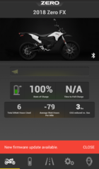
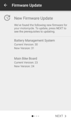
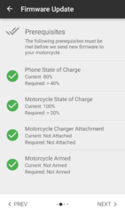
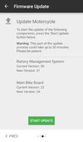
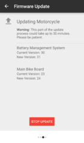
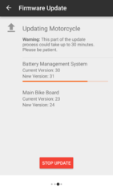
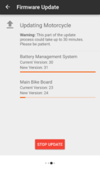
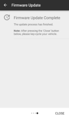
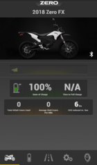

# Official Mobile Application

Zero publishes a native mobile app for their vehicles that connects to the [MBB](https://web.archive.org/web/2025/https://zeromanual.com/wiki/MBB) via Bluetooth LE.

First, check [Zero's official mobile app user guide](http://www.zeromotorcycles.com/app/help/ios/) for an official and somewhat comprehensive overview.

This is an unofficial guide to their application.

## Versions

Versions used internally by Zero and reported by the App may not match the versions reported by the mobile operating system.

For example, as of this writing the Zero App reports itself as 1.6.50(21), but Google Play Store reports it as 1.6.50

- [Zero Motorcycles on Android App Store](https://play.google.com/store/apps/details?id=com.ZeroMotorcycles&hl=en_US)
- [Zero Motorcyles app on iTunes App Store](https://itunes.apple.com/us/app/zero-motorcycles/id596423381?mt=8)

To see the version number in the App, touch Support and then About This App.

Release information, as scraped from [APK Pure](https://apkpure.com/zero-motorcycles/com.ZeroMotorcycles) and iTunes:

| OS | Version | Rev | Date | Release Notes |
| --- | --- | --- | --- | --- |
| iOS | 2.0.0 |  | 2019-09-30 | New Look and Feel |
| 〃 | 1.7.5 |  | 2019-08-19 | Support for new model year motorcycles. |
| 〃 | 1.5.0 |  | 2018-10-16 | Support for model year 2019 motorcycles |
| 〃 | 1.4.2 |  | 2018-02-05 | Performance Tab now mirrors Trip 1 Odometer for MY15-MY18   Updated reporting of some values on the Battery Tab   Fixed speed offset seen between DASH and riding screen   Bluetooth Help is now available from the Support Tab   General Bug fixes |
| 〃 | 1.4.0 |  | 2017-09-27 | - Model Year 18 Support.   - The application will now alert you when it detects that your motorcycle's firmware is out of date.   - Better in-app support of firmware update for Model Year 17 and Model Year 18 motorcycles. |
| 〃 | 1.3.0 |  | 2017-05-03 | Bug Fixes |
| 〃 | 1.2.0 |  | 2016-11-02 | - Owners of 2017 models can use the Zero Motorcycles app to update their motorcycle’s firmware, saving time, money and service trips.   - Miscellaneous bug fixes and performance enhancements.   - Support for Italian language. |
| 〃 | 1.1.0 |  | 2016-09-28 | - Fix for bug that wouldn't allow you to connect to your motorcycle on iOS 10.   - String translation fixes. |
| 〃 | 1.0.9 |  | 2016-04-07 | - Miscellaneous bug fixes and performance enhancements   - Updated to include 2015 and 2016 model year Zero Motorcycles, including the 11kW models.   - Enhanced diagnostic reporting via ability to send battery management system (BMS) logs on 2014 model year and later Zero Motorcycles |
| 〃 | 1.0.8 |  | 2016-03-04 | - Miscellaneous bug fixes and performance enhancements   - Updated to include 2015 and 2016 model year Zero Motorcycles   - Enhanced diagnostic reporting via ability to send battery management system (BMS) logs on 2014 model year and later Zero Motorcycles |
| 〃 | 1.0.7 |  | 2014-07-09 | - Changed the company email for sending logs.   - Small UI fix for iOS 7.1. |
| 〃 | 1.0.6 |  | 2014-07-02 | - Updated the application for iOS7.0 and above.   - Added more specific log uploading support. |
| 〃 | 1.05 |  | 2013-03-19 | Minor improvements |
| 〃 | 1.03 |  | 2013-02-25 | Bug fixes & improvements |
| 〃 | 1.01 |  | 2013-02-19 | Minor issues resolved |
| 〃 | 1.00 |  | 2013-01-25 |  |
| Android | 2.0.0 |  | 2019-10-01 | New Look and Feel |
| 〃 | 1.7.5 |  | 2019-08-21 | Support for new model year motorcycles. |
| 〃 | 1.7.3 |  | 2018-10-17 | Support for model year 2019 motorcycles |
| 〃 | 1.6.71 | 22 | 2018-02-14 | Performance Tab now mirrors Trip 1 Odometer for MY15-MY18   Updated reporting of some values on the Battery Tab   Fixed speed offset seen between DASH and riding screen   Bluetooth Help is now available from the Support Tab   General Bug fixes |
| 〃 | 1.6.50 | 21 | 2017-09-29 | - Model Year 18 Support.   - The application will now alert you when it detects that your motorcycle's firmware is out of date.   - Better in-app support of firmware update for Model Year 17 and Model Year 18 motorcycles.   - Bug fixes. |
| 〃 | 1.5.7 | 20 | 2017-05-06 | - Crash fix for pre-5.0 (Lollipop) devices.   - Battery tab should now be quicker to load. |
| 〃 | 1.4.59 | 19 | 2016-12-14 | - Crash fix for pre-5.0 (Lollipop) devices.   - Battery tab should now be quicker to load. |
| 〃 | 1.4.56 | 18 | 2016-11-04 | - Owners of 2017 models can use the Zero Motorcycles app to update their motorcycle’s firmware, saving time, money and service trips.   - Miscellaneous bug fixes and performance enhancements.   - Support for Italian language. |
| 〃 | 1.4.54 | 17 | 2016-11-03 | - Owners of 2017 models can use the Zero Motorcycles app to update their motorcycle’s firmware, saving time, money and service trips.   - Miscellaneous bug fixes and performance enhancements.   - Support for Italian language. |
| 〃 | 1.3.17 | 16 | 2016-04-06 | - Miscellaneous bug fixes and performance enhancements   - Updated to include 2015 and 2016 model year Zero Motorcycles, including the 11kW models.   - Enhanced diagnostic reporting via ability to send battery management system (BMS)   logs on 2014 model year and later Zero Motorcycles |
| 〃 | 1.3.16 | 15 | 2016-03-03 | - Miscellaneous bug fixes and performance enhancements   - Updated to include 2015 and 2016 model year Zero Motorcycles   - Enhanced diagnostic reporting via ability to send battery management system (BMS) logs on 2014 model year and later Zero Motorcycles |
| 〃 | 1.2.8 | 14 | 2015-12-21 | Fixed crashes in home screen. |

## Capabilities

### Ride Mode

Customize in Settings, Riding Screen Setup.

App now supports Landscape or Portrait.

Preview in Settings, Riding Screen Preview

When underway, Ride Mode, most functions in the app are disabled, only Riding Screen is available.

Other functions are available when key is on and throttle is disabled (by right-thumb switch or kickstand).

Voltage is not available on the Riding Screen. If you have concerns that your State Of Charge (percent full) or Distance To Empty is inaccurate and want to check the voltage, you'll have to stop riding to get out of Ride Mode and click the battery icon to see the voltage.

### Statistics Mode

| Page | Indicator | Official Description | Unit | Unofficial Guidance |
| --- | --- | --- | --- | --- |
| Home | [State of Charge](https://web.archive.org/web/2025/https://zeromanual.com/wiki/State_of_Charge) |  | % |  |
| [Battery](https://web.archive.org/web/2025/https://zeromanual.com/wiki/Battery) | Time Until Charged | An estimate of how long it will take for your Zero to fully charge. | Hours and minutes (hh:mm) | Seems to be a linear projection based on the current Charging Watts and estimated capacity? |
| 〃 | Capacity Kilowatt Hours |  | kWh | TBD   See Capacity Amp Hours below |
| 〃 | Capacity Amp Hours |  | Ah | TBD   Could divide kWh capacity estimate by maximum pack voltage? Or multiply/project another figure. |
| 〃 | Charging Watts | This provides an estimate of Watts running into your battery from the [on-board charger](https://web.archive.org/web/2025/https://zeromanual.com/wiki/Charger). | W | This multiplies incoming current to the battery from any source by current pack voltage.   Any charger contributes to this.   Power draw by the chargers will be higher as a small portion of the power is lost as heat and current to run fans and accessories. |
| 〃 | Total Kwatt Hours Used | This indicates the total kWatt Hours Used on the batteries currently installed on your Zero. | kWh | Lifetime current\*voltage discharge integrated and summed. MBB persistent value. |
| 〃 | Trip Kwatt Hours Used | This indicates the kWatt Hours Used on your Zero since your last reset. It can be reset (or tripped) in the Settings view, under reset statistics. | kWh | Delimited by the trip reset button. |
| 〃 | [Cell Balance](https://web.archive.org/web/2025/https://zeromanual.com/wiki/Cell_Balance) | This is a diagnostic indicator of the current state of balance; this is for Zero Motorcycle dealer reference. | mV | This represents the maximum difference in cell voltages in the series of cells that stack up to a [Brick](https://web.archive.org/web/2025/https://zeromanual.com/wiki/Brick). |
| 〃 | [Battery](https://web.archive.org/web/2025/https://zeromanual.com/wiki/Battery) Volts | This indicates the current battery voltage; the maximum you will typically see is 116 Volts. The minimum you may see is 85 volts. The fuel gauge has a more accurate estimate of your charge state. | V | [Battery](https://web.archive.org/web/2025/https://zeromanual.com/wiki/Battery) Voltage can be a way to compensate for the necessary projections and estimations used to build the [SoC](https://web.archive.org/web/2025/https://zeromanual.com/wiki/SoC) figure, particularly as temperature changes.   Battery voltage does vary temporarily with the current charge state and level; incoming current raises it, outgoing current (while riding) lowers it. |
| 〃 | Charge Cycles | This measures the number of times started charging. Partial charge cycles are counted as 1 cycle in this feature (at least in my 2017 Zero SR). | # | Logged count of times Charge Mode stopped with 95%+ SoC achieved   Need to understand this more accurately; there may be more logic in the [BMS](https://web.archive.org/web/2025/https://zeromanual.com/wiki/BMS) to discount partial cycles. |
| Performance | Odometer | This indicates the total miles traveled on your Zero. This is the total vehicle odometer as reported by the motorcycle. It may not always agree with the odometer on the dashboard. | miles or km | [MBB](https://web.archive.org/web/2025/https://zeromanual.com/wiki/MBB)-reported/calculated miles.   The dash keeps a separate figure.   There are legally-required mechanisms to prevent mileage tampering.   Calculated from the [MBB drive description settings](https://web.archive.org/web/2025/https://zeromanual.com/wiki/MBB_Console). |
| 〃 | Trip Odometer | This indicates the miles traveled on your Zero since the last reset. This is not the total vehicle odometer, as it can be reset (or tripped) in the settings view, under reset statistics. | miles or km | Calculated from the [MBB drive description settings](https://web.archive.org/web/2025/https://zeromanual.com/wiki/MBB_Console) like the main Odometer. |
| 〃 | Money Saved Vs Gas | This shows how much money you have saved by riding a Zero motorcycle instead of an internal combustion engine vehicle. This is a derived statistic based on the values you provide on the settings page. In the DRIVE SETUP tab, you will be able to add:   - Cost per Gallon of Gas, in your local area.   - MPG of ICE (Internal Combustion Engine) vehicle for comparison. For example, if your Toyota Tacoma gets 22 MPG you put “22” as the value.   - Cost Per kWatthour. You can get this statistic from your electric company utility bill. | $ or other currency |  |
| 〃 | Cost Per Mile | Cost Per Mile is calculated with the following formula: Average watt-hours per mile (since resetting your odometer) X Cost Per kWhatthour. | $/mile or (other currency)/km |  |
| 〃 | Average Watt Hours Per Mile | This indicates the Average Watt Hours Per Mile on your Zero once you have paired it to your phone. It can be reset (or tripped) in the settings view, under reset statistics. | Wh/mi or Wh/km |  |
| 〃 | C02 Reduced Vs. Gas | This estimates how much C02 you have reduced by riding your Zero motorcycle instead of an internal combustion engine vehicle.   This is a derived statistic based on the values you provide on the settings page. In the DRIVE SETUP tab, you will be able to add:   - MPG of ICE (Internal Combustion Engine) vehicle for comparison. For example, if your Toyota Tacoma gets 22 MPG you can put “22” as the value.   - kWatthours and distance you have travelled. | lb or kg |  |

### Upgrading Firmware

As of 2017, Zero models are capable of performing remote firmware updates by the customer using the mobile app.

Apparently this doesn't transfer to older models because the older boards did not have enough storage space to perform an atomic/reversible update.

This means holding both firmware versions and being able to toggle which version to use.

So, if anything goes wrong with a firmware update, the system can roll back to the previous version without requiring a dealer visit.

## Usage

First, check [Zero's official mobile app user guide](http://www.zeromotorcycles.com/app/help/ios/) for an official and somewhat comprehensive overview.

### Obtaining Logs

The Zero companion mobile app can send logs to Zero customer service, or to an email address.

2014+ models can export BMS logs in addition to the primary MBB logs, but the extraction time can be very long

In an emergency, just focus on the MBB logs first and try BMS logs later.

The logs are binary-encoded in a proprietary way.

Having collected many owners' logs, some have reverse-engineered most of the encoding.

#### Decoding Logs

You can send the logs to yourself, and use a log file parser utility to do some digging which might save time if the utility can successfully decode the relevant parts.

[Forum thread introducing the tool](http://electricmotorcycleforum.com/boards/index.php?topic=5020.0).

[GitHub repository for the log parser](https://github.com/KimBurgess/zero-log-parser).

[Incomplete/reverse-engineered log structure documentation](https://github.com/KimBurgess/zero-log-parser/blob/master/log_structure.md).

[Online version of the log parser app, just upload your .bin file and view the results](http://home.hasslers.net/zerologparser/).

[HTML/Javascript downloadable log parser](https://zero-motorcycle-community.github.io/browser-parse/), works on your Android/iOS phone to decode log files on the same device.

### Firmware Update

On 2017 and newer Zeros, it's possible for the user to upgrade the firmware via the Zero Motorcycles mobile app.

The app will provide a notification, and when clicked it will walk the user through a step-by-step process.

This can update both the BMS and MBB firmwares.

The process is shown below.

**Screenshots**

- 

  "New firmware update available" notification
- 

  Firmware Update step 1: MBB and BMS version listing
- 

  Firmware Update step 2: Prerequisites
- 

  Firmware Update step 3: Start Update
- 

  Firmware Update step 4: Update in Progress with Stop Update button
- 

  Firmware Update step 5: Update in Progress with MBB progress bar
- 

  Firmware Update step 6: Update in Progress with BMS progress bar
- 

  Firmware Update step 7: Update Complete confirmation screen
- 

  Firmware Update step 8: Main Screen after update

## Common Problems

### Pairing

1. Ensure the following:
   - The kickstand is down.
   - The kill switch is in the Stop position.
   - The key is in the Off position.
2. Turn the key to the On position and:
   - For 2014+ models, hold the Mode button for five seconds
   - For 2013 models, toggle the SPORT ECO switch 12 times.
3. Then select the motorcycle to pair from your device:
   - On Android, select Setup, Available Devices, Scan.
   - On iOS, use the Settings app, select Bluetooth, and scan for new devices.
4. When Zero Motorcycle appears, pair to it and verify the six digit code.

### Unable to Connect

Sometimes the MBB will simply no longer activate a session with the mobile device.

**Official Guidance**

[Zero's Bluetooth Connectivity Guide](http://www.zeromotorcycles.com/app/help/ios/connectivity.php) covers:

- Turning on Bluetooth Discoverability on the bike.
- Connecting on iOS
- Connecting on Android

[Zero's Mobile FAQ](http://www.zeromotorcycles.com/app/help/ios/faq.php) covers:

- More Bluetooth connection questions
- Some insight into the statistics shown in the app
- How to kill the app (which helps reset a software connection management problem)

**Potential Workarounds**

- Kill the app, then re-connect to the bike in the Bluetooth settings, then start the app.
- Put phone in airplane mode for at least 10 seconds then put it back to normal (i.e. reboot the wireless chipset).
- Turning wifi off until the bluetooth has connected sometimes helps.

**Reconnection**

The app's UI is identical for iOS and Android which has some annoying results, because each platform handles Bluetooth connectivity differently.

When the app is disconnected from the device, a dialog will appear offering to use the app in offline mode or visit the settings screen.

- On Android, the settings screen can reconnect to the device, whereas on iOS, this feature is not possible.
- On iOS, to reconnect, visit the Settings app itself, navigate under bluetooth, and reconnect to the device in the list presented.

### Unable to Customize [Drive Mode](https://web.archive.org/web/2025/https://zeromanual.com/wiki/Drive_Modes)

This seems to be a bug with specific revisions of the mobile application.

In particular, multiple reports that newer versions of the app are unable to make changes to the Custom Mode max torque and and regen parameters on 2014 Zero motorcycles, on both Android and iPhone. It's unclear what other years may be affected. <http://electricmotorcycleforum.com/boards/index.php?topic=7106.0>

togo reports no version since 1.3.17 works on his 2014 Zero SR.

### Slow to Obtain Logs

If you have several ride through faults then the large quantity of data can make downloading logs very slow. Occasionally blip the throttle to keep the bike from timing out.

### Unable to Obtain Logs

**Newer Android versions**

The e-mail log files functionality on Android phones/tablets with newer Android versions does not work, the application crashes after downloading the log files but before offering to e-mail the files.

- Workaround 1: The logs are saved on the internal memory on this path: "internal\_memory\android\data\com.zeromotorcycles\files\".

[See dalamarios forum entry here](http://electricmotorcycleforum.com/boards/index.php?topic=8736.0)

- Workaround 2: If you have access to an Android device with an older Android OS version, you may have more luck downloading and mailing using that device. I had success using an old tablet with Android version 4.4

**BMS logs**

BMS logs are not obtainable on 2013 models, and even on newer models, the BMS logs take a dangerously long amount of time to access considering the typical mobile application e access session length.

Zero reports that versions released in late September address this issue.

**Workarounds**

- Definitely send/obtain MBB logs alone before trying to extract and send MBB with BMS logs.
- Connect to the [MBB Console](https://web.archive.org/web/2025/https://zeromanual.com/wiki/MBB_Console) directly via OBD-II connection.

### Stuck Screen

### Stuck Orientation

